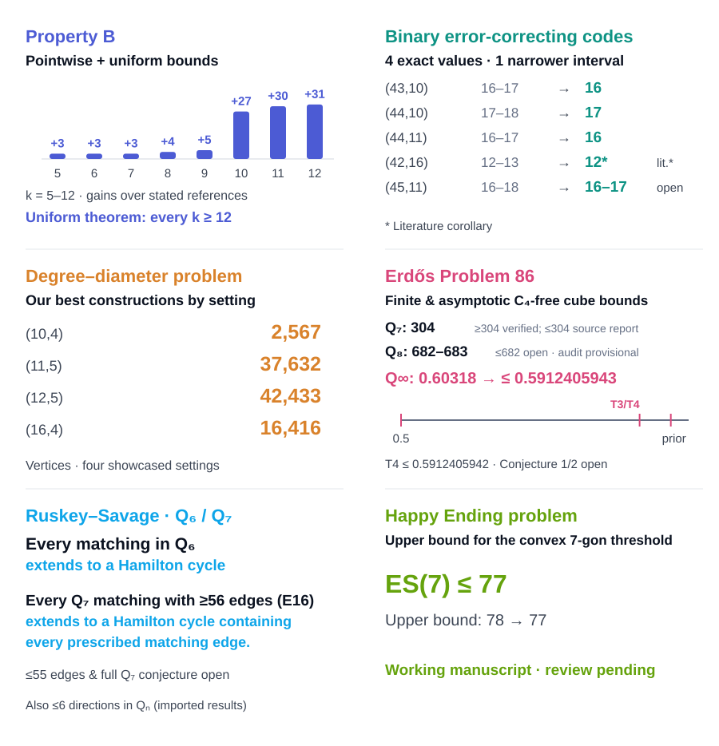
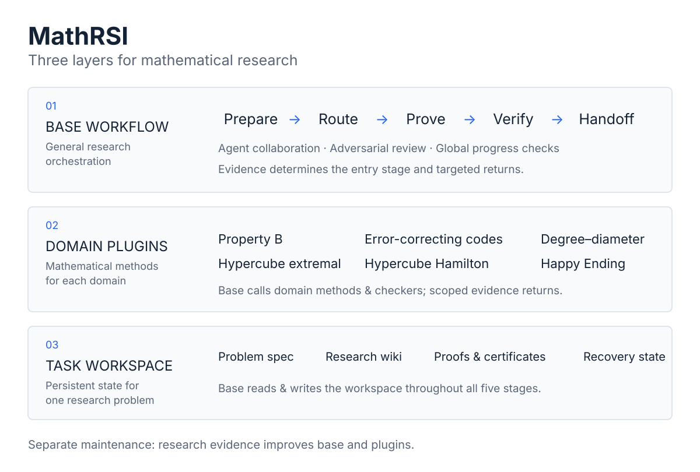
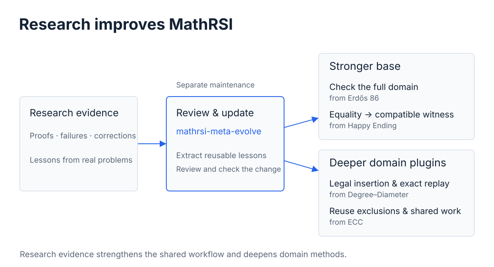

<div align="center">

# <picture><source media="(prefers-color-scheme: dark)" srcset="figures/mathrsi/branding/mark-c-dark.png"></picture> MathRSI<br><sub><sup><em>SII MathRSI Team</em></sup></sub>

**Research advances. The workflow learns.**<br>Readable Markdown skills for Claude Code and Codex to run, verify, and refine mathematical research.

[](https://lisresearchgroup.github.io/math-rsi/ "Website / EN + 中文")&nbsp; [](#quick-start)&nbsp; [](case-studies/README.md)&nbsp; [](docs/WORKFLOWS.md)&nbsp; [](README.zh-CN.md)

</div>

[](figures/mathrsi/media/evolution.mp4)

*Actual homepage evolution replay. Click for MP4; [execution provenance and manuscript status](case-studies/README.md).*

MathRSI pairs a shared base workflow with domain plugins and a per-problem research wiki, guiding Claude Code and Codex from literature survey and route selection through proof development, review, verification, and handoff. Validated results and diagnosed failures feed back to refine both the workflow and plugins.

<a id="quick-start"></a>

## 1. 🚀 Quick Start

After completing [setup](docs/QUICKSTART.md), open this repository in **Claude Code** or **Codex** with access to your task directory. In Codex, replace `/skill` with `$skill`. Replace the example paths below with your own.

**Start from a mathematical problem**

```text
/mathrsi-research Study edge-count lower bounds for k-uniform hypergraph two-coloring; work in ../my-problem/
```

Connects literature research, route exploration, proof work, verification and handoff, reusing the task wiki throughout. If you already have a problem statement, you can pass `../my-problem/problem.md` instead.

**Check a candidate proof or local lemma**

```text
/mathrsi-verify Check ../my-problem/proof.tex
```

Checks the proof or a specific obligation, repairs local omissions and identifies substantive mathematical gaps that need further proof work.

**Resume an existing study** (Codex example)

```text
$mathrsi-research Continue the study in ../my-problem/
```

Reads the task's existing specification, wiki and resumption notes, then continues from the current evidence. In Claude Code, use `/mathrsi-research`.

<a id="six-mathematical-frontiers"></a>

## 2. 🧮 Mathematical Results

Research across six domains supplies results and reusable methods. [Public homepage](https://lisresearchgroup.github.io/math-rsi/) · [Local viewing instructions](docs/HOMEPAGE.md). The **[bilingual visual tour](https://lisresearchgroup.github.io/math-rsi/)** shows their problems, results and evolution; the **[six-case index](case-studies/README.md)** links proofs, verification scopes and runnable tools.

[](case-studies/README.md)

- **Property B:** bounds for $k=5,\ldots,12$ and exponentially growing additive gains for every $k\ge12$. [Results & proof scope](case-studies/property-b/README.md)
- **Error-correcting codes:** three gaps dating to 1985 closed; four exact values (one from literature) and one narrowed range. [Results, methods & open case](case-studies/README.md#error-correcting-codes)
- **Degree–diameter:** four dated construction benchmarks improved, including a 2,567-vertex $(10,4)$ graph. [Construction & evidence](case-studies/degree-diameter/README.md)
- **Erdős Problem 86:** asymptotic density upper bound improved from $0.60318$ to $\lt0.59155154$. [Result & verification scope](case-studies/README.md#erdős-problem-86)
- **Ruskey–Savage:** every matching of $Q_6$ extends to a Hamilton cycle. [Proof & certificate scope](case-studies/README.md#ruskeysavage-q6)
- **Happy Ending:** working manuscripts lower the $\mathrm{ES}(7)$ upper bound from 78 to 77; independent review pending. [Manuscripts & status](case-studies/happy-ending/README.md)

<a id="three-layers"></a>

## 3. 🧩 Three Layers



**Base** (`base/`) supplies general research logic. **Domain plugins** (`plugins/`) supply specialized mathematics and checkers. **Task workspaces** hold each problem's specification, wiki, proofs, certificates and recovery state. [Architecture & plugin contract](docs/PLUGIN_CONTRACT.md) · [Editable source & GPT Image variant](figures/mathrsi/README.md)

<a id="how-research-runs"></a>

## 4. 🔬 How Research Runs

The main [`mathrsi-research`](base/skills/mathrsi-research/SKILL.md) skill coordinates **Prepare → Route → Prove → Verify → Handoff**, entering from current evidence and reading each returned artifact. The task wiki is read, updated and reused throughout; scoped collaborators and cross-model reviewers support the work.

| What you need | Start here |
| --- | --- |
| Formulate a new question and investigate the literature | [Prepare](base/skills/mathrsi-prepare/SKILL.md) |
| Resume research or an unfinished proof | [Route iteration](base/skills/mathrsi-route-loop/SKILL.md) · [Proof construction](base/skills/mathrsi-prove/SKILL.md) |
| Check and repair a candidate proof or certificate | [Verify](base/skills/mathrsi-verify/SKILL.md) · [Proof-repair example](examples/proof-repair/README.md) |
| Deliver established results and make them reusable | [Handoff](base/skills/mathrsi-handoff/SKILL.md) |

[Detailed workflow & return paths](docs/WORKFLOWS.md) · [Six-domain routing](docs/DOMAIN_ROUTING.md) · [Workspace & memory](docs/WORKSPACE.md)

<a id="research-improves-the-workflow"></a>

## 5. 🔄 Research Improves the Workflow



Two tracks evolve together: **shared base behavior** becomes stronger, while **domain plugins** expand and deepen. Separate [`mathrsi-meta-evolve`](base/skills/mathrsi-meta-evolve/SKILL.md) maintenance turns research evidence into implemented changes.

- **v4 base:** recover simultaneous equality conditions in a tight integer bound, make a legal exchange, and connect the capacity-forced witness to the original problem.
- **Later base maintenance on `main`:** mandatory global reassessment uses two independent read-only agents when local work stops reducing the original gap or total completion cost.
- **Domain methods:** v4 deepens Happy Ending equality/exchange and DD insertion/replay; later ECC maintenance reuses exclusions and shared computations across precisely identified nodes.

**[v4 is the current release](docs/V4_CHANGES.md); `main` includes subsequent maintenance.** Research results retain their original execution provenance. [Evolution & implementation records](development/README.md) · [Maintenance guide](docs/EVOLUTION_WORKFLOW.md)

<details>
<summary>Fixed releases and earlier improvements</summary>

- **v0:** pre-harness Property B/ECC research tools; no Git tag.
- **[v1](https://github.com/lisresearchgroup/math-rsi/tree/v1):** five solving stages, three-layer separation, adversarial route iteration and the initial plugins.
- **[v2](https://github.com/lisresearchgroup/math-rsi/tree/v2):** separate maintenance workflow, DD integration, evidence inheritance and common-coverage checks. [Changes](docs/V2_CHANGES.md)
- **[v3](https://github.com/lisresearchgroup/math-rsi/tree/v3):** full-domain versus working-set checks, marked-object transport, finite universal certificates and explicit Lean-premise audits; upgraded ECC and three new domains. [Changes](docs/V3_CHANGES.md)
- **[v4](https://github.com/lisresearchgroup/math-rsi/tree/v4):** equality-to-witness proof actions and Happy Ending/DD methods. [Changes](docs/V4_CHANGES.md)

Tags remain fixed complete snapshots. Choose one for a reproducible starting point and record the exact commit. [Historical v2/v3 figures](figures/mathrsi/README.md#historical-diagrams)

</details>

<a id="documentation--provenance"></a>

## 6. 📚 Documentation

**[Choose a reading path](docs/README.md)** · [Six research cases](case-studies/README.md) · [Repository map](docs/README.md#repository-map) · [Validation records](development/README.md#validation-and-implementation) · [Skill acceptance](docs/SKILL_ACCEPTANCE.md)

Built on **[ARIS](https://github.com/wanshuiyin/Auto-claude-code-research-in-sleep)** and the research artifacts preserved in the plugins and cases. The bundled ARIS snapshot is `c485faa59a68e51c6575dea67ca57abc7a6a2b9c`. [Provenance](docs/PROVENANCE.md) · [Snapshot manifest](base/ARIS_SNAPSHOT.json) · [Bridge sources](mcp-servers/SOURCE.md)

Workflow and scripts are **[MIT licensed](LICENSE)**. Archived papers and third-party materials retain their original copyrights.
