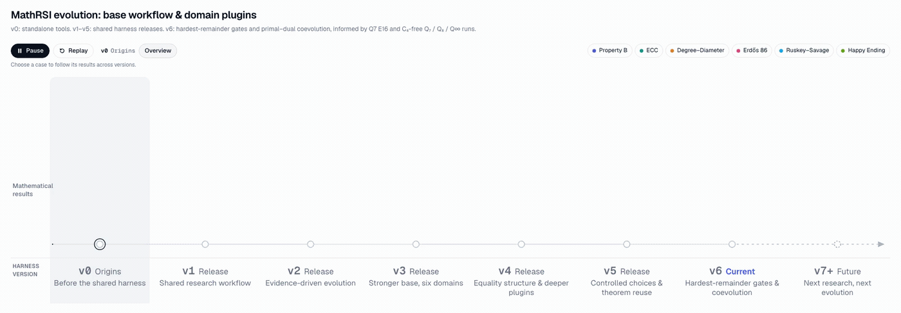

<div align="center">

# MathRSI

*SII MathRSI Team*

**Research advances. The workflow learns.**

An agent-executable, self-evolving workflow and domain knowledge harness for rigorous mathematical research.

[中文](README.zh-CN.md)

[](docs/QUICKSTART.md)&nbsp; [](case-studies/README.md)&nbsp; [](docs/HOMEPAGE.md)&nbsp; [](docs/WORKFLOWS.md)

</div>

MathRSI takes a mathematical question from literature and route exploration through proof construction, adversarial review, verification and reproducible handoff. **Claude Code or Codex executes readable Markdown skills**, using domain methods and the current problem's research wiki. Research evidence, including failures and partial work, feeds improvements back into the shared workflow and domain plugins.

[](figures/mathrsi/media/evolution.mp4)

*Actual homepage evolution replay. Click for MP4; [execution provenance and manuscript status](case-studies/README.md).*

## Quick start

Clone with an account that has access to the repository. These local checks use Python 3.9+ and its standard library:

```bash
git clone https://github.com/lisresearchgroup/math-rsi.git
cd math-rsi
python3 tools/check_links.py              # check documentation links
python3 examples/proof-repair/replay.py   # deterministic proof-repair replay
```

Put a problem statement (for example, `problem.md`) or candidate proof (`proof.tex`) in a separate task directory. Open the clone in **Claude Code** or **Codex**, with access to that directory. Use `/mathrsi-research` or `$mathrsi-research` when project skills are discovered, or give the agent this request with your actual paths:

```text
Read /abs/path/to/math-rsi/base/skills/mathrsi-research/SKILL.md.
Study <my question or candidate proof> in /abs/path/to/my-task.
Restore its specification and research-wiki, or create them as needed for a new task.
Enter at the stage supported by current evidence; use helpers from
/abs/path/to/math-rsi/base/tools with ARIS_REPO=/abs/path/to/math-rsi/base.
```

Depending on the stage reached, the task directory keeps a specification, proof or precise remaining gap, verification record and recovery notes.

The clone includes the skills and reviewer bridge source. Configure your chosen agent/model access and the tools needed by your task. **[Full setup](docs/QUICKSTART.md)** · [Proof-repair walkthrough](examples/proof-repair/README.md) · [Reviewer MCP setup](docs/REVIEWER_MCP.md)

## Six mathematical frontiers

Research across six domains supplies results and reusable methods. The **[bilingual visual tour](docs/HOMEPAGE.md)** shows their problems, results and evolution; the **[six-case index](case-studies/README.md)** links proofs, verification scopes and runnable tools.

- **Property B · hypergraph two-coloring.** Reported lower bounds for $k=5,\ldots,12$ are $35,67,131,267,543,1112,2275,4664$, alongside a uniform improvement over the specified RS budget for every $k\ge12$. The work combines concrete improvements with a general theorem. [Results & proof scope](case-studies/property-b/README.md)
- **Error-correcting codes · optimal binary distances.** The exact values $d_2(43,10)=16$, $d_2(44,10)=17$, $d_2(44,11)=16$ and $d_2(42,16)=12$ close four optimal-distance questions; the last applies a published 2020 theorem. [Results, methods & open case](case-studies/README.md#error-correcting-codes)
- **Degree–diameter · large graphs.** A 2,567-vertex $(10,4)$ graph improves the Comellas entry of 2,566 checked on 2026-11-05: a larger graph under the same degree and diameter constraints. [Construction & evidence](case-studies/degree-diameter/README.md)
- **Erdős Problem 86 · square-free hypercubes.** An exact certificate improves the specified asymptotic edge-density upper bound from $0.60318$ to $\lt0.59155154$, toward the conjectured $1/2$. [Result & verification scope](case-studies/README.md#erdős-problem-86)
- **Ruskey–Savage · Hamilton extension in $Q_6$.** Every matching of $Q_6$ extends to a Hamilton cycle, settling the six-dimensional case; imported results also cover matchings using at most six directions in any dimension. [Proof & certificate scope](case-studies/README.md#ruskeysavage-q6)
- **Happy Ending · convex heptagons.** Working manuscripts claim $N(7,6,7)\le75$ and $N(7,7,7)\le76$, hence $\mathrm{ES}(7)\le77$, tightening the prior 78 threshold. **Working manuscripts; independent review pending.** [Manuscripts & status](case-studies/happy-ending/README.md)

## Three layers


**Base** (`base/`) supplies general research logic. **Domain plugins** (`plugins/`) supply specialized mathematics and checkers. **Task workspaces** hold each problem's specification, wiki, proofs, certificates and recovery state. [Architecture & plugin contract](docs/PLUGIN_CONTRACT.md) · [Editable source & GPT Image variant](figures/mathrsi/README.md)

## How research runs

The main [`mathrsi-research`](base/skills/mathrsi-research/SKILL.md) skill coordinates **Prepare → Route → Prove → Verify → Handoff**, entering from current evidence and reading each returned artifact. The task wiki is read, updated and reused throughout; scoped collaborators and cross-model reviewers support the work.

| What you need | Start here |
| --- | --- |
| Formulate a new question and investigate the literature | [Prepare](base/skills/mathrsi-prepare/SKILL.md) |
| Resume research or an unfinished proof | [Route iteration](base/skills/mathrsi-route-loop/SKILL.md) · [Proof construction](base/skills/mathrsi-prove/SKILL.md) |
| Check and repair a candidate proof or certificate | [Verify](base/skills/mathrsi-verify/SKILL.md) · [Proof-repair example](examples/proof-repair/README.md) |
| Deliver established results and make them reusable | [Handoff](base/skills/mathrsi-handoff/SKILL.md) |

[Detailed workflow & return paths](docs/WORKFLOWS.md) · [Six-domain routing](docs/DOMAIN_ROUTING.md) · [Workspace & memory](docs/WORKSPACE.md)

## Research improves the workflow


Two tracks evolve together: **shared base behavior** becomes stronger, while **domain plugins** expand and deepen. Separate [`mathrsi-meta-evolve`](base/skills/mathrsi-meta-evolve/SKILL.md) maintenance turns research evidence into implemented changes.

- **v4 base:** recover simultaneous equality conditions in a tight integer bound, make a legal exchange, and connect the capacity-forced witness to the original problem.
- **Later base maintenance on `main`:** mandatory global reassessment uses two independent read-only agents when local work stops reducing the original gap or total completion cost.
- **Domain methods:** v4 deepens Happy Ending equality/exchange and DD insertion/replay; later ECC maintenance reuses exclusions and shared computations across precisely identified nodes.

**[v4 is the current release](docs/V4_CHANGES.md); `main` includes subsequent maintenance.** Research results retain their original execution provenance. [Evolution & implementation records](development/README.md) · [Maintenance guide](docs/EVOLUTION_WORKFLOW.md)

<details>
<summary>Fixed releases and earlier improvements</summary>

- **v0:** pre-harness Property B/ECC research tools; no Git tag.
- **[v1](https://github.com/lisresearchgroup/math-rsi/tree/v1):** five solving stages, three-layer separation, adversarial route iteration and the initial plugins.
- **[v2](https://github.com/lisresearchgroup/math-rsi/tree/v2):** separate maintenance workflow, DD integration, evidence inheritance and common-coverage checks. [Changes](docs/V2_CHANGES.md)
- **[v3](https://github.com/lisresearchgroup/math-rsi/tree/v3):** full-domain versus working-set checks, marked-object transport, finite universal certificates and explicit Lean-premise audits; upgraded ECC and three new domains. [Changes](docs/V3_CHANGES.md)
- **[v4](https://github.com/lisresearchgroup/math-rsi/tree/v4):** equality-to-witness proof actions and Happy Ending/DD methods. [Changes](docs/V4_CHANGES.md)

Tags remain fixed complete snapshots. Choose one for a reproducible starting point and record the exact commit. [Historical v2/v3 figures](figures/mathrsi/README.md#historical-diagrams)

</details>

## Documentation & provenance

**[Choose a reading path](docs/README.md)** · [Six research cases](case-studies/README.md) · [Repository map](docs/README.md#repository-map) · [Validation records](development/README.md#validation-and-implementation) · [Skill acceptance](docs/SKILL_ACCEPTANCE.md)

Built on **[ARIS](https://github.com/wanshuiyin/Auto-claude-code-research-in-sleep)** and the research artifacts preserved in the plugins and cases. The bundled ARIS snapshot is `c485faa59a68e51c6575dea67ca57abc7a6a2b9c`. [Provenance](docs/PROVENANCE.md) · [Snapshot manifest](base/ARIS_SNAPSHOT.json) · [Bridge sources](mcp-servers/SOURCE.md)

Workflow and scripts are **[MIT licensed](LICENSE)**. Archived papers and third-party materials retain their original copyrights.
