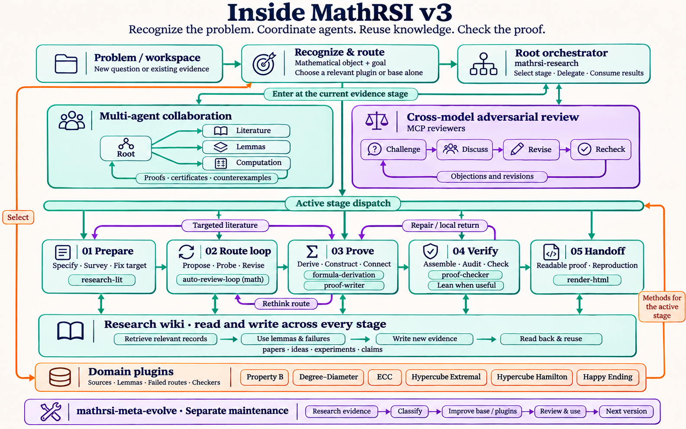

# MathRSI

[中文说明](README.zh-CN.md) · [Quick start](docs/QUICKSTART.md) · [Try a proof repair](examples/proof-repair/README.md) · [Property B case study](case-studies/property-b/README.md) · [Degree–Diameter case study](case-studies/degree-diameter/README.md)

Fixed versions: **[v1](https://github.com/lisresearchgroup/math-rsi/tree/v1)** ([ZIP](https://github.com/lisresearchgroup/math-rsi/archive/refs/tags/v1.zip)) · **[v2](https://github.com/lisresearchgroup/math-rsi/tree/v2)** ([ZIP](https://github.com/lisresearchgroup/math-rsi/archive/refs/tags/v2.zip)) · **[v3](https://github.com/lisresearchgroup/math-rsi/tree/v3)** ([ZIP](https://github.com/lisresearchgroup/math-rsi/archive/refs/tags/v3.zip)) · **[v4 — current](https://github.com/lisresearchgroup/math-rsi/tree/v4)** ([ZIP](https://github.com/lisresearchgroup/math-rsi/archive/refs/tags/v4.zip)). Each tag preserves a complete repository snapshot and stays fixed; `main` carries the recommended **v4** release and subsequent maintenance; the fixed `v4` tag does not include later increments. See [v4 capability changes](docs/V4_CHANGES.md), [v3 changes and runnable checks](docs/V3_CHANGES.md) and [v2 changes](docs/V2_CHANGES.md).

**An agent-executable, self-evolving workflow and domain knowledge harness for rigorous mathematical research.**

MathRSI organizes mathematical research from problem formulation and literature verification to route exploration, proof construction, independent auditing, optional Lean formalization, and reproducible handoff. Structured Markdown skills, domain plugins, cross-model review bridges, and verification contracts let coding agents (Claude Code and Codex) execute research step by step while preserving exact quantifiers and original problem obligations.

### How Research Experience Evolves MathRSI (`v0` → `v4`)

MathRSI evolves in **two complementary directions**:

- **A stronger shared base workflow.** Research experience improves how existing skills choose routes, carry proof obligations, use counterexamples, verify results, and hand work forward. [`mathrsi-meta-evolve`](base/skills/mathrsi-meta-evolve/SKILL.md) turns transferable lessons into changes at the relevant workflow steps, so other domains can reuse them.
- **Broader and deeper domain plugins.** New domains add specialized mathematical methods; existing plugins gain stronger reductions, reusable lemmas, failure knowledge, and callable checkers. v3 both upgrades ECC and adds three domains.

The version table separates these two kinds of progress. v1 established nine solving skills; v2 added the maintenance skill. **v3 strengthens the existing ten base skills and expands domain capability to six domains and fourteen domain skills.** Skill count measures organization; the changes below describe capability.


The figure is the preserved **v3 snapshot**; [the interactive homepage](development/homepage-redesign-20261105/site/index.html) now extends the evolution through v4. Open the HTML after cloning or downloading. v3 upgraded the existing ECC plugin and added three domains. [Figure sources and review](figures/mathrsi/README.md) · [v3 implementation details](docs/V3_CHANGES.md).

| Version | Research experience | Stronger base workflow | Broader / deeper plugins |
| --- | --- | --- | --- |
| **v0 · Basic research tools** | Initial Property B and ECC investigations accumulated proofs, failures, checks and research wikis. | Standalone skills coordinated within individual workspaces, before a shared MathRSI orchestrator. This historical stage is not a Git release. | Source research workspaces and their mathematical tools. |
| **[v1](https://github.com/lisresearchgroup/math-rsi/tree/v1)** | [Property B and ECC's concrete research transitions](development/workflow-redesign/REAL_PROJECT_TRANSITIONS.md). | Established **five executable subworkflows**, the `base / plugin / task` separation, adversarial route iteration, proof acceptance, wiki return paths and optional Lean. Bundled the complete dual-host skills. | Full **Property B** plugin and an initial **ECC draft**. |
| **[v2](https://github.com/lisresearchgroup/math-rsi/tree/v2)** | Historical **Degree–Diameter** research. | Added **[`mathrsi-meta-evolve`](base/skills/mathrsi-meta-evolve/SKILL.md)**. Public baseline changes update the research queue; object changes trigger separate checks of inherited proofs and old refutations; shared coverage can replace a failed sufficient gate; formal-only tasks go directly to their actual Lean exports. [v2 details](docs/V2_CHANGES.md). | Added the **Degree–Diameter** plugin, its source wiki, constructions, transfer methods and certificate tools. |
| **[v3](https://github.com/lisresearchgroup/math-rsi/tree/v3)** | **Erdős 86**, **Ruskey–Savage Q6**, further **ECC** work inheriting v1/v2 methods, and **Happy Ending**. | Strengthened **four evidence-handling actions inside the existing workflows**, detailed below. The five-stage architecture and separate maintenance workflow remain. | Upgraded the **same ECC plugin**; added **Hypercube Extremal**, **Hypercube Hamilton** and **Happy Ending**. Mathematical sources, failures and thin checkers ship with each plugin. |

| **[v4](https://github.com/lisresearchgroup/math-rsi/tree/v4) · Current** | New **Happy Ending** 75/76/77 working proofs, and the (10,4) graph actually constructed with **v2 + DD + the PR #7 repair**. | Connect integer-threshold equality structure → legal equal-size replacement and capacity-forced witnesses → endpoint/mark-compatible return to the original caller. | Deepens the **same Happy Ending and Degree–Diameter plugins**; still six domains and fourteen domain skills. [v4 details](docs/V4_CHANGES.md). |

Routine fixes also carry forward: [PR #7](https://github.com/lisresearchgroup/math-rsi/pull/7) repairs task dispatch, actual file delivery and recovery snapshots; it is included in v3 without being counted as another research-driven generation.

### How v4 Further Strengthens Base and Plugins

**The base gains one connected proof action.** When an integer bound misses by one, trace the same inequality chain to recover simultaneous zero-slack conditions. Use that structure for a legal equal-size replacement, force an actual witness from capacity, then check its endpoints and marked data at the original caller. This extends the existing [route-loop](base/skills/mathrsi-route-loop/SKILL.md), [prove](base/skills/mathrsi-prove/SKILL.md) and [verify](base/skills/mathrsi-verify/SKILL.md); the base still has ten skills.

**The plugins gain concrete mathematical methods.** Happy Ending absorbs the 75/76/77 proof chain and counterexamples while retaining the manuscripts' unreviewed/unaccepted status. DD adds matching-edge cuts and vertex insertion, old-only switches, whole-graph distance diagnosis and portable edit replay. Its 2,567-vertex graph came from v2 + DD + the PR #7 repair, not a v4 run. Existing counterexample feedback and evidence inheritance carry forward without being counted again. See [v4 capabilities and verification scope](docs/V4_CHANGES.md).

**Subsequent v4 maintenance on `main` makes global reassessment mandatory.** A valid reduction must also be assessed for usefulness: what mathematical obstacle or total completion cost does it actually reduce? Two independent read-only agents examine the original goal, remaining gaps and alternatives at defined checkpoints or when local work stops changing the completion path; Root then changes the work queue or authorizes a bounded continuation. See the [executable protocol](base/skills/mathrsi-research/references/global-reassessment.md) and [maintenance evidence](docs/V4_CHANGES.md).

### How v3 Strengthens the Shared Base

Each v3 base change turns a concrete research failure into an action in the existing subworkflows ([base diff report](development/evolution/v3-20261104/base/BASE_CHANGES.md) · [runnable examples](development/evolution/v3-20261104/base/USE.md)):

| Bottleneck Observed in Research | What v3 Changes in Base Workflows | Owning Subworkflows | Source Case & Plugin Connection |
| :--- | :--- | :--- | :--- |
| **1. Working-set overfitting & lost historical bests**: A candidate scores well on an active subset but violates the full domain, or a later iteration overwrites an earlier verified bound. | Track `restricted` (working-set), `full`-domain, `exploration_best`, and `accepted_best` separately. Feed actual full-domain violating inputs back into candidate generation, and re-verify the final exact object over the full domain before updating `accepted_best`. | [`route-loop`](base/skills/mathrsi-route-loop/SKILL.md), [`verify`](base/skills/mathrsi-verify/SKILL.md), [`handoff`](base/skills/mathrsi-handoff/SKILL.md) | **Erdős 86** active-row pool separation & exact rational PSD check ([`check_q4_candidate.py`](plugins/hypercube-extremal/tools/check_q4_candidate.py)). |
| **2. Untracked roots, targets, or required edges across reductions**: Symmetry quotients, completions, or contractions silently alter which root, partner, or mandatory edge is being proved. | Transport roots, targets, partner maps, and required edges through every transformation, compose the maps, and recover original partners and required edges at the calling obligation. | [`prove`](base/skills/mathrsi-prove/SKILL.md), [`verify`](base/skills/mathrsi-verify/SKILL.md) | **Erdős 86** synchronized rooted $Q_3$ flags; **Ruskey–Savage $Q_6$** root-preserving maximalization; **Happy Ending** leftmost-pivot chart transport. |
| **3. Intractable universal input families & discarded failure pools**: Direct enumeration of all configurations explodes, and subsets failing a sufficient gate are thrown away even when individual instances are valid. | Query the domain plugin for a proved finite basis/rank/coverage bridge to close universal obligations; retain legal objects from sufficient-gate failure pools and route them to per-instance positive certificates. | [`route-loop`](base/skills/mathrsi-route-loop/SKILL.md), [`prove`](base/skills/mathrsi-prove/SKILL.md) | **Ruskey–Savage $Q_6$** 1024-forest $\mathbb{F}_2$ rank bridge ([`check_forest_rank.py`](plugins/hypercube-hamilton/tools/check_forest_rank.py)) and positive certificates from rank-deficient pools. *(Happy Ending common middle matching & bilateral compensation reinforce common-coverage rules in plugin knowledge.)* |
| **4. External premises in Lean theorem headers**: `#print axioms` reports only standard axioms while an external scan, literature bound, or unverified matrix sits in an explicit `(h : ...)` theorem hypothesis. | Inspect every explicit theorem parameter and unfolded definition alongside `#print axioms`; separate kernel-proved reductions and verified actual data from external literature, classification, or scan assumptions. | [`verify`](base/skills/mathrsi-verify/SKILL.md), [`handoff`](base/skills/mathrsi-handoff/SKILL.md) | **ECC** `ecc43`/`ecc42` Lean audits ([`lean-boundary.md`](plugins/ecc/skills/ecc-certificate/references/lean-boundary.md)) vs. actual generator matrix verification. |

<details>
<summary><strong>Historical v2 architecture diagram</strong> (retained as a v2 visual snapshot; its ECC-draft and future-v3 labels reflect the v2 release)</summary>


See [figure sources and review](figures/mathrsi/README.md).
</details>

---

## Why MathRSI

- **Enter at the current evidence stage**: Start from a raw problem statement, resume an in-progress proof workspace, or jump directly to auditing and repairing a complete candidate proof.
- **Keep lemmas bound to the original problem**: Intermediate reductions, conditional lemmas, and computational certificates are tracked against their actual callers so the agent can check whether a local result actually closes the main theorem.
- **Self-contained dual-host ARIS bundle**: Ships with **10 MathRSI skills** (9 solving skills plus the outer maintenance skill), **32 bundled ARIS skills** in both Claude Code (`base/skills/`) and Codex (`base/skills/skills-codex/`) layouts, **53 helper scripts** (`base/tools/`), **4 MCP reviewer bridge servers** (`mcp-servers/`), and **six domain plugins**: Property B, degree–diameter, ECC, hypercube extremal bounds, hypercube Hamilton extension, and Happy Ending. No external ARIS checkout or global installer is required.
- **Clean separation of core, domain, and workspace**: Running a task or domain plugin updates only the problem's task workspace. Reusable domain tools are curated into plugins, and general workflow lessons are distilled into the next base iteration through the separate [`mathrsi-meta-evolve` skill](base/skills/mathrsi-meta-evolve/SKILL.md), within the maintenance scope already authorized by the user.

---

## Quick Start

See **[docs/QUICKSTART.md](docs/QUICKSTART.md)** for step-by-step setup and **[examples/proof-repair/README.md](examples/proof-repair/README.md)** for a self-contained walkthrough that audits, repairs, and hands off a flawed candidate proof.

### 1. Clone and verify the local bundle

Clone with an account that has access to the group repository. The local checks below use Python 3.9+ and its standard library:

```bash
git clone https://github.com/lisresearchgroup/math-rsi.git
cd math-rsi

python3 tools/check_links.py
python3 examples/proof-repair/replay.py
```

### 2. Run a mathematical task in your agent

Start Codex or Claude Code in the clone, with access to your task directory. The agent executes the Markdown workflows; Python provides helpers and reviewer bridges. Configure the reviewer CLIs and MCP services you plan to use through the [reviewer setup guide](docs/REVIEWER_MCP.md).

- **Direct path (works immediately in any supported agent session)**:
  ```text
  Read /absolute/path/to/math-rsi/base/skills/mathrsi-research/SKILL.md
  (and /absolute/path/to/math-rsi/plugins/propertyb/skills/mathrsi-propertyb/SKILL.md if working on Property B).
  In workspace /absolute/path/to/my-task, study <problem statement or candidate proof>.
  Restore any existing spec, wiki, and state; select the appropriate subworkflow
  (prepare, route-loop, prove, verify, or handoff), execute it, read the resulting
  artifacts, and continue the next authorized step.
  Use helpers from /absolute/path/to/math-rsi/base/tools (ARIS_REPO=/absolute/path/to/math-rsi/base).
  ```
- **Repo-relative skill aliases** (when your agent session is rooted in this clone):
  - **Claude Code** (`.claude/skills/`): `/mathrsi-research`, `/mathrsi-prepare`, `/mathrsi-route-loop`, `/mathrsi-prove`, `/mathrsi-verify`, `/mathrsi-handoff`
  - **Codex** (`.agents/skills/`): `$mathrsi-research`, `$mathrsi-prepare`, `$mathrsi-route-loop`, `$mathrsi-prove`, `$mathrsi-verify`, `$mathrsi-handoff`

---

## Maintain the existing MathRSI version

Read [`base/skills/mathrsi-meta-evolve/SKILL.md`](base/skills/mathrsi-meta-evolve/SKILL.md) with the research source, current maintenance record, and allowed change scope. It classifies evidence into base behavior, domain knowledge, task state, or deferred proposals, implements supported changes, and uses the affected behavior. Invoke `/mathrsi-meta-evolve` in Claude Code or `$mathrsi-meta-evolve` in Codex; both aliases share the same body. See the [evolution guide](docs/EVOLUTION_WORKFLOW.md) for a copyable request.

The bundled ARIS `meta-optimize` and `meta-apply` have separate host-specific aliases and retain their original contracts; they are not alternate names for this mathematical adaptation. The [v2 changes](docs/V2_CHANGES.md) record DD-based revisions to v1. The [v3 changes](docs/V3_CHANGES.md) and [maintenance record](development/evolution/v3-20261104/EVOLUTION.md) record the next increment on that implementation. The current [v4 increment](docs/V4_CHANGES.md) further connects equality structure to compatible witnesses and deepens the Happy Ending/DD plugins. Historical research results supply evidence for maintenance; they are not newly solved benchmark tasks for the receiving version.

---

## Three-Layer Architecture

| Layer | Location | Role |
| :--- | :--- | :--- |
| **Base Core** | `base/` | 9 MathRSI solving skills plus `mathrsi-meta-evolve`, 32 dual-host ARIS skills, shared verification contracts, and `base/tools/` helpers (`ARIS_REPO=<clone>/base`). |
| **Domain Plugins** | `plugins/` | Domain reductions, proved lemmas, counterexample maps, and domain checkers. Includes the complete **Property B** plugin (`plugins/propertyb/`, 4 skills + archive), the **degree–diameter** plugin (`plugins/degree-diameter/`, 4 skills + source wiki and supporting archive), the upgraded **ECC** plugin, and new **hypercube-extremal**, **hypercube-hamilton**, and **Happy Ending** plugins. See the domain table below. |
| **Task Workspace** | User task dir | Problem-specific `FORMAL_SPEC.md`, `research-wiki/`, proof drafts, computational logs, `VERIFICATION.md`, and `NEXT_SESSION.md`. |

As defined in the [Plugin Contract](docs/PLUGIN_CONTRACT.md), plugins receive the active mathematical obligation and return scoped evidence to the calling stage. Plugins never mutate `base/` or weaken the original acceptance criteria during a problem-solving run.

---

## Five Executable Subworkflows

The top-level orchestrator ([`mathrsi-research`](base/skills/mathrsi-research/SKILL.md)) owns stage transitions. It inspects existing workspace evidence, delegates one subworkflow scope at a time, reads the returned artifacts and remaining obligations, and dispatches the next step.



Root consumes returned artifacts before dispatching the next obligation. Cross-model critique and deterministic or Lean checks provide distinct evidence; domain methods return to the calling stage. [Domain routing](docs/DOMAIN_ROUTING.md) · [Executable workflow details](docs/WORKFLOWS.md) · [Figure sources and review](figures/mathrsi/README.md).

<details>
<summary><strong>Historical v2 workflow diagram</strong> (the same 5 subworkflows remain in v3; see the tables above and <a href="docs/DOMAIN_ROUTING.md">DOMAIN_ROUTING.md</a> for v3 domain integration)</summary>


</details>

The research wiki across the diagram means the task’s `<W>/research-wiki/` is **read and updated in all five stages**. Agents locate relevant records through `index.md` / `query_pack.md`, read full entity pages and their evidence, then persist reusable results through the bundled ARIS wiki skill and helper. Decisive results are recorded during research, and the next caller reads them before acting. `wiki-enrich` fills paper pages when needed. [Exact read/write operations and ownership](docs/WORKSPACE.md#7-五阶段的-wiki-读取与写回).

Research memory spans all five stages, with targeted returns for literature, route revision, and proof repair. The separate outer `mathrsi-meta-evolve` classifies evidence: Base and Plugin changes proceed through implementation, review, use, and adoption; Task and Defer remain in the wiki or backlog.

| Subworkflow | What It Does | Embedded ARIS Skills Used | Wiki Read / Write | Primary Outputs |
| :--- | :--- | :--- | :--- | :--- |
| **1. [`mathrsi-prepare`](base/skills/mathrsi-prepare/SKILL.md)** | Chains [`mathrsi-specify`](base/skills/mathrsi-specify/SKILL.md) (preliminary) $\rightarrow$ [`mathrsi-survey`](base/skills/mathrsi-survey/SKILL.md) (broad alias/citation/errata search & primary-source verification) $\rightarrow$ `mathrsi-specify` (final). | `research-lit`, `research-wiki`, `wiki-enrich` | **Read:** prior papers, imports and failed routes. **Write:** paper entities, precise conditions and relationships after source reading. | `FORMAL_SPEC.md`, `LITERATURE.md`, updated wiki entities |
| **2. [`mathrsi-route-loop`](base/skills/mathrsi-route-loop/SKILL.md)** | Mathematical adaptation of ARIS `auto-review-loop`: proposes a proof route, runs adversarial review, executes informative math/compute probes, revises the route, and rechecks with persistent reviewer memory. | `auto-review-loop` *(math adaptation)*, `research-review` *(composed)*, `research-wiki` | **Read:** methods, failed domains and restart conditions. **Write:** route changes, counterexamples and scoped probe results during substantive rounds. | `ROUTE_REPORT.md` with first concrete proof obligations & reviewer traces |
| **3. [`mathrsi-prove`](base/skills/mathrsi-prove/SKILL.md)** | Stabilizes objects and derivations, drafts lemmas, runs domain computations or parallel workers with exclusive write scopes, and binds results back to the original problem caller. | `formula-derivation`, `proof-writer`, `proof-orchestrator` *(optional)*, `research-wiki` | **Read:** relevant lemma, failure and evidence pages before each new obligation. **Write:** reusable conditional lemmas, callers and refutations as results arrive. | `PROOF_DRAFT.md`, computational certificates, or exact blocking gaps |
| **4. [`mathrsi-verify`](base/skills/mathrsi-verify/SKILL.md)** | For a natural-language proof, assembles scattered pieces and performs the applicable checks and `proof-checker` repair loop. A formal-only goal goes directly to `lean-formalize`, checking the actual export, definitions, build, and axioms without requiring TeX first. | `proof-writer` *(via assemble)*, `proof-checker`, `lean-formalize` *(optional)*, `research-wiki` | **Read:** import assumptions and previous verification scopes. **Write:** exact checked scope and evidence; checker-owned claims or ordinary entity updates for direct Lean / computation. | `PROOF.md` / `PROOF.tex`, `VERIFICATION.md`, `PROOF_AUDIT.md` |
| **5. [`mathrsi-handoff`](base/skills/mathrsi-handoff/SKILL.md)** | Packages the readable proof, standalone reproduction inputs/commands, citation checks, optional HTML/PDF views, updated wiki state, and resumption notes. | `render-html`, `citation-audit` / `paper-compile` *(when requested)*, `research-wiki` | **Read:** the adopted results and evidence. **Write:** remaining updates, reproduction links and recovery pointers; reuse the earlier stages’ entries. | `HANDOFF.md`, `NEXT_SESSION.md`, reproducible bundle |

### Targeted Return Paths, Wiki Memory, and Adversarial Review

- **Persistent Research Wiki**: `research-wiki` and `wiki-enrich` run across all stages to accumulate verified imports, proved conditional lemmas, and failed routes. Agents read full entity pages—not just auto-generated `query_pack.md` summaries—when resuming or checking conditions.
- **Targeted Literature Lookup (`route-loop` / `prove` $\rightarrow$ `survey`)**: When a new import question or suspected counterexample arises mid-proof, the caller invokes `mathrsi-survey` for an incremental source check and returns directly to the active obligation without resetting `FORMAL_SPEC.md`.
- **Local Verification Return (`prove` $\leftrightarrow$ `verify`)**: High-risk sub-lemmas or domain certificates can be verified early; a local pass returns to the parent `prove` caller to complete downstream steps rather than triggering full-problem `handoff`.
- **Repair vs. Route Rethink**: Proof gaps, index errors, or checker fixes return from `verify` to `prove`. If the route fails or repeated work stops producing useful information, the orchestrator returns from `prove` to `route-loop` to reconsider the method.
- **Cross-Model Review & Optional Lean**: `mathrsi-route-loop` and `mathrsi-verify` use bundled MCP bridges (`mcp-servers/` for Grok, Antigravity/Gemini, Codex, and Claude-review; see [docs/REVIEWER_MCP.md](docs/REVIEWER_MCP.md)). Model agreement never substitutes for a mathematical proof. `lean-formalize` is invoked on demand when formal verification is requested or high-leverage for a specific obligation.

---

## Domain Plugins

### Property B (`plugins/propertyb/`) — Accepted v1 Plugin

Provides a self-contained knowledge base (`plugins/propertyb/knowledge/`) and four specialized skills for uniform hypergraph 2-coloring lower bounds $m(k)$:

| Skill | Stage Integration & Responsibility |
| :--- | :--- |
| **[`mathrsi-propertyb`](plugins/propertyb/skills/mathrsi-propertyb/SKILL.md)** | Domain entrypoint: maps hypergraph coloring problems to reduction, trace, repair, or asymptotic routes. |
| **[`propertyb-literature`](plugins/propertyb/skills/propertyb-literature/SKILL.md)** | Integrates with `prepare/survey` for hypergraph coloring aliases, citation chains, historical errata, and Radhakrishnan–Srinivasan baselines. |
| **[`propertyb-bound-lab`](plugins/propertyb/skills/propertyb-bound-lab/SKILL.md)** | Integrates with `route-loop` (failure diagnosis & probes) and `prove` (lock selection, actual traces, common bad pairs, signed repair gates, general-$k$ bounds). |
| **[`propertyb-certificate`](plugins/propertyb/skills/propertyb-certificate/SKILL.md)** | Integrates with `verify` for domain coverage checks, exact rational arithmetic replay, and binding local certificates to the global coloring statement. |

### Degree–Diameter (`plugins/degree-diameter/`) — v2 Addition

The [domain entry](plugins/degree-diameter/skills/mathrsi-degree-diameter/SKILL.md) connects to the existing five workflows. [`dd-construction`](plugins/degree-diameter/skills/dd-construction/SKILL.md) develops current-graph coverage, frozen-source clones, and algebraic routes; [`dd-obstruction-certificate`](plugins/degree-diameter/skills/dd-obstruction-certificate/SKILL.md) binds scoped exclusions, exact certificates, and Lean exports to the actual graph; [`dd-transfer-diagnosis`](plugins/degree-diameter/skills/dd-transfer-diagnosis/SKILL.md) rechecks inherited evidence when the source, rule, field, or public baseline changes. Each returns to its calling stage.

The [plugin guide](plugins/degree-diameter/README.md) includes the source research wiki, proofs, programs, failures, reviews, and formalization archive. New tasks write their own workspace wiki. Historical validity, comparison dates, and verification scopes stay separate; copying an archive neither resumes its Goal nor reruns its proofs.

### How v3 Expands and Deepens Plugins

| Domain entry | What the agent can do | Bounded use and evidence |
| --- | --- | --- |
| [ECC](plugins/ecc/skills/mathrsi-ecc/SKILL.md) + [ecc-certificate](plugins/ecc/skills/ecc-certificate/SKILL.md) | Binary-code reductions, common coset/pair constraints, actual-matrix checks and explicit Lean import boundaries. This upgrades the existing plugin, replacing its draft-only status. | [172 saved-set readback, one complete parent certificate and actual-matrix checks](plugins/ecc/evidence/IMPLEMENTATION.md) |
| [Hypercube extremal](plugins/hypercube-extremal/skills/mathrsi-hypercube-extremal/SKILL.md) | Common Q4 completions, synchronised rooted flags, working-set separation, integer Gram certificates and high-dimensional averaging. | [Full final Q4 replay](plugins/hypercube-extremal/evidence/IMPLEMENTATION.md); [new-candidate checker](plugins/hypercube-extremal/tools/check_q4_candidate.py) |
| [Hypercube Hamilton extension](plugins/hypercube-hamilton/skills/mathrsi-hypercube-hamilton/SKILL.md) | Root-preserving maximalization, universal forest-rank arguments, positive local certificates and marked gluing. | [1024-forest replay](plugins/hypercube-hamilton/evidence/IMPLEMENTATION.md); [parameterized rank checker](plugins/hypercube-hamilton/tools/check_forest_rank.py) |
| [Happy Ending](plugins/happy-ending/skills/mathrsi-happy-ending/SKILL.md) + [happy-ending-certificate](plugins/happy-ending/skills/happy-ending-certificate/SKILL.md) | Cup/cap and signotope models, weak/split distinctions, state capacities, common matching compensation and scoped SAT/witness checks. | The archived proof and SAT statuses remain attached to their claims; the newly reported 75/76 values await source material. |

Each domain entry receives the current stage and obligation, uses its mathematical resources or checker, and returns scoped evidence to its caller. The complete research proof, a local certificate replay, and an archived audit retain their distinct roles.
---

## Research Case: Property B

**Individual lower bounds for k = 5–12 and a uniform theorem for every k ≥ 12.** The general theorem and the earlier five-uniform bounds 33 and 34 have end-to-end Lean proofs; the individual bounds have their own paper and computational verification scopes, detailed in the [case study](case-studies/property-b/README.md).

[](case-studies/property-b/README.md)

These studies were carried out with **ARIS**, then distilled into MathRSI's workflows and Property B plugin. The case includes full offline proof readers, formal source, direct evidence links, and the lessons that shaped the harness. New tasks can evaluate the selected MathRSI revision itself.

**[Read the case](case-studies/property-b/README.md)** · [Full proof HTML](case-studies/property-b/readers/PROPERTY_B_GENERAL_BOUND.html) · [Lean reader](case-studies/property-b/readers/PROPERTY_B_GENERAL_LEAN.html). Clone or download the repository and open `case-studies/property-b/index.html` to read the HTML locally.

---

## Research Case: Degree–Diameter

**MathRSI v2 produced a new 2,567-vertex (10,4) graph, exceeding the Comellas table's 2,566 vertices on 5 November 2026.** The combined catalogue contains **163 graphs across 44 degree–diameter pairs, including 49 with concrete-graph Lean proofs**. Four parameter pairs improve table entries; the diameter-three series extends to **414,132 vertices**.

Earlier **ARIS** research informed the degree–diameter plugin; the new continuation used the **v2 workflow and DD plugin**. The case explains covering neighborhoods, finite-field lifts and geometric connection reallocation, with comparison sources, compact reconstruction programs and an [execution-version record](case-studies/degree-diameter/evidence/execution_version.md).

**[Read the case](case-studies/degree-diameter/README.md)** · [中文版](case-studies/degree-diameter/README.zh-CN.md) · [Construction programs](case-studies/degree-diameter/reproduce/README.md). Clone or download the repository and open `case-studies/degree-diameter/index.html` for the illustrated reader.

---

## Documentation Index

*(Note: Detailed reference guides under `docs/` and `base/skills/` are currently written in Chinese.)*

- **[Quick Start Guide](docs/QUICKSTART.md)** — Cloning, environment setup, and running your first task.
- **[Proof Repair Example](examples/proof-repair/README.md)** — Walkthrough of an end-to-end verification, counterexample check, union-bound repair, and handoff on a flawed candidate proof.
- **[Workflow & Orchestration Guide](docs/WORKFLOWS.md)** — Detailed stage inputs, ARIS skill handoffs, return paths, and copyable task prompts.
- **[ARIS Reuse Reference](docs/ARIS_REUSE.md)** — Dual-host layout (`base/skills/` vs. `base/skills/skills-codex/`), helper bindings, and external runtime dependencies.
- **[Reviewer MCP Setup](docs/REVIEWER_MCP.md)** — Registering and invoking the bundled `grok-exec`, `antigravity-exec`, `codex-exec`, and `claude-review` MCP servers.
- **[Plugin Contract](docs/PLUGIN_CONTRACT.md)** — How domain plugins interface with the five subworkflows without mutating the base core.
- **[Workspace Conventions](docs/WORKSPACE.md)** — Artifact layout, `research-wiki` usage, and session recovery via `NEXT_SESSION.md`.
- **[v4 Changes](docs/V4_CHANGES.md)** — Current base improvements, Happy Ending/DD methods, actual use and review.
- **[v3 Changes](docs/V3_CHANGES.md)** — Earlier base and domain improvements, actual commands, and review status.
- **[v2 Changes](docs/V2_CHANGES.md)** — Concrete changes to v1, DD stage integration, and evidence boundaries.
- **[Evolution Guide](docs/EVOLUTION_WORKFLOW.md)** — Human entry to [`mathrsi-meta-evolve`](base/skills/mathrsi-meta-evolve/SKILL.md), which maintains the executable process for improving the existing base and plugins from research evidence.
- **[Architecture Figures](figures/mathrsi/README.md)** — High-resolution diagrams, generation prompts, and visual alignment review records.

---

## Validation & Current Version Scope

The v1 implementation has been exercised through isolated bundle tests, targeted workflow trials, and real domain-checker replays. [Validation records](development/VALIDATION.md) retain the commands, review responses, and precise scope.

| Evidence | What it establishes |
| --- | --- |
| Relocated ARIS bundle checks | Original resource completeness, wiki operations, reviewer configuration parsing, and both HTML templates work from the bundled copy. |
| 61 offline MCP tests | Protocol behavior of the four bundled bridges. Live bundled Gemini continuation also succeeded; the latest bundled Grok first call timed out on the test host. |
| [Proof-repair trial](development/figure-workflow-check-20261101/REPORT.md) | A fresh agent found false independence of overlapping-edge events, repaired the proof using a union bound, preserved the theorem, and completed fresh source reviews and handoff. Review was same-family/provisional. PDF compilation remains pending because the test machine lacked TeX. |
| Property B replays and local workflow trial | Selected exact certificate checks run from the bundled resources; early local verification returns to its original proof obligation. See the records for each parameter's coverage. |

The v3 release retains these checks and adds real uses of the affected base behavior, ECC matrix/saved-set/one-parent checks, full Q4 certificate replay, and the complete A10 finite rank certificate. The [v3 changes](docs/V3_CHANGES.md) link the actual commands and readback ranges. Gemini 4 and Opus 5.5 each completed two source-based maintenance review rounds; concrete fixes and reading scopes are recorded in the v3 maintenance record. The v4 increment adds two exact strategy-counterexample checks, a lower25 witness replay and ten DD finite-edit reconstructions; [v4 details](docs/V4_CHANGES.md) record their scopes and Gemini/Opus maintenance reviews. Long-task success rates and equal-budget efficiency remain separate future evaluations.

Model CLIs and accounts, search access, and optional TeX/Lean environments are supplied by the user. The repository includes the workflow and bridge source, not these services or toolchains. Use the task's pinned Lean dependencies when formalizing an existing project.

---

## Provenance & License

MathRSI's workflow and bundled ARIS skill adaptations build on **[ARIS (Auto-claude-code-research-in-sleep)](https://github.com/wanshuiyin/Auto-claude-code-research-in-sleep)** (snapshot commit `c485faa59a68e51c6575dea67ca57abc7a6a2b9c`, Copyright (c) 2026 wanshuiyin) and scientific research artifacts documented in the domain plugins, including Property B, ECC, degree–diameter, Erdős 86, Ruskey–Savage Q6 and Happy Ending. See **[docs/PROVENANCE.md](docs/PROVENANCE.md)**, [`base/ARIS_SNAPSHOT.json`](base/ARIS_SNAPSHOT.json), and [`mcp-servers/SOURCE.md`](mcp-servers/SOURCE.md) for exact file-level provenance.

- The MathRSI workflow, scripts, and bundled ARIS components are licensed under the **[MIT License](LICENSE)**.
- Archived academic papers, preprints, and third-party historical reference materials under `plugins/` and `development/` retain their original authors' and publishers' copyrights; the repository's MIT license does not relicense those third-party works.
