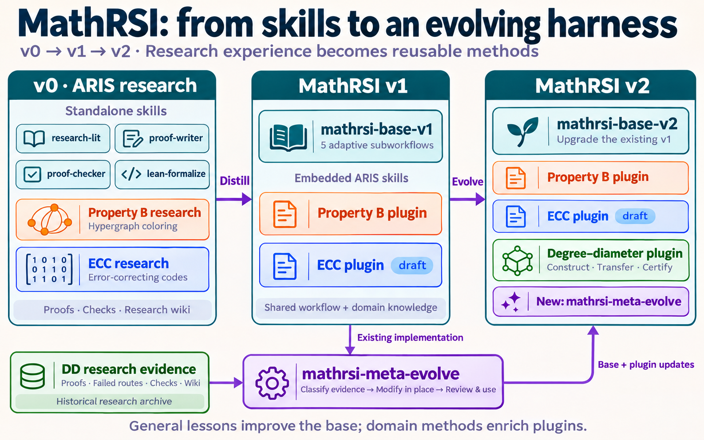
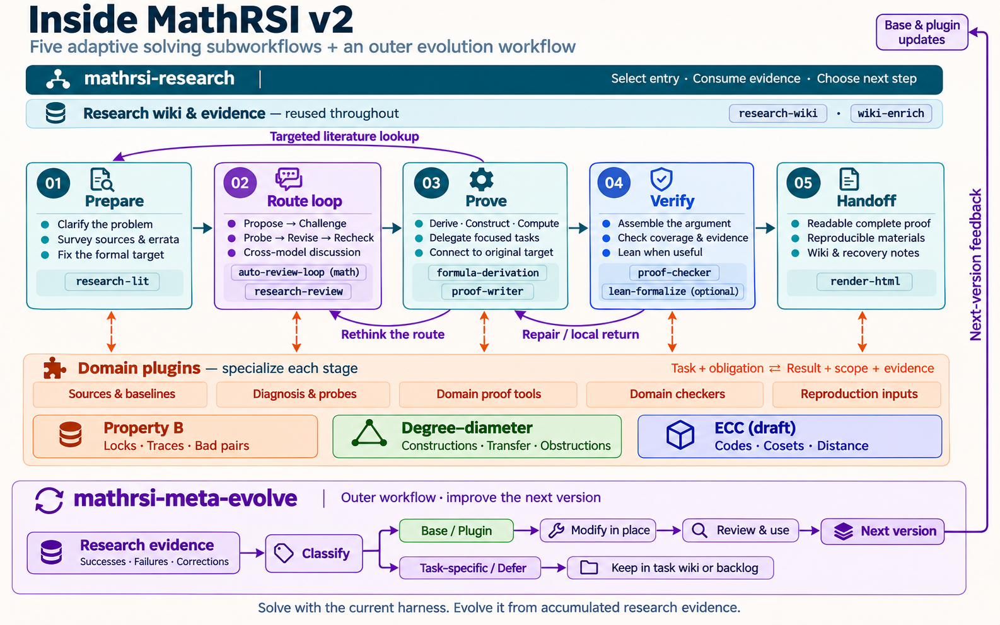
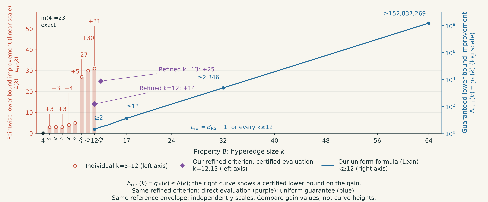

# MathRSI

[English](README.md) · [快速开始（English）](docs/QUICKSTART.md) · [可运行证明修复示例](examples/proof-repair/README.md) · [Property B 成果案例](case-studies/property-b/README.md)

固定版本：**[v1](https://github.com/lisresearchgroup/math-rsi/tree/v1)**（[下载 ZIP](https://github.com/lisresearchgroup/math-rsi/archive/refs/tags/v1.zip)）· **[v2](https://github.com/lisresearchgroup/math-rsi/tree/v2)**（[下载 ZIP](https://github.com/lisresearchgroup/math-rsi/archive/refs/tags/v2.zip)）。标签固定完整仓库快照，旧标签不移动；`main` 跟随当前推荐版。v2 在 v1 上新增 meta-evolve、degree–diameter 插件及工作流改进。

**以 ARIS 完整技能和领域知识组织数学研究。** 从文献查漏到严密证明，把发现、推导、计算、审阅、形式化与可复现交接接成实际工作流。

主流程按现有成果选择入口，并衔接五组可独立使用的子流程：**问题准备与文献 → 求解路线迭代 → 证明推进 → 装配验证 → 交付沉淀。** 每组实际执行、交付结果，由调用者读取后继续；新障碍带着具体问题回文献或路线，未变的成果直接复用。已有完整证明可直接进入验证，短证明可以直接完成，不必跑满五组。



Property B与ECC先用独立ARIS技能开展研究，再沉淀为统一v1工作流；DD历史研究作为独立证据源，推动当前v2的外层维护、流程改进与DD插件。ECC仍为草案。[图源与审阅记录](figures/mathrsi/README.md)。

本仓以详细 Markdown 为主，直接携带32项ARIS技能的Claude/Codex双端完整实现、共享资源、模板与helpers。MathRSI自己新增的代码只做明确的开发核查；数学研究由agent判断与执行，不另造调度平台或通用证明判分器。

## 从这里开始

- [数学研究总控](base/skills/mathrsi-research/SKILL.md)：选择起点，执行并消费子流程产物，保持原目标与已有证据的连接。
- [完整工作流与调用序列](docs/WORKFLOWS.md)：五组子流程的输入、真实动作、阶段产物、回流图及恢复例子。
- [ARIS实际调用说明](docs/ARIS_REUSE.md)：32技能双端位置、各阶段输入输出、helper命令与外部运行依赖。
- [跨模型 MCP 调用与安装](docs/REVIEWER_MCP.md)：仓内 Python 桥接、双端配置、Grok／Gemini 首轮及续接、调用结果如何进入审阅循环。
- [v2具体变化](docs/V2_CHANGES.md)：在现有v1上吸收DD历史证据的增量修改、领域接入及本轮实际范围。
- [Degree–diameter领域入口](plugins/degree-diameter/skills/mathrsi-degree-diameter/SKILL.md)：构造、共同覆盖、有限排除、迁移诊断与原图核验；[完整资料](plugins/degree-diameter/README.md)随仓保留原wiki和支撑原件。
- [Property B领域主技能](plugins/propertyb/skills/mathrsi-propertyb/SKILL.md)：结合完整知识库选择研究路线。
- [Property B知识库](plugins/propertyb/knowledge/README.md)：完整引理/证明/失败经验、原始wiki与源码，不依赖作者另一份工作目录。
- [工作区与恢复](docs/WORKSPACE.md)：已有项目沿用原规格和wiki，不初始化覆盖。
- [mathrsi-meta-evolve](base/skills/mathrsi-meta-evolve/SKILL.md)：从真实研究经验增量修改现有 base／插件，并实际使用；[人读入口](docs/EVOLUTION_WORKFLOW.md)解释调用和采用边界。

### 五组数学子流程



研究wiki贯穿五组子流程，文献查漏、路线修订与局部证明修复按具体义务回流。独立外层 `mathrsi-meta-evolve` 将经验分为Base、Plugin、Task和Defer：前两类经实现、审阅、实际使用后决定采用；单题状态与暂缓建议分别留在wiki或backlog。

|子流程|实际动作与交接|
|---|---|
|[mathrsi-prepare](base/skills/mathrsi-prepare/SKILL.md)|先用[specify](base/skills/mathrsi-specify/SKILL.md)恢复或澄清初步问题，再由[survey](base/skills/mathrsi-survey/SKILL.md)实际广搜、深读关键进口和更新wiki，最后定稿原题；交正式规格与文献依据|
|[mathrsi-route-loop](base/skills/mathrsi-route-loop/SKILL.md)|执行 ARIS auto-review-loop 的数学适配：提案、对抗审阅、实际修法、结果回收、复核，保留各 reviewer 记忆与轮内恢复；交可立即执行的路线及首批任务|
|[mathrsi-prove](base/skills/mathrsi-prove/SKILL.md)|组合推导、证明写作、领域方法和独占worker，立即回收并接实际caller；交候选证明、见证或准确未闭义务|
|[mathrsi-verify](base/skills/mathrsi-verify/SKILL.md)|自然语言证明按需[assemble](base/skills/mathrsi-assemble/SKILL.md)并执行适用独核与proof-checker；仅形式目标直接lean-formalize，核实际导出/定义/build/公理，不强制先TeX；交准确scope与下一步|
|[mathrsi-handoff](base/skills/mathrsi-handoff/SKILL.md)|整理完整可读正文、实际复现材料、按需HTML／包、wiki与恢复入口；部分交接保留主目标开放状态|

八项子技能加一个总控组成九项解题技能，另有独立外层维护技能 mathrsi-meta-evolve，合计十项 MathRSI 技能；使用本仓ARIS作为内部动作并做数学输入、目标和执行顺序适配。路线审阅没有定理真值评分门；局部核验返回其原证明义务，完整验证才进入最终交付。具体动作及范围以实际入口为准。

实际回流也由这些入口执行：[route-loop](base/skills/mathrsi-route-loop/SKILL.md)或[prove](base/skills/mathrsi-prove/SKILL.md)将准确新文献问题交给[survey](base/skills/mathrsi-survey/SKILL.md)，得到原文条件后回同一义务；[verify](base/skills/mathrsi-verify/SKILL.md)的局部结果返回原prove，实质缺口交prove修，核心方法失效才回route-loop。完整候选可直接verify，已核结果再交handoff。

### Property B的专用技能

|技能|承担的实际工作|
|---|---|
|[propertyb-literature](plugins/propertyb/skills/propertyb-literature/SKILL.md)|异名广搜、前后引用链、历史错误、原文定理条件与基线比较|
|[propertyb-bound-lab](plugins/propertyb/skills/propertyb-bound-lab/SKILL.md)|新预算完整域、选锁与真实迹、共同坏对、signed修复、一般k推导及失败回流|
|[propertyb-certificate](plugins/propertyb/skills/propertyb-certificate/SKILL.md)|实际输入连接、分类覆盖、精确算术、独立重放、审阅修正与原染色装配|
|[mathrsi-propertyb](plugins/propertyb/skills/mathrsi-propertyb/SKILL.md)|统筹这些能力，选择当前瓶颈对应的工具与交付路线|

### Degree–diameter的专用技能

|技能|五workflow中的实际工作|
|---|---|
|[mathrsi-degree-diameter](plugins/degree-diameter/skills/mathrsi-degree-diameter/SKILL.md)|prepare/survey对齐图对象、目标及公开来源；各阶段按当前义务分派领域能力|
|[dd-transfer-diagnosis](plugins/degree-diameter/skills/dd-transfer-diagnosis/SKILL.md)|prepare/route-loop及证明回流时核新基线、换源/域/连接后的正负证据，交实际下一任务|
|[dd-construction](plugins/degree-diameter/skills/dd-construction/SKILL.md)|route-loop/prove推进当前覆盖增点、冻结源邻域克隆、仿射共同路线和GQ构造|
|[dd-obstruction-certificate](plugins/degree-diameter/skills/dd-obstruction-certificate/SKILL.md)|prove/verify将必要域、完整有限判定、exact dual或Lean实际caller接原图；只回交该scope|

[插件资料层](plugins/degree-diameter/README.md)保留源wiki、证明、程序、失败、审阅和形式化；handoff按已核范围取复现入口，新题wiki写自己的工作区。历史DD由原研究流程完成，是本轮v1→v2的经验来源，不能追认为MathRSI v1/v2的解题试验。

ECC保留[首版草案](plugins/ecc/skills/mathrsi-ecc/SKILL.md)，等待用户安排另一位领域agent重做；它未按本次Property B标准验收，未加入项目默认技能发现。已授权的ECC原交接只读快照见[经验来源](development/context/ecc-source/README.md)；没有写入或恢复ECC原研究。

工作流的具体衔接提炼自[Property B与ECC的六条历史转折](development/workflow-redesign/REAL_PROJECT_TRANSITIONS.md)，包括局部核验返回原义务、完整覆盖与拒绝证据分工，以及较弱必要条件已足够时及时收束。本轮开发读取和整理这些经验，未重新解题或重放全部生产证据，也未据此宣称通用提速已经验证。

## 研究案例：Property B 超图二染色

**k = 5–12 的逐项下界，以及覆盖全部 k ≥ 12 的统一定理。** 一般定理和较早的五元下界33、34已有端到端Lean；其余逐项结果各自的纸面证明、计算证书和独核范围在[案例页](case-studies/property-b/README.md)中列明。

[](case-studies/property-b/README.md)

这些研究先通过 **ARIS** 完成，再沉淀成 **MathRSI 的工作流和 Property B 插件**。它们是方法来源与成果案例；后续新题再检验所选 MathRSI 版本本身的效果。案例包括完整可读证明、Lean源码与审计入口，以及真实失败与有效修法。

**[案例首页（English）](case-studies/property-b/README.md)** · [完整证明HTML](case-studies/property-b/readers/PROPERTY_B_GENERAL_BOUND.html) · [Lean阅读页](case-studies/property-b/readers/PROPERTY_B_GENERAL_LEAN.html)。克隆或下载后，在浏览器打开 `case-studies/property-b/index.html`；全文阅读页为中文，公式与图离线可读。

## 可直接使用

```text
读取 /实际路径/MathRSI/base/skills/mathrsi-research/SKILL.md，
再读 /实际路径/MathRSI/plugins/propertyb/skills/mathrsi-propertyb/SKILL.md。
在 /我的任务目录 中研究 <准确问题>，先恢复现有规格、wiki与状态。
按已有成果选择prepare、route-loop、prove、verify或handoff，
执行后读取实际产物，在同一轮内继续已授权的下一步。
所有helper显式来自 /实际路径/MathRSI/base/tools；不回退外部ARIS仓库。
```

`.agents/skills/` 和 `.claude/skills/` 提供仓库内**相对**发现别名；实际内容就在base和plugins里，复制整个MathRSI后仍有效。当前会话未刷新发现时直接读SKILL路径即可。没有全局安装、没有改写用户私有reviewer配置。跨模型的 Python MCP 桥接源码随仓保存在 [mcp-servers](mcp-servers/README.md)，按[调用说明](docs/REVIEWER_MCP.md)注册；CLI、登录状态、Lean、TeX及网络服务由实际环境提供。

已发现技能时，Claude可用 `/mathrsi-research` 或相应子技能；Codex可用 `$mathrsi-research` 或直接要求读真实路径。不要把slash写法当成所有宿主通用命令，也不要给子技能编造未支持的flag。[调用序列](docs/WORKFLOWS.md)给出从新题、已有证明和局部义务进入的完整例子。

## 从研究经验迭代现有版本

读取 [mathrsi-meta-evolve](base/skills/mathrsi-meta-evolve/SKILL.md)，提供源研究、已有关键转折依据、本轮维护记录及可改范围。它对照当前实现，将经验分到 base、插件、单题或暂缓，形成实际修改，再由协调者使用受影响行为；执行链只由该技能维护。[使用说明](docs/EVOLUTION_WORKFLOW.md)有可复制请求。

Claude 可用 `/mathrsi-meta-evolve`，Codex 可用 `$mathrsi-meta-evolve`，双端共用主体。原版 ARIS `meta-optimize`／`meta-apply` 也有各宿主别名，但保留自己的合同，不与数学适配混称。使用和验收按实际改动核查，不强制无历史 agent 重跑完整流程；数学独核仍遵循原题合同。本轮已用该技能组织现有v1的增量修改与DD插件接入；[具体变化](docs/V2_CHANGES.md)与[维护记录](development/evolution/dd-v2-20261102/EVOLUTION.md)区分实际实现、使用、审阅和采用。没有据历史DD成果宣称新版解题率或提速已测成。

## 三层边界

|层次|内容|
|---|---|
|base|通用数学研究主流程，完整ARIS能力、验证与交接契约|
|plugins|领域定理、证明方法、失败反例、计算/Lean经验及可运行案例|
|任务工作区|当前问题的规格、新证明、wiki、运行证据、预算和恢复状态|

[插件契约](docs/PLUGIN_CONTRACT.md)用自然语言说明输入、义务、行动、结果与核验，不强制统一JSON。运行插件不改base或验收条件；新领域知识在独立维护步骤纳入。历史源资料是只读快照，不恢复35 Lean、36研究或任何旧Goal。

## 验证与开发

[本轮验证记录](development/VALIDATION.md)分别报告技能资源完整性、搬迁副本执行、真实数学案例和模型审阅范围。它们不等于通用解题成功率或RSI增益评测。

```bash
python3 tools/check_links.py
python3 -B base/tests/smoke_bundle.py --help
```

链接检查覆盖维护中的主流程/插件文档和内部别名；原始历史档案里的旧HTML/日志链接另有归档说明。base的独立smoke实际验证被复制的上游资源和wiki/router/renderer。组内仓库为 [lisresearchgroup/math-rsi](https://github.com/lisresearchgroup/math-rsi)，开发使用短期分支。英文首页与快速开始提供克隆、运行示例和跨模型配置入口。

## 来源

[ARIS](https://github.com/wanshuiyin/Auto-claude-code-research-in-sleep) 固定来源、许可证与领域提炼说明见 [PROVENANCE](docs/PROVENANCE.md)。ARIS与MathRSI工作流沿用MIT；归档学术论文与第三方原件保留各自权利，不能将仓库MIT标题理解为重新许可这些作品。
