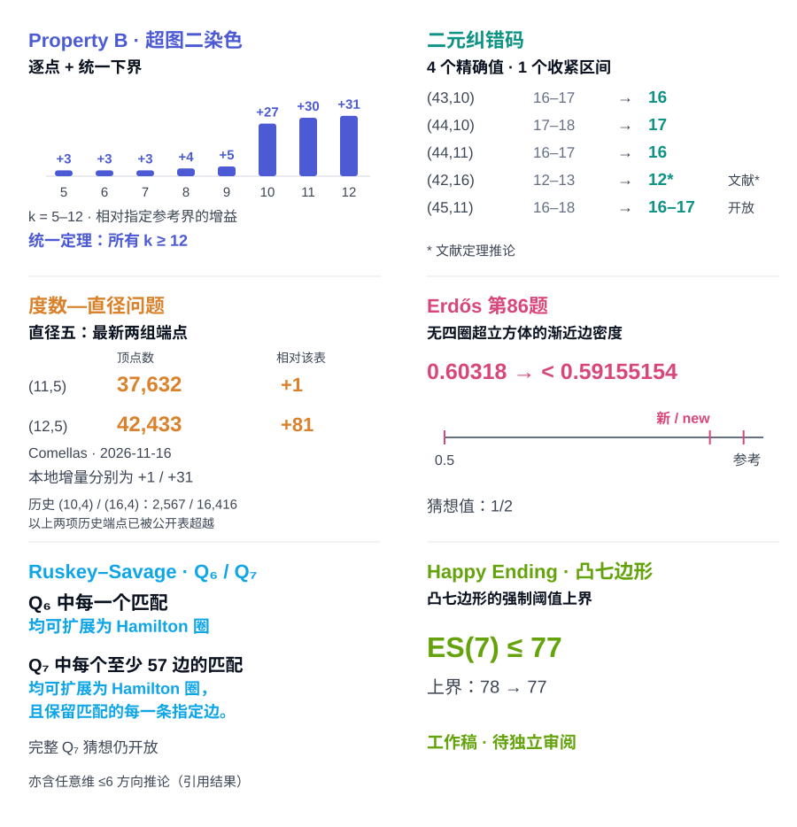

<div align="center">

# <picture><source media="(prefers-color-scheme: dark)" srcset="figures/mathrsi/branding/mark-c-dark.png"></picture> MathRSI<br><sub><sup><em>SII MathRSI Team</em></sup></sub>

**研究持续推进，工作流从中学习。**<br>让 Claude Code 与 Codex 执行可读的 Markdown 技能，推进、验证并改进数学研究。

[](https://lisresearchgroup.github.io/math-rsi/ "项目主页 / EN + 中文")&nbsp; [](#开始使用)&nbsp; [](case-studies/README.md)&nbsp; [](docs/WORKFLOWS.md)&nbsp; [](#contributors)&nbsp; [](README.md)

</div>

[](figures/mathrsi/media/evolution.mp4)

*真实主页演进回放；点击观看 MP4。[运行归属与工作稿状态](case-studies/README.md)。*

MathRSI 结合通用工作流、领域插件与单题研究知识库，引导 Claude Code 或 Codex 完成文献调研、路线探索、证明、审阅、验证与交付。研究成果和失败经验持续用于改进工作流与插件。

<a id="开始使用"></a>

## 1. 🚀 快速开始

克隆仓库并完成[配置](docs/QUICKSTART.md)后，在 **Claude Code** 或 **Codex** 中打开本仓库，并允许访问任务目录。Codex 将 `/skill` 换成 `$skill`。下列示例路径请替换为自己的路径。

**从数学问题开始**

```text
/mathrsi-research 研究 k 元超图二染色的边数下界；工作目录 ../my-problem/
```

自动串联文献调研、路线探索、证明推进、验证与交付，全程复用任务 wiki。已有题面时，也可直接给 `../my-problem/problem.md`。

**检查候选证明或局部引理**

```text
/mathrsi-verify 检查 ../my-problem/proof.tex
```

核验稿件或具体义务，修复可补步骤，或定位需要继续证明的实质数学缺口。

**接着已有研究继续**（Codex 示例）

```text
$mathrsi-research 继续 ../my-problem/ 中的研究
```

读取任务目录已有的规格、wiki 与断点记录，从当前证据接续推进。Claude Code 使用 `/mathrsi-research`。

<a id="六个数学方向"></a>

## 2. 🧮 数学成果

六个领域的研究同时积累数学结果和可复用方法。[公开主页](https://lisresearchgroup.github.io/math-rsi/) · [本地运行方法](docs/HOMEPAGE.md)。**[中英可视化导览](https://lisresearchgroup.github.io/math-rsi/)**展示问题、成果与演进；**[六题统一索引](case-studies/README.md)**连接证明、核验范围和可运行工具。

[](case-studies/README.md)

- **Property B：** $k=5,\ldots,12$ 的具体下界，以及所有 $k\ge12$ 随参数指数增长的加性增益。[成果与证明范围](case-studies/property-b/README.md)
- **纠错码：** 闭合三组 1985 年已有的缺口，得到四组精确距离（含一项文献推论）并收窄一组区间。[结果、方法与开放参数](case-studies/README.md#error-correcting-codes)
- **Degree–Diameter：** 刷新四组历史构造基准，包括一个 2,567 点的 $(10,4)$ 图。[构造与证据](case-studies/degree-diameter/README.md)
- **Erdős 第 86 题：** 渐近密度上界从 $0.60318$ 改进至 $\lt0.59155154$。[结果与核验范围](case-studies/README.md#erdős-problem-86)
- **Ruskey–Savage：** $Q_6$ 的每个匹配均可延拓为 Hamilton 圈。[证明与证书范围](case-studies/README.md#ruskeysavage-q6)
- **Happy Ending：** 工作稿将 $\mathrm{ES}(7)$ 上界从 78 收紧至 77，待独立审阅。[原稿与状态](case-studies/happy-ending/README.md)

<a id="三层架构"></a>

## 3. 🧩 三层架构


**Base**（`base/`）提供通用研究方法；**领域插件**（`plugins/`）提供专门数学和检查器；**任务工作区**保存单题规格、wiki、证明、证书与恢复状态。[架构与插件契约](docs/PLUGIN_CONTRACT.md) · [可编辑源文件与 GPT Image 版本](figures/mathrsi/README.md)

<a id="研究如何推进"></a>

## 4. 🔬 研究如何推进

主入口 [`mathrsi-research`](base/skills/mathrsi-research/SKILL.md) 协调 **准备 → 路线 → 证明 → 验证 → 交付**，从当前证据进入并读取每阶段实际产物。任务 wiki 贯穿读取、更新和再次使用；职责明确的协作者与跨模型 reviewer 参与研究。

| 当前需要 | 使用入口 |
| --- | --- |
| 明确新问题，调查文献 | [Prepare · 准备](base/skills/mathrsi-prepare/SKILL.md) |
| 续接研究或未完成证明 | [路线迭代](base/skills/mathrsi-route-loop/SKILL.md) · [证明推进](base/skills/mathrsi-prove/SKILL.md) |
| 检查并修复候选证明或证书 | [Verify · 验证](base/skills/mathrsi-verify/SKILL.md) · [证明修复示例](examples/proof-repair/README.md) |
| 交付已有成果并供后续复用 | [Handoff · 交付](base/skills/mathrsi-handoff/SKILL.md) |

[详细工作流与返回路径](docs/WORKFLOWS.md) · [六领域路由](docs/DOMAIN_ROUTING.md) · [工作区与记忆](docs/WORKSPACE.md)

<a id="研究经验如何改进工作流"></a>

## 5. 🔄 研究经验如何改进工作流


两条线共同演进：**共享 Base 的行为持续强化**，**领域 Plugins 持续扩展与深化**。独立的 [`mathrsi-meta-evolve`](base/skills/mathrsi-meta-evolve/SKILL.md) 维护流程把研究证据转成实际改动。

- **v4 Base：** 从紧整数界找出必须同时成立的取等条件，通过合法交换，将容量迫出的见证接回原题。
- **`main` 后续 Base 维护：** 当局部工作不再缩小原题缺口或完成总成本时，由两位独立只读 agent 强制重评全局进展。
- **领域方法：** v4 深化 Happy Ending 取等／替换与 DD 插点／重放；后续 ECC 维护在精确标识的节点间复用排除结论和共同计算。

**[v4 是当前 release](docs/V4_CHANGES.md)，`main` 包含后续维护。** 数学成果保留实际运行归属。[演进与实现记录](development/README.md) · [维护指南](docs/EVOLUTION_WORKFLOW.md)

<details>
<summary>固定版本与早期改进</summary>

- **v0：** 统一 harness 形成前的 Property B／ECC 研究工具阶段，无 Git tag。
- **[v1](https://github.com/lisresearchgroup/math-rsi/tree/v1)：** 五阶段、三层分离、对抗路线迭代与初始插件。
- **[v2](https://github.com/lisresearchgroup/math-rsi/tree/v2)：** 独立维护流程、DD、证据继承和共同覆盖检查。[变更](docs/V2_CHANGES.md)
- **[v3](https://github.com/lisresearchgroup/math-rsi/tree/v3)：** 工作集／全域区分、标记对象运输、有限全称证书、Lean 显式前提审计；升级 ECC 并新增三个领域。[变更](docs/V3_CHANGES.md)
- **[v4](https://github.com/lisresearchgroup/math-rsi/tree/v4)：** 取等到见证的证明动作，Happy Ending／DD 专用方法。[变更](docs/V4_CHANGES.md)

各 tag 保留固定完整快照。需要可复现起点时选择相应版本，并记录实际 commit。[历史 v2／v3 配图](figures/mathrsi/README.md#historical-diagrams)

</details>

<a id="文档与来源"></a>

## 6. 📚 文档与来源

**[按目的选择阅读路径](docs/README.md)** · [六题研究案例](case-studies/README.md) · [仓库地图](docs/README.md#repository-map) · [验证记录](development/README.md#validation-and-implementation) · [技能验收](docs/SKILL_ACCEPTANCE.md)

基于 **[ARIS](https://github.com/wanshuiyin/Auto-claude-code-research-in-sleep)** 和插件／案例保留的研究原件。随仓 ARIS 快照为 `c485faa59a68e51c6575dea67ca57abc7a6a2b9c`。[来源说明](docs/PROVENANCE.md) · [快照清单](base/ARIS_SNAPSHOT.json) · [桥接来源](mcp-servers/SOURCE.md)

工作流和脚本采用 **[MIT 许可证](LICENSE)**；归档论文与第三方材料保留原版权。

<a id="contributors"></a>

## 7. 👥 贡献者

Ruofeng&nbsp;Yang<sup>&#42;</sup>, Haitong&nbsp;Ma<sup>&#42;</sup>, Kaitao&nbsp;Qiu, Zuhao&nbsp;Zhang, Jiaxuan&nbsp;Sun, Tianzhi&nbsp;Ren, Shuai&nbsp;Li<sup>#</sup>

<sup>&#42;</sup> 同等贡献。<sup>#</sup> 通讯作者。
