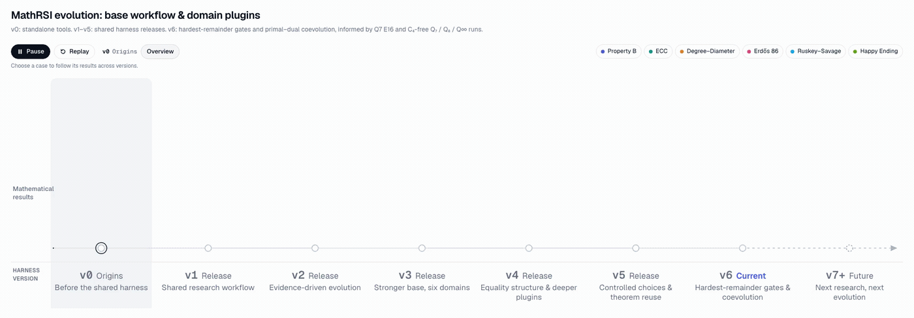

<div align="center">

# MathRSI

*SII MathRSI Team*

**研究持续推进，工作流从中学习。**

面向严谨数学研究、由 agent 实际执行并持续演进的工作流与领域知识 harness。

[English](README.md)

[](docs/QUICKSTART.md)&nbsp; [](case-studies/README.md)&nbsp; [](docs/HOMEPAGE.md)&nbsp; [](docs/WORKFLOWS.md)

</div>

MathRSI 将数学问题从文献检索、路线探索推进到证明、对抗审阅、验证与可复现交付。**Claude Code 或 Codex 读取并执行 Markdown skills**，结合领域方法和当前问题的研究 wiki 开展工作。包括失败与局部进展在内的研究证据，再用于改进共享工作流和领域插件。

[](figures/mathrsi/media/evolution.mp4)

*真实主页演进回放；点击观看 MP4。[运行归属与工作稿状态](case-studies/README.md)。*

## 开始使用

使用有仓库访问权限的账号克隆。以下本地检查仅需 Python 3.9+ 标准库：

```bash
git clone https://github.com/lisresearchgroup/math-rsi.git
cd math-rsi
python3 tools/check_links.py              # 检查文档链接
python3 examples/proof-repair/replay.py   # 确定性重放证明修复示例
```

将问题说明（如 `problem.md`）或候选证明（如 `proof.tex`）放入独立任务目录。在 **Claude Code** 或 **Codex** 中打开克隆目录，并让宿主能访问该任务目录。项目技能已发现时使用 `/mathrsi-research` 或 `$mathrsi-research`；也可替换实际路径后直接发送：

```text
请读取 /abs/path/to/math-rsi/base/skills/mathrsi-research/SKILL.md。
在 /abs/path/to/my-task 研究 <我的数学问题或候选证明>。
恢复已有规格和 research-wiki；新题则按需建立，从当前证据支持的阶段进入。
调用 /abs/path/to/math-rsi/base/tools 下的工具时设置
ARIS_REPO=/abs/path/to/math-rsi/base。
```

按所到阶段，任务目录留下规格、证明或明确缺口、核验记录与恢复文件。

仓库包含技能和 reviewer 桥接源码。模型访问及本题需要的工具由所选宿主环境提供。**[完整配置](docs/QUICKSTART.md)** · [证明修复示例](examples/proof-repair/README.md) · [Reviewer MCP 配置](docs/REVIEWER_MCP.md)

## 六个数学方向

六个领域的研究同时积累数学结果和可复用方法。**[中英可视化导览](docs/HOMEPAGE.md)**展示问题、成果与演进；**[六题统一索引](case-studies/README.md)**连接证明、核验范围和可运行工具。

- **Property B · 超图二染色。** $k=5,\ldots,12$ 的逐参数报告下界为 $35,67,131,267,543,1112,2275,4664$，另有对每个 $k\ge12$ 严格改进指定 RS 预算的一般定理，将具体参数改进与统一结论连接起来。[成果与证明范围](case-studies/property-b/README.md)
- **纠错码 · 二元最优距离。** $d_2(43,10)=16$、 $d_2(44,10)=17$、 $d_2(44,11)=16$、 $d_2(42,16)=12$ 闭合四个最优距离问题；最后一项应用已发表的 2020 年定理。[结果、方法与开放参数](case-studies/README.md#error-correcting-codes)
- **Degree–Diameter · 大图构造。** 一个 2,567 点的 $(10,4)$ 图超过 2026-11-05 核对的 Comellas 表中 2,566 点条目，在相同度数和直径约束下得到更大的图。[构造与证据](case-studies/degree-diameter/README.md)
- **Erdős 第 86 题 · 无四圈超立方体子图。** 精确证书将指定的渐近边密度上界从 $0.60318$ 改进至 $\lt0.59155154$，向猜想值 $1/2$ 推进。[结果与核验范围](case-studies/README.md#erdős-problem-86)
- **Ruskey–Savage · $Q_6$ Hamilton 延拓。** $Q_6$ 的每个匹配均能延拓为 Hamilton 圈，解决六维情形；结合文献进口，还覆盖任意维中使用至多六个方向的匹配。[证明与证书范围](case-studies/README.md#ruskeysavage-q6)
- **Happy Ending · 凸七边形。** 已收到的工作稿声称 $N(7,6,7)\le75$、 $N(7,7,7)\le76$，从而 $\mathrm{ES}(7)\le77$，收紧原 78 阈值。**工作稿，待独立审阅。**[原稿与状态](case-studies/happy-ending/README.md)

## 三层架构


**Base**（`base/`）提供通用研究方法；**领域插件**（`plugins/`）提供专门数学和检查器；**任务工作区**保存单题规格、wiki、证明、证书与恢复状态。[架构与插件契约](docs/PLUGIN_CONTRACT.md) · [可编辑源文件与 GPT Image 版本](figures/mathrsi/README.md)

## 研究如何推进

主入口 [`mathrsi-research`](base/skills/mathrsi-research/SKILL.md) 协调 **准备 → 路线 → 证明 → 验证 → 交付**，从当前证据进入并读取每阶段实际产物。任务 wiki 贯穿读取、更新和再次使用；职责明确的协作者与跨模型 reviewer 参与研究。

| 当前需要 | 使用入口 |
| --- | --- |
| 明确新问题，调查文献 | [Prepare · 准备](base/skills/mathrsi-prepare/SKILL.md) |
| 续接研究或未完成证明 | [路线迭代](base/skills/mathrsi-route-loop/SKILL.md) · [证明推进](base/skills/mathrsi-prove/SKILL.md) |
| 检查并修复候选证明或证书 | [Verify · 验证](base/skills/mathrsi-verify/SKILL.md) · [证明修复示例](examples/proof-repair/README.md) |
| 交付已有成果并供后续复用 | [Handoff · 交付](base/skills/mathrsi-handoff/SKILL.md) |

[详细工作流与返回路径](docs/WORKFLOWS.md) · [六领域路由](docs/DOMAIN_ROUTING.md) · [工作区与记忆](docs/WORKSPACE.md)

## 研究经验如何改进工作流


两条线共同演进：**共享 Base 的行为持续强化**，**领域 Plugins 持续扩展与深化**。独立的 [`mathrsi-meta-evolve`](base/skills/mathrsi-meta-evolve/SKILL.md) 维护流程把研究证据转成实际改动。

- **v4 Base：** 从紧整数界找出必须同时成立的取等条件，通过合法交换，将容量迫出的见证接回原题。
- **`main` 后续 Base 维护：** 当局部工作不再缩小原题缺口或完成总成本时，由两位独立只读 agent 强制重评全局进展。
- **领域方法：** v4 深化 Happy Ending 取等／替换与 DD 插点／重放；后续 ECC 维护在精确标识的节点间复用排除结论和共同计算。

**[v4 是当前 release](docs/V4_CHANGES.md)，`main` 包含后续维护。** 数学成果保留实际运行归属。[演进与实现记录](development/README.md) · [维护指南](docs/EVOLUTION_WORKFLOW.md)

<details>
<summary>固定版本与早期改进</summary>

- **v0：** 统一 harness 形成前的 Property B／ECC 研究工具阶段，无 Git tag。
- **[v1](https://github.com/lisresearchgroup/math-rsi/tree/v1)：** 五阶段、三层分离、对抗路线迭代与初始插件。
- **[v2](https://github.com/lisresearchgroup/math-rsi/tree/v2)：** 独立维护流程、DD、证据继承和共同覆盖检查。[变更](docs/V2_CHANGES.md)
- **[v3](https://github.com/lisresearchgroup/math-rsi/tree/v3)：** 工作集／全域区分、标记对象运输、有限全称证书、Lean 显式前提审计；升级 ECC 并新增三个领域。[变更](docs/V3_CHANGES.md)
- **[v4](https://github.com/lisresearchgroup/math-rsi/tree/v4)：** 取等到见证的证明动作，Happy Ending／DD 专用方法。[变更](docs/V4_CHANGES.md)

各 tag 保留固定完整快照。需要可复现起点时选择相应版本，并记录实际 commit。[历史 v2／v3 配图](figures/mathrsi/README.md#historical-diagrams)

</details>

## 文档与来源

**[按目的选择阅读路径](docs/README.md)** · [六题研究案例](case-studies/README.md) · [仓库地图](docs/README.md#repository-map) · [验证记录](development/README.md#validation-and-implementation) · [技能验收](docs/SKILL_ACCEPTANCE.md)

基于 **[ARIS](https://github.com/wanshuiyin/Auto-claude-code-research-in-sleep)** 和插件／案例保留的研究原件。随仓 ARIS 快照为 `c485faa59a68e51c6575dea67ca57abc7a6a2b9c`。[来源说明](docs/PROVENANCE.md) · [快照清单](base/ARIS_SNAPSHOT.json) · [桥接来源](mcp-servers/SOURCE.md)

工作流和脚本采用 **[MIT 许可证](LICENSE)**；归档论文与第三方材料保留原版权。
