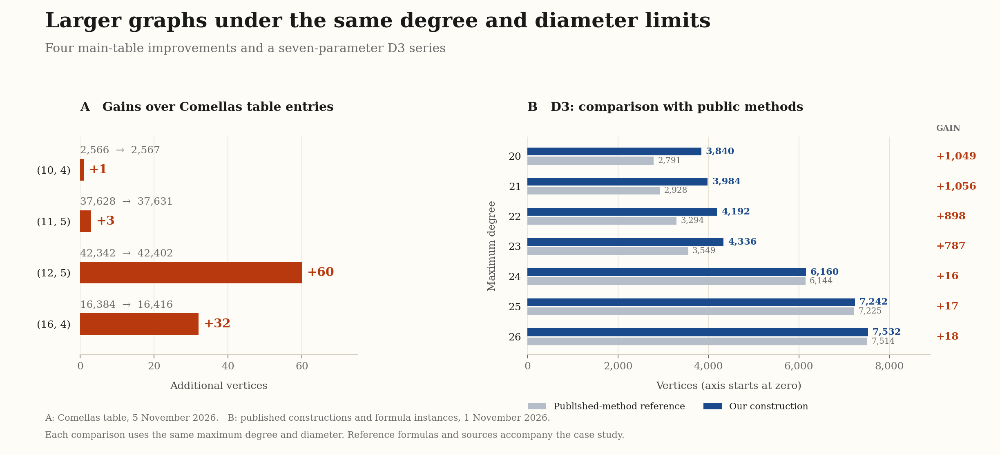
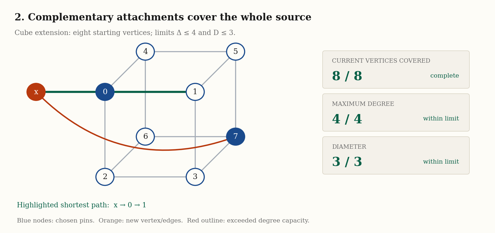
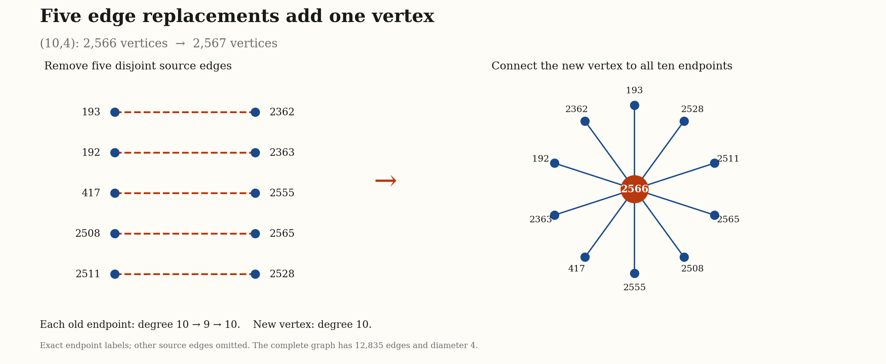
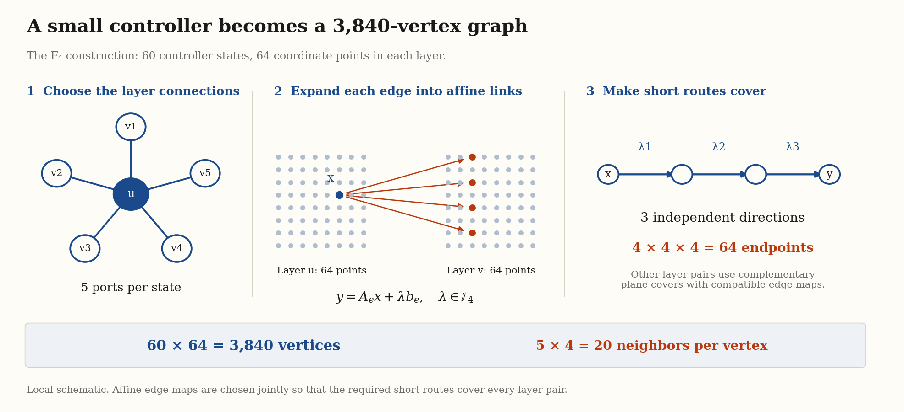
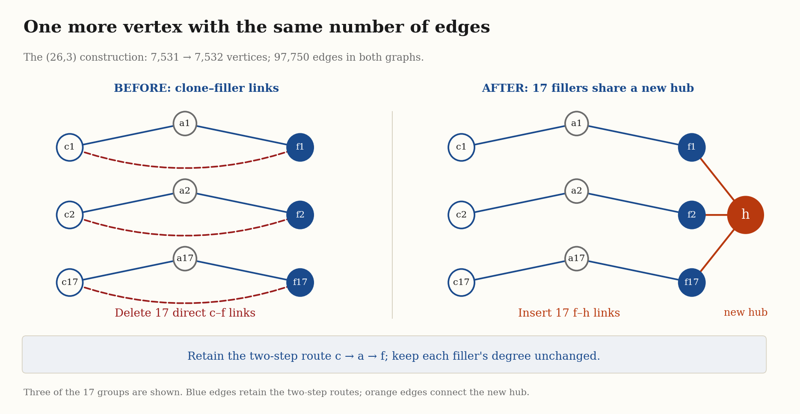

# Degree–Diameter: four improvements over the Comellas table

**MathRSI v2 constructs a 2,567-vertex graph for (10,4), exceeding the Comellas table's 2,566 vertices. Four parameter pairs now improve table entries; the combined catalogue contains 163 graphs across 44 parameter pairs, with 49 concrete graphs proved in Lean.**

The degree–diameter problem asks how many vertices a simple undirected graph can have when each vertex has at most Δ neighbors and every pair of vertices is connected by a path of length at most D. Earlier ARIS research developed neighborhood extensions, finite-field layers and geometric connection reallocation. The new (10,4) result was obtained using **MathRSI v2 and its degree–diameter plugin**, continuing that research with its saved constructions and failure trajectories. [Execution version](evidence/execution_version.md).

[Read the illustrated case](index.html) · [中文版](index.zh-CN.html) · [Construction programs](reproduce/README.md)

Clone or download the repository and open `index.html` locally for the interactive figures. GitHub displays the HTML source; this README is the overview to read on GitHub.

## Results

Our constructions improve four entries in the [Comellas table](https://web.mat.upc.edu/francesc.comellas/delta-d/table_degree_diameter.html), checked on **5 November 2026**. The latest result is a **10-regular graph of diameter 4 on 2,567 vertices**, exceeding the table's 2,566 vertices.

| (Δ,D) | Comellas table | Our construction | Additional vertices |
| --- | ---: | ---: | ---: |
| **(10,4)** | **2,566** | **2,567** | **+1** |
| (11,5) | 37,628 | **37,631** | +3 |
| (12,5) | 42,342 | **42,402** | +60 |
| (16,4) | 16,384 | **16,416** | +32 |

The diameter-three constructions cover seven consecutive degrees, from 20 to 26. Their reference values come from published constructions and applications of published formulas, including Rajiv, PolarStar, and Delorme's methods.

| Δ, with D = 3 | Published-method reference | Our construction | Additional vertices |
| --- | ---: | ---: | ---: |
| 20 | 2,791 | **3,840** | +1,049 |
| 21 | 2,928 | **3,984** | +1,056 |
| 22 | 3,294 | **4,192** | +898 |
| 23 | 3,549 | **4,336** | +787 |
| 24 | 6,144 | **6,160** | +16 |
| 25 | 7,225 | **7,242** | +17 |
| 26 | 7,514 | **7,532** | +18 |

Across 37 diameter-three parameter pairs, our constructions exceed these specified public-method references. Examples at higher degrees include **56,862 vertices for (54,3)**, an increase of 1,350, and **414,132 vertices for (98,3)**. [Sources and comparison formulas](evidence/comparison_notes.md) give the 1 November 2026 literature review and the scope of each comparison.

## How the constructions work

### 1. Extend a graph through covering neighborhoods

Keep the original edges and connect a new vertex x to a set S of existing vertices. If the radius-(D−1) neighborhoods around S cover the current graph, every vertex is within D steps of x. Each selected neighbor must also have room for the new edge. Repeating this argument gives the D5 extension sequences; neighborhood cloning supports related D3 and D4 constructions.

The interactive illustration compares four choices on a cube: one attachment misses a vertex; complementary attachments cover it; reusing the same attachment points exceeds their degree limit; choosing different points allows another extension.

The new **(10,4) construction** extends this idea to a graph with no unused degree capacity. Starting from 2,566 vertices, we remove five disjoint edges and connect a new vertex to all ten endpoints. Every affected old vertex returns to degree 10, and the new vertex has degree 10. Failed point pairs guided the subsequent choices of edges; the final 2,567-vertex graph passes the complete distance check.

[Exact recipe, construction program and verification](reproduce/d10_d4/README.md) accompany the ten accepted intermediate versions from 2,558 to 2,567 vertices.

### 2. Lift a small controller over a finite field

The **3,840-vertex, degree-20 graph** uses 60 controller states, each carrying the 64 points of F₄³. Five controller ports supply four neighbors each. Compatible affine maps make three-step routes cover the required coordinate layers. Moving from shared parameters to edge-specific maps resolved the compatibility obstacle in the F4 construction.

### 3. Reallocate geometric connections

Spreads and ovoids in generalized quadrangles organize compatible filling and cloning positions. In the **7,531 → 7,532** construction, 17 clone–filler edges are replaced by 17 edges from a new hub to the fillers. Alternative short routes preserve the distance bound, while the edge count remains **97,750**.

The construction builds on source graphs and controllers by Mizuno, Rajiv, Yugeswardeenoo, and Bhakar/f4t4nt, together with Delorme's and subsequent finite-geometry methods. [Construction notes](evidence/construction_visual_notes.md) connect the illustrations to the underlying arguments and source programs.

## What carries over to new problems

The successful steps changed how connections were chosen: combine neighborhoods that cover different regions, allocate degree capacity across all additions, and replace a connection only when the affected routes can be recovered. These lessons turn an individual construction into a starting point for a family of parameters. The proofs, counterexamples and construction programs informed MathRSI's [degree–diameter plugin](../../plugins/degree-diameter/README.md), which connects these methods to the research workflows in v2.

## Verification and reproduction

All 163 graphs have mathematical or computational verification; **49 have proofs of their concrete graph constructions in Lean**, including the new 2,567-vertex graph and all seven degree-20–26 representatives. The catalogue includes intermediate extensions, with each parameter comparison using its largest construction.

- [Graph catalogue](data/catalog.csv): orders, degrees, diameters and verification details for all 163 graphs.
- [Parameter comparisons](data/public_comparisons.csv): the 44 parameter pairs and their reference constructions.
- [Source programs and inputs](reproduce/README.md): reconstruct every graph without repeating the discovery search.
- [Figures and construction notes](evidence/construction_visual_notes.md): SVG/PNG illustrations and the corresponding mathematical arguments.

The HTML is generated from this README with ARIS `/render-html`. Edit the Markdown and run `python3 tools/render_index.py` from the case directory to update the English and Chinese readers.
