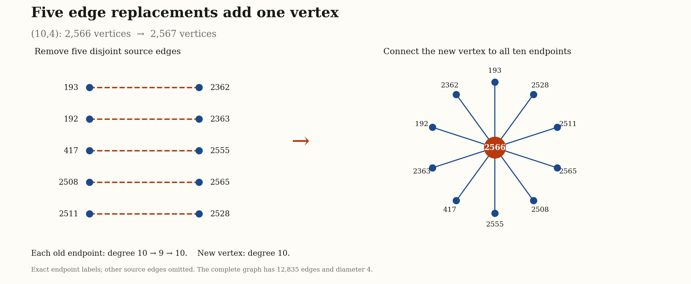

# 度数—直径：超过公开纪录的构造

**两组新成果超过 Comellas 公开纪录表。** 我们在 **2026 年 11 月 16 日**记录的成果为 **(11,5) 的 37,632 点图**和 **(12,5) 的 42,433 点图**，分别比当时表中的纪录多 **1 点**和 **81 点**。**11 月 18 日复查，这两项增益仍然成立。** 此前 (10,4) 的 **2,567 点**和 (16,4) 的 **16,416 点**成果，按各自当时的比较日期保留。

[最新双语成果与方法](../../development/homepage-redesign-20261105/site/dd-latest.html) · [English](README.md) · [图文案例与纪录时间线](index.zh-CN.html)

## 纪录改进时间线

| (Δ,D) | 本项目构造 | 当时公开表值 | 增益与比较日期 |
| --- | ---: | ---: | --- |
| (10,4) | **2,567** | 2,566 | **+1** · 2026-11-05 |
| (11,5) | **37,632** | 37,631 | **+1** · 2026-11-16；11-18 复查 |
| (12,5) | **42,433** | 42,352 | **+81** · 2026-11-16；11-18 复查 |
| (16,4) | **16,416** | 16,384 | **+32** · 2026-11-05 |

每项成果都对应一个明确时间点的公开纪录改进。后来出现更大的图，会推进纪录，也会与此前的成果一起保留在这条时间线上。[日期与来源](evidence/record_timeline.md)。

## 最新 D5 纪录改进 · 成果记录于 2026-11-16

**公开表最后核对：2026-11-18。**

| (Δ,D) | 此前本地图 | 最新图 | 本地增量 | Comellas 2026-11-18 | 相对该表增益 |
| --- | ---: | ---: | ---: | ---: | ---: |
| (11,5) | 37,631 | **37,632** | **+1** | 37,631 | **+1** |
| (12,5) | 42,402 | **42,433** | **+31** | 42,352 | **+81** |

两张最终图分别有 205,366 与 246,309 条边，最大度为 11 与 12，直径均恰为五。D12 的 31 次合法增点，是相对我们此前 42,402 点图的本地增量；相对上述公开表值的增益为 81 点。

**实际运行归属：** 本地 2026-11-11 main／v4 后续维护，加上 DD 反馈更新。研究并非由已发布 v5 跑出，其成果与方法反馈 **v5 主线维护**，固定 v5 标签不动。演进图中简写为“运行：v4 + 本地更新”。

**方法与实际核验。** D12 将完整源图保留为诱导子图，以合法剩余度数连接加入 31 个新点；最终图全部 31 个新点均做完整 BFS，旧—旧距离继承已接受源图前提。D11 改变核心，不能只靠保源边证明距离：核心距离依赖 H9 几何定理与字面绑定，全部 160 个旧外围点和新点共 161 个根做完整 BFS。两张最终图均精确重建，独立有限数组／度数检查通过；具体端到端 Lean 实例和所需源最终审阅义务仍开放。

[Comellas 表](https://web.mat.upc.edu/francesc.comellas/delta-d/table_degree_diameter.html)随新构造持续推进。**2026-11-18**，其 (10,4) 与 (16,4) 已分别更新到 **2,614** 和 **16,848** 点。我们此前的 2,567 与 16,416 点图，仍作为超过 **2026-11-05** 所核对纪录的成果保留；上面的两组 D5 构造在本次复查时仍高于表值。

**联合选择与增量核验。** 采用极小核心阻塞集，从全部余度端口池联合补全连接；依据真实坏点对修改前部构造，后续只消费已独立核验的前缀。 本轮还反馈 Base 的“先收件，再派发”：依据已返回的原始结果更新当前事实，再派发任务或审阅；避免重复运行与旧状态回退。 [v5 后续维护记录](https://github.com/lisresearchgroup/math-rsi/blob/main/development/evolution/v5-dd-20261116/EVOLUTION.md)。

[私有原件与重放包](https://github.com/lisresearchgroup/math-rsi/tree/main/plugins/degree-diameter/archive/dd-latest-two-parameters-20261116/) · [v5 后续维护](../../docs/V5_CHANGES.md)

## 历史研究与图解方法

度数—直径问题研究的是：当每个顶点至多有 Δ 个邻居、任意两点之间的距离至多为 D 时，一张简单无向图最多能有多少个顶点？前期 ARIS 研究积累了邻域扩张、有限域分层和几何连接重分配的方法。此前的 (10,4) 成果由 **MathRSI v2 及度数—直径插件**在后续研究中取得，继承了已有构造和失败轨迹。[实际使用版本](evidence/execution_version.md)。

[图文版](index.zh-CN.html) · [English](index.html) · [构造程序](reproduce/README.md)

克隆或下载仓库后，在浏览器打开 `index.zh-CN.html` 即可使用交互图。GitHub 显示 HTML 源码；直接在 GitHub 阅读时，可使用这份 README。

## 此前的纪录改进 · 2026-11-05

截至 **2026 年 11 月 5 日**，以下四组构造超过 [Comellas 表](https://web.mat.upc.edu/francesc.comellas/delta-d/table_degree_diameter.html)列出的点数。当时包括 **10 正则、直径为 4 的 2,567 点图**，超过表中的 2,566 点。

| (Δ,D) | Comellas 表 | 我们的构造 | 增加顶点 |
| --- | ---: | ---: | ---: |
| **(10,4)** | **2,566** | **2,567** | **+1** |
| (11,5) | 37,628 | **37,631** | +3 |
| (12,5) | 42,342 | **42,402** | +60 |
| (16,4) | 16,384 | **16,416** | +32 |

直径为 3 的构造覆盖了 20 至 26 度这七个连续参数，比较对象为列明的公开构造及已发表公式，包括 Rajiv、PolarStar 和 Delorme 的方法。这一组按具体方法比较，与上面按日期记录的 Comellas 主表纪录改进分别说明。

| 度数 Δ，D = 3 | 公开方法比较值 | 我们的构造 | 增加顶点 |
| --- | ---: | ---: | ---: |
| 20 | 2,791 | **3,840** | +1,049 |
| 21 | 2,928 | **3,984** | +1,056 |
| 22 | 3,294 | **4,192** | +898 |
| 23 | 3,549 | **4,336** | +787 |
| 24 | 6,144 | **6,160** | +16 |
| 25 | 7,225 | **7,242** | +17 |
| 26 | 7,514 | **7,532** | +18 |

共有 37 组 D3 参数超过列明的公开方法比较值。更高度数的例子包括 **(54,3) 的 56,862 点图**，比相应方法保证多 1,350 点；以及 **(98,3) 的 414,132 点图**。[来源与比较公式](evidence/comparison_notes.md)列出了 2026 年 11 月 1 日的文献核查及各项比较范围。

## 构造方法

### 1. 通过互补邻域扩张已有图

保留原有边，让新顶点 x 连接到一组已有顶点 S。如果 S 中各点的半径 D−1 邻域共同覆盖当前整张图，x 到每个顶点的距离就至多为 D。同时，每个被选点都要有足够的度数空间。逐次应用这一条件得到 D5 扩张序列；完整邻域复制还支持了相关的 D3、D4 构造。

交互图比较了四种选择：只接一处会漏掉一个顶点；互补的两处可以覆盖全图；重复占用相同位置会超过度数上限；换一组连接位置则能继续扩张。

此前的 **(10,4) 构造**把这一思路用于度数已经用满的底图：从 2,566 点图中删去五条互不相交的边，再让新点连接这十个端点。受影响的旧点恢复为 10 度，新点也是 10 度。搜索将失败点对反馈到下一次选边，最终得到通过完整距离检查的 2,567 点图。

[具体配方、构造程序与验证记录](reproduce/d10_d4/README.md)一并提供，保留了从 2,558 到 2,567 点的十个合法版本。

### 2. 在小控制器上放置有限域坐标层

**20 度、3,840 点图**使用 60 个控制器状态，每个状态放入 F₄³ 的 64 个点。五个控制器端口各提供四个邻居。相容的仿射映射让三步路线覆盖所需的坐标层。在 F4 构造中，从共享参数改为逐边映射，解决了原有参数选择的兼容性障碍。

### 3. 利用几何结构重分配连接

广义四边形中的 spread、ovoid 为填补点与复制位置提供了相容的组织方式。在 **7,531 → 7,532 点**的构造中，17 条“复制点—填补点”连接被替换成新点 h 到这 17 个填补点的连接。替代的短路线保持距离限制，总边数仍为 **97,750**。

这些构造建立在 Mizuno、Rajiv、Yugeswardeenoo 和 Bhakar/f4t4nt 的源图与控制器，以及 Delorme 等作者的有限几何方法之上。[构造说明](evidence/construction_visual_notes.md)给出了图解对应的数学论证和程序。

## 可以迁移到新问题的经验

成功的步骤改变了连接的选择方式：让不同邻域覆盖不同区域，统筹多次添加所需的度数空间，并在找到替代路线后重新安排连接。这些经验使单个成功图成为一系列参数的构造起点。相应的证明、反例与构造程序已沉淀到 MathRSI 的[度数—直径插件](../../plugins/degree-diameter/README.md)，在 v2 中接入现有研究工作流。

## 历史验证与复现

2026 年 11 月的历史目录中，**2026-11-05 的目录快照**收录 163 张有数学论证或计算验证的图，**49 张具体图完成了 Lean 证明**，包括 2,567 点图及 20 至 26 度的全部七张代表图。目录包含连续扩张的中间版本，各参数比较采用其中点数最多的构造。

- [图目录](data/catalog.csv)：163 张图的点数、度数、直径与验证细节。
- [参数比较](data/public_comparisons.csv)：44 组参数及其参考构造。
- [构造程序与输入](reproduce/README.md)：无需重做搜索即可重建每张图。
- [图表与构造说明](evidence/construction_visual_notes.md)：SVG、PNG 及对应数学论证。

HTML 由这份 Markdown 经 ARIS `/render-html` 生成。编辑正文后，在案例目录运行 `python3 tools/render_index.py` 即可更新中英文页面。
