# Happy Ending 问题 (N(7,5,6)) 的 LLM 辅助 SAT 求解进展报告

## 1. 执行摘要

### 1.1 当前目标

本项目的总体方向是用计算机辅助证明研究 Happy Ending 问题及其伪直线（pseudolinear）版本。当前代码集中处理参数

\[
(n,a,b,N)=(7,5,6,26).
\]

在代码采用的有序三元组二染色/符号序列模型中，我们希望证明：在 (N=26) 个有序顶点上，同时满足伪直线约束、没有红色长度 5 路径、没有蓝色长度 6 路径、并且没有 7-gon 的赋值不存在。换言之，目标 CNF 应为 `UNSAT`。

若这一编码和边界对应关系全部成立，当前计算目标表达的是伪直线版本的上界

\[
N_{\mathrm{pseudolinear}}(7,5,6)\le 25.
\]

需要谨慎区分：仓库当前直接处理的是伪直线/signotope SAT 模型；仅凭这里的计算结果，不能自动声称已经解决经典几何 Happy Ending 问题的全部版本，也不能在没有核对下界和编码等价性的情况下声称已经确定精确值。

### 1.2 为什么不能只依赖 SAT solver

原始 (N=26) 编码本身很大。R16 的一个典型基础 CNF 约有：

- `307,403` 个变量；
- `1,107,268` 到 `1,107,279` 个子句，具体数量随 cube 假设略有变化。

即使先按几何结构切成 RTQ cases，困难 case 仍非常昂贵。当前 `rtq/results.tsv` 中已有 107 个 `UNSAT` case，逐 case wall time 相加约为：

- `11,361,063.10` 秒；
- 约 `3,155.85` 小时；
- 约 `131.49` 个“case 累计天”。

这里的“累计天”是每个 case 耗时的总和，不是并行服务器上的自然日。即便如此，它仍直接说明：每提出一批 lemma 就完整重跑所有真实 case，会使迭代周期过长。

### 1.3 当前整体方案

当前方案不是让 LLM 直接判断 SAT/UNSAT，而是让它承担一个更受约束的数学发现角色：从真实困难分支中提炼局部结构，提出可以形式化为 CNF 的候选 lemma，再由程序逐层筛选。

完整流程可以概括为：

```mermaid
flowchart LR
    A[基础 signotope / path / gon SAT 编码] --> B[R/T/P/Q 或精确 witness 分支]
    B --> C[Linux SAT solver 批量求解]
    C --> D[提取 UNSAT / TIMEOUT 困难 cases]
    D --> E[CNF metadata + BCP + 几何结构 enrichment]
    E --> F[局部 lemma contexts 与分组]
    F --> G[LLM 提出 DSL 候选 lemma]
    G --> H[Schema / audit / exclusion / local SAT self-check]
    H --> I[Coverage 快速筛查]
    I --> J[BCP 条件传播快速筛查]
    J --> K[少量真实 solver portfolio / ablation]
    K --> L[验证后 lemma library]
    L --> A
```



这个流程形成了三个不同强度的效果证据：

1. **Coverage**：lemma 在观察到的结构中是否有适用机会。
2. **BCP probe**：在根传播或少量针对性分支后，lemma 是否能更早推出结论或产生局部冲突。
3. **真实 SAT 对比**：加入 lemma 后，solver 的状态、时间、CDCL conflicts、decisions 等是否真正改善。

前两者是快速 proxy，不替代第三者。

### 1.4 已取得的主要结果

截至本报告所依据的工作区快照，主要成果如下。

1. 已建立可运行的端到端 pipeline，包括 cubing、批量求解、困难 case 提取、语义 enrichment、LLM prompt、候选审计、排重/蕴含检查、局部自检、coverage、BCP 和完整 solver 对比命令。
2. 已生成 R、RT、RTP、RTQ、RTPQ 五种粒度的结构化划分；完整理论分支数分别为 `22`、`22`、`275`、`253`、`4048`。
3. 当前 RTQ 结果显示，已记录的 107 个已完成 case 全部为 `UNSAT`，但仍有 timeout、missing 和尚未进入当前记录集的 cases，尚未完成整个 (N=26) 证明。
4. 已形成一个含 `64` 个 lemma 的 verified library，其中 `60` 个 contradiction lemma、`4` 个 forced-literal lemma。
5. 64 个 verified lemma 在 coarse RTQ contexts 上的 strict coverage 为 0，但 coherent potential coverage 接近全覆盖。这不是“lemma 无效”，而是当前 coarse contexts 缺少可作为严格事实的 path/witness 前提；潜在覆盖率只能说明适用机会。
6. 改进后的 quick BCP 在 8 个困难样本、64 个小分支场景中，有 `52/64 = 81.25%` 的场景观察到目标 literal 被提前推出，但没有新增最终赋值或新增 BCP 冲突。这说明这些 lemma 主要表现为“传播捷径”，而不是单步扩大根层闭包。
7. 现有 TeX 结果表记录：在 R16 的 q02--q12 共 11 个已解 `UNSAT` cases 上，联合加入 64 个 verified lemma 后，累计求解时间从 `2,413,975.33` 秒下降到 `1,532,408.90` 秒，减少 `881,566.43` 秒，即 `36.52%`；11 个 case 均有改善。

### 1.5 当前最重要的结论

目前最合理的判断是：

- LLM 已经帮助发现了一批能够被 SAT 编码接纳、并在真实 R16 cases 上联合产生明显加速的局部定理；
- coverage 和 BCP 已经可以将“完全不可能起作用”的候选，与“在困难状态附近经常接近触发、可能充当传播捷径”的候选区分开；
- 但我们还不能从当前 BCP 结果推断某个单独 lemma 一定降低 CDCL 搜索树，也不能从联合 64-lemma 实验中准确归因每个 lemma 的贡献；
- 下一阶段应从“继续无差别增加 lemma 数量”转向“冻结数据版本、按 lemma/family 做消融、用收益/注入成本比选择小型组合，并完成服务器端可复现对比”。

---

## 2. 数学问题与代码中的形式化对象

### 2.1 Happy Ending 问题在本项目中的表达

经典 Happy Ending 问题研究平面一般位置点集中必然出现凸多边形的最小规模。当前项目使用与伪直线排列和 signotope 相联系的有序三元组二染色模型。

顶点按顺序写为

\[
1<2<\cdots<N.
\]

对每个三元组 (i<j<k)，代码建立变量

\[
x_{i,j,k}.
\]

当前实现中的颜色约定为：

- (x_{i,j,k}=\text{True})：红色，亦称 `cup` 方向；
- (x_{i,j,k}=\text{False})：蓝色，亦称 `cap` 方向。

这只是编码约定。阅读报告、JSON 和代码时，应始终以变量极性和 metadata 中的 role 为准，避免只凭几何图形中的“向上/向下”直觉判断颜色。

### 2.2 路径约束

`a=5` 和 `b=6` 对应两类禁止结构：

- 不允许红色/cup 长度 5 路径；
- 不允许蓝色/cap 长度 6 路径。

代码通过动态规划式的辅助变量表示“是否存在以某端点结束、具有某长度的 cup/cap path”，而不是为每一条完整路径直接建立一个巨大析取。随后通过 Tseitin 变量和正反向蕴含子句保证这些辅助变量确实代表相应路径的存在性。

### 2.3 7-gon 与 split witness

一个 7-gon 在当前 split 编码中由一条 cap 路径和一条 cup 路径组合而成。设两条路径长度参数为 (d,e)，则要求

\[
d+e=n+2=9.
\]

同时必须满足

\[
2\le d<a=5,\qquad 2\le e<b=6.
\]

因此当前参数下唯一可行的 split type 是

\[
(d,e)=(4,5).
\]

这也是文件名中经常出现 `d04_e05` 的原因。虽然代码保留了 `t`（type）这一层，但在 (N(7,5,6)) 中它只有一个实际取值。

### 2.4 伪直线/signotope 约束

`lib/erdos.py` 为每个四元组加入 signotope 一致性条件。直观上，它限制四元组中相关三元组颜色沿固定顺序不能任意振荡，从而使抽象二染色保持可由伪直线构型解释的局部一致性。

因此当前 CNF 不是任意 3-uniform hypergraph 二染色，而是加入了额外几何可实现性代理约束的模型。

### 2.5 证明目标的 SAT 含义

完整 (N=26) CNF 同时编码：

1. signotope/伪直线一致性；
2. 不存在红色长度 5 path；
3. 不存在蓝色长度 6 path；
4. 不存在 7-gon；
5. 当前 cube 对应的结构化分支假设；
6. 可选的 verified lemma clauses。

若所有构成完备划分的 cubes 都被严格证明为 `UNSAT`，才能推出完整 (N=26) 实例 `UNSAT`。单个或部分 RTQ case 的 `UNSAT` 不能替代对整个分支空间的覆盖证明。

---

## 3. 代码结构与各模块职责

### 3.1 统一入口

[`ai_sat_pipeline.py`](../ai_sat_pipeline.py) 是当前推荐的统一 CLI。它暴露以下子命令：

| 子命令 | 作用 |
|---|---|
| `exact-cubes` | 生成固定具体 split witness 的精确 assumption cubes |
| `run-manifest` | 对 manifest 中每个 cube 调用 `main.py` |
| `extract-hard` | 解析 solver 输出并按困难程度选择 cases |
| `analyze-hard` | 串联困难 case 提取、enrichment 和 context 构建 |
| `enrich` | 为 hard-cube JSONL 增加 BCP、路径、witness、近冲突等结构 |
| `lemma-contexts` | 生成局部、顺序标准化的 `lemma_context_v1` 记录 |
| `prompt` | 从 contexts 构造聚合式 LLM lemma 提议 prompt |
| `classify-contexts` | 按证据形态和难度确定性分组 |
| `prompt-context-groups` | 为每个 context group 生成单独 prompt |
| `audit-candidates` | 检查候选 lemma 是否与证据一致、是否空洞或误用 advisory 信息 |
| `check-lemma-exclusion` | 做重复、已知蕴含和 subsumption 排除 |
| `lemma-coverage` | 同时计算 strict、coherent potential、atomwise potential coverage |
| `lemma-bcp-probe` | 做根 BCP、残余宽度、条件分支和传播提前量测评 |
| `portfolio` | 比较多组 solver 结果 |
| `compare-lemma-constraints` | 比较已有 baseline 与 lemma-constrained 结果 |
| `run-lemma-comparison` | 在服务器上实际运行 baseline/with-lemma 并比较 |

### 3.2 SAT 编码层

| 文件 | 主要职责 |
|---|---|
| [`main.py`](../main.py) | 组装参数、编码、assumptions 和 verified lemma；生成 CNF/meta；调用 solver |
| [`lib/erdos.py`](../lib/erdos.py) | 三元组颜色、cup/cap path、signotope、7-gon/split-gon 约束 |
| [`lib/sat_tseitin.py`](../lib/sat_tseitin.py) | Tseitin CNF 构造、变量命名、clause group、DIMACS 和 `.meta.json` |
| [`lib/lemma.py`](../lib/lemma.py) | 将 verified lemma 的局部顶点模板提升到 (N) 个顶点上的所有保序嵌入 |
| [`lemma_pipeline.py`](../lemma_pipeline.py) | lemma DSL schema、atom 解析、CNF clause 生成和通用数据读写 |

`lib/sat_tseitin.py` 记录 `var_roles` 和 `clause_groups` 非常重要。后续 enrichment 和 BCP probe 正是依靠 metadata 将一个变量重新解释成 triple、cup、cap、path 或辅助变量，并将传播原因归因到 `pseudolinear`、`no_red_5_path`、`lemma:<name>` 等组。

### 3.3 Cubing 与批量求解层

| 文件 | 主要职责 |
|---|---|
| [`constrain_split_gon.py`](../constrain_split_gon.py) | 生成 R/RT/RTP/RTQ/RTPQ 最小 witness 参数划分 |
| [`split_witness_cubes.py`](../split_witness_cubes.py) | 进一步固定具体 cap/cup 顶点路径，生成精确 witness cubes |
| [`cube_manifest_runner.py`](../cube_manifest_runner.py) | 按 manifest 并行运行 cases、过滤参数、断点续跑、汇总结果 |
| [`out_parser.py`](../out_parser.py) | 解析 SAT solver 状态、时间、conflicts、decisions、propagations 等 |

### 3.4 困难 case 与 LLM 证据层

| 文件 | 主要职责 |
|---|---|
| [`hard_cube_extractor.py`](../hard_cube_extractor.py) | 读取 CNF/out/meta；做 BCP；抽取 triple、witness、near-gon、critical tuple、conflict core 和局部 context |
| [`lemma_context_classifier.py`](../lemma_context_classifier.py) | 按已知 cup 事实、witness profile、solver 难度、r/q 区间等分组 |
| [`llm_prompt_builder.py`](../llm_prompt_builder.py) | 构造 geometry-first prompt，并严格区分事实和搜索提示 |

### 3.5 候选 lemma 验证层

| 文件 | 主要职责 |
|---|---|
| [`candidate_auditor.py`](../candidate_auditor.py) | 检查候选内部冲突、空洞 contradiction、证据误用、跨 cube 支持等 |
| [`lemma_exclusion.py`](../lemma_exclusion.py) | 排除 exact duplicate、内部重复、被 verified/prior lemma subsume 的候选 |
| [`local_lemma_checker.py`](../local_lemma_checker.py) | 为 clausal candidate 构造局部反例 SAT 检查；advisory candidate 跳过 |
| [`lemma_integrator.py`](../lemma_integrator.py) | 实验性的定向 lemma 集成逻辑；尚未成为 `main.py --lemma_dir` 的主路径 |

### 3.6 快速测评和真实对比层

| 文件 | 主要职责 |
|---|---|
| [`lemma_grader.py`](../lemma_grader.py) | 对 lemma library 中每个 lemma 分别计算三种 coverage、hit 和 forced-claim 潜力 |
| [`lemma_bcp_probe.py`](../lemma_bcp_probe.py) | 在 metadata-bearing hard CNF 上做根传播、near-trigger 分支和传播延迟分析 |
| [`portfolio_eval.py`](../portfolio_eval.py) | 比较 baseline 与不同 solver/lemma 变体的状态和性能 |

### 3.7 测试

`tests/` 已覆盖候选审计、exclusion、context 提取、coverage、BCP、metadata、CLI、portfolio 等关键模块。测试的主要价值是保证 proxy 指标的定义和 JSON schema 稳定；它们不能替代服务器上对真实 Kissat/CaDiCaL 运行和最终证明证书的检查。

本报告复核时执行：

```bash
python -m unittest discover -s tests -v
```

结果为 `Ran 83 tests ... OK`。这说明当前本地单元测试中的 83 个行为检查全部通过，但不代表 Linux 外部 solver、长时间 portfolio 或 proof generation 已在本次复核中运行。

### 3.8 其他目录和研究 artifacts

| 路径 | 内容 |
|---|---|
| `lemmas/verified/` | 当前可注入的 verified library、定理目录和来源库 |
| `lemmas/candidates/` | 各轮 LLM/挖掘产生的候选库，包括 reviewed 但 server-pending 的候选 |
| `lemmas/audits/` | Audit、exclusion、self-check、coverage 和多轮 review artifacts |
| `res/` | Cubes、CNF/meta、solver 输出、hard records、contexts、coverage 和 BCP 报告 |
| `prompts/` | LLM prompt 输出目录；当前快照未保留已生成 prompt 文件 |
| `kissat/` | Kissat solver 源码/构建树 |
| `cadical-sc2025/` | CaDiCaL 相关 solver 源码/构建树 |
| `AE_kissat2025_MAB/` | 另一套 Kissat/portfolio 实验代码树 |
| `legacy/` | 早期 AI/SAT pipeline 和已弃用实验；不应与当前统一 CLI 混用 |
| `tmp/` | 一次性挖掘、转换或复核脚本；不属于稳定公共接口 |

---

## 4. SAT 编码实现细节

### 4.1 基础 triple 变量

对每个 (1\le i<j<k\le N) 创建一个 triple 颜色变量。(N=26) 时基础 triple 数为

\[
\binom{26}{3}=2600.
\]

总变量远多于 2600，是因为 path existence、Tseitin 子表达式、split witness 和其他反向蕴含都需要辅助变量。

### 4.2 Cup/cap 路径动态规划

直接枚举所有可能长路径会迅速膨胀。实现使用“端点 + 长度”状态递推：较长路径由较短路径和一个新 triple 的颜色共同推出，同时加入反向前驱约束，避免辅助变量只满足单向蕴含而产生伪模型。

这一层既服务于基础禁止路径约束，也服务于 lemma DSL 中的 `cup`、`cap`、`path` atoms。

### 4.3 Clause groups

编码器为子句记录来源组，例如：

- `pseudolinear`：signotope/伪直线约束；
- `no_red_5_path`：禁止红色长度 5 path；
- `no_blue_6_path`：禁止蓝色长度 6 path；
- `no_7_gon`：禁止 7-gon；
- `split_partition`：当前 cube 的最小 witness 参数假设；
- `lemma:<candidate_name>`：某个具体候选 lemma 产生的子句。

BCP 中的 `conflict_group` 和 `reason_group_counts` 正是利用这些标签回答：“某个冲突或传播主要由哪类约束触发？”

### 4.4 Metadata 的作用

每个 DIMACS CNF 对应的 `.meta.json` 至少需要保存：

- DIMACS 变量编号与语义变量名之间的对应；
- `var_roles`；
- clause group 范围；
- 编码参数和文件 hash。

没有 metadata 时，solver 仍可运行，但 BCP probe 无法把 lemma atom 映射回现有变量，也无法解释传播原因。因此 legacy/no-meta 记录只能被快速测评明确跳过。

### 4.5 Lemma 的全局提升

verified lemma 通常在局部顶点 (1,ldots,k) 上表述。`lib/lemma.py` 枚举所有保序嵌入

\[
1\le v_1<\cdots<v_k\le N
\]

并为每个嵌入加入相应 CNF clause。

这保证 lemma 对所有顶点位置都成立，但成本很高。当前 64 个 verified lemma 的 arity 分布为：

| Arity | Lemma 数 | 每个 lemma 在 (N=26) 的嵌入数 | 该层总子句数 |
|---:|---:|---:|---:|
| 5 | 12 | \(\binom{26}{5}=65,780\) | 789,360 |
| 6 | 42 | \(\binom{26}{6}=230,230\) | 9,669,660 |
| 7 | 10 | \(\binom{26}{7}=657,800\) | 6,578,000 |
| **合计** | **64** | - | **17,037,020** |

按当前 atom 展开后，估计总 lemma clause literals 为 `75,877,230`。单看子句数量，lemma 增量约为基础 CNF 110.7 万子句的 `15.4` 倍。因此“lemma 正确”不等于“lemma 值得全局加入”：一个逻辑上有效但触发很少、arity 很大或子句很宽的 lemma，可能因扫描成本反而拖慢 solver。

---

## 5. R/T/P/Q 结构划分

### 5.1 为什么做 cubing

Cubing 的目的，是把一个巨大 SAT 实例分解为一组互斥且完备的结构化分支。每个 cube 固定少量几何 witness 参数，随后由 solver 分别证明每个分支 `UNSAT`。

相比按任意 Boolean 变量盲目切分，R/T/P/Q 参数具有数学含义，便于：

- 控制分支数量；
- 比较不同几何区域的困难度；
- 从 timeout cases 中提炼可解释的局部结构；
- 为 LLM 提供比原始百万子句 CNF 更紧凑的上下文。

### 5.2 R、T、P、Q 的含义

当前 split-gon 划分使用以下最小参数：

- `r`：最小 split witness 的右端点；
- `t`：在该 `r` 下最小可行 split type，即 `(d,e)`；
- `p`：cap 路径的最小左端点；
- `q`：cup 路径的最小左端点。

“最小”条件十分关键：它使不同 cubes 尽量互斥，并使它们的并集覆盖所有可能 witness。

在本问题中 `t=(4,5)` 唯一，所以文件名通常写成：

```text
r16_d04_e05_q02
```

它表示右端点 `r=16`、split type `(4,5)`、cup 左端点 `q=2` 的 RTQ 分支。

### 5.3 各级划分规模

当前 manifest 设计的理论 case 数为：

| 划分级别 | 固定参数 | Case 数 | 特点 |
|---|---|---:|---|
| R | `r` | 22 | 很粗，单 case 极难 |
| RT | `r,t` | 22 | 本参数下 `t` 唯一，因此与 R 数量相同 |
| RTP | `r,t,p` | 275 | 固定 cap 左端点 |
| RTQ | `r,t,q` | 253 | 固定 cup 左端点，规模适中 |
| RTPQ | `r,t,p,q` | 4048 | 更细，但 case 数明显增加 |
| **全部层 manifest 条目** | - | **4620** | 不表示互相独立的一次完备实验，应按选定层使用 |

`r` 的范围是 5 到 26。RTQ 的 253 个 cases 对当前探索尤其重要：它比 RTPQ 的 4048 个分支小得多，又比只固定 R/RT 提供了更多局部结构，所以被选作困难 case 和 lemma 数据的主要来源。

### 5.4 Coarse cube 与 exact witness cube

RTQ 只固定 `r,t,q`，没有固定 cap 左端点 `p`，也没有固定组成 cup/cap 的全部内部顶点。它表达的是“存在某类 witness”的粗分支。

[`split_witness_cubes.py`](../split_witness_cubes.py) 则可固定：

- 一条具体 cap 路径；
- 一条具体 cup 路径；
- 相应的粗 R/T/P/Q 参数；
- 两条路径不能要求同一个 triple 同时具有相反颜色。

精确 witness cubes 更适合形成严格的局部事实和 lemma 前提，但分支数更大。当前 coarse RTQ 数据中 strict coverage 为 0 的核心原因之一，正是 coarse cube 只告诉我们“某个 witness 可能存在”，并没有把一条具体 path 的所有 triple 固定为事实。

### 5.5 Manifest runner

`cube_manifest_runner.py` 支持：

- `max_procs` 并行；
- 按 `r,d,e,p,q` 过滤；
- resume 已完成 case；
- `--generate_only` 只生成 CNF 和 metadata；
- 汇总 `.out` 为结果表。

当前 runner 的结果状态主要依赖 solver 输出文件解析。对超长任务，仍建议由 Linux server 的调度器或外层 wrapper 明确实施 wall-time limit、kill、退出码保存和日志归档，而不是仅靠输出文件是否完整来推断 timeout。

---

## 6. 纯 SAT/RTQ 求解结果

### 6.1 当前 RTQ 已完成结果

来源：[`res/split_cubes_n7_a5_b6_N26/rtq/results.tsv`](../res/split_cubes_n7_a5_b6_N26/rtq/results.tsv)。

该结果表当前包含 107 个 case，全部标记为 `UNSAT`。其 wall time 统计为：

| 指标 | 数值 |
|---|---:|
| 已完成 `UNSAT` cases | 107 |
| case wall-time 总和 | 11,361,063.10 s |
| 总和折算小时 | 3,155.85 h |
| 总和折算天 | 131.49 d |
| 中位 case 时间 | 26,958.91 s，约 7.49 h |
| 最长已完成 case | 1,203,305.87 s，约 13.93 d |

各 `r` 已完成 case 数为：

| r | 已完成数 | r | 已完成数 | r | 已完成数 |
|---:|---:|---:|---:|---:|---:|
| 5 | 1 | 10 | 6 | 15 | 10 |
| 6 | 2 | 11 | 7 | 16 | 11 |
| 7 | 3 | 12 | 8 | 17 | 11 |
| 8 | 4 | 13 | 9 | 18 | 11 |
| 9 | 5 | 14 | 10 | 19 | 9 |

较大的 `r` 区域尚未在该表中形成完整结果。

### 6.2 最困难的已解 cases

按 `results.tsv` 的 wall time，当前最昂贵的一批已解 cases 包括：

| Case | Wall time (s) | 约合天数 |
|---|---:|---:|
| `r16_d04_e05_q02` | 1,203,305.87 | 13.93 |
| `r14_d04_e05_q01` | 1,162,242.27 | 13.45 |
| `r17_d04_e05_q03` | 883,620.17 | 10.23 |
| `r15_d04_e05_q02` | 740,984.28 | 8.58 |
| `r13_d04_e05_q01` | 732,659.22 | 8.48 |
| `r18_d04_e05_q04` | 652,787.55 | 7.56 |
| `r16_d04_e05_q03` | 564,366.07 | 6.53 |

这些数字解释了为什么“每次改 lemma 后完整重跑”不适合快速迭代。

### 6.3 聚合 hard-cube 记录状态

来源：[`res/split_cubes_n7_a5_b6_N26/rtq/hard_cubes.jsonl`](../res/split_cubes_n7_a5_b6_N26/rtq/hard_cubes.jsonl)。

当前文件有 137 条记录：

| 状态 | 数量 |
|---|---:|
| `UNSAT` | 107 |
| `TIMEOUT` | 26 |
| `MISSING` | 4 |
| **总计** | **137** |

理论 RTQ 完备划分有 253 个 cases，因此当前 hard-cube 文件也不是完整 RTQ 证明清单。文件中缺少的 116 个理论分支，可能包括尚未运行、未抽取或在当前工作区快照中没有对应记录的 cases，不能直接按 `UNSAT` 处理。

这些 hard-cube 记录中的 solver 指标总量也显示了搜索规模：

| 状态 | Solver runtime 总和 (s) | Conflicts 总和 | Propagations 总和 |
|---|---:|---:|---:|
| `UNSAT` | 10,647,431.01 | 11,790,669,137 | 15,141,208,119,681 |
| `TIMEOUT` | 9,712,331.73 | 10,824,247,358 | 14,607,709,245,072 |

`runtime_sec` 通常来自 solver 自己报告的 CPU/runtime，而 `results.tsv` 的 `elapsed_sec` 更接近 runner 观察到的 wall time；二者因 I/O、调度、并行和 solver 计时口径而可能不同。

### 6.4 R16 切片

来源：[`res/split_cubes_n7_a5_b6_N26/rtq_r16_d04_e05/hard_cubes.jsonl`](../res/split_cubes_n7_a5_b6_N26/rtq_r16_d04_e05/hard_cubes.jsonl)。

当前 R16 文件包含 12 条记录：

- `q01`：`TIMEOUT`；
- `q02` 到 `q12`：`UNSAT`。

其中：

- q02 solver 内部 runtime 约 `1,035,099.63` 秒，约 `12.0` 天；
- q02 约产生 `1.234` billion conflicts 和 `1.540` trillion propagations；
- q02--q12 的 baseline wall-time 总和为 `2,413,975.33` 秒，约 `27.94` 个 case 累计天；
- q02 一项占该总时间约 `49.85%`；
- q02--q04 合计约占 `84.92%`；
- q02--q06 合计约占 `95.33%`。

这意味着真实 portfolio 应优先覆盖头部困难 case。若只在大量很快的 q10--q12 上观察百分比，可能得到好看的相对变化，却几乎不改变总计算成本。

---

## 7. 从困难 case 中提取 LLM 可用证据

### 7.1 为什么不能把原始 CNF 直接交给 LLM

单个 case 有数十万变量和上百万子句。直接给 LLM 原始 DIMACS 不仅超出上下文，而且缺少数学语义。当前 pipeline 的做法是把信息逐层压缩：

1. 解析 solver 状态和性能；
2. 用 metadata 恢复变量语义；
3. 在 assumptions 下做 unit propagation；
4. 提取固定和传播出的 triple；
5. 搜索可能/精确 split witnesses；
6. 搜索 near-7-gon、critical 4-tuples、critical triples 和局部冲突核心；
7. 选择一个小的有序顶点窗口并重编号为 (1,ldots,k)；
8. 输出紧凑的 `lemma_context_v1`。

### 7.2 Hard score

`out_parser.py` 对 cases 建立困难度排序。其思想是：

- `TIMEOUT` 获得极高优先级；
- 然后综合 runtime；
- 对 conflicts、decisions 使用对数尺度，避免超大绝对值完全支配排序。

这一分数是样本选择启发式，不是数学难度的严格定义。不同 solver、硬件、seed 或时间限制下，排序可能变化。

### 7.3 Enrichment 中的事实等级

Pipeline 对证据做了关键区分：

- **严格事实**：由 cube assumption、metadata 和 BCP 可以确定为真或假的 atom；
- **候选 witness / search hint**：当前局部状态下可能存在，但尚未固定具体内部路径；
- **未知 atom**：当前记录中没有确定赋值。

候选 witness 会带有类似：

```json
{
  "status": "possible",
  "evidence_role": "search_hint",
  "use_as_fact": false
}
```

LLM 可以使用它寻找模式，但不能把它直接当成 lemma 的已证前提。这个约束防止模型从“可能存在一条路径”错误跳到“这条路径已经存在”。

### 7.4 当前 aggregate enrichment 结果

当前 aggregate RTQ enrichment 有 137 个 records。提取统计大致为：

| 结构 | 数量 |
|---|---:|
| Propagated triples | 0 |
| Candidate split witnesses | 2,721 |
| Near 7-gons | 0 |
| Critical 4-tuples | 0 |
| Critical triples | 0 |
| Minimal conflict cores | 0 |

这说明当前 coarse RTQ artifact 的语义恢复能力有限：它能枚举大量“可能的 split witness”，但没有从 CNF+metadata 中恢复出足够多的严格传播事实或局部冲突结构。

R16 的 12 个 records 中有 240 个 candidate split witnesses，也全部是 possible/search-hint 性质；propagated triples、near-gons、critical tuples 和 conflict cores 仍为 0。

### 7.5 当前 context 数据

Aggregate 文件 [`res/split_cubes_n7_a5_b6_N26/rtq/lemma_contexts.jsonl`](../res/split_cubes_n7_a5_b6_N26/rtq/lemma_contexts.jsonl) 有 1,571 条 contexts，来自 137 个 cubes：

| Context 属性 | 数量 |
|---|---:|
| `source_window_kind=possible_split_window` | 1,571 |
| 已知 `cup=false` atoms | 4,890 |
| 已知 `cup=true` atoms | 727 |
| Unknown triple atoms | 14,785 |
| Candidate witnesses | 3,771 |

3,771 个 candidate witnesses 全部是 `possible + search_hint + use_as_fact=false`。

R16 的 144 条 contexts 中：

- 已知 `cup=false` atoms：484；
- 已知 `cup=true` atoms：56；
- unknown triples：1,464；
- candidate witnesses：372，全部 advisory。

因此当前 contexts 更像“困难几何区域的模式提示”，而不是完整局部模型。它适合让 LLM 提出待验证猜想，不适合直接作为 theorem truth 的依据。

### 7.6 Context 分组

`lemma_context_classifier.py` 将 aggregate 1,571 个 contexts 分成 79 个确定性 groups。分组维度包括：

- 已知 cup 真假事实轮廓；
- 已知事实数量；
- candidate witness 轮廓；
- solver runtime/hard-score band；
- `r/q` 区间。

当前主要 concept seeds 的 context 数为：

| Concept seed | Context 数 | 直观含义 |
|---|---:|---|
| `negative_cup_wall` | 842 | 大量 cup 不存在形成的阻挡墙 |
| `true_false_frontier` | 551 | cup 真/假状态交界处 |
| `positive_cup_core` | 176 | 局部存在较明确的正 cup 核心 |
| `sparse_blocked_cup` | 2 | 稀疏但具有阻挡特征的 cup 配置 |

分组后可让 LLM 每次聚焦一种结构，而不是让高频模式淹没稀有但可能更有价值的模式。

---

## 8. LLM 如何提出 lemma

### 8.1 LLM 的职责边界

LLM 在本项目中负责：

- 观察局部 contexts 的共同结构；
- 为结构命名并提出可泛化概念；
- 用受限 DSL 写出候选 lemma；
- 给出假设、结论、直观解释、来源 contexts 和预期用途。

LLM 不负责：

- 仅凭语言判断 lemma 已被证明；
- 将 possible witness 当成事实；
- 修改 verified library 的信任边界；
- 决定最终 SAT/UNSAT 状态；
- 替代 Linux server 上的真实 solver 和证明检查。

### 8.2 Geometry-first prompt

`llm_prompt_builder.py` 的 prompt 先要求模型识别几何模式，再输出候选。这样做的目的不是追求自然语言丰富度，而是减少下面两类低质量输出：

1. 只把已有 assumption 换一种说法；
2. 提出只能在某一个绝对顶点编号上成立、不能保序提升的过拟合规则。

Prompt 明确告知模型：

- `unknown_atoms` 不是 false；
- `candidate_witnesses` 只是 search hints；
- clausal lemma 的 hypotheses 必须是可验证事实；
- 候选应尽量低 arity、短 clause、跨 cubes 出现；
- 先提出概念模板，再输出排名后的具体 DSL candidates。

当前工作区中的 `prompts/` 目录没有保留已经生成的 prompt 文件，因此这里能够确认的是 prompt 构建代码和 schema，而不是一批可逐条审计的历史 LLM 原始对话。后续正式实验应把生成 prompt、模型名/版本、采样参数和原始响应一起归档。

### 8.3 Lemma DSL

允许的主要 atom 包括：

- `triple`：某个三元组是红/蓝；
- `path`：具体有序顶点序列构成某色路径；
- `cup` / `cap`：给定端点间存在指定长度路径；
- `split_witness`：存在指定 split 结构；
- `signotope4`：四元组局部 signotope 模式；
- `contradiction`：结论为矛盾。

允许的 lemma 类型分为两类。

**可转为 CNF 的 clausal candidates：**

- `contradiction`：若 hypotheses 同时成立则不可能；
- `forced_literal`：若 hypotheses 成立，则某个 atom 必须为真或假。

**只用于搜索策略的 advisory candidates：**

- `branching_rule`：建议优先分支某个 atom；
- `cube_refinement`：建议怎样进一步切分 cube。

后两种不会被 BCP 当作 lemma clauses 注入。

### 8.4 一个 forced-literal lemma 如何变成子句

若候选表达

\[
h_1\land h_2\land h_3\Longrightarrow c,
\]

则 CNF 子句为

\[
\neg h_1\lor\neg h_2\lor\neg h_3\lor c.
\]

若结论是 contradiction，则为

\[
\neg h_1\lor\neg h_2\lor\cdots\lor\neg h_m.
\]

因此一个正确 lemma 不改变原问题的解集；它只是把原本需要 solver 经过多步推导才能发现的逻辑后果，显式地写成更短的子句。

---

## 9. 候选 lemma 的验证与晋级流程

### 9.1 Schema 和结构检查

首先检查 JSON 和 DSL 是否满足约定，包括：

- 顶点编号是否在 arity 范围内；
- 顶点次序是否有效；
- atom 类型和 polarity 是否允许；
- forced claim 是否存在；
- contradiction 是否误带 claim；
- candidate 名称和来源信息是否完整。

### 9.2 Candidate audit

`candidate_auditor.py` 检查：

- hypotheses 内是否直接自相矛盾；
- contradiction 是否只是把显然冲突的两个 atom 放在一起；
- clausal lemma 是否依赖 advisory-only witness；
- claim 是否已经直接包含在 hypothesis 中；
- 是否只支持一个绝对 cube，缺乏保序泛化证据；
- 来源 contexts 的 hard priority 和跨 cube 支持。

Audit 通过不等于数学证明，只表示候选在结构和证据使用上没有明显错误。

### 9.3 Exclusion gate

`lemma_exclusion.py` 检查：

- candidate library 内 exact duplicate；
- 与 verified library 重复；
- 与 prior candidates 重复；
- 是否被更短/更强的已有 lemma subsume；
- 是否只是已有 lemma 的弱化版本。

这个 gate 很重要，因为只看 coverage 往往会奖励“把已知 cup 定义重新投影成几个 triple”的显然规则。它们命中率高，却未必带来新的 solver 信息。

### 9.4 局部 SAT self-check

对于 clausal candidate，局部检查构造：

\[
\text{base constraints}+\text{hypotheses}+\neg\text{claim}
\]

并检查是否 `UNSAT`。对于 contradiction candidate，则检查 base constraints 与全部 hypotheses 是否 `UNSAT`。

当前辅助流程还会尝试移除 hypotheses 中的 atom，检查最小性，避免保留无用前提。

需要记录一个实现风险：当前 `SATInstance.solve()` 的布尔接口可能把“明确 UNSAT”和“solver 启动/返回异常导致的非 SAT”都折叠成 false，而 `local_lemma_checker.py` 的某些路径会把 false 解释为 UNSAT。服务器端晋级必须保存明确退出码、状态和最好可检查的 proof，不能只依赖一个布尔返回值。

### 9.5 Verified 边界

只有满足以下条件的 lemma 才应进入 solver 默认信任的 verified library：

1. Schema 合法；
2. Audit 通过；
3. Exclusion 通过；
4. 局部反例 SAT 检查明确 `UNSAT`；
5. 在 Linux 真实 solver portfolio 中 baseline 与 with-lemma 的 SAT/UNSAT 状态完全一致；
6. 最好保留 proof 或至少保留完整可复现日志和输入 hash。

### 9.6 候选迭代结果

当前工作区中主要候选批次的状态如下：

| 候选批次 | 数量/类型 | Exclusion | Audit | Local self-check | 说明 |
|---|---|---|---|---|---|
| `rtq_cup_fact_leverage_candidates` | 9 | reject | 未形成完整通过 | 未完成 | 26 个 exclusion/质量问题 |
| `rtq_generalized_cup_closure_candidates` | 8 | pass | pass | 8/8 | 第一批较稳定 closure candidates |
| `rtq_distinct_cup_blocker_candidates` | 3 | pass | pass | 3/3 | 不同 cup blocker 模式 |
| `rtq_path_frontier_certificate_candidates` | 4 contradiction | pass | pass | 4/4 | 但 coarse contexts strict coverage 为 0 |
| `rtq_final_core_theorem_candidates` | 60 | reject | pass | 60/60 | 33 个重复/subsumption 问题，不是干净终稿 |
| `rtq_final_core_theorem_candidates_reviewed` | 41 forced literal | pass | pass | 41/41 | 12 个 families，仍待 server validation |
| `rtq_novel_frontier_bridge_candidates` | 10 | reject | pass | 10/10 | 有 2 个 exclusion 问题 |
| `rtq_novel_frontier_bridge_candidates_reviewed` | 8 forced literal | pass | pass | 8/8 | 8 个 families，仍待 server validation |

两个 reviewed library 共 49 个尚未晋级的候选。高质量 review 文件显示它们经过多轮复核，但 `server_validation.status` 仍为 `server_pending`。

如果把这 49 个候选全部全局提升到 (N=26)，仅按 arity 估计会再增加 `25,818,650` 个子句。因此它们不应因为“全部 self-check 通过”就整包注入；应先做候选级 coverage/BCP/cost 排名和 family ablation。

---

## 10. 当前 verified lemma library

### 10.1 数量与类型

来源：[`lemmas/verified/verified_lemma_library.json`](../lemmas/verified/verified_lemma_library.json)。

| 分类 | 数量 |
|---|---:|
| 总 lemma 数 | 64 |
| Contradiction | 60 |
| Forced literal | 4 |
| Arity 5 | 12 |
| Arity 6 | 42 |
| Arity 7 | 10 |

按来源/数学主题可分为：

| 主题 | 数量 | 直观含义 |
|---|---:|---|
| Blocked red Cup5 endpoint closure | 14 | Cup5 到端点后，某些局部颜色组合不能继续共存 |
| Complementary split7 cap4/cup5 blockers | 10 | cap4 与 cup5 互补 split 形成 7-gon 风险，因此必须阻断 |
| Opposite-orientation same-endpoint 4-route collision | 6 | 同端点、相反方向的多条 route 不能同时闭合 |
| Known Cup5 blocks cap4 | 4 | 已知 Cup5 会强制阻断特定 cap4 路径 |
| Signotope-closed endpoint blockers | 30 | 利用 signotope 局部闭包把端点阻挡传播到其他 triple |

### 10.2 核心数学直觉

这些 lemma 大多属于“端点 route certificate obstruction”模式：

1. 某个 Cup5/Cap4 的存在，说明端点之间已经形成一条较长单色 route；
2. 若再允许若干局部 triple 取特定颜色，就会闭合成禁止 path 或 7-gon；
3. signotope 四元组规则还会把局部颜色继续传播；
4. 因此至少一个 blocker triple 必须取相反颜色，或整组 hypotheses 不可同时成立。

### 10.3 Verified library 中的代表性规则

下面用 `Bijk` 表示 triple `(i,j,k)` 为蓝色，用 `Rijk` 表示红色。

`formal_no_blocked_red_cup5_path` 是 arity-5 contradiction lemma：

\[
\neg Cup5(1,5)\land RPath(1,2,3,4,5)
\Longrightarrow \bot.
\]

其 CNF 形式为：

\[
Cup5(1,5)\lor\neg R123\lor\neg R234\lor\neg R345.
\]

它表达：若具体红色 5-vertex path 已存在，就不能同时声称相同端点间不存在 Cup5。该规则接近 path-existence 定义的短投影，coverage 很高，能把高层 cup 状态和底层 triple 状态直接连接起来。

`cup_blocker_1245_forces_456_blue` 是 verified forced-literal lemma：

\[
\neg Cup5(1,6)\land R124\land R245
\Longrightarrow B456.
\]

若 `456` 仍为红色，那么 `R124,R245,R456` 会给出与“端点 1--6 之间不存在 Cup5”冲突的红色 route，因此 `456` 必须为蓝色。

Quick BCP 中表现突出的 `endpoint15_blue_closure_123_234_345_blocks_cup15` 也是当前 verified library 的真实成员：

\[
Cup5(1,5)\land B123\land B234\land B345
\Longrightarrow \bot.
\]

三个连续蓝色 triples 给出同端点的蓝色 cap route，而 `Cup5(1,5)` 给出相反方向的长 cup certificate；二者在当前 signotope/路径约束下不可共存。它是 arity-5 lemma，只需
\(\binom{26}{5}=65,780\) 个全局实例，因此在 BCP 收益与注入成本之间表现较好。

对应的 arity-6 例子 `multi_blue_closure_124_245_456_blocks_cup16` 为：

\[
Cup5(1,6)\land B124\land B245\land B456
\Longrightarrow \bot.
\]

它在 quick BCP 中 target 提前量较大，但需要
\(\binom{26}{6}=230,230\) 个全局实例，成本约为 arity-5 模板的 3.5 倍。

### 10.4 Reviewed、尚待服务器晋级的 rigidity schemas

下面三组更丰富的公式来自：

- `rtq_final_core_theorem_candidates_reviewed.json`；
- `rtq_novel_frontier_bridge_candidates_reviewed.json`。

它们已通过当前 audit、exclusion 和局部 self-check，但仍是前文所述 49 个 `server_pending` candidates，不属于当前 64 个 verified lemmas，也没有被用于本报告第 13 节的 64-lemma 真实对比。

一个 positive-cup corridor schema 为：

\[
Cup5(1,6)\land Cup5(2,7)
\Longrightarrow
B123\land B567\land R134\land R245\land R356.
\]

实现时右侧五个结论被拆成五个 forced-literal candidates。直观上，两条错开一个顶点的 Cup5 从两端夹住中间区间，迫使端部形成蓝色 separator、中间形成红色 bridge。

一个 cup-recovery-fan schema 为：

\[
Cup5(1,6)\land B124
\Longrightarrow
B567\land R135\land R145\land R235\land R345.
\]

这里 `B124` 充当 cap guard；结合正 Cup5 和 signotope 闭包，另一侧被迫形成一组相互关联的 red/cup recovery fan，而不是一个孤立 triple。

一个 frontier bridge schema 为：

\[
\neg Cup5(2,7)\land Cup5(3,7)
\Longrightarrow B245.
\]

它利用相邻左端点的 Cup5 真/假边界，强制一个跨越 frontier 的蓝色 skip triple。这类规则可能把高层 path-existence 状态快速投影成底层 triple literal，但在进入 solver 默认 library 前仍需完成服务器验证和真实 portfolio。

---

## 11. Coverage 快速测评

### 11.1 Coverage 测的是什么

Coverage 回答的是：对一个局部 lemma 模板，在多少 records/cubes 中至少存在一个保序顶点映射，使其 hypotheses 被当前证据覆盖？

它不运行完整 CDCL solver，也不证明 lemma 会减少搜索树。

对每个 lemma，报告包括：

- `covered_record_count`：至少有一个映射命中的 record 数；
- `covered_cube_count`：去重后的 cube 数；
- `coverage_rate`：covered records / eligible records；
- `hit_count`：所有命中映射总数；
- `new_forced_claim_count`：forced claim 尚未知，lemma 有机会新增事实；
- `already_known_claim_count`：claim 原本已知，命中但不增加信息；
- `claim_conflict_count`：证据中 claim 已知为相反值；
- `mapping_count`：检查过的保序映射数；
- `skipped_mapping_count`：因 mapping cap 跳过的映射/记录。

### 11.2 三种 coverage 同时输出

当前命令一次实验同时计算三种口径。

#### Strict coverage

只使用 `known_atoms` 和其他 `use_as_fact=true` 的严格证据。它是最保守的口径。

#### Coherent potential coverage

在严格事实之外，每次只加入一个内部一致的 advisory evidence group，例如同一条 possible witness 的 atoms。它回答：“如果某个完整候选 witness 后来被确认，这个 lemma 是否可能触发？”

它比 strict 宽松，但不会任意拼接不同、可能不兼容的 hints。

#### Atomwise potential coverage

把 `unknown_atoms` 或不同 `candidate_witnesses` 中出现的 advisory atoms 取并集。它是最宽松的机会覆盖上界，可能把不能在同一模型中同时成立的 hints 组合起来。

因此三者应按以下关系阅读：

\[
\text{strict evidence}
\subseteq
\text{coherent opportunity}
\subseteq
\text{atomwise upper bound}.
\]

### 11.3 Aggregate context coverage

输入：64 个 verified lemmas 和 aggregate 1,571 条 `lemma_context_v1`。

| 模式 | Covered records | Record rate | Covered cubes | Hits | Potential new forced claims |
|---|---:|---:|---:|---:|---:|
| Strict | 0 / 1,571 | 0% | 0 / 137 | 0 | 0 |
| Coherent potential union | 1,563 / 1,571 | 99.49% | 136 / 137 | 7,991 | 3,621 |
| Atomwise potential union | 1,571 / 1,571 | 100% | 137 / 137 | 17,040 | - |

Strict 为 0 的主要原因不是 lemma 从不适用，而是这些 lemma 大量依赖 Cup5、Cap4 或具体 path 事实；coarse RTQ contexts 只有 possible witnesses，没有把这些路径作为严格事实。

Coherent coverage 99.49% 表示：几乎每个困难 context 中都存在一个内部一致的候选 witness，使至少一个 verified lemma 有机会触发。它说明 lemma library 与困难区域的结构相关，但不能当作 99.49% 的实际触发概率。

### 11.4 Aggregate enriched-cube coverage

输入：137 个 full-(N) enriched records。

| 模式 | Covered records | Hits | Potential new forced claims |
|---|---:|---:|---:|
| Strict | 0 / 137 | 0 | 0 |
| Coherent potential union | 137 / 137 | 35,315 | 28,619 |
| Atomwise potential union | 137 / 137 | 203,963 | - |

该评测共处理约 `28,933,124` 个 mappings；另有 `2,500,010` 个 mapping 因默认 `250,000` cap 被跳过。主要来源是 10 个 arity-7 split7 candidates，每次在超限记录上检测到第 `250,001` 个 mapping 后停止。

Enriched full-(N) 记录允许在更多顶点上嵌入，所以 hit 数远高于局部 context。两者不能直接按 hit 绝对值比较。

### 11.5 R16 coverage

R16 contexts 有 144 条、12 个 cubes：

| 模式 | Covered records | Covered cubes | Hits | Potential new forced claims |
|---|---:|---:|---:|---:|
| Strict | 0 / 144 | 0 / 12 | 0 | 0 |
| Coherent potential union | 144 / 144 | 12 / 12 | 716 | 330 |
| Atomwise potential union | 144 / 144 | 12 / 12 | 1,232 | - |

R16 enriched records 有 12 条：

| 模式 | Covered records | Hits | Potential new forced claims |
|---|---:|---:|---:|
| Strict | 0 / 12 | 0 | 0 |
| Coherent potential union | 12 / 12 | 3,163 | 2,606 |
| Atomwise potential union | 12 / 12 | 18,935 | - |

### 11.6 每个 lemma 的 coverage 分布

Aggregate contexts 的 coherent per-lemma 分布为：

- 54 个 lemma 为 0；
- 2 个低于 10%；
- 4 个在 10%--50%；
- 4 个至少 50%。

Atomwise 模式下：

- 13 个为 0；
- 29 个低于 10%；
- 15 个在 10%--50%；
- 7 个至少 50%。

R16 contexts 的 coherent 分布更集中：55 个为 0，5 个低于 10%，4 个至少 50%。这说明 64 个 verified lemmas 中，当前困难 contexts 的潜在覆盖主要由少数 endpoint/Cup5 closure lemmas 驱动，并不是所有 lemma 均匀贡献。

### 11.7 Coverage 最高的代表性 lemmas

Aggregate coherent 模式中，代表性高覆盖 lemma 包括：

| Lemma | Record coverage | Covered cubes / 137 | 解释 |
|---|---:|---:|---|
| `formal_no_blocked_red_cup5_path` | 88.80% | 120 | 一条 Cup5 若同时被某些端点颜色阻断会形成矛盾 |
| `cup_blocker_1234...` | 76.38% | - | Cup5 结构强制一个端点 blocker literal |
| `cup_blocker_1235...` | 75.24% | - | 相邻顶点版本的 blocker closure |
| `cup_blocker_1245...` | 67.85% | - | 跨一个内部顶点的 blocker closure |

前三个 forced-blocker 类别在 aggregate coherent 模式下分别贡献约 `1,214`、`1,196`、`1,122` 个潜在新增 forced claims。

R16 coherent 模式中：

- `formal_no_blocked_red_cup5_path` 覆盖 `91.67%` records、11/12 cubes，约 341 hits；
- 两个主要 forced blocker 分别覆盖 `84.03%`，各约 121 hits；
- `cup_blocker_1245...` 覆盖 `61.11%`，约 88 hits。

这些是后续 BCP 和真实 ablation 应优先保留的候选族。

### 11.8 早期 candidate coverage 的经验

`rtq_generalized_cup_closure_candidates` 在旧 strict 报告中覆盖 329/1,571 records，即 `20.94%`，涉及 34 cubes，并产生 3,577 个 new-forced 机会。但绝大多数命中由 4 个 arity-5 的直接 projection lemmas 驱动，每个约 851 hits；更复杂的候选可能为 0。

`rtq_path_frontier_certificate_candidates` 的 strict coverage 为 0，因为 path 前提只存在于 advisory witness 中。

这带来两个方法论结论：

1. Coverage 必须逐 lemma 输出，不能只看 library union，否则少数高频 lemma 会掩盖其余 lemma 完全不触发；
2. Coverage 排名必须与 novelty/exclusion 和注入成本结合，否则最显然、最接近定义展开的 lemma 往往排名最高。

---

## 12. BCP 快速测评

### 12.1 BCP 是什么

BCP 是 Boolean Constraint Propagation，也称 unit propagation。

对于一个 CNF 子句，例如

\[
\neg h_1\lor\neg h_2\lor c,
\]

如果当前赋值已经使 (h_1=h_2=\text{True})，那么前两个 literal 都为 false，子句只剩 (c)。BCP 会立即强制 (c=\text{True})。

若一个子句的所有 literals 都变为 false，BCP 立即发现 conflict。

现代 CDCL SAT solver 会反复执行 BCP，但实际求解还包括：

- decision/branching；
- conflict analysis；
- learned clauses；
- restart；
- clause database 管理；
- 变量活动度和预处理。

因此 BCP probe 只观察局部传播，不等于完整 solver 性能。

### 12.2 本项目 BCP 测的具体问题

BCP probe 比较同一个 hard cube 在两种条件下的传播：

1. **Baseline**：原始 CNF + cube assumptions；
2. **With lemmas**：在 baseline 上加入候选 lemma clauses。

它当前依次观察：

1. 根层是否立即 conflict；
2. 根层是否得到更多 assignments/triple assignments；
3. lemma clauses 在根闭包后还剩几个未满足 literals，即 residual width；
4. 对 residual width 为 2 或 3 的 near-trigger clause，做少量针对性 decisions；
5. 比较 lemma target 是否比 baseline 更早进入 propagation trail；
6. 统计收益与全局注入成本，形成 Pareto frontier。

### 12.3 关键术语

| 术语 | 含义 |
|---|---|
| `root BCP` | 不作额外 decision，只在 cube assumptions 下传播到闭包 |
| `immediate conflict` | unit propagation 本身发现空子句；不是 Kissat 的累计 CDCL conflict counter |
| `residual width` | 在当前赋值下，一个 lemma clause 尚未满足的 literal 数 |
| `near-trigger` | residual width 很小，补 1--2 个针对性 decision 后 lemma 会变成 unit |
| `branch scenario` | 为测试一个 near-trigger 而临时加入的一小组 decisions |
| `same closure` | baseline 和 with-lemma 最终得到相同赋值集合/冲突状态 |
| `target accelerated` | 最终闭包相同，但 lemma 的目标 literal 在传播序列中更早出现 |
| `target advance` | target 在 propagation trail 中提前的位置数 |
| `new assignment` | with-lemma 闭包中出现 baseline 没有的最终赋值 |
| `new BCP conflict` | with-lemma 在该局部分支发现 baseline 未发现的 unit-propagation conflict |
| `Pareto frontier` | 没有另一个候选能在可见收益维度都不差、且注入成本更低 |

### 12.4 为什么旧的 root-only BCP 几乎全是 0

旧 aggregate `rtq/bcp.jsonl` 只在根层检查 32 个样本。结果没有新增 immediate conflict、assignment 或 triggered clause。

原因是多数 lemma hypotheses 包含 Cup5/Cap4 或多个 triple；在 coarse RTQ assumptions 的根闭包下，它们距离完整满足仍有 2--3 个 literals。它们可能在 solver 搜索几层之后非常有用，但根层永远看不到。

因此 BCP 后来增加了 residual-distance 和 bounded branch probe：不是随机深搜，而是只对“已经接近触发”的 clauses 补少量 decision，观察它们能否成为传播捷径。

### 12.5 Quick BCP 的默认设计

`--quick` 当前默认：

- hard-first 选择 8 个 cases；
- 每个 candidate/case 最多扫描 5,000 个 mappings；
- 超大 mapping space 做确定性 sampling；
- 每个 case 最多 8 个 candidate-balanced branch probes；
- 优先使用 PySAT/native propagation；
- 记录 shortcut latency，即 target 的 trail 提前量。

Hard-first 排序为：

1. `TIMEOUT` 优先；
2. `hard_score` 降序；
3. `runtime_sec` 降序；
4. `conflicts` 降序；
5. `propagations` 降序；
6. 使用稳定 case id 打破平局。

### 12.6 R16 quick BCP 结果

来源：[`res/split_cubes_n7_a5_b6_N26/rtq_r16_d04_e05/bcp_quick.jsonl`](../res/split_cubes_n7_a5_b6_N26/rtq_r16_d04_e05/bcp_quick.jsonl)。

当前报告的主要汇总为：

| 指标 | 结果 |
|---|---:|
| 采样 cases | 8 |
| 每 case branch 上限 | 8 |
| Branch scenarios | 64 |
| 有效 scenarios | 64 |
| 有 near-trigger 且被测试的 candidates | 39 |
| 未观察到 near-trigger 的 candidates | 25 |
| Target accelerated scenarios | 52 / 64 = 81.25% |
| Target advance 总量 | 15,385 trail positions |
| 平均 target advance rate | 32.8189% |
| Same closure | 64 / 64 |
| New BCP conflicts | 0 |
| New assignments | 0 |
| New triple assignments | 0 |
| 可见 CNF propagation reduction | 0 |
| Candidate Pareto frontier | 2 |
| 总 wall time | 54.816 s |

候选级分类为：

- 31 个 `conditional_accelerated_shortcut`：在小分支下触发，且 target 可测量地提前；
- 8 个 `conditional_shortcut_only`：能够形成捷径，但当前延迟指标未显示稳定提前；
- 25 个 `mapped_but_distant`：可映射到 case，但在当前有限分支中离触发较远。

### 12.7 Quick BCP 结果说明了什么

最重要的现象是：所有测试分支最终 closure 相同，但 81.25% 的场景中 target 更早出现。

这说明 verified lemmas 的主要局部作用是：

- **不一定推出 baseline 永远推不出的事实；**
- **而是把 baseline 经过多轮原始 path/signotope 子句才能得到的事实，压缩为一条短推理路径。**

这与 lemma 的理论作用高度一致。对 CDCL solver 而言，更早的 literal 可能：

- 更早使其他长子句变短；
- 更早暴露冲突；
- 改变 implication graph；
- 产生更短或更有用的 learned clauses；
- 减少在错误分支上继续深入的时间。

但 BCP 没有观察到 new conflict/new assignment，因此不能仅凭该结果声称搜索空间已经被严格缩小。加速是否兑现，仍取决于真实 CDCL 行为。

### 12.8 Quick BCP 中表现突出的 lemmas

| Lemma | Accelerated | Mean target advance | Mean advance rate | Near-trigger cases | 估计全局成本 | 评价 |
|---|---:|---:|---:|---:|---:|---|
| `endpoint15_blue_closure_123_234_345_blocks_cup15` | 2/2 | 411.5 | 54.22% | 8/8 | 65,780 clauses / 263,120 literals | Pareto，低 arity，收益/成本最好之一 |
| `endpoint15_blue_closure_124_235_345_blocks_cup15` | 2/2 | 415.0 | 40.18% | 8/8 | 65,780 / 263,120 | 触发广、成本低 |
| `multi_blue_closure_124_245_456_blocks_cup16` | 2/2 | 439.0 | 57.14% | 7/8 | 230,230 / 920,920 | Pareto，提前率高但 arity-6 成本较大 |
| `multi_blue_closure_134_345_456_blocks_cup16` | 2/2 | 484.5 | 53.56% | 7/8 | 230,230 / 920,920 | 提前位置最大，但被更优成本/收益组合支配 |

这些名字可按三部分读：

- `endpoint15` / `cup16`：规则作用的 cup 端点；
- `blue_closure_123_234_345`：多个蓝色 triple 形成的局部 closure；
- `blocks_cup15`：结论是阻止或否定相应 Cup5 状态。

arity-5 endpoint lemmas 的优势尤其明显：它们对 (N=26) 只需 65,780 个保序嵌入，而 arity-6 需要 230,230 个，约为前者的 3.5 倍。

### 12.9 标准 BCP 结果

来源：[`res/split_cubes_n7_a5_b6_N26/rtq_r16_d04_e05/bcp.jsonl`](../res/split_cubes_n7_a5_b6_N26/rtq_r16_d04_e05/bcp.jsonl)。

去掉 `--quick` 后的当前报告：

| 指标 | 结果 |
|---|---:|
| 采样 cases | 12 |
| 报告快照中的状态 | 8 `TIMEOUT` + 4 `UNSAT` |
| 总运行时间 | 约 1,378 s，约 23 min |
| Candidate mapping scan | 约 1,139 s |
| Branch probe | 约 203 s |
| Exhaustive mapping candidates | 54 |
| Sampled mapping candidates | 10 |
| Near-trigger candidates | 56 |
| 实际测试 candidates | 47 |
| Branch scenarios | 96 |
| 有效 scenarios | 93 |
| Baseline native conflicts | 3 |
| Same closure | 93 / 93 |
| New assignments/conflicts | 0 |
| Pareto candidates | 5 |

标准模式的主要成本不是 BCP 本身，而是 candidate mapping scan，占总时间约 82.7%。这表明下一步性能优化应优先处理：

- 预编译每个 lemma 的 atom/variable lookup；
- 复用不同 cases 之间相同 (N) 的保序 embedding；
- 先按 evidence anchors 缩小顶点候选；
- 先用 quick ranking 筛掉低价值 candidates，再运行 exhaustive mapping。

标准模式使用可解释 Python BCP 引擎时，当前 shortcut latency 只记录“存在机会”，没有像 quick/PySAT 路径一样给出可比较的 target trail 位置，因此 `conditional_target_accelerated_count` 为 0 不应被解释为 quick 结果被推翻。它说明两个 engine 的可观测指标不同。

标准模式的 5 个 Pareto candidates 均是 arity-5 endpoint15 lemmas：每个约 65,780 clauses、263,120 literals，并在 12/12 cases 中观察到 near-trigger。它进一步支持优先对这类低 arity endpoint closure 做真实 solver ablation。

### 12.10 BCP 能说明和不能说明的内容

**能说明：**

- lemma 是否能映射到真实 CNF 变量；
- 在困难 case 根状态附近，lemma clause 离触发有多远；
- 小量针对性 decision 后，lemma 是否成为 unit/conflict；
- lemma 是否把某个目标 literal 提前；
- 哪些 candidates 的局部收益更广、更稳定；
- 收益与全局注入 clause/literal 成本的相对关系。

**不能直接说明：**

- Kissat/CaDiCaL 的总 CDCL conflicts 一定减少；
- solver wall time 一定减少；
- 一个局部分支中的 target 提前会改变全局搜索顺序；
- quick sample 上的排名能无偏代表所有 253 个 RTQ cases；
- same closure 的 lemma 没有价值；
- new assignment 为 0 就意味着 solver 不会加速。

BCP 最适合用作“进入真实 portfolio 前的候选筛选器”，不是最终评价器。

---

## 13. 真实 SAT solver 加速结果

### 13.1 R16 q02--q12 联合实验

该表比较基础 CNF 与加入 64 个 verified lemmas 后的求解时间：

| Cube | Baseline (s) | With lemmas (s) | 节省 (s) | Reduction |
|---|---:|---:|---:|---:|
| q02 | 1,203,305.87 | 825,297.60 | 378,008.27 | 31.40% |
| q03 | 564,366.07 | 322,274.50 | 242,091.57 | 42.90% |
| q04 | 282,241.07 | 157,840.50 | 124,400.57 | 44.08% |
| q05 | 165,475.56 | 100,270.20 | 65,205.36 | 39.40% |
| q06 | 85,779.86 | 54,518.10 | 31,261.76 | 36.44% |
| q07 | 53,097.27 | 31,923.50 | 21,173.77 | 39.88% |
| q08 | 37,775.25 | 25,916.70 | 11,858.55 | 31.39% |
| q09 | 16,081.73 | 10,359.30 | 5,722.43 | 35.58% |
| q10 | 4,647.18 | 3,209.80 | 1,437.38 | 30.93% |
| q11 | 989.09 | 691.20 | 297.89 | 30.12% |
| q12 | 216.38 | 107.50 | 108.88 | 50.32% |
| **总计** | **2,413,975.33** | **1,532,408.90** | **881,566.43** | **36.52%** |

换算后：

- baseline 总和约 `27.94` 个 case 累计天；
- with-lemma 总和约 `17.74` 个 case 累计天；
- 节省约 `244.88` 小时，即 `10.20` 个 case 累计天；
- 11 个 cases 全部改善；
- 单 case reduction 中位数为 `36.44%`；
- 最小 reduction 为 `30.12%`；
- 最大 reduction 为 `50.32%`。

### 13.2 这项结果的意义

这是目前最直接支持 LLM-lemma 路线有效的结果，因为它测量的不是 coverage 或局部传播，而是真实困难 `UNSAT` cases 的求解时间。

结果与 BCP 的“传播捷径”观察相容：虽然 lemma 没有在根层产生更多最终 assignments，但在搜索中间状态里更早推出相同 target，最终可能减少昂贵分支上的工作。

尤其重要的是，收益不是只出现在一个偶然 case 上；q02--q12 全部改善，且最昂贵的 q02--q04 也分别减少约 31.40%、42.90%、44.08%。因此总体 36.52% 不是由几个极快 case 的百分比制造出来的。

### 13.3 为什么还需要 per-lemma/family ablation

联合加入 64 个 lemmas 后加速，并不能回答：

- 是 4 个高覆盖 endpoint lemmas 贡献了大部分收益，还是 64 个共同作用？
- 是否有一些 lemma 没有帮助、但增加了 clause scanning 成本？
- 是否有某些 lemma 单独拖慢，只是被其他 lemma 的收益掩盖？
- arity-7 lemma 的大规模提升成本是否值得？

推荐至少比较：

1. Baseline；
2. 全部 64 verified；
3. Coverage top-k；
4. Quick BCP Pareto top-k；
5. 仅 arity-5 endpoint closure；
6. 每个数学 family 单独；
7. leave-one-family-out；
8. 少量逐 lemma A/B，优先头部候选。

---

## 14. 当前方法已经解决了什么

### 14.1 工程层面

已经建立了从真实 solver 数据到新 lemma 再回到 solver 的闭环，而不再是手工把自然语言定理塞进代码。这个闭环具有：

- 统一 CLI；
- 结构化 JSONL schema；
- evidence provenance；
- fact/advisory 区分；
- candidate audit；
- duplicate/subsumption gate；
- 局部 SAT self-check；
- per-lemma coverage；
- 快速与标准 BCP；
- 真实 portfolio 对比接口。

### 14.2 数学发现层面

已经从困难 RTQ 状态中提炼出若干稳定主题：

- Cup5 端点闭包；
- cap4/cup5 互补 blocker；
- 同端点相反方向 route collision；
- signotope 驱动的 endpoint closure；
- cup 真/假 frontier bridge；
- 多个蓝色 triple 对 Cup5 的条件阻断。

这些规则不是任意语言猜测，而是可以映射到有限 arity 模板、生成 CNF 并接受反例 SAT 检查的候选定理。

### 14.3 性能层面

目前有两个互相支持的性能信号：

1. Quick BCP 中大量小分支 target 被明显提前；
2. R16 q02--q12 的真实 solver 联合时间减少 36.52%。

二者共同支持“短 lemma clauses 可以压缩原编码中的长传播链”这一工作假设。

---

## 15. 当前尚未解决的问题与风险

### 15.1 完整 (N=26) 证明尚未完成

RTQ 理论上有 253 个 cases，当前 hard-cube 记录只有 137 条，其中还含 26 timeout 和 4 missing。R16 q01 未解，高 `r` 区域也不完整。

### 15.2 Coarse contexts 缺少严格 witness 事实

Strict coverage 全为 0 表明当前数据生成链路没有把最关键的 Cup5/Cap4 path 事实暴露给 grader。潜在 coverage 很高，但它依赖 possible witness。

这限制了：

- 严格命中率；
- candidate 的真实触发概率估计；
- 对 contradiction lemma 的直接 hit 统计；
- 从局部冲突中归因新 theorem family。

### 15.3 Enrichment 的语义信息不够丰富

当前 aggregate enrichment 的 propagated triples、near-gons、critical tuples 和 conflict cores 都为 0。需要确认：

- 所有重建 CNF 是否带完整 `.meta.json.var_roles`；
- assumptions 是否被正确映射；
- clause group ranges 是否覆盖所有编码部分；
- server 生成的 CNF/meta 与本地 parser schema 是否同版本。

### 15.4 Coverage 存在机会膨胀

Atomwise potential 会合并不同 hints，可能组合出不共存的 hypotheses。Full-(N) enriched records 又拥有大量保序 embeddings，因此 hit 数很大。

必须避免以下误读：

- `100% potential coverage` 不等于每个 case 求解时一定触发；
- hit 数高不等于独立信息多；
- arity 越大，映射数天然越多，不能直接和低 arity lemma 比 hit；
- 已知 claim 的重复命中对 solver 价值有限。

### 15.5 BCP 仍是有限局部样本

Quick BCP 只看 8 cases、每 case 8 个针对性 branches。它有选择偏差：near-trigger clauses 更容易被测到，深层或需要不同 decision 顺序的 lemma 可能被低估。

标准 BCP 更全面但 23 分钟中大部分时间花在 mapping scan，而且 Python engine 缺少与 quick 相同的 trail latency 可比性。

### 15.6 全局 lemma 注入成本很大

64 个 verified lemmas 增加约 1703.7 万子句；49 个 reviewed candidates 若全部加入还会增加约 2581.9 万子句。当前 `main.py --lemma_dir` 使用全局保序提升，尚未接入按 case/evidence 定向实例化的 prototype。

### 15.7 局部验证状态需要更严格

局部 checker 的 solver 布尔返回值需要改成显式枚举 `SAT/UNSAT/UNKNOWN/ERROR`。正式 verified lemma 还应具备：

- 可重放 CNF；
- solver 完整状态和退出码；
- proof trace 或可独立验证的最小反例排除证书；
- candidate 和 base encoding hash。

### 15.8 尚无单 lemma 因果归因

Coverage 和 BCP 已经逐 lemma 输出，但真实 solver 只比较联合 library。当前不能声称某个具体 lemma 单独节省了多少时间。

---

## 16. 建议的下一阶段测评方案

### 16.1 第一优先级：冻结可复现基线

为每次正式实验保存一个 manifest：

```json
{
  "candidate_sha256": "...",
  "records_sha256": "...",
  "cnf_sha256": "...",
  "meta_sha256": "...",
  "solver": "kissat/cadical + exact commit",
  "solver_args": [],
  "hardware": "CPU/RAM/OS",
  "seed": 0,
  "timeout_sec": 0,
  "started_at": "...",
  "finished_at": "..."
}
```

重新生成或确认当前 R16 q01--q12 的 metadata-bearing CNFs，并让 coverage、BCP 和真实 solver 全部引用同一 records hash。

### 16.2 第二优先级：从 64 个 lemma 中选小组合

建议优先测试：

1. 4--5 个 arity-5 endpoint15 Pareto lemmas；
2. 一个 quick BCP 表现最好的 arity-6 multi-blue closure；
3. coverage 最高的 `formal_no_blocked_red_cup5_path`；
4. 4 个 forced-literal blockers；
5. 每个其他 theorem family 的一个代表。

可采用近似综合分数：

\[
\text{score}
=
\frac{
\text{coverage breadth}
\times\text{near-trigger robustness}
\times\text{target advance}
\times\text{novelty}
}{
\text{estimated clause literals}
\times\text{mapping/evaluation cost}
}.
\]

该分数只用于排序，最终仍由真实 solver 决定。

### 16.3 第三优先级：分层真实 portfolio

为了控制服务器时间，可按下面的漏斗运行。

| 阶段 | Case 集合 | 超时 | 候选组合 | 目的 |
|---|---|---|---|---|
| A | q10--q12 | 短 | 单 lemma/family | 快速排除明显变慢组合 |
| B | q07--q09 | 中 | top-k 组合 | 测量中等难度稳定性 |
| C | q04--q06 | 长 | 2--4 个最佳组合 | 观察真实 conflicts/decisions 变化 |
| D | q02--q03 | 很长 | 最终 shortlist | 决定总 wall-time 收益 |
| E | q01 timeout | 分阶段 | 最终 shortlist + 精确 cubing | 尝试突破未解 case |

每组至少保存：status、wall time、CPU time、conflicts、decisions、propagations、restarts、peak memory、CNF size、seed。

### 16.4 第四优先级：做 family ablation

推荐实验矩阵：

- `baseline`；
- `all_verified_64`；
- `arity5_endpoint_only`；
- `cup5_blocked_path_only`；
- `split7_blockers_only`；
- `signotope_endpoint_only`；
- `BCP_pareto_top5`；
- `all_verified_64 - family_i`。

Leave-one-family-out 能回答某一 family 是否真正不可替代。若去掉一个 family 后时间不变甚至更快，该 family 应从默认 solver 配置中移出，即使它在数学上正确。

### 16.5 第五优先级：改善严格 evidence

对 q01、q02 等头部困难 cases：

1. 生成 `--generate_only` 的最新 CNF/meta；
2. 检查 `var_roles` 完整性；
3. 用 exact witness cubes 固定具体 cap4/cup5；
4. 在 exact cubes 上重新做 unit propagation；
5. 生成 strict-fact-rich contexts；
6. 再让 LLM 提候选。

这会减少“所有候选只在 potential 模式命中”的情况，并允许真正统计 contradiction hit 和 strict forced facts。

### 16.6 第六优先级：优化 BCP 速度和全面性

标准 BCP 的最大瓶颈是 mapping scan。可以进一步实现：

- 按 `candidate arity` 缓存 (N=26) 的保序 embeddings；
- 将 lemma atom 模板预编译成 variable-role 查询；
- 以已知端点/candidate witness 为 anchor，只枚举兼容 embeddings；
- 对相同 CNF 复用 baseline root closure；
- quick 阶段只保留 residual width 最小、cost-adjusted score 最高的实例；
- standard 阶段只运行 quick top-k candidates；
- 让 Python explained engine 同样记录稳定的 trail event index，统一 quick/standard latency 指标；
- 增加 branch diversity，避免 8 个 probes 都来自同一 candidate family；
- 报告 mapping sampling 的置信/覆盖比例。

### 16.7 第七优先级：定向 lemma 实例化

当前全局注入每个 lemma 的所有保序 embeddings。可研究三种层次：

1. **全局低 arity**：只全局加入成本低、稳定的 arity-5 lemmas；
2. **case anchored**：根据当前 `r,q` 或已知 endpoints，只加入可能触发的 embeddings；
3. **solver-side lazy generation**：当相关 path/cup 状态出现时再按需加入 lemma instance。

定向实例化必须保证逻辑正确：少加有效 lemma 只影响性能，不影响 soundness；但不能根据未证 advisory witness 加入一个本来不全局有效的规则。

### 16.8 第八优先级：完成 proof-grade 验证

最终若要形成可信的计算机辅助证明，需要：

- 明确完备且互斥的 cube partition；
- 每个 cube 的明确 `UNSAT` 状态；
- 所有 injected lemma 的独立正确性证明或 proof trace；
- solver 产生的 DRAT/LRAT 等可检查证明，或等价的可复验机制；
- 独立 proof checker；
- 输入、代码、solver 和 proof hashes；
- 一键重放脚本和资源说明。

性能优化实验和 proof artifact 可以分开运行，但最终数学结论必须依赖 proof-grade 结果，而不是 timeout 推断或 wall-time 表格。

---

## 17. 推荐的日常快速迭代漏斗

对每一批新 candidates，建议固定使用以下顺序：

1. **Schema + audit + exclusion**：秒级到分钟级；先排除错误、重复和显然弱化。
2. **Local self-check**：在候选 arity 的局部实例上找反例；任何 `SAT` candidate 立即淘汰。
3. **Per-lemma coverage**：同时看 strict/coherent/atomwise；重点看跨 cube、new forced、mapping cost。
4. **Quick BCP**：8 个 hard-first cases、每 case 8 branches；重点看 near-trigger breadth、target advance 和 cost。
5. **Standard BCP shortlist**：只对 top candidates 做更完整 mapping；控制在几十分钟内。
6. **小 portfolio**：先在快/中等 cases 上做单 lemma/family A/B。
7. **头部真实 cases**：只让少数最佳组合进入 q02/q03/q01 长任务。
8. **完整 comparison**：server-side baseline/with-lemma，检查 status 一致性并保存 provenance。

建议每批候选最终形成一张决策表：

| Candidate | Correctness | Strict cov. | Coherent cov. | BCP near-trigger | Target advance | Cost | Small portfolio | 决策 |
|---|---|---:|---:|---:|---:|---:|---:|---|
| lemma A | pass | ... | ... | ... | ... | ... | ... | promote/drop |

这样可以避免只因某一项指标好看就晋级。

---

## 18. 常用命令

### 18.1 查看全部 pipeline 子命令

```bash
python ai_sat_pipeline.py --help
```

### 18.2 Coverage

对 R16 local contexts：

```bash
python ai_sat_pipeline.py lemma-coverage \
  lemmas/verified/verified_lemma_library.json \
  res/split_cubes_n7_a5_b6_N26/rtq_r16_d04_e05/lemma_contexts.jsonl \
  --out res/split_cubes_n7_a5_b6_N26/rtq_r16_d04_e05/context_coverage.jsonl
```

对 R16 enriched records：

```bash
python ai_sat_pipeline.py lemma-coverage \
  lemmas/verified/verified_lemma_library.json \
  res/split_cubes_n7_a5_b6_N26/rtq_r16_d04_e05/enriched_hard_cubes.jsonl \
  --out res/split_cubes_n7_a5_b6_N26/rtq_r16_d04_e05/enrich_coverage.jsonl
```

必要时调整 mapping cap：

```bash
--max_mappings_per_record 250000
```

输出一次包含 strict、coherent potential、atomwise potential 三种 coverage，并包含 library aggregate 和每个 lemma 的单独结果。

### 18.3 Quick BCP

```bash
python ai_sat_pipeline.py lemma-bcp-probe \
  lemmas/verified/verified_lemma_library.json \
  res/split_cubes_n7_a5_b6_N26/rtq_r16_d04_e05/hard_cubes.jsonl \
  --quick \
  --branch_probe_limit_per_case 8 \
  --out res/split_cubes_n7_a5_b6_N26/rtq_r16_d04_e05/bcp_quick.jsonl
```

`--quick` 默认等价于 8 个 hard-first cases、每 candidate/case 最多 5,000 mappings 和 8 个 balanced branch probes，除非显式覆盖参数。

### 18.4 标准 BCP

```bash
python ai_sat_pipeline.py lemma-bcp-probe \
  lemmas/verified/verified_lemma_library.json \
  res/split_cubes_n7_a5_b6_N26/rtq_r16_d04_e05/hard_cubes.jsonl \
  --branch_probe_limit_per_case 8 \
  --out res/split_cubes_n7_a5_b6_N26/rtq_r16_d04_e05/bcp.jsonl
```

可用参数还包括：

- `--limit`；
- `--max_mappings_per_case`；
- `--mapping_overflow_policy sample|skip`；
- `--max_residual_width`；
- `--branch_selection_policy candidate_balanced|residual_first`；
- `--branch_bcp_engine auto|pysat|python`；
- `--no_branch_short_circuit`；
- `--no_shortcut_latency_probe`。

### 18.5 服务器真实 lemma comparison

此命令应在项目规定的 Linux server 环境运行：

```bash
python ai_sat_pipeline.py run-lemma-comparison \
  <manifest.tsv> \
  <comparison_outdir> \
  --lemma_dir lemmas/verified/verified_lemma_library.json \
  --n 7 --a 5 --b 6 --N 26 \
  --solver kissat \
  --max_procs <并发数> \
  --out <comparison_report.json>
```

可以用 `--fixed_r 16`、`--fixed_d 4`、`--fixed_e 5`、`--fixed_q 2` 等参数先限制到小切片，也可以用 `--constrained_only` 仅运行 lemma 一侧，但正式对比最好保留同环境 baseline。

---

## 19. 术语表

| 术语 | 本项目中的含义 |
|---|---|
| Happy Ending problem | 寻找保证出现凸多边形/相应有序结构的最小点数问题 |
| Pseudolinear | 用伪直线排列推广直线/点构型的组合几何模型 |
| Signotope | 对有序子集符号施加局部变化规则的组合结构；这里约束 triple 二染色 |
| SAT | CNF 是否存在满足赋值 |
| UNSAT | CNF 不存在满足赋值；所有允许构型都导致禁止结构 |
| CNF | 若干析取子句的合取 |
| Literal | 一个 Boolean 变量或其否定 |
| Tseitin encoding | 用辅助变量把复杂逻辑线性地转成 CNF 的方法 |
| Cube | 一组 assumptions，代表原搜索空间的一个分支 |
| R/T/P/Q | split witness 的最小右端点、类型、cap 左端点、cup 左端点 |
| RTQ | 固定 r、type 和 q 的 coarse 分支 |
| RTPQ | 同时固定 r、type、p、q 的更细分支 |
| Split witness | 一条 cap route 和一条 cup route 构成的潜在 7-gon 证书 |
| Lemma | 可由基础约束推出、加入后不改变解集的辅助定理 |
| Contradiction lemma | 一组 hypotheses 不可同时成立 |
| Forced-literal lemma | hypotheses 成立时某个 literal 必须取指定值 |
| Advisory candidate | 只建议 branching/cubing，不作为逻辑子句注入 |
| Order-preserving embedding | 把局部顶点 (1<\cdots<k) 映射到全局递增顶点组 |
| Coverage | 在多少 evidence records 中存在满足 hypotheses 的映射 |
| Hit | 一个具体 record 中的一个具体命中映射 |
| Strict evidence | 由 assumptions/BCP/metadata 确定的事实 |
| Potential evidence | unknown atoms 或 possible witnesses 给出的适用机会 |
| Coherent potential | 一次只使用一个内部一致 witness group |
| Atomwise potential | 合并所有 advisory atoms 的宽松上界 |
| BCP/UP | 反复利用 unit clause 强制变量，直到闭包或冲突 |
| CDCL conflict | 完整 solver 搜索中的冲突计数；不同于 BCP probe 的 immediate conflict |
| Residual width | 当前赋值后 lemma clause 尚未满足的 literal 数 |
| Near-trigger | 补少量 decisions 后即可让 lemma unit/conflict |
| Propagation trail | BCP 推出 literals 的先后序列 |
| Target advance | lemma 让目标 literal 在 trail 中提前的程度 |
| Same closure | 两侧最终赋值集合相同，但推导顺序可能不同 |
| Pareto frontier | 在收益和成本上没有被另一个候选全面支配 |
| Portfolio | 多 cases、多 solver 或多 lemma 组合的对比实验 |
| Ablation | 只加入/移除某个 lemma 或 family，以测其独立贡献 |
| Provenance | 输入、代码、solver、参数、hash、硬件和时间等实验来源信息 |

---

## 20. 总结

用户对当前方向的理解基本正确：项目目标是推进 Happy Ending 问题的一个当前计算目标，现阶段聚焦 (N(7,5,6)) 的 (N=26) 伪直线/signotope UNSAT 实例；已经尝试用 R/T/P/Q 结构划分降低单实例难度，但仅靠 SAT solver 处理最困难 cases 仍需要数天到数周级的单 case 时间，因此引入 LLM 协助发现 lemma。

更精确地说，当前工作的创新点不只是“用 LLM 提 lemma”，而是建立了一个受验证约束的循环：

\[
\text{困难 SAT 状态}
\rightarrow
\text{结构化几何证据}
\rightarrow
\text{LLM 候选}
\rightarrow
\text{形式审计与反例检查}
\rightarrow
\text{coverage/BCP 快筛}
\rightarrow
\text{真实 solver 验证}.
\]

当前结果已经表明，这条路线不是纯概念实验：64 个 verified lemmas 在 R16 q02--q12 的现有真实结果表中联合减少了 36.52% 的累计求解时间。BCP 又给出了合理的局部机制解释，即这些 lemma 常常不改变最终 unit-propagation closure，却能把关键 target literal 提前约三分之一的 propagation trail，并在 81.25% 的被测小分支中观察到提前。

与此同时，完整证明仍有明确缺口：RTQ 分支未全部完成、q01 仍困难、coarse contexts 缺少 strict witness facts、BCP artifacts 与当前输入 hash 不一致、真实对比缺少机器可读 provenance、联合 library 还没有 per-lemma 因果归因。

因此下一阶段最值得做的，不是继续无上限地产生更多候选，而是：

1. 固定最新 metadata-bearing 数据和 hashes；
2. 用 per-lemma coverage 与 quick BCP 选出低 arity、高传播提前、低成本的 shortlist；
3. 在 R16 cases 上做 family/lemma ablation 和重复真实 solver 对比；
4. 将最佳小组合用于 q01 及更高 `r` 的未解区域；
5. 同时补齐完备 cubing、明确 solver 状态和 proof-grade 验证链。

这会把当前“已经观察到联合加速”的结果，进一步转化为“知道哪些数学 lemma 为什么有效、在什么结构上有效、以多大 CNF 成本有效”，并最终服务于完整 (N=26) `UNSAT` 证明。
