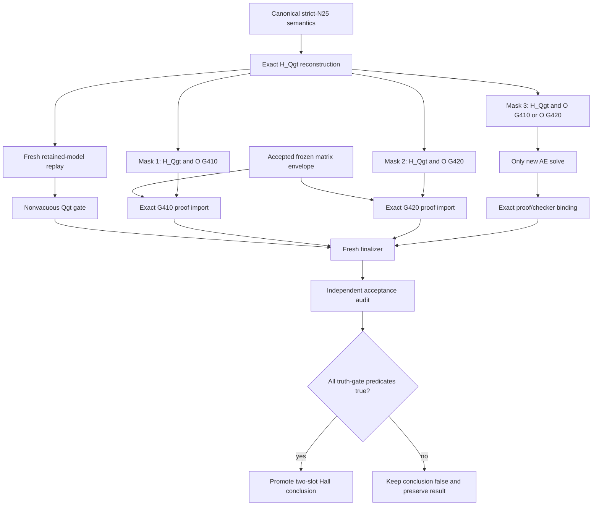

# Strict-N25 `Qgt` two-slot Hall evidence chain

## Current status

**Campaign status:** `ACCEPTED_TWO_SLOT_HALL_N25`

**Hall status:** `hall_conclusion_proof_qualified = true`

This report records the accepted two-slot Hall evidence chain attached to the
canonical strict-order-25 `Qgt` first-to-next transition.  Its two singleton
complements were imported from the frozen transition-conditioned
ordinary-state matrix with live-byte validation and without rerunning their
solvers or checkers.  The campaign freshly replayed the nonvacuity witness and
performed exactly one new solver run: the joint disjunctive mask.  That mask
was proved UNSAT, independently checked, freshly finalized, and independently
accepted with byte-equal replay.

The previously accepted matrix theorem remains frozen background:

\[
H_{\mathrm{Qgt}}
\Longrightarrow
\neg O[G410]\land\neg O[G420].
\]

The finalizer's Hall flag is guarded by exact nonvacuity, source-import, and
direct-proof predicates; it was not inferred from the singleton theorem alone.
Overall campaign acceptance additionally requires byte-equal independent
replay, unchanged external evidence, and a clean post-run filesystem audit.

## Exact formal setting

Let \(\Phi_{25}\) be the canonical strict-order-25 rank-3 signotope SAT
formula with the project path restrictions and weak shared-outer-endpoint
7-gon exclusion.  Let \(F(t)\) mean that endpoint \(t\) is
exceptional/full, and define

\[
A_v=TF[E411,\mathtt{path6\_before\_path5}](v),\qquad
B_w=T[E421,\mathtt{path6\_before\_path5}](w).
\]

Here \(A_v\) asserts both that \(v\) is the global first exceptional
endpoint and that it has typed state/orientation
`E411/path6_before_path5`.  The atom \(B_w\) asserts the typed
`E421/path6_before_path5` event at \(w\).  Define

\[
P(v,w)=A_v\land B_w\land v<w\land
\bigwedge_{v<t<w}\neg F(t).
\]

Thus \(w\) is the next exceptional endpoint after \(v\), rather than an
arbitrary later `E421` endpoint.  Write \(q_x\) for the unique minimum
path6/cup start decoded at endpoint \(x\).  The increasing-q relation is

\[
Qgt(v,w): q_w>q_v.
\]

The common hypothesis of every Hall mask is exactly

\[
H_{\mathrm{Qgt}}
:=\Phi_{25}\land
\exists v,w\,[P(v,w)\land q_w>q_v].
\]

Operationally, the encoding selects exactly one endpoint for each of the two
transition positions.  It retains firstness, nextness, both endpoint types
and orientations, and the strict q increase.  The Hall campaign must build
this antecedent through the canonical `QGT` transition constructor; a generic
two-occurrence antecedent, a merely later second event, a fixed gap, `Qeq`, or
`Qlt` is not interchangeable with \(H_{\mathrm{Qgt}}\).

For an ordinary state \(G\), let \(S[u,G]\) say that endpoint \(u\) has
state \(G\), and let

\[
O[G]\iff\bigvee_{u=1}^{25}S[u,G].
\]

This is global occupancy anywhere in the full 25-endpoint model.  It is not
occupancy at \(v\) or \(w\), between \(v\) and \(w\), or in a prefix or
suffix.

## Two slots and the three nonempty masks

The Hall graph has two exceptional-event slots and two distinct ordinary
targets:

\[
e_1=(v,E411/6{<}5),\qquad
e_2=(w,E421/6{<}5),
\]

\[
\Gamma(e_1)=\{G410\},\qquad
\Gamma(e_2)=\{G420\}.
\]

The slot names are proof-graph labels inside the shared exact hypothesis
\(H_{\mathrm{Qgt}}\); they do not weaken or independently reconstruct that
hypothesis.  For every nonempty slot subset, the canonical complement formula
is:

| mask | slot subset | exact complement formula | added occupancy clause |
| --- | --- | --- | --- |
| `1` | \(\{e_1\}\) | \(H_{\mathrm{Qgt}}\land O[G410]\) | `(333070,)` |
| `2` | \(\{e_2\}\) | \(H_{\mathrm{Qgt}}\land O[G420]\) | `(333072,)` |
| `3` | \(\{e_1,e_2\}\) | \(H_{\mathrm{Qgt}}\land(O[G410]\lor O[G420])\) | `(333070, 333072)` |

The joint mask is a **single positive disjunction**.  It must never be encoded
as the two units \(O[G410]\) and \(O[G420]\), because

\[
H_{\mathrm{Qgt}}\land O[G410]\land O[G420]
\]

being UNSAT would rule out only simultaneous occupancy.  It would not prove
that both target states are absent.  By contrast, UNSAT of

\[
H_{\mathrm{Qgt}}\land(O[G410]\lor O[G420])
\]

is exactly the joint complement of
\(\neg O[G410]\land\neg O[G420]\).

The full mask order is fixed as `[1, 2, 3]`; omissions, duplicates,
reordering, a swapped slot target, or any additional mask are evidence-schema
failures.

## Accepted theorem and proof obligation

> **Theorem (strict-N25 typed `Qgt` two-slot Hall relation).**
> In every model of \(\Phi_{25}\), suppose the global first exceptional
> endpoint \(v\) is `E411/path6_before_path5`, its next exceptional endpoint
> \(w\) is `E421/path6_before_path5`, and \(q_w>q_v\).  Then `G410` and
> `G420` are both globally absent.  Consequently the fixed assignment
> \(e_1\mapsto G410\), \(e_2\mapsto G420\) sends the two transition slots
> to two distinct missing ordinary-state types, and every nonempty subset of
> these two slots satisfies its corresponding two-slot Hall obligation.

Equivalently, the accepted logical conclusion is

\[
\Phi_{25}\models
\forall v,w\left(
P(v,w)\land q_w>q_v
\Longrightarrow
\neg O[G410]\land\neg O[G420]
\right).
\]

The existential formulation of \(H_{\mathrm{Qgt}}\) and this universal-pair
formulation do not differ in strength here.  The `TF` atom fixes the global
first exceptional endpoint, while the no-intermediate-exceptional condition
fixes its next exceptional endpoint, so a satisfying \(P(v,w)\) pair is unique
inside a model.

For a model \(X\), let

\[
M(X)=\{G:\neg O_X[G]\}.
\]

The theorem therefore implies, only for this two-slot typed pattern,

\[
\{G410,G420\}\subseteq M(X),\qquad |M(X)|\ge 2.
\]

The singleton implications were already supported by the accepted matrix
cells.  This campaign additionally constructed a sealed, complete three-mask
Hall artifact and supplied a direct proof of the joint disjunctive complement.
Its finalizer and independent auditor both accepted the result.

## Fresh nonvacuity gate

The Hall conclusion must not be inferred from an impossible transition
antecedent.  The retained complete `Qgt` model has the independently decoded
witness

\[
(v,w,w-v,q_v,q_w)=(11,14,3,1,2).
\]

Its frozen source bindings are:

| object | SHA-256 |
| --- | --- |
| Qgt parent formula | `161596318de66e9eefb2aed626299c3bbea9d0b7c5546b117bf62698c3f8d36a` |
| Qgt parent DIMACS | `5ca5bb9c0e46cf7791b57acc5a142727b9405bc5c4b8658f4025bf86f6a41987` |
| retained solver output | `e20efd29c1739e1b77b2c0b79ca1c7444ab2e0591c33bd8d4b2c3a7ac6ed05f3` |
| complete assignment | `73dd267ca954c1a4fc465af59e76ec44a69c1760c33741e8dd0ea18562489b5c` |
| reconstructed profile/coloring | `3533992eb58838a55bba780eb64f655d81e45f5e4cc7bb70c52e8174e273a384` |
| semantic SAT audit | `ae20e69dd2dad51184a760928dc18b9e3b127769935ac0ab7104540af5d53424` |
| mode-gate semantic identity | `e8b2e3ecd7e2d4c2b50b75c0da70a14b9442542c1b7dcfe02c78b66d7a2a9ef9` |

The retained model path is

```text
/data/ktqiu_hdd/math_agent/res/state_charging/
20260826_transition_obligations/solve/transition_qgt.out
```

The campaign independently reconstructed the exact parent, replayed the
complete assignment against every clause, recovered the typed first-to-next
transition and strict q increase, and reproduced the witness above.

**New-campaign replay state:** `AUDITED_SAT_N25`

The accepted final records gate SHA-256
`5f1611218ca04699e5d6a164bccbf828748549859532295d1eb28c4eab235f0b`.

## Imported singleton proof provenance

The singleton masks are exact formulas already solved and accepted in the
sealed 50-cell transition-conditioned ordinary-state matrix.  They must be
reconstructed byte-for-byte and imported as frozen provenance.  Neither
singleton solver nor singleton checker is to be rerun, and the import must
not be described as a new solve.

The authoritative source campaign is

```text
/data/ktqiu_hdd/math_agent/res/state_charging/
20260901_transition_conditioned_ordinary_matrix_v1
```

Its frozen envelope is:

| layer | serialized-file SHA-256 | semantic/content SHA-256 |
| --- | --- | --- |
| matrix final | `5dabfc807ce0d8c7d7f87d7c70a6df3b18f1a0b6a10ba81bbb8889c8247a5868` | `441354cb22b6b123de0e80809b222953dbddc75f620fbc01c9b7fa70765ceaed` |
| acceptance receipt | `baa2685ac63a339c2e662821899bf635ccdce71718f778346119609c2a65c638` | `bdb68aea11c0621bb8f92e5c35c5f24d8689809ae0a35fc423de1b3e2912a625` |
| campaign seal | `655d431242673a157e2cd523b921b6deebc1de1ea2d93ec1d7b2d676f816f944` | `091defcd7d41406261f4a432e6842ddc78f2ce92b097dfb9c75857bcfadafa3f` |
| suite manifest | `90541f9155c257cfa3dcd99e9b17f9780e39d4b79ed5f5dec93182c2c074fde3` | suite `03a93ec3fad67aef3f8ac5291377d293911cc356754a486f1683f53ef3fa5fe5` |
| runtime registry | - | `6c5e8d4a7d99aff79a11f25dd6636bc5f623533470b484eb3c5fcb628c121845` |

The exact singleton bindings are:

| field | mask `1`: `Qgt/G410` | mask `2`: `Qgt/G420` |
| --- | --- | --- |
| source case | `transition_ordinary_qgt_g410` | `transition_ordinary_qgt_g420` |
| accepted class | `VERIFIED_UNSAT_N25` | `VERIFIED_UNSAT_N25` |
| formula SHA-256 | `56b9c0782549a367ccdc2b13abde485fc38be23d537ce92c070eb3074bfc5e4c` | `7903b7d4911b6c66f3929775c2f68910dd753f6ece45e377c54b31719dc9454f` |
| DIMACS SHA-256 | `3bdbc16d77d60534579ac98d9ce93dd2c03c74e757ac2175d77baf539f532e3d` | `8f3130464cb594b080c55ea73a5e960686b64fb0a43c9b3908b1d84bfef970d5` |
| DIMACS bytes | `21,687,998` | `21,687,998` |
| status-file SHA-256 | `72874ccc290c17a2e9274599e8ad9ba451ef721d5d624964e9257915ed225f57` | `a104ec0669baa839d79600b37dbc6dfa6124a6dfd36ea02e114263a93303e96f` |
| proof SHA-256 | `803be3ff7e2a90b57faa44105203eba2b409a07c7da435e47a7252eec9b92642` | `25257e6ff3fc2f1b78fd2fa7b92d3cacc7cd1f4b7f86602696dc1fefadd5cf88` |
| proof bytes | `221,387,597` | `473,470,540` |
| checker-log SHA-256 | `69b3bab753ff6b8171bd7d4df4be4776a58bc2d71413f5b4f8a2fc04c2c4c73b` | `500e5429a7a19658e78d10fba8bea5098f4af27291944bbf903b686cd3ccca11` |
| current-campaign import state | `IMPORTED_VERIFIED_UNSAT_N25` | `IMPORTED_VERIFIED_UNSAT_N25` |
| import-attestation SHA-256 | `c0ff40576c69a69e04c299bb2746fdfdea3956c59c73f580c5e0019a6c0f6006` | `54dc9e032c23e990d9da7eb1ad72f48f0f7ce999f34ab8dc8f9aa8a8b4477c5d` |
| solver/checker rerun | `false / false` | `false / false` |

The retained proof bodies are respectively

```text
attempt00/solve/transition_ordinary_qgt_g410.proof
attempt00/solve/transition_ordinary_qgt_g420.proof
```

under the authoritative matrix root.  A valid import requires all of the
following:

1. reconstruct the singleton from the canonical Qgt parent plus its one
   positive occupancy unit;
2. require byte identity with the retained source DIMACS and equality of the
   formula identity;
3. live-hash the retained status, proof, and checker log;
4. verify that the recorded checker command names that exact DIMACS and proof
   and that the retained log has the unambiguous verdict `s VERIFIED`;
5. validate the matrix final and acceptance receipt against the frozen
   external anchors; and
6. record `solver_rerun=false` and `checker_rerun=false` for each import.

Any mismatch makes the import invalid.  A raw `UNSAT` status, a proof body
without its exact CNF binding, or a log detached from its recorded checker
command is insufficient.

## The sole new direct solve: joint disjunctive mask

The accepted solver schedule contained only mask `3`:

\[
C_{\{e_1,e_2\}}
=H_{\mathrm{Qgt}}\land(O[G410]\lor O[G420]).
\]

The canonical Qgt parent and joint identity have already been independently
reconstructed:

| field | fixed value |
| --- | --- |
| parent formula SHA-256 | `161596318de66e9eefb2aed626299c3bbea9d0b7c5546b117bf62698c3f8d36a` |
| parent base SHA-256 | `ad47f5d6c2630093aaf2f22443b1aedb73ab862dc2fc3b321e2faae488776549` |
| added clause | `(333070, 333072)` |
| added-clause SHA-256 | `cef3d8ffa60cdace93b101697f02e1f68698de1e66425315497f2c825a13ec1f` |
| joint formula SHA-256 | `83ac0109597d39514aefdcc364c121a1dc4ee78148bdbfb51c44a342c8fa819b` |
| joint DIMACS SHA-256 | `ee424e5a9a78b2989a971d475d94a60c33724cae5ac8f950889301e6b9c813db` |
| variables | `337,094` |
| clauses | `1,247,137` |
| parent supplemental clauses | `18,252` |
| joint supplemental clauses | `18,253` |
| DIMACS bytes | `21,688,005` |
| direct-solve state | `VERIFIED_UNSAT_N25` |
| raw status / return / timeout | `UNSAT / 20 / false` |
| solver elapsed | `604.9714680723846 s` |
| solver-output SHA-256 | `997a5966887c5d1172b59ae410a93419bb6101b1324c4b9bc96cd42c3ea66155` |
| status-file SHA-256 | `97c55def7bb92460d69dabad9cfdbb23b40731dcfa05d4b82ef3138899e8cc45` |
| proof SHA-256 / bytes | `9a36350c0644914db725d385034c60f64d3231bc109322d8a7cb74dee74b8d40 / 446,580,577` |
| checker verdict / elapsed | `s VERIFIED / 1,352.182 s` |
| checker-log SHA-256 | `ef90f0d4de994f0f67b268c24b3aadcad40220d58f7bb71c7d903a7a8da56663` |

No new variable is introduced.  The seven-byte DIMACS-size difference from a
singleton is consistent with replacing a positive unit by the two-literal
positive clause, but acceptance depends on the exact hashes above rather than
on size alone.

The pinned solver is

```text
/data/ktqiu_hdd/math_agent/AE_kissat2025_MAB/build/kissat
```

with SHA-256
`c2e44161cd142694f2b612e0be2dcc59cb656df6d42f8713adc4d05b9a22f5fa`.
The independent checker is

```text
/data/ktqiu_hdd/math_agent/res/state_charging/
20260822_unknown_resolution/any/ae_c2e44161_3600/adapter/proof_checker.snapshot
```

with SHA-256
`2f01df83916c158d7da43deefde1ea3ea60b19f5d636ae03f31042e88ef179e9`.

Mask `3` entered the final as `VERIFIED_UNSAT_N25` only after a nonempty proof
from the exact joint DIMACS and acceptance of that exact CNF/proof pair by the
pinned checker.  Overall campaign acceptance was withheld until the
independent fresh-replay audit.  The final artifact retained no `UNKNOWN` mask.

## Evidence truth gate

The finalizer's Hall flag and the overall accepted-campaign status are two
separate evidence layers.  In pseudocode, the permitted rules are:

```text
hall_conclusion_proof_qualified =
    exact_strict_n25_qgt_parent
    and canonical_mask_order == [1, 2, 3]
    and direct_solver_schedule == [3]
    and fresh_qgt_gate == AUDITED_SAT_N25
    and mask_1 == IMPORTED_VERIFIED_UNSAT_N25
    and mask_2 == IMPORTED_VERIFIED_UNSAT_N25
    and mask_3 == VERIFIED_UNSAT_N25
    and singleton_solver_rerun == false
    and singleton_checker_rerun == false
    and all_source_and_tool_hashes_match
    and unknown_mask_count == 0

accepted_two_slot_hall_n25 =
    hall_conclusion_proof_qualified
    and independent_acceptance_audit == accepted_fresh_replay
    and auditor_fresh_final_replay_byte_equal == true
    and auditor_external_evidence_unchanged == true
    and post_run_terminal_residue_count == 0
```

Every finalizer predicate is true in `hall_final.json`; every acceptance
predicate is true across the acceptance receipt and the separate terminal
filesystem inspection.

There is no inference-by-majority and no partial promotion.  In particular:

- the two accepted source proofs without valid current-campaign imports do
  not close this Hall artifact;
- a verified joint proof without fresh nonvacuity does not close it;
- the logical derivability of the joint clause from the two singleton
  theorems does not replace the requested direct joint proof/checker binding;
- a completed solver run without byte-equal independent final replay and
  acceptance remains unaccepted; and
- any `UNKNOWN` mask keeps `hall_conclusion_proof_qualified=false`.

The corresponding proof dependency graph is:



## Accepted proof roles

The paper-level proof has four distinct roles:

1. **Nonvacuity.**  The fresh SAT replay supplies an actual model of
   \(H_{\mathrm{Qgt}}\).
2. **Singleton complements.**  The two imported exact proofs establish
   \(H_{\mathrm{Qgt}}\Rightarrow\neg O[G410]\) and
   \(H_{\mathrm{Qgt}}\Rightarrow\neg O[G420]\), while preserving their
   original solver/checker provenance.
3. **Joint Hall mask.**  The sole new direct solve verifies the exact
   disjunctive complement and supplies a proof/checker-qualified artifact for
   the nonempty subset \(\{e_1,e_2\}\).
4. **Distinct-target conclusion.**  Since `G410 != G420`, the fixed slot map
   has two different missing targets, so this realized typed transition has at
   least two missing ordinary-state types.

These roles must remain separate in the final artifact.  In particular, the
fresh nonvacuity witness is not an UNSAT proof, and the imported singleton
proofs are not new solver executions.

## Scope and explicit nonclaims

This campaign is restricted to the canonical strict-N25 encoding and the
single typed first-to-next `Qgt` pattern above.  The accepted campaign does
not prove:

- a theorem for arbitrary order \(N\), a fresh-prefix formula, or any
  interval/suffix-relative occupancy notion;
- a theorem for `Qeq`, `Qlt`, or an exact \((q_v,q_w,w-v)\) partition;
- a theorem for arbitrary consecutive exceptional events, arbitrary later
  pairs, different event types, or different endpoint orientations;
- that the second event alone implies `G420` is missing;
- that exactly two ordinary states are missing or that no third state is
  forced absent;
- a three-slot Hall graph, a dynamic charging map, an occurrence-level
  injection for an arbitrary exceptional pattern, or the global inequality
  \(\#\{\text{missing ordinary states}\}\ge
  \#\{\text{exceptional occurrences}\}\);
- any new result for qv21, any rerun of a closed Qlt layer, or UNSAT of
  monolithic `Agt1`; or
- any triple-only theorem.

Qlt, the 50-cell transition matrix, and their evidence chains are frozen
inputs.  This campaign must not mutate or relabel those artifacts.

## Terminal result block

The machine-result values below are read from the compact snapshot's sealed
config/seal/manifest/final/receipt/status chain, not from an in-flight solver
log.  Conclusion fields come from the final and receipt.  The compact-archive
fields and terminal-residue count come from the separate post-run
transfer/filesystem audit.

| field | value |
| --- | --- |
| campaign root | `/data/ktqiu_hdd/math_agent/res/state_charging/20260901_qgt_two_slot_hall_v1` |
| campaign config file / semantic SHA-256 | `acad26152739be698a7173782a310e9ac8fb0b07925cfa4fad7a4646745957cb / 685cee8c193cbf54a681cffcfc03d0a586c9e8876e66f233278094cd1fb3b83d` |
| campaign seal file / semantic SHA-256 | `8078897d763cf811fc1254bb9d4783a83cb4ee7a067d4ea0ad78470e93cc8313 / dc612f0e00ff2d4a94eb3f9abc0b89501ac08028394566f62c738a51091c7945` |
| suite manifest file / semantic SHA-256 | `a373932ecf528afde949b12c4b5f67396568d1178aae6585e28639a1aed7e5b7 / 8d4f8e1741a5c89390d092799f6dfd6e9e0c683be027162814e8988b279dd966` |
| manifest shape | `1 gate + 3 masks = 4 cases`; direct schedule `[mask 3]` |
| registry SHA-256 | `fd65224e5fa83c2169e3fbec1381fefcfc98469752e3a23a62ae7c77fea4a49b` |
| runtime registry SHA-256 / files | `cd8711a7d35f40b920bc925c851746d1db33550d19d317b0622e7375e3a815cb / 33` |
| external registry SHA-256 / entries | `c76489cac133f11fa92bacf365d0e9647101607abeb7ef3c09dbea8b01fd3660 / 13` |
| remote-run / progress file SHA-256 | `b7b82ffc4bcc5830902b081d992ad60a3e0b3a0f4352fa5846a5f20a86096bc8 / cd8dc795d8981df18bbc1b97f8bbf375157cdb4b5a82438efda1855da5ccf25e` |
| summary file / semantic SHA-256 | `077458d8d5671d93890a16539b75fe94087eb6c1bb1cc0eac4cb8bddb28936a8 / e11ffa24fd95cd1f67cf9a0faca8b838f24ce134f1470ccec37d8060e16cd76a` |
| fresh Qgt nonvacuity gate | `AUDITED_SAT_N25`; witness `(11,14,3,1,2)` |
| mask `1` exact import | `IMPORTED_VERIFIED_UNSAT_N25` |
| mask `2` exact import | `IMPORTED_VERIFIED_UNSAT_N25` |
| mask `3` direct solve | `VERIFIED_UNSAT_N25`; only new solver run |
| mask `3` proof SHA-256 / bytes | `9a36350c0644914db725d385034c60f64d3231bc109322d8a7cb74dee74b8d40 / 446,580,577` |
| mask `3` checker-log SHA-256 | `ef90f0d4de994f0f67b268c24b3aadcad40220d58f7bb71c7d903a7a8da56663` |
| campaign final file / semantic SHA-256 | `386ae292b05df13e71ebae26c85b7fb296ca331403ff5b5b34f4da58a34b5bf0 / 9970b66fd5336665f470d283c7878dd003f12f548ef4986ba108f21527640ba2` |
| independent receipt file / semantic SHA-256 | `f3e1a2fb5fd9aa2401710ba7c86cb2ade8035b1843af27118a8ee75b276fe001 / 18d5b476f5eb3ca671a667722e17a08a6196d9e1f463ffaa750100ece6670653` |
| independent audit status | `accepted_fresh_replay` |
| fresh replay byte-equal / external evidence unchanged | `true / true` |
| classification counts | `2 IMPORTED_VERIFIED_UNSAT_N25 + 1 VERIFIED_UNSAT_N25` |
| terminal residue / UNKNOWN mask count | `0 / 0` |
| conclusion | `two_slot_Hall_relation_proof_qualified` |
| `hall_conclusion_proof_qualified` | `true` |
| authoritative Linux validation | four self-tests, core `26/26`, runtime `22/22`, launcher syntax pass |
| final local regression gate | Python compile `7/7`; tests `75/75`; Git Bash launcher syntax pass |
| compact local metadata/log snapshot | `tmp/qgt_two_slot_hall_server_20260901`; 17 extracted files plus the transfer archive, with no CNF/proof in the payload |
| compact archive SHA-256 / bytes | `4cec23f50b4a5749efed1c80b850b56232aef5833a32dd282a61bf2950a91183 / 235,520` |

### Terminal classification

```text
ACCEPTED_TWO_SLOT_HALL_N25
```

The accepted theorem text in the final artifact is:

> Under strict-N25 H_Qgt, the two slots e1->G410 and e2->G420 satisfy every
> nonempty Hall mask.

Its machine-recorded limit is:

> strict-N25 two-slot first-to-next Qgt only; no Qeq, exact-q/gap, three-slot,
> arbitrary occurrence, or global charging claim.

The local compact snapshot is a terminal metadata/log snapshot only.  The
authoritative CNFs and the 446,580,577-byte proof remain under the server
campaign root, so the compact snapshot must not be described as a complete
self-contained proof package.
