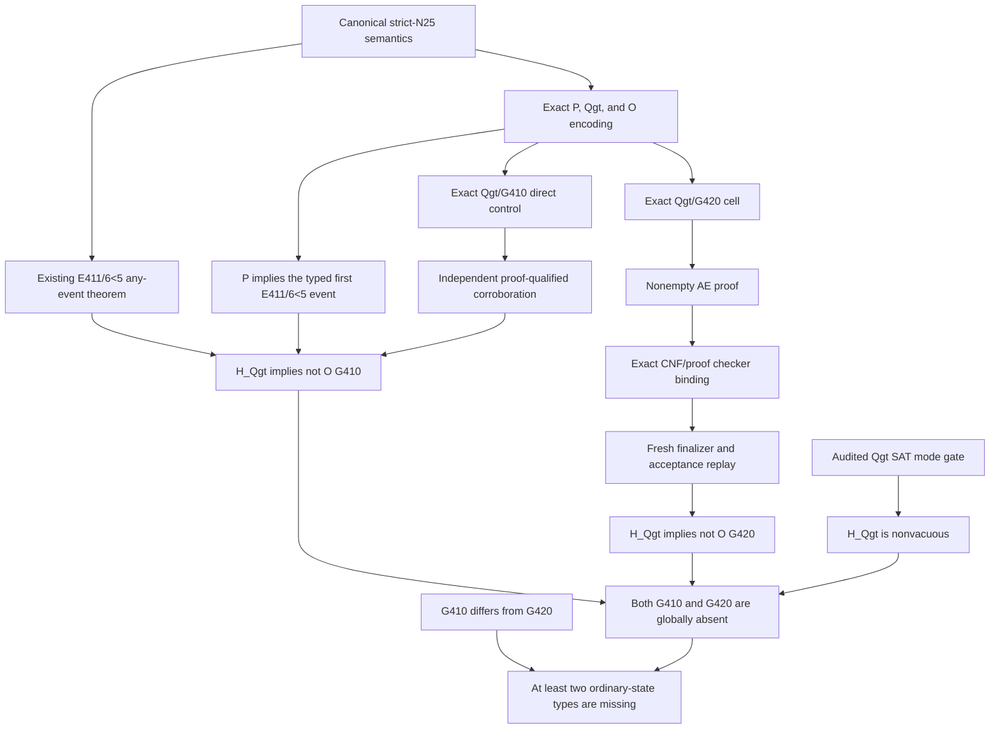

# Transition-conditioned ordinary-state matrix at strict order 25

## Status and main conclusion

The sealed `Qeq/Qgt x 25 ordinary states` campaign completed on 2026-09-01.
All 50 canonical cells were processed, finalized, and accepted by an
independent fresh replay.  The final classification is

\[
47\times\texttt{AUDITED\_SAT\_N25}
+3\times\texttt{VERIFIED\_UNSAT\_N25}
+0\times\texttt{UNKNOWN}.
\]

The only verified-UNSAT cells are

```text
Qeq/G410
Qgt/G410
Qgt/G420
```

Thus the coarse `Qeq` mode forces no single fixed ordinary-state absence
beyond the known `G410` control: every one of its 24 non-control target cells
has a SAT counterexample.  The coarse `Qgt` mode forces the additional,
distinct global absence of `G420`.  In the exact strict-N25 scope defined
below, the accepted result is

\[
H_{\mathrm{Qgt}}
\Longrightarrow
\neg O[G410]\land\neg O[G420].
\]

This is a two-distinct-state exclusion for one typed first-to-next transition
pattern.  It is not yet a Hall theorem or a charging injection across multiple
exceptional occurrences.

## Formal setting

Let \(\Phi_{25}\) denote the canonical strict-order-25 rank-3 signotope SAT
formula, including its path restrictions and weak shared-outer-endpoint
7-gon exclusion.  Let \(F(t)\) mean that endpoint \(t\) is exceptional/full,
and define

\[
A_v=TF[E411,\mathtt{path6\_before\_path5}](v),\qquad
B_w=T[E421,\mathtt{path6\_before\_path5}](w).
\]

Here \(A_v\) says that \(v\) is the global first exceptional endpoint and
has typed state/orientation `E411/path6_before_path5`; \(B_w\) says that
\(w\) has typed state/orientation `E421/path6_before_path5`.  The transition
predicate is

\[
P(v,w)=A_v\land B_w\land v<w\land
\bigwedge_{v<t<w}\neg F(t).
\]

Therefore \(w\) is the next exceptional endpoint after \(v\), not merely a
later co-occurring `E421` endpoint.  The SAT encoding selects exactly one
endpoint for each of the two slots.

Write `MinCup(x,r)` for the existing exact atom saying that the minimum
path6/cup start at endpoint \(x\) is \(r\), and write that unique decoded
minimum as \(q_x\).  The two remaining modes after the completed `Qlt`
exclusion are

\[
Qeq(v,w): q_w=q_v,\qquad Qgt(v,w): q_w>q_v.
\]

For a canonical ordinary state \(G\), let \(S[u,G]\) say that endpoint
\(u\) has state \(G\), and define global occupancy by

\[
O[G]\iff\bigvee_{u=1}^{25}S[u,G].
\]

This is occupancy anywhere in the full 25-endpoint model.  It is not
occupancy at \(v\) or \(w\), between \(v\) and \(w\), in a prefix, or in a
suffix.

For \(R\in\{Qeq,Qgt\}\), abbreviate the nonvacuous mode hypothesis by

\[
H_R:=\Phi_{25}\land
\exists v,w\,[P(v,w)\land R(v,w)].
\]

The exact matrix cell for mode \(R\) and ordinary state \(G\) is

\[
C_{R,G}:=H_R\land O[G].
\]

Operationally, every cell was built from a fresh canonical parent transition
formula plus exactly one positive global occupancy unit.  No exact
\((q_v,q_w,w-v)\) restriction occurs in this first-round registry.

The canonical ordinary-state order is

```text
G000 G100 G110 G111 G200 G210 G211 G220 G221 G222
G300 G310 G311 G320 G321 G322 G330 G331 G332 G333
G400 G410 G420 G430 G440
```

Its ordered projection SHA-256 is
`5bd8b4e70f79c9268762af1c8f32d482001bb0600380e26561cec10ac771a52d`;
the complete 50-case registry SHA-256 is
`5b606b34b37982cc1ab8c028015b6a8c30c37522730e69c6b9d7e856e13e45f5`.

## Evidence semantics

- `AUDITED_SAT_N25` means that a complete assignment satisfies every clause
  of the exact cell CNF and that an independent reconstruction recovers the
  required first-to-next transition, q relation, and target global occupancy.
- `VERIFIED_UNSAT_N25` means that the exact target CNF has a nonempty AE proof,
  the recorded independent checker accepts that exact CNF/proof binding, and
  the fresh finalizer and acceptance audit retain the result.
- `UNKNOWN` would support no mathematical conclusion.  There are no UNKNOWN
  cells in this campaign.

A SAT cell for \(G\) refutes the implication \(H_R\Rightarrow\neg O[G]\).
Different SAT cells may use different models: 24 individually SAT cells do
not assert that one model simultaneously occupies all 24 target states.

## Complete 2-by-25 matrix

In the table, `SAT` means `AUDITED_SAT_N25` and `VU` means
`VERIFIED_UNSAT_N25`.

| ordinary state | `Qeq` | `Qgt` |
| --- | --- | --- |
| `G000` | SAT | SAT |
| `G100` | SAT | SAT |
| `G110` | SAT | SAT |
| `G111` | SAT | SAT |
| `G200` | SAT | SAT |
| `G210` | SAT | SAT |
| `G211` | SAT | SAT |
| `G220` | SAT | SAT |
| `G221` | SAT | SAT |
| `G222` | SAT | SAT |
| `G300` | SAT | SAT |
| `G310` | SAT | SAT |
| `G311` | SAT | SAT |
| `G320` | SAT | SAT |
| `G321` | SAT | SAT |
| `G322` | SAT | SAT |
| `G330` | SAT | SAT |
| `G331` | SAT | SAT |
| `G332` | SAT | SAT |
| `G333` | SAT | SAT |
| `G400` | SAT | SAT |
| `G410` | **VU** | **VU** |
| `G420` | SAT | **VU** |
| `G430` | SAT | SAT |
| `G440` | SAT | SAT |

The mode totals and conclusions are:

| mode | audited SAT | verified UNSAT | UNKNOWN | forced missing states | new state other than `G410` |
| --- | ---: | ---: | ---: | --- | --- |
| `Qeq` | 24 | 1 | 0 | `G410` | none |
| `Qgt` | 23 | 2 | 0 | `G410`, `G420` | `G420` |
| total | 47 | 3 | 0 | - | `G420` under `Qgt` |

The runner used 31 freshly audited retained-parent-model replays and 19
external AE-kissat solves.  It processed all 50 cases in canonical order
without early stopping.

## Nonvacuity of the two modes

Both mode premises were freshly replayed as audited SAT before any cell UNSAT
was interpreted as an implication.

| mode | audited witness \((v,w,w-v,q_v,q_w)\) | parent formula SHA-256 | parent CNF SHA-256 | retained SAT output SHA-256 / bytes |
| --- | --- | --- | --- | --- |
| `Qeq` | `(16,17,1,1,1)` | `fe06748a0d108983a9fd8c5f282a7ab8fd23a883d1a9d9d062fc69d67274f323` | `a1957eaa9de2f1429ed01aedb8f31930d68b3ab7234a8051a8f2d2046e49be78` | `f86c014e464a3e9c9a5fe733abf053166fda99bdba0ad95ab4e84d0065fcb0f6` / 2,612,839 |
| `Qgt` | `(11,14,3,1,2)` | `161596318de66e9eefb2aed626299c3bbea9d0b7c5546b117bf62698c3f8d36a` | `5ca5bb9c0e46cf7791b57acc5a142727b9405bc5c4b8658f4025bf86f6a41987` | `e20efd29c1739e1b77b2c0b79ca1c7444ab2e0591c33bd8d4b2c3a7ac6ed05f3` / 2,605,043 |

The corresponding mode-gate semantic SHA-256 values are
`53fadebdf4d54e214d9f0153513b8103f531b6f9be04969f5a614a123f7884f1`
for `Qeq` and
`e8b2e3ecd7e2d4c2b50b75c0da70a14b9442542c1b7dcfe02c78b66d7a2a9ef9`
for `Qgt`.  Their independent audit SHA-256 values are respectively
`77c2cae4018e1ed30a33a83021fcf2dcadd60633099c4079c31b8cd4ec443d92`
and
`ae20e69dd2dad51184a760928dc18b9e3b127769935ac0ab7104540af5d53424`.
Thus neither `Qeq` nor `Qgt` is an impossible antecedent.

## Exact proof bindings for the three UNSAT cells

All three cases use 337,094 variables.  `Qeq/G410` has 1,272,437 clauses;
each `Qgt` case has 1,247,137 clauses.  The proof bodies remain on the
authoritative server, while the compact local snapshot retains their exact
paths, hashes, byte counts, statuses, and checker logs.

| exact cell | formula SHA-256 | DIMACS CNF SHA-256 | proof SHA-256 | proof bytes |
| --- | --- | --- | --- | ---: |
| `Qeq/G410` | `7c07f8033477d4848ab4a10a6a070068a23102bdb5de0ddc68c717922ad85144` | `a6b842e0279e3dfd8b336d38a58eff3c104fa900880f3525c7c6da92db2c0636` | `982b572687616a88fd1c22ed086f85f1ac73267d66498574b9e43b0e1b0d3971` | 238,038,498 |
| `Qgt/G410` | `56b9c0782549a367ccdc2b13abde485fc38be23d537ce92c070eb3074bfc5e4c` | `3bdbc16d77d60534579ac98d9ce93dd2c03c74e757ac2175d77baf539f532e3d` | `803be3ff7e2a90b57faa44105203eba2b409a07c7da435e47a7252eec9b92642` | 221,387,597 |
| `Qgt/G420` | `7903b7d4911b6c66f3929775c2f68910dd753f6ece45e377c54b31719dc9454f` | `8f3130464cb594b080c55ea73a5e960686b64fb0a43c9b3908b1d84bfef970d5` | `25257e6ff3fc2f1b78fd2fa7b92d3cacc7cd1f4b7f86602696dc1fefadd5cf88` | 473,470,540 |

The shared independent checker is

```text
/data/ktqiu_hdd/math_agent/res/state_charging/20260822_unknown_resolution/any/ae_c2e44161_3600/adapter/proof_checker.snapshot
```

with SHA-256
`2f01df83916c158d7da43deefde1ea3ea60b19f5d636ae03f31042e88ef179e9`.
For each row, the checker command is bound in the final artifact to that
row's exact DIMACS path and proof path, and its log contains the unambiguous
verdict `s VERIFIED`.  The checker-log bindings are:

| exact cell | proof/check log SHA-256 | downloaded log bytes | AE elapsed seconds |
| --- | --- | ---: | ---: |
| `Qeq/G410` | `303e0536033dd677f17ab13e46d0be4e960e6fb0c861962c30ac441652110891` | 399 | 231.788 |
| `Qgt/G410` | `69b3bab753ff6b8171bd7d4df4be4776a58bc2d71413f5b4f8a2fc04c2c4c73b` | 399 | 202.450 |
| `Qgt/G420` | `500e5429a7a19658e78d10fba8bea5098f4af27291944bbf903b686cd3ccca11` | 400 | 568.110 |

The exact proof paths, under campaign root
`/data/ktqiu_hdd/math_agent/res/state_charging/20260901_transition_conditioned_ordinary_matrix_v1/attempt00/solve/`,
are `transition_ordinary_qeq_g410.proof`,
`transition_ordinary_qgt_g410.proof`, and
`transition_ordinary_qgt_g420.proof`.

## The decisive `Qeq/G420` counterexample

The new `G420` exclusion cannot be extended from `Qgt` to all nondecreasing
transitions.  The exact cell

\[
C_{Qeq,G420}=H_{Qeq}\land O[G420]
\]

is audited SAT.  Its independently reconstructed witness is

\[
(v,w,w-v,q_v,q_w)=(9,11,2,1,1),
\]

with `G420` globally occupied at endpoint 8.  Its evidence bindings are:

| object | SHA-256 |
| --- | --- |
| exact formula | `41be2c75ece497802242c9092966b694bb0688b091497dce1b1a3dbab23bf38a` |
| exact CNF | `0767f4f4419cc9a3ad6309982f8a7e9e39eccbcae1d7c784b7194866a7894ce7` |
| solver output | `157636082ba5b584752f70558c34d74ec113a10bdf33166c700bac577af49d98` |
| complete assignment | `01f8cc69ca3b5a9897e23be4101411f4b4df973e52176206c66ac834ac6cf2b4` |
| reconstructed profile/coloring | `33a4ca73949a3cb2a248d9bd5945cc7a196a321e9516ac0f83ba29c8ba78173b` |
| SAT audit file | `10b5594d691b9ed406f88109df51484921fb181da46898e82964a713258d59a0` |
| SAT audit semantic | `befab3cd689ae91be4cfe5b285dc3afc7a8e9641fa3ca6229f1edcd30a9dec2a` |

This witness establishes only that `G420` can occur under `Qeq`; it does not
identify a common model for all 24 SAT targets.

## Theorem: two distinct global absences under `Qgt`

**Theorem (strict-N25 `Qgt` two-state exclusion).**  In every model of
\(\Phi_{25}\), if the global first exceptional endpoint \(v\) is
`E411/path6_before_path5`, its next exceptional endpoint \(w\) is
`E421/path6_before_path5`, and \(q_w>q_v\), then the two distinct ordinary
states `G410` and `G420` are both globally absent.  Equivalently,

\[
\Phi_{25}\models
\forall v,w\,
\left(
P(v,w)\land q_w>q_v
\Longrightarrow
\neg O[G410]\land\neg O[G420]
\right).
\]

In particular, if \(M(X)=\{G:\neg O_X[G]\}\) is the set of canonical
ordinary-state types globally missing from a model \(X\), then

\[
H_{Qgt}\Longrightarrow
\{G410,G420\}\subseteq M(X),
\qquad |M(X)|\geq2.
\]

### Proof

The exact `Qgt/G420` cell is

\[
\Phi_{25}\land
\exists v,w\,[P(v,w)\land q_w>q_v]\land O[G420].
\]

Its nonempty AE proof is accepted against the exact bound CNF by the pinned
independent checker and survives the byte-equal fresh finalizer replay.
Hence this formula is UNSAT, which is precisely
\(H_{Qgt}\Rightarrow\neg O[G420]\).

For `G410`, the retained any-event theorem gives

\[
E411/\mathtt{path6\_before\_path5}\Longrightarrow\neg O[G410].
\]

The predicate \(P(v,w)\) contains that typed first event at \(v\), so
antecedent strengthening gives
\(H_{Qgt}\Rightarrow\neg O[G410]\).  The new exact `Qgt/G410` direct proof
independently confirms the same stronger cell; it is a redundant control, not
a proof that the second event alone causes `G410` absence.

Combining the two implications gives the displayed conjunction.  Since
`G410` and `G420` are different state tokens, both belong to \(M(X)\), so
\(|M(X)|\geq2\).  Finally, the audited Qgt witness
\((v,w,w-v,q_v,q_w)=(11,14,3,1,2)\) proves that the antecedent is realizable,
so the implication is not vacuous. \(\square\)

The two proof roles must not be conflated:

- `G420` is a direct complement solve for the exact joint
  `P and Qgt and O[G420]` cell;
- `G410` follows from the older any-event theorem by antecedent
  strengthening/clause inclusion, with the exact `Qgt/G410` solve as an
  independent proof-qualified control;
- mode nonvacuity comes from a separate audited SAT gate; and
- the lower bound two is a propositional conjunction plus
  `G410 != G420`.

## Proof dependency graph



## Immutable hash chain and fresh acceptance

The lightweight evidence snapshot is
`tmp/transition_ordinary_matrix_server_20260901/`.  The heavy DIMACS and
proof bodies remain on the authoritative server.  The accepted chain is:

| layer | serialized-file SHA-256 | semantic/content SHA-256 |
| --- | --- | --- |
| source transition suite | - | `9f6f7042554cc63a46eeadc3faa927aebe38f8fc278f690506328526ada14be8` |
| runtime registry | - | `6c5e8d4a7d99aff79a11f25dd6636bc5f623533470b484eb3c5fcb628c121845` |
| campaign config | `22914e164bee11a081ea93ababfa8d33049491d00395b9a0f9bcbd833d2374bf` | `85cd419760dd832897b9ea23799ff879ba821b539a6f2bfe37c225cd0ac53655` |
| campaign seal | `655d431242673a157e2cd523b921b6deebc1de1ea2d93ec1d7b2d676f816f944` | `091defcd7d41406261f4a432e6842ddc78f2ce92b097dfb9c75857bcfadafa3f` |
| suite manifest | `90541f9155c257cfa3dcd99e9b17f9780e39d4b79ed5f5dec93182c2c074fde3` | suite `03a93ec3fad67aef3f8ac5291377d293911cc356754a486f1683f53ef3fa5fe5` |
| progress | `504f6a0740e330afd541fe003050f94039eba7d2ff53b494a5c953626ca2a1fe` | - |
| remote run | `9eaafb7a2de0f7777a7a5a613abe4258615b8ac8af7cd2dafe74530d7f74e7c2` | - |
| campaign summary | `da6142a8fa8f486b996f9bac3dc8bcded321cd1bf02ece99ab81a1c13b156409` | `713f7140c9824186ea8d255e340a75e8064384d3097b6804b37cb485ed1c0908` |
| matrix final | `5dabfc807ce0d8c7d7f87d7c70a6df3b18f1a0b6a10ba81bbb8889c8247a5868` | `441354cb22b6b123de0e80809b222953dbddc75f620fbc01c9b7fa70765ceaed` |
| acceptance audit | `baa2685ac63a339c2e662821899bf635ccdce71718f778346119609c2a65c638` | `bdb68aea11c0621bb8f92e5c35c5f24d8689809ae0a35fc423de1b3e2912a625` |

The solver binary SHA-256 is
`c2e44161cd142694f2b612e0be2dcc59cb656df6d42f8713adc4d05b9a22f5fa`;
the checker SHA-256 is the value recorded in the preceding proof section.
The independent receipt has

```text
status = accepted_fresh_replay
fresh_replay_byte_equal = true
all_mode_premises_audited_sat = true
qlt_evidence_mutated = false
monolithic_Agt1_claim = false
Hall_composition_claim = false
```

It re-finalized the campaign and found the fresh final bytes identical to the
accepted matrix final.  The 116-file compact snapshot archive SHA-256 is
`ab3b849c9b66de2ef554bb07b60de9f5449a937022eecd43baf2d48844bb2174`.

## Theorem boundary and explicit nonclaims

This report proves only the displayed implication inside the canonical
strict-N25 encoding.  In particular, it does not establish any of the
following:

- a theorem for `Qeq`; the audited `Qeq/G420` model is an explicit
  counterexample;
- a theorem for arbitrary consecutive exceptional events, later event pairs,
  other exceptional state types, or other endpoint orientations;
- `E421/path6_before_path5 -> not O[G420]` by itself; `G420` needs the full
  joint `P and Qgt` antecedent;
- a statement for arbitrary \(N\), a fresh-prefix formula, or a local
  interval/suffix notion of occupancy;
- that exactly two states are missing, or that `G410` and `G420` are the only
  missing states;
- an occurrence-level injection, a multi-event charging map, any Hall-subset
  theorem, or
  \(\#\{\text{missing ordinary states}\}\geq
  \#\{\text{all exceptional occurrences}\}\);
- UNSAT of monolithic `Agt1`, which was not rerun; or
- any new `Qlt` layer, qv21 result, or triple-only theorem.

The completed fixed-pair `Qlt` chain is frozen context.  Its role here is only
to exclude the decreasing branch and thereby justify the exhaustive coarse
split into `Qeq` and `Qgt`.

## Next proof-engineering gate

### Two-slot Hall masks

For the `Qgt` pattern, provisionally assign two slots

\[
\Gamma(e_1)=\{G410\},\qquad
\Gamma(e_2)=\{G420\}.
\]

The minimal proof-qualified two-slot suite consists of the already audited
SAT nonvacuity gate for \(H_{Qgt}\) and the three nonempty masks:

\[
\begin{aligned}
\{e_1\}:&\quad H_{Qgt}\land O[G410],\\
\{e_2\}:&\quad H_{Qgt}\land O[G420],\\
\{e_1,e_2\}:&\quad
H_{Qgt}\land\bigl(O[G410]\lor O[G420]\bigr).
\end{aligned}
\]

All three falsifiers must be UNSAT in the Hall evidence chain.  The joint
mask must use the disjunction: the conjunction
\(O[G410]\land O[G420]\) would only rule out simultaneous presence and would
not prove that both targets are absent.  The two singleton implications
mathematically imply the joint mask, but the project should still retain
either a direct proof/checker/finalizer record for every nonempty mask or an
auditable formal proof-composition certificate.  Until that artifact exists,
`Hall_composition_claim` remains false.

### Role of exact q/gap localization

The coarse `Qgt/G420` theorem already quantifies over every exact
\((q_v,q_w,w-v)\) realization satisfying \(q_w>q_v\).  Exact-q/gap
enumeration is therefore not required to make this theorem true.  Its useful
roles are to localize the mechanism, compress the edge into a human-readable
lemma, search for a third distinct charge, and select promising three-event
patterns.

For `Qeq`, all 24 non-`G410` coarse cells are SAT, so there is no uniform
second target.  A later dynamic search may nevertheless find different
targets on different exact \((q_v,q_w,w-v)\) partitions.  That search should
first tabulate the triples actually realized by the retained audited models,
identify empirical zero cells, eliminate candidates with fast SAT
counterexamples, and reserve AE proof/checking for the residual candidates.

Triple-only remains paused unless a later verified UNSAT edge needs
compression into a readable mathematical lemma.
