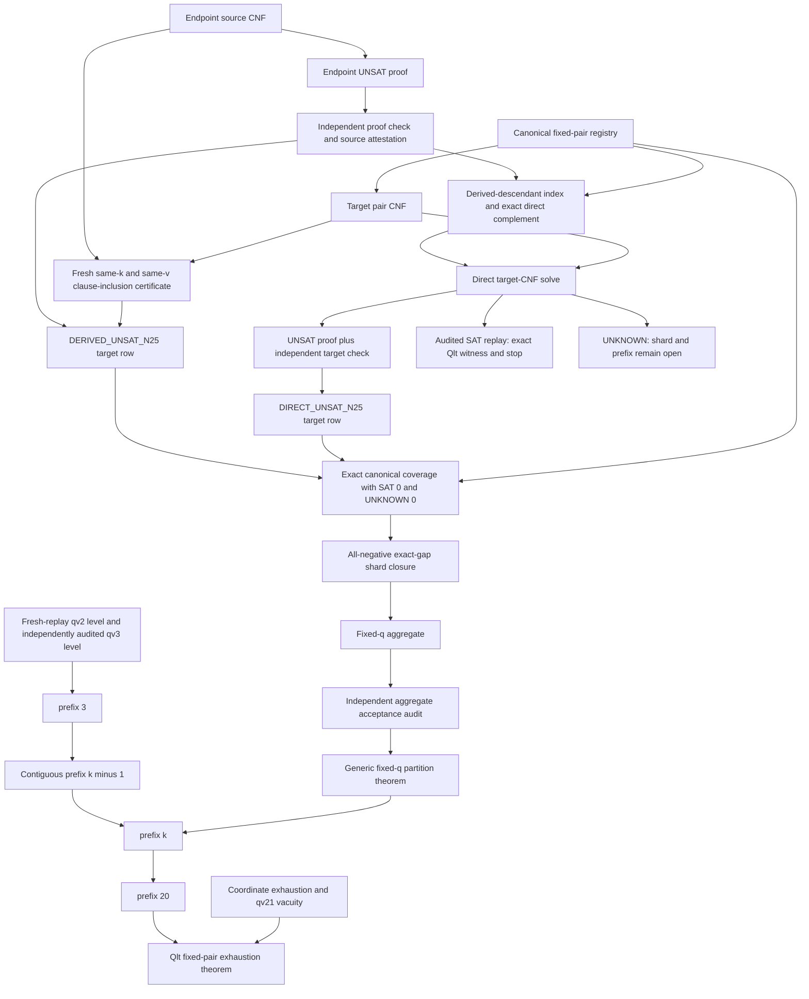

# Fixed-pair exhaustion theorem for `Qlt` at strict order 25

## Status and scope

This document freezes the completed fixed-pair proof of `Qlt` exclusion on
2026-09-01.  It is a proof map for the retained evidence, not a request to
produce new evidence.  In particular:

- `q_v=20` is the last nonvacuous fixed-q level;
- no `q_v=21` campaign is defined or required;
- no closed endpoint, pair, aggregate, audit, or prefix layer is to be rerun;
- the historical series launcher is retained only as provenance and is not to
  be executed again; and
- the conclusion is `Qlt` exclusion under the strict-N25 fixed-pair encoding,
  not UNSAT of the separate monolithic `Agt1` relaxation.

The terminal theorem identifier is

```text
Qlt_excluded_by_fixed_qv2_to_qv20_partitions
```

## Formal setting

Let `T0` be the strict-N25 CNF for the complete first-to-next transition
predicate.  With

\[
A_v=TF[E411,\mathtt{path6\_before\_path5}](v),\qquad
B_w=T[E421,\mathtt{path6\_before\_path5}](w),
\]

and with \(F(t)\) denoting that endpoint \(t\) is exceptional/full, its
selected endpoints satisfy

\[
P(v,w)=A_v\land B_w\land v<w\land
\bigwedge_{v<t<w}\neg F(t).
\]

Write \(M(x,r)\) for the existing exact atom `MinCup(x,r)`, so that in a
valid decoded model it states that the path6/cup minimum at endpoint \(x\) is
exactly \(r\).  For integers \(k,\ell,v,w\), define the fixed-pair target

\[
\Phi_{k,\ell,v,w}
=T0\land \operatorname{sel}_A(v)\land \operatorname{sel}_B(w)
\land M(v,k)\land M(w,\ell).
\]

The canonical coordinate set at fixed \(q_v=k\) is

\[
\mathcal D_k=
\{(\ell,v,w):1\leq \ell<k,\ k+4\leq v<w\leq25\}.
\]

The exact gap \(g=w-v\) is recorded as an identity field, so the operational
order is \((k,\ell,g,v)\).  It does not change the mathematical set.

For endpoint reuse, let \(E_{k,v}\) denote the proof source associated with
the same \(k\) and first endpoint \(v\).  There are two construction families:

- for `q_v=3` and generic `q_v=4..20`,
  \(E_{k,v}=T0\land\operatorname{sel}_A(v)\land M(v,k)\);
- for legacy `q_v=2`, the source is the first-slot `A0` formula plus
  \(\operatorname{sel}_A(v)\) and \(M(v,2)\).  Its `A0` clauses are certified
  as the exact first-slot prefix of the target `T0` clauses.

The historical qv2 endpoint-only suite also retained a diagnostic source at
\(v=25\).  It has no legal descendant \(w>v\), so it is not one of the 19
canonical first-endpoint coordinates in \(\mathcal D_2\) and contributes no
pair row.

This distinction is constructional.  The reusable logical property in both
families is the checked clause inclusion

\[
\operatorname{Clauses}(E_{k,v})
\subseteq
\operatorname{Clauses}(\Phi_{k,\ell,v,w}).
\]

## Lemma 1: the fixed-pair coordinates are disjoint and exhaustive

Every strict-N25 `Qlt` witness belongs to exactly one
\(\mathcal D_k\), with \(2\leq k\leq20\).

### Proof

For a `Qlt` witness, \(q_w<q_v\), while every legal minimum is a positive
integer.  Hence, with \(k=q_v\) and \(\ell=q_w\),
\(k\geq2\) and \(1\leq\ell<k\).  The five-vertex path6 witness underlying a
minimum \(k\) forces \(v\geq k+4\).  The next exceptional endpoint satisfies
\(v<w\leq25\), hence \(v\leq24\) and therefore \(k\leq20\).

The exact `MinCup` atoms and selected endpoints determine
\((k,\ell,v,w)\) uniquely, so two distinct coordinates cannot contain the
same model.  Conversely, a satisfying assignment of
\(\Phi_{k,\ell,v,w}\), for a coordinate in \(\mathcal D_k\), satisfies the
complete `T0` next-event semantics and \(\ell<k\), and is therefore an
encoded `Qlt` witness.  Thus the formulas indexed by
\(\bigsqcup_{k=2}^{20}\mathcal D_k\) form an exact disjoint partition of
`Qlt`.  Finally, at \(k=21\) the lower bound gives \(v\geq25\), which is
incompatible with \(v<w\leq25\).  There is no nonvacuous `q_v=21` level.
\(\square\)

For a fixed \(k\) and \(\ell\), the number of endpoint pairs is

\[
\sum_{v=k+4}^{24}(25-v)=\binom{22-k}{2}.
\]

There are \(k-1\) choices of \(\ell\), giving
\(|\mathcal D_k|=(k-1)\binom{22-k}{2}\).  The complete count is:

| \(k=q_v\) | # \(q_w\) values | # first endpoints | # exact gaps | pairs per \(q_w\) | pairs | cumulative |
| ---: | ---: | ---: | ---: | ---: | ---: | ---: |
| 2 | 1 | 19 | 19 | 190 | 190 | 190 |
| 3 | 2 | 18 | 18 | 171 | 342 | 532 |
| 4 | 3 | 17 | 17 | 153 | 459 | 991 |
| 5 | 4 | 16 | 16 | 136 | 544 | 1,535 |
| 6 | 5 | 15 | 15 | 120 | 600 | 2,135 |
| 7 | 6 | 14 | 14 | 105 | 630 | 2,765 |
| 8 | 7 | 13 | 13 | 91 | 637 | 3,402 |
| 9 | 8 | 12 | 12 | 78 | 624 | 4,026 |
| 10 | 9 | 11 | 11 | 66 | 594 | 4,620 |
| 11 | 10 | 10 | 10 | 55 | 550 | 5,170 |
| 12 | 11 | 9 | 9 | 45 | 495 | 5,665 |
| 13 | 12 | 8 | 8 | 36 | 432 | 6,097 |
| 14 | 13 | 7 | 7 | 28 | 364 | 6,461 |
| 15 | 14 | 6 | 6 | 21 | 294 | 6,755 |
| 16 | 15 | 5 | 5 | 15 | 225 | 6,980 |
| 17 | 16 | 4 | 4 | 10 | 160 | 7,140 |
| 18 | 17 | 3 | 3 | 6 | 102 | 7,242 |
| 19 | 18 | 2 | 2 | 3 | 54 | 7,296 |
| 20 | 19 | 1 | 1 | 1 | 19 | 7,315 |

Equivalently,

\[
\sum_{k=2}^{20}(k-1)\binom{22-k}{2}
=\binom{22}{4}=7315.
\]

## Lemma 2: same-`v` clause inclusion transfers endpoint UNSAT

Suppose the endpoint CNF \(E_{k,v}\) has a proof-qualified UNSAT result and a
fresh certificate verifies

\[
\operatorname{Clauses}(E_{k,v})
\subseteq
\operatorname{Clauses}(\Phi_{k,\ell,v,w})
\]

for the same \(k\) and the same first endpoint \(v\).  Then
\(\Phi_{k,\ell,v,w}\) is UNSAT.

### Proof

Clause inclusion gives the implication
\(\Phi_{k,\ell,v,w}\Rightarrow E_{k,v}\): every assignment satisfying the
stronger target CNF would satisfy every source clause.  Such an assignment
cannot exist because \(E_{k,v}\) is UNSAT.  Therefore the target is UNSAT.
\(\square\)

The certificate checks more than the displayed implication: the base CNF,
first-slot or `T0` prefix, fixed-q identity, first endpoint, shared selector,
shared `MinCup` literal, formula hashes, and CNF hashes are all bound.  A
source at \(w\), at another \(k\), or with SAT/UNKNOWN status cannot be used.
The resulting target classification is `DERIVED_UNSAT_N25`; it has
`direct_proof=false`.  The endpoint proof remains a proof of the source CNF
and must never be described as a proof emitted for the target CNF.

## Direct complement and row closure

For the qv3 and generic qv4..qv20 campaign planners, the direct set is exactly
the canonical complement of descendants supported by individually verified
same-\(k\), same-\(v\) endpoint rows.  Every coordinate in that complement is
solved as its own target CNF \(\Phi_{k,\ell,v,w}\):

- target UNSAT is accepted only with a nonempty proof, exact CNF/proof/command
  binding, and an independent checker verdict;
- target SAT is accepted only after complete model and semantic replay and
  would establish `Qlt` realizability on that exact coordinate; and
- UNKNOWN leaves the coordinate, shard, aggregate, and prefix open.

The legacy qv2 campaign predates the uniform complement planner.  In
particular, its 37 gap-one/gap-two rows were already retained as direct
proofs, even where endpoint reuse could in principle have been available.
Its final aggregate nevertheless has disjoint direct and derived rows with
exact canonical coverage.  Thus “direct complement” is exact for qv3 and
qv4..qv20; qv2 uses the separately validated, immutable hash-bound legacy
aggregate.

The logical roles of the five evidence layers are deliberately different:

| Layer | Object proved or checked | Permitted conclusion |
| --- | --- | --- |
| endpoint proof | the source CNF \(E_{k,v}\) | only that endpoint source is UNSAT |
| same-`v` inclusion | source clauses are a subset of one target CNF | endpoint UNSAT transfers to that one target |
| direct complement solve | the exact target CNF \(\Phi_{k,\ell,v,w}\) | direct SAT/UNSAT/UNKNOWN for that pair |
| fixed-q aggregate or legacy level record | every canonical coordinate in \(\mathcal D_k\) occurs once, negative, with no SAT/UNKNOWN | `q_v=k` fixed-pair partition excluded |
| cumulative prefix | a contiguous sequence of accepted fixed-q levels with external file/semantic hash bindings | only the listed prefix excluded; full `Qlt` only at prefix 20 |

## Proposition 3: fixed-q aggregate theorem

Fix \(k\in\{2,\ldots,20\}\).  If the accepted fixed-q evidence contains
every coordinate of \(\mathcal D_k\) exactly once, every row is either
direct proof-verified UNSAT or endpoint-derived UNSAT under Lemma 2, there are
zero audited SAT and zero UNKNOWN rows, all required partition components are
closed, and the level passes its protocol-specific acceptance gate, then no
`Qlt` witness has \(q_v=k\).  The applicable gates are the immutable,
fresh-replayed and hash-bound legacy aggregate gate for qv2, the legacy
campaign-summary plus independent-audit gate for qv3, and the generic
aggregate plus independent-audit gate for qv4..qv20.

### Proof

Each canonical coordinate formula is UNSAT by either its target proof or
Lemma 2.  Exact, duplicate-free level coverage makes their disjunction
UNSAT.  By Lemma 1, that disjunction is exactly the `Qlt` slice with
\(q_v=k\).  The applicable legacy gate or independent audit establishes that
the retained level evidence and its proof/certificate bindings are the
objects just described.
\(\square\)

An endpoint wave alone is not a fixed-q theorem.  In particular, an endpoint
SAT row is not a fixed-pair witness, and an endpoint UNKNOWN row does not
derive any pair.  The theorem boundary is the accepted complete pair-level
record, not the endpoint wave.

## Theorem 4: cumulative fixed-pair exhaustion of `Qlt`

Assume the strict-N25 encoding and the retained proof/checker attestations.
The accepted contiguous fixed-q level evidence for
\(q_v=2,\ldots,20\) implies that the encoded `Qlt` obligation is UNSAT.

Equivalently, within the canonical strict-N25 transition semantics, every
selected \(A_v\)-to-\(B_w\) first-to-next transition in this encoded
E411/E421 event pattern satisfies \(q_w\geq q_v\).

### Proof

The legacy `prefix[3]` binds the freshly validated, hash-anchored qv2 190-pair
aggregate and the independently audited qv3 342-pair campaign summary.  By
Proposition 3, no `Qlt` witness has \(q_v=2\) or \(q_v=3\).

For \(k=4,\ldots,20\), inductively suppose `prefix[k-1]` excludes all levels
\(q_v=2,\ldots,k-1\).  Prefix extension accepts only the next all-negative
aggregate at exactly \(q_v=k\), together with its independent audit, and
binds the predecessor prefix, aggregate, and audit by both serialized-file
and semantic SHA-256.  Proposition 3 excludes level \(k\), so `prefix[k]`
excludes every level \(2,\ldots,k\).  This proves the invariant through
`prefix[20]`.

The terminal prefix therefore excludes all 7,315 coordinate formulas.  By
Lemma 1, those formulas are a disjoint exhaustive partition of every
nonvacuous `Qlt` witness.  Hence `Qlt` is excluded. \(\square\)

The observed pair-evidence distribution is:

| fixed-q scope | pairs | direct target proofs | same-`v` derived rows |
| --- | ---: | ---: | ---: |
| qv2 legacy | 190 | 107 | 83 |
| qv3 | 342 | 24 | 318 |
| qv4..qv20 | 6,783 | 0 | 6,783 |
| total | 7,315 | 131 | 7,184 |

## Proof dependency graph



For qv2, the direct branch in this graph includes the proof-verified historical
gap-one/gap-two rows rather than only the minimal complement.  This does not
change the disjoint row union or the aggregate theorem.

## Frozen terminal evidence

The compact terminal snapshot is
`tmp/qlt_qv20_final_server_20260901/`.  It omits the large CNFs and proofs but
retains the terminal qv20 records, all qv5..qv20 controller receipts and
stdout/stderr bindings, the final prefix, controller final, lock-state
records, and the successful launcher exit/log.  The complete earlier-q anchor
history is recorded in `reports/state_charging_progress_20260827.md`.

| Object | serialized-file SHA-256 | semantic/self SHA-256 |
| --- | --- | --- |
| qv20 endpoint final | `93692e709a0c562ecf8a426cb18f432daa09cd2adfcda8c96ca5965d3ccd68ad` | `9b9e5707e66a497923aec5587ef569469802365505fea9a169681ff8cd623f79` |
| qv20 pair seal | `bf305ee20b593eb55d9b07f00a84d5ea28a400e576b5460e6f95357b6d0e3346` | `776bd6af63d2bdfb6d718fb20af93433c6548de2077011d0da5dcc6f1b4b8d49` |
| qv20 pair summary | `9b1eb4116b08dbd8a97cb37b0408e4f7a3b1048065ca04279728c3357fb55dd3` | `c1a1d591f3c3c8348a666321590f8bd74e7f295887b172345ec362be6bc1dd86` |
| qv20 fixed-q aggregate | `3f8a916fac8c6fcd66b8b0279d96bbcef769c24bad622e9f9ff04da2c365ef7c` | `c28532cf1ce7317ef408b3a0f3b21f56d259770070aaa56a3a495d385562ad47` |
| qv20 independent audit | `1427015df81ba5f631e04c21b660a610de98d4561f69643f0197e961e48e5f65` | `3c2f3c46b8cbc4e794ee9e3f26e3d330c4ecba178b950828886159d3fc32a96c` |
| terminal `prefix[20]` | `fab29aa1408f31db1999af64b7841ac92d04480de099a591604ec346a0507f54` | `9663bd0916cbf5cb2cae4c533d62c3aa5fab6218ca1e736ba2f82b26eb863cc4` |
| `series_final` | `a7e54ace52d90cfd97666d5a33b51d6bec2c060a7e86a265169908ed8a6e4c8f` | `6f214674c0649b209fed93953005ba596dbe5142c758e12304281f6992b24d8a` |

The retained series has 112/112 succeeded stage receipts, 112/112 zero exits,
and 224 stdout/stderr byte bindings.  The historical resume launcher has
SHA-256
`2a8edcb55531a515675c9bf246e8dbe01234e9bc78162088b88bfe767dbfefd8`;
its exit file contains zero.  All controller and qv20 processes had exited,
with zero active locks, zero open lock file descriptors, and zero partial
artifacts at capture time.

## Theorem boundary

This theorem is about the encoded strict-N25 `Qlt` obligation and its exact
fixed-pair partition.  The mathematical transfer beyond the Boolean model
uses the separately documented correctness of the strict-N25 encoding.  This
artifact does not transfer conclusions outside that scope.

`Qlt` implies `Agt1`, because \(q_w\geq1\) and \(q_w<q_v\) force
\(q_v>1\).  The converse is false: `Agt1` binds neither a legal next E421
successor nor a decrease \(q_w<q_v\), and it can contain endpoint scopes such
as \(v=25\) that have no legal \(w>v\) descendant.  Therefore `Qlt` exclusion
cannot be reversed into `Agt1` exclusion.

In particular, this artifact does not establish any of the following stronger
or different claims:

- UNSAT of the monolithic `Agt1` relaxation, which remains `UNKNOWN` at its
  retained 3,600-second run;
- a global endpoint-source theorem (the qv3 endpoint wave, for example,
  retained one UNKNOWN source while its pair complement was solved directly);
- a MUS or semantic-minimality statement; or
- any additional `q_v=21` result.

The terminal evidence is therefore frozen at `prefix[20]`; further execution
would not strengthen this fixed-pair exhaustion theorem.
