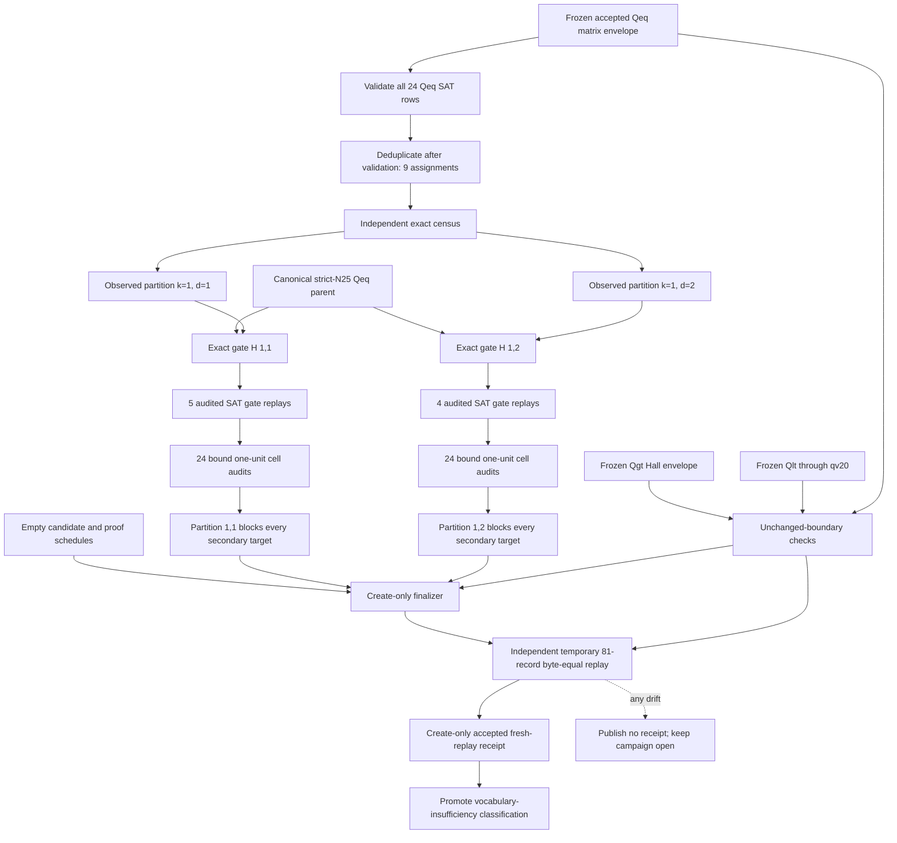

# Strict-N25 `Qeq` exact-q/gap retained-model replay

## Accepted status and principal conclusion

The production-v2 exact-partition suite has been generated and its retained
models have been replayed successfully.  The replay contains

\[
24\ \text{validated source rows}
+9\ \text{exact-gate audits}
+48\ \text{exact-cell audits}
=81\ \text{records}.
\]

The create-only finalizer and independent fresh-replay auditor have completed.
The published receipt has `status=accepted_fresh_replay`, binds the final
bytes, and confirms byte-equal reconstruction of all 81 replay records and of
the final payload.  The mathematical outcome below is therefore the formally
accepted campaign result; all terminal identities in this report are copied
from sealed artifacts, the published receipt, or the post-run closed-world
filesystem check.

The accepted coarse `Qeq` matrix contributes 24 SAT rows, one for each
ordinary state other than the known control state `G410`.  Independent
decoding of their complete assignments gives nine unique models and exactly
two observed exact partitions:

| exact partition `(k,d)` | accepted source rows | unique assignments | secondary states observed | empirical zero candidates |
| --- | ---: | ---: | ---: | ---: |
| `(1,1)` | 20 | 5 | 24/24 | 0 |
| `(1,2)` | 4 | 4 | 24/24 | 0 |

Fresh replay against the exact formulas confirms that both partitions are
nonvacuous and that, in each one, every state `G != G410` has an audited SAT
counterexample.  Thus neither partition has a second ordinary-state label
that is uniformly missing.  In particular, no total second-charge rule that
depends only on `(k,d)` can be formed from the current 25 unmarked ordinary
states.

The prescribed stopping classification is therefore

```text
CURRENT_25_STATE_VOCABULARY_INSUFFICIENT_FOR_EXACT_Q_GAP_CHARGING
```

This is the user's third stopping condition.  It ends the present exact-q/gap
campaign with zero SAT-solver, proof-producer, or proof-checker invocations by
this Qeq campaign, and without this Qeq campaign starting a three-event or
three-slot Hall campaign.

## Formal setting

Let \(\Phi_{25}\) be the canonical strict-order-25 rank-3 signotope SAT
formula, including the path restrictions and weak shared-outer-endpoint
7-gon exclusion.  Write

\[
A_v=TF[E411,\mathtt{path6\_before\_path5}](v),\qquad
B_w=T[E421,\mathtt{path6\_before\_path5}](w).
\]

Here \(A_v\) asserts that \(v\) is the global first exceptional endpoint and
has the indicated typed state and orientation.  The transition predicate is

\[
P(v,w)=A_v\land B_w\land v<w\land
\bigwedge_{v<t<w}\neg F(t),
\]

where \(F(t)\) says that endpoint \(t\) is exceptional.  Thus \(w\) is the
next exceptional endpoint after \(v\), not merely a later exceptional
endpoint of the right type.  The canonical encoding selects one endpoint for
each transition slot.

Let \(q_x\) be the unique exact minimum path6/cup start decoded at endpoint
\(x\).  For a legal coordinate \((k,d)\), define the aggregate exact `Qeq`
hypothesis

\[
H_{k,d}:=\Phi_{25}\land
\exists v,w\,[P(v,w)\land q_v=q_w=k\land w-v=d].
\]

The endpoints are selected inside the formula; \(H_{k,d}\) does not fix one
particular pair \((v,w)\).  This distinction is essential to the scope of the
negative result below.

For an ordinary state \(G\), let \(S[u,G]\) mean that endpoint \(u\) has
state \(G\), and define global occupancy by

\[
O[G]\iff\bigvee_{u=1}^{25}S[u,G].
\]

This is occupancy anywhere in the entire 25-endpoint model.  It is not
occupancy at \(v\) or \(w\), between them, in a prefix, or in a suffix.  The
exact occupancy cell is

\[
C_{k,d,G}:=H_{k,d}\land O[G].
\]

The canonical ordinary-state order is

```text
G000 G100 G110 G111 G200 G210 G211 G220 G221 G222
G300 G310 G311 G320 G321 G322 G330 G331 G332 G333
G400 G410 G420 G430 G440
```

The 24 possible second-charge targets are this order with `G410` removed.
`G410` is excluded because the first `E411/path6_before_path5` event already
forces its global absence; selecting it again would not give a second,
distinct charge.

## Exact partition registry and formula construction

The canonical strict-N25 combinatorial registry is

\[
1\le k\le20,\qquad 1\le d\le21-k.
\]

For coordinate \((k,d)\), its supported selector pairs are

\[
(v,w=v+d),\qquad k+4\le v\le25-d,
\]

so the combinatorial support count is \(22-k-d\).  Ordering first by \(k\),
then by \(d\), and finally by \(v\) gives 210 exact coordinates and 1540
supported fixed pairs.  This is a syntactic/combinatorial registry only; it
does not assert that each coordinate is semantically realizable.

Each exact gate is built from the canonical
`state_charging.transition_obligations.QEQ` formula.  Its base clauses are
identical to the parent's base clauses, and the parent's supplemental-clause
sequence is an exact prefix of the gate's supplemental-clause sequence.  This
is a clause-sequence identity, not a claim that the serialized parent DIMACS
file is a byte prefix of the gate DIMACS: at minimum, a DIMACS header changes
when the clause count changes.  The parent already contains \(P(v,w)\) and
\(q_w=q_v\).  The gate appends only:

1. 50 symmetric selector-conditioned exact-q clauses, covering both selected
   transition slots; and
2. \(275+d\) selector-pair exclusions for every positive-gap pair whose gap is
   not exactly \(d\).

No variable is introduced.  A cell appends one further positive global
occupancy unit \(O[G]\).  The expected identities are:

| formula | added condition | supplemental clauses | total clauses | variables |
| --- | --- | ---: | ---: | ---: |
| gate `H[k,d]` | exact `q_v=q_w=k`, exact gap `d` | `43,877+d` | `1,272,761+d` | 337,094 |
| cell `C[k,d,G]` | gate plus one `O[G]` unit | `43,878+d` | `1,272,762+d` | 337,094 |

For the two observed coordinates this gives:

| `(k,d)` | supported selector pairs | gate clauses | cell clauses |
| --- | ---: | ---: | ---: |
| `(1,1)` | 20 | 1,272,762 | 1,272,763 |
| `(1,2)` | 19 | 1,272,763 | 1,272,764 |

The source-row count `20` in partition `(1,1)` is not a statement that all 20
supported endpoint pairs occur.  Source rows are matrix target rows and may
share assignments and selected endpoint pairs.

## Empirical census before exact replay

The frozen source is the accepted transition-conditioned ordinary matrix at

```text
/data/ktqiu_hdd/math_agent/res/state_charging/
20260901_transition_conditioned_ordinary_matrix_v1
```

Its accepted `Qeq/G` rows for `G != G410` were processed as follows:

1. rehash and validate each row's exact CNF, status, output, original SAT
   audit, complete assignment, and accepted matrix envelope;
2. independently rebuild the profile and coloring and rescan the typed
   first-to-next transition;
3. decode \((v,w,q_v,q_w)\), require \(q_v=q_w\), and set
   \((k,d)=(q_v,w-v)\);
4. reconstruct the complete set of globally occupied ordinary states; and
5. deduplicate by complete-assignment SHA-256 only after every one of the 24
   source rows has passed validation.

The resulting census has nine unique complete assignments.  Its per-partition
secondary-state union and empirical candidate set are

\[
U_{k,d}=\bigcup_{X\in\mathcal M_{k,d}}
\{G:O_X[G]\},
\]

\[
Z_{k,d}=\bigl(\mathcal G\setminus\{G410\}\bigr)\setminus U_{k,d},
\]

where \(\mathcal M_{k,d}\) is the set of retained complete assignments
decoded into that partition.  The census gives

\[
U_{1,1}=U_{1,2}=\mathcal G\setminus\{G410\},\qquad
Z_{1,1}=Z_{1,2}=\varnothing.
\]

The five unique `(1,1)` assignments jointly cover all 24 secondary labels;
the four unique `(1,2)` assignments independently do the same.  This census
is discovery evidence, not by itself an exact-formula certificate.  It
determines that the direct-solver and proof-escalation schedules must both be
empty and identifies which retained assignments must be freshly replayed.

## Fresh exact replay

The production suite contains exactly 50 formulas:

\[
2\ \text{exact nonvacuity gates}
+2\cdot24\ \text{exact occupancy cells}.
\]

The replay then produces a canonical 81-record chain:

| record role | `(1,1)` | `(1,2)` | total |
| --- | ---: | ---: | ---: |
| validated accepted source rows | 20 | 4 | 24 |
| unique-assignment exact-gate audits | 5 | 4 | 9 |
| exact audited-SAT occupancy cells | 24 | 24 | 48 |
| **total** | **49** | **32** | **81** |

Every unique assignment is replayed against its exact gate, so each partition
has an audited SAT nonvacuity gate before any cell is interpreted.  Each of
the nine gate audits normalizes a complete assignment, scans every clause of
the full exact-gate formula, and then independently rebuilds the profile,
coloring, first-to-next typed transition, exact \(q\) values, and the complete
global ordinary-state occupancy set without trusting the transition-selector
or `O[G]` auxiliaries.

For every secondary token \(G\), a compatible retained gate assignment with
\(O[G]\) true is then checked against the cell's sole additional occupancy
unit.  A cell audit does not redundantly rescan the million-clause gate.
Instead, each of the 48 cell audits:

- requires exactly the same complete assignment SHA-256 as its bound gate
  audit and records that gate's `gate_audit_sha256`;
- binds the parent, gate, and cell formula identities and requires the gate's
  complete formula audit to have passed;
- verifies that the cell inherits every gate clause and adds exactly one
  positive unit, the requested global `O[G]` literal;
- checks that the same assignment makes that unique appended unit true; and
- reuses the gate's independently reconstructed occupancy, recording
  `independent_occupancy_reused_from_exact_gate_replay=true`, and verifies that
  it contains the requested state.

Thus the cell's recorded proof rule is exactly
`satisfied_formula_and_true_appended_unit_imply_satisfied_cell`.  The formula
prefix involved here is again the inherited clause sequence, not a byte-prefix
claim about two serialized DIMACS files.  Concretely, the current extension
schema field `exact_gate_is_byte_identical_formula_prefix=true` is validated
by checking
`cell.formula.supplemental_clauses[:-1] == gate.formula.supplemental_clauses`;
despite that field's name, it does not assert DIMACS-file byte-prefix identity.

The completed replay classification is therefore:

| partition | nonvacuity | audited SAT secondary cells | missing replay cells | classification |
| --- | --- | ---: | ---: | --- |
| `(1,1)` | audited SAT | 24/24 | 0 | `BLOCKING_PARTITION_ALL_24_SECONDARY_CELLS_AUDITED_SAT` |
| `(1,2)` | audited SAT | 24/24 | 0 | `BLOCKING_PARTITION_ALL_24_SECONDARY_CELLS_AUDITED_SAT` |

Different cells may, and generally do, use different complete assignments.
The table does **not** claim that one model in either partition simultaneously
occupies all 24 secondary states.  Its exact meaning is the quantifier
statement

\[
\forall G\ne G410\ \exists X_{k,d,G}\models C_{k,d,G}.
\]

This is precisely what is needed to refute a state label that would have to be
absent in every model of \(H_{k,d}\).

## Theorem: exact `(k,d)` cannot supply a second charge in this vocabulary

Let \(\mathcal R\) be the set of semantically realizable exact `Qeq`
coordinates.  A current-vocabulary `(k,d)`-dynamic second-charge rule is a
function

\[
\gamma:\mathcal R\longrightarrow
\mathcal G\setminus\{G410\}
\]

such that for every \((k,d)\in\mathcal R\),

\[
H_{k,d}\Longrightarrow\neg O[\gamma(k,d)].
\]

> **Theorem (failure of current-vocabulary exact-q/gap charging).**  In the
> canonical strict-N25 encoding, both
> \((1,1)\) and \((1,2)\) are realizable exact `Qeq` partitions.  For each of
> these partitions and every ordinary state \(G\ne G410\), the formula
> \(H_{k,d}\land O[G]\) is satisfiable.  Consequently no total
> current-vocabulary `(k,d)`-dynamic second-charge rule \(\gamma\) exists.

### Proof

For each of the nine retained complete assignments, full formula replay and
independent semantic reconstruction recover one of the exact transitions
\((k,d)=(1,1)\) or \((1,2)\).  Hence each corresponding \(H_{k,d}\) is
satisfiable and both coordinates belong to \(\mathcal R\).

Fix either observed coordinate.  For every
\(G\in\mathcal G\setminus\{G410\}\), the fresh cell audit supplies a complete
assignment satisfying \(H_{k,d}\land O[G]\).  Therefore

\[
H_{k,d}\not\Longrightarrow\neg O[G]
\qquad\text{for every }G\ne G410.
\]

If a total rule \(\gamma\) existed, its value at `(1,1)` would be some state
\(G\ne G410\) and would require
\(H_{1,1}\Rightarrow\neg O[G]\), contradicting the audited SAT cell for that
state.  The `(1,2)` partition gives an independent contradiction of the same
kind.  Thus no such total rule exists. \(\square\)

The theorem is a failure result for a proposed invariant, not an assertion
that every individual model has only one missing state.  Individual models
may omit several ordinary states; the result says that no single unmarked
state token other than `G410` is omitted uniformly throughout either exact
aggregate partition.

## Zero-action accounting

Both empirical zero sets are empty.  The production policy therefore permits
only complete retained-assignment replay and enforces all of the following as
fields of this Qeq campaign's config/final chain:

```text
candidate_solver_order = []
proof_escalation_order = []
solver_invocation_count = 0
proof_producer_invocation_count = 0
checker_invocation_count = 0
execution_kind = retained_matrix_model_replay
```

No raw `UNSAT` result is interpreted, and no new UNSAT claim is made by this
Qeq campaign.  Its certificates are audited SAT counterexamples.  This Qeq
campaign neither invokes an AE proof producer or checker nor creates a new AE
proof or checker log.

## Evidence dependency graph



The mathematical blocker is already present once one exact partition has 24
audited SAT cells.  The second blocker is retained as independent
corroboration.  The finalizer binds the complete 81-record chain, and the
auditor must regenerate all 81 records in a temporary directory, compare
their serialized bytes and registry, reconstruct the final bytes, and verify
that the registered external files, runtime registry, and internal evidence
remained unchanged before the acceptance receipt is published.

## Frozen evidence boundary

This Qeq campaign reads and rehashes prior accepted evidence but invokes none
of those prior campaigns' generators, solvers, proof checkers, finalizers,
auditors, or launchers.  The principal sealed/hash-registered inputs are:

| frozen chain | authoritative object | serialized SHA-256 | semantic SHA-256 |
| --- | --- | --- | --- |
| transition ordinary matrix | `matrix_final.json` | `5dabfc807ce0d8c7d7f87d7c70a6df3b18f1a0b6a10ba81bbb8889c8247a5868` | `441354cb22b6b123de0e80809b222953dbddc75f620fbc01c9b7fa70765ceaed` |
| transition ordinary matrix | `campaign_acceptance_audit.json` | `baa2685ac63a339c2e662821899bf635ccdce71718f778346119609c2a65c638` | `bdb68aea11c0621bb8f92e5c35c5f24d8689809ae0a35fc423de1b3e2912a625` |
| accepted Qgt Hall | `hall_final.json` | `386ae292b05df13e71ebae26c85b7fb296ca331403ff5b5b34f4da58a34b5bf0` | `9970b66fd5336665f470d283c7878dd003f12f548ef4986ba108f21527640ba2` |
| accepted Qgt Hall | `campaign_acceptance_audit.json` | `f3e1a2fb5fd9aa2401710ba7c86cb2ade8035b1843af27118a8ee75b276fe001` | `18d5b476f5eb3ca671a667722e17a08a6196d9e1f463ffaa750100ece6670653` |
| completed Qlt | terminal `prefix[20]` | `fab29aa1408f31db1999af64b7841ac92d04480de099a591604ec346a0507f54` | `9663bd0916cbf5cb2cae4c533d62c3aa5fab6218ca1e736ba2f82b26eb863cc4` |
| completed Qlt | `qv05_to_qv20/series_final.json` | `a7e54ace52d90cfd97666d5a33b51d6bec2c060a7e86a265169908ed8a6e4c8f` | `6f214674c0649b209fed93953005ba596dbe5142c758e12304281f6992b24d8a` |

The matrix and Qgt chains are frozen at commits `f4d5628` and `c6f28f9`.
This Qeq campaign does not rerun the 50-cell matrix, either Qgt singleton, or
the Qgt joint Hall mask.  The completed Qlt evidence through `qv20` is also a
sealed/hash-registered input and is not rerun by this Qeq campaign.

By contrast, `qv21`, monolithic `Agt1`, and triple-only are prohibited reruns
and outside this task's scope; they are not sealed inputs to this campaign.
No `qv21` campaign or result is asserted.  The current Qeq campaign also does
not start a three-event or three-slot evidence chain.

## Acceptance truth gate

The terminal classification may be promoted only if all predicates below are
true:

```text
qeq_exact_vocabulary_blocker_replay =
    exact_strict_n25_Qeq_parent
    and observed_partition_order == [(1,1), (1,2)]
    and source_row_count == 24
    and unique_assignment_count == 9
    and gate_audit_count == 9
    and cell_audit_count == 48
    and blocking_partition_order == [(1,1), (1,2)]
    and each_observed_partition_is_nonvacuous
    and each_observed_partition_has_24_audited_SAT_secondary_cells
    and candidate_solver_order == []
    and proof_escalation_order == []
    and solver_invocation_count == 0
    and proof_producer_invocation_count == 0
    and checker_invocation_count == 0
    and frozen_prior_campaign_invocation_count_by_this_qeq_campaign == 0
    and registered_matrix_files_unchanged
    and registered_qgt_envelopes_unchanged
    and registered_qlt_envelopes_unchanged
    and new_hall_layer_started_by_this_qeq_campaign == false
    and three_event_or_slot_campaign_started_by_this_qeq_campaign == false
    and untested_coordinate_realizability_claim == false

accepted_qeq_exact_vocabulary_insufficiency =
    qeq_exact_vocabulary_blocker_replay
    and final.status == CURRENT_25_STATE_VOCABULARY_INSUFFICIENT_FOR_EXACT_Q_GAP_CHARGING
    and final.pass == true
    and final.terminal == true
    and receipt.status == accepted_fresh_replay
    and receipt.terminal_classification == CURRENT_25_STATE_VOCABULARY_INSUFFICIENT_FOR_EXACT_Q_GAP_CHARGING
    and receipt.fresh_replay_record_count == 81
    and receipt.fresh_replay_records_byte_equal == true
    and receipt.fresh_temporary_replay_byte_equal == true
    and receipt.registered_external_files_unchanged == true
    and receipt.runtime_registry_unchanged == true
    and receipt.internal_evidence_unchanged == true
```

In addition, both publication paths call
`_reject_forbidden_execution_artifacts`.  Passing that validator is a
procedural publication gate, not a serialized
`forbidden_execution_residue_count` field in the current final or receipt
schema; the separate post-run filesystem inspection supplies the reported
terminal residue count.

The published receipt witnesses the second conjunction.  The campaign is
therefore accepted under this truth gate.

## Exhaustiveness boundary and explicit nonclaims

The exact registry contains 210 legal combinatorial coordinates.  Only
`(1,1)` and `(1,2)` were observed and replayed.  The remaining 208 coordinates
are classified solely as

```text
NOT_RUN_AFTER_EXISTENTIAL_BLOCKER
```

This is control-flow accounting, not a semantic verdict.  For every one of
those 208 coordinates, this campaign makes no claim of SAT, UNSAT,
realizability, or impossibility.  Exhausting them would be necessary for a
positive theorem asserting that every realizable partition admits a second
missing state, but it is unnecessary for the negative result: one realized
partition with a SAT counterexample for every possible target already defeats
a total `(k,d)`-only rule.

More generally, this campaign does **not** prove:

- that one exact-partition model simultaneously contains all 24 secondary
  ordinary states;
- that every individual model in `(1,1)` or `(1,2)` has only `G410` missing;
- that the remaining 208 combinatorial coordinates are unrealizable;
- a statement for a fixed endpoint pair `(v,w)`, a rule that may depend on
  `(v,w)`, or a position/prefix/suffix-refined state vocabulary;
- that no augmented ordinary-state language or different invariant can yield
  a second charge;
- a theorem for arbitrary order, arbitrary exceptional types or orientations,
  arbitrary later pairs, or arbitrary exceptional occurrences;
- a new theorem for `Qgt` or `Qlt`, or any result from the prohibited and
  out-of-scope qv21, monolithic `Agt1`, or triple-only reruns;
- any new Hall edge, two-slot Hall artifact, three-slot Hall relation, or
  occurrence-level injection; or
- the global inequality
  \(\#\{\text{missing ordinary states}\}\ge
  \#\{\text{exceptional occurrences}\}\).

The supported next scientific step is therefore to augment the ordinary-state
vocabulary with position, prefix, or suffix information, or to replace the
invariant.  A three-event/three-slot Hall campaign remains out of scope until
the `Qeq` obstruction has been resolved in such an enriched framework.

## Production-v2 terminal result block

The accepted execution facts and terminal identities are recorded explicitly
below.

| field | value |
| --- | --- |
| authoritative campaign root | `/data/ktqiu_hdd/math_agent/res/state_charging/20260902_qeq_exact_partition_replay_v2` |
| execution policy | `complete_retained_assignment_replay_only_no_solver_proof_checker` |
| generation / retained-model replay | `completed / completed` |
| suite shape | `2 gates + 48 cells = 50 formulas` |
| replay-record shape | `24 source records + 9 gate-audit records + 48 cell-audit records = 81 records` |
| observed partitions | `[(1,1),(1,2)]` |
| partition source counts | `(1,1):20; (1,2):4` |
| partition unique-assignment counts | `(1,1):5; (1,2):4` |
| exact gate/cell classifications | `9 AUDITED_SAT_N25_EXACT_QEQ_GATE; 48 AUDITED_SAT_N25_EXACT_QEQ_CELL` |
| candidate-zero counts | `(1,1):0; (1,2):0` |
| candidate solver / proof escalation order | `[] / []` |
| `solver_invocation_count / proof_producer_invocation_count / checker_invocation_count` by this Qeq campaign | `0 / 0 / 0` |
| mathematical stopping classification | `CURRENT_25_STATE_VOCABULARY_INSUFFICIENT_FOR_EXACT_Q_GAP_CHARGING` |
| remaining-coordinate accounting | `208 NOT_RUN_AFTER_EXISTENTIAL_BLOCKER`; no realizability claim |
| `frozen_prior_campaign_invocation_count_by_this_qeq_campaign` | `0` |
| `registered_matrix_files_unchanged` | `true` |
| `registered_qgt_envelopes_unchanged` | `true` |
| `registered_qlt_envelopes_unchanged` | `true` |
| `new_hall_layer_started_by_this_qeq_campaign` | `false` |
| `three_event_or_slot_campaign_started_by_this_qeq_campaign` | `false` |
| `untested_coordinate_realizability_claim` | `false` |
| create-only finalizer result | `status=CURRENT_25_STATE_VOCABULARY_INSUFFICIENT_FOR_EXACT_Q_GAP_CHARGING; pass=true; terminal=true` |
| independent acceptance-auditor result | `accepted_fresh_replay`; create-only receipt published |
| accepted terminal status | `CURRENT_25_STATE_VOCABULARY_INSUFFICIENT_FOR_EXACT_Q_GAP_CHARGING` |
| campaign config file / semantic SHA-256 | `1fa29d6d89c1154d8a6e35cb8af880cc43f720293bce6c2fac8322bd5f9a5c8d / 706d0f5a62d9ca2dda514505fe5640167ee394433c58adc8806a136fdfb9629e` |
| campaign seal file / semantic SHA-256 | `61f98ab62201e8cfe93e1e852c0d54609b494c8d7263458d0a68ebe885512d2b / 64e3cd4e8bf1d1097f8348c93eb1b788a05fda9c2024b162e3927b38514fd9a9` |
| manifest file / suite SHA-256 | `a217ef999390132f8dff7c9fc178218ec7e221f36d5f5d7c7fc2bf156b254c16 / 744bef6f4d740b149834b8a32623bda47cf31a0127a331e0ee98c064ef1f8f96` |
| exact-partition registry SHA-256 | `052fdbbddce38798892d75e61a92f65bd3834a79fa3ccfeef11dba2a92bee328` |
| census SHA-256 | `f9294871c00bc79b2ac6abed971fc915062b11acc401472a378bcef6ae08a062` |
| runtime / external-evidence registry SHA-256 | `b973bc4b912bb5f6ad6d6161bfc489ad6a47e1c0824afb0f67ecb5d0ee4052da / 429255d41f087d29362f936f2aa76a1a52ec81d7ae2bb9164066deadf1fbae2e` |
| remote-run / progress file SHA-256 | `6fcf9daf731ecd59d89c4e0b84c671245cc8b940fa66fd163c7d13d7a2f15564 / 30cac9f03f818849878c02a4c9d170671ba2698428ff0f316e66a750a97bd7af` |
| summary file / semantic SHA-256 | `ecb115c0e2cd76d07424f7fadf35d63502615e156bc8afb3b5cb7f1aad5af479 / 7ed6edb0fc2858145eb58790f7da70bd1db5377dec1c8faf573e7eb5793b0251` |
| replay-plan SHA-256 | `39cdfe7f6d4e71e65279c25665ef6c68b0868a06ed8a9b1523656806fc379a59` |
| 81-record content-registry SHA-256 | `019a811a2977ae1cb111d8c63ff46bb80ef55ba1791389e5d57f7c9fd70d68e8` |
| terminal internal snapshot SHA-256 | `7350e1e2725234f0bb51263a29c7daf5a14db764d16b23ddcfbd6df7305a3112` |
| terminal result-file registry SHA-256 | `dc6b5f1294573306bfb0066d415478ced7022e5a9706ed26ac62c744fac24fb6` |
| campaign final file / semantic SHA-256 | `37006eb316dfeda9a4bcdf4480fba2f56bfe0a11f742af813adc38797c035968 / ebf5d7fcdb4bfae971c5b777e6fdef519b25aad0b2058fd57d5d1c21a8f947ff` |
| acceptance-input snapshot / registry SHA-256 | `77161bec5b31d16c09eaf4a30719a3123b0e526ee9a370c23adf862302046b9e / e8cc64425c2cebc75669c00099d73226ce5e12c05351bd579e8577234fabb72d` |
| acceptance receipt file / semantic SHA-256 | `b2bc865d1095fa82d153294a8518d00b1385ee254c8e2527ecd27a27bc238c81 / 09f5411c147db8649cb7bb23d7e9c299a08b565e2bc902c3ef20a9666c1176d9` |
| `fresh_replay_records_byte_equal` for the independent 81-record replay | `true` |
| `fresh_temporary_replay_byte_equal` for the independently rebuilt final | `true` |
| `registered_external_files_unchanged / runtime_registry_unchanged / internal_evidence_unchanged` | `true / true / true` |
| terminal forbidden residue count | `0` |
| server compact metadata archive | `/data/ktqiu_hdd/math_agent/tmp/qeq_exact_partition_server_20260902_v2_metadata.tar.gz`; 686,223 bytes; SHA-256 `0850a5533913c4487ac0ef3a64eda6e339bec2c0e853c84503ec94e2e1d3f7fb`; 221 entries, zero CNF files |

The published receipt records `accepted_fresh_replay`; the table above comes
from sealed artifacts, that receipt, and the post-run closed-world inspection,
not from an in-flight log or the superseded v1 candidate chain.

Operationally, the `screen` wrapper's auxiliary audit `.exit` sidecar is an
empty file because its quoting layer discarded the intended `0` payload.  It
is outside the sealed acceptance chain and is not used as evidence.  The
complete audit log is valid JSON (SHA-256
`766be9b7cd8ff3eafa3d18e153b148ef2497a784ac9b8e364a89a583a290edfd`),
binds the published receipt's file SHA-256, and ends with
`status=accepted_fresh_replay`; the auditor process has exited and the
publication-last receipt independently supplies the acceptance verdict.  The
empty sidecar is preserved in the server metadata archive for transparency.
