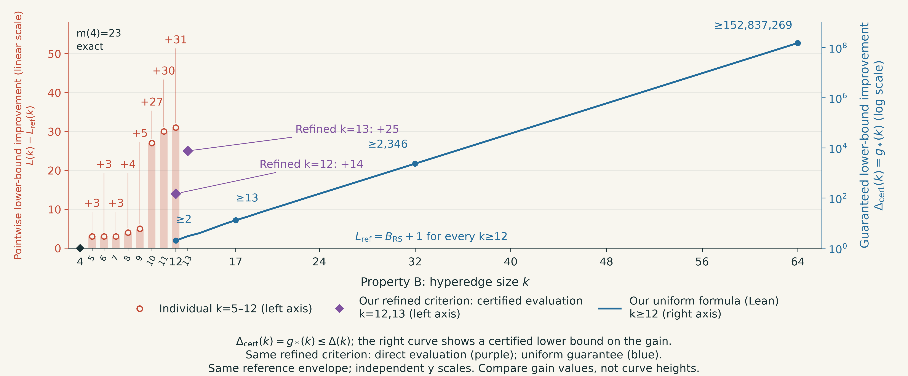

# Property B: stronger lower bounds, reusable proof methods

**Individual bounds for k = 5–12, a uniform theorem for every k ≥ 12, and the research experience behind MathRSI's Property B plugin.**

Let m(k) be the minimum number of edges in a finite simple k-uniform hypergraph that admits no red/blue vertex coloring in which every edge contains both colors. This case studies lower bounds for this classical hypergraph two-coloring problem.

These studies were carried out with **ARIS**. Their proofs, failed routes, verification practices, and accumulated wiki were then distilled into **MathRSI's workflows and Property B plugin**. New tasks will evaluate MathRSI v1 itself.



The red points show individual improvements over the specified reference values; the blue curve shows a certified lower estimate of the uniform theorem's gain. The purple points evaluate our stronger criterion C.2 at particular parameters. Axis definitions and full baseline citations are in the complete reader below.

## Read the results

Clone or download the repository and open **[index.html](index.html)** locally. GitHub displays HTML source rather than hosting these pages as a website. The case overview is in English; the full mathematical readers are in Chinese, with offline SVG formulas and figures.

- **[General bound: complete proof and comparisons](readers/PROPERTY_B_GENERAL_BOUND.html)** — Definitions, numbered theorems and proofs, literature comparisons, and the small-parameter results.
- **[General theorem: complete Lean reader](readers/PROPERTY_B_GENERAL_LEAN.html)** — Original statement, formal proof architecture, actual theorem exports, and build and axiom-audit records.
- **[Reader and source map](readers/README.md)** — The six included readers, their dates and scope, and the direct evidence links.
- **[Property B knowledge library](../../plugins/propertyb/knowledge/README.md)** — Reusable mathematics, original wiki, failure maps, certificates, and full Lean sources.

## A uniform improvement for every k ≥ 12

B_RS(k) is the maximum positive integer edge budget accepted by an explicit combination of the Radhakrishnan–Srinivasan positive-association estimate and exact single-overlap integral. This combined budget is defined in our proof; it is not a separately named theorem in the original paper. The complete reader identifies the original claims and their use.

For every integer k ≥ 12, define

```text
Δ(k) = floor( sqrt(B_RS(k)) / (8 (1 + ln k)) ) ≥ 2.
```

Every finite simple k-uniform hypergraph with at most B_RS(k) + Δ(k) edges has Property B. Therefore

```text
m(k) ≥ B_RS(k) + Δ(k) + 1,    for every k ≥ 12.
```

The theorem has an analytic proof and **end-to-end Lean formalization**. The formal statement starts from an arbitrary finite vertex type and the original edge set; it returns a Boolean coloring with both colors in every edge. The maximal budget, structural reductions, and probability criterion are proved internally. The audited transitive axioms are `propext`, `Classical.choice`, and `Quot.sound`.

Start with [Twelve.lean](../../plugins/propertyb/knowledge/archive/formal/Aris4Math/General/Growth/Twelve.lean), the independent original-statement restatement [ReviewAuditGeneralGrowth12.lean](../../plugins/propertyb/knowledge/archive/formal/ReviewAuditGeneralGrowth12.lean), and the [recorded verification](readers/evidence/context/propertyb-general/bridge-12-16-20261021/lean/VERIFICATION.json). The C.2 numerical evaluations and comparison theorems D/E have their own evidence; they are outside this Lean export's scope.

## Individual results and their evidence

The reference values below match the comparison figure, including a common RS baseline from k = 12. They are specified comparison points, rather than a survey of every current record. Here the gain is **L_new − L_ref**; for the uniform theorem, L_ref = B_RS + 1 and the gain is Δ.

| k | Reference L_ref | Reported lower bound L_new | Gain | Proof and verification scope |
| --- | --- | --- | --- | --- |
| 5 | 32 | **35** | +3 | Complete natural-language candidate and local certificates; full Lean for 35 remains unfinished. The earlier bounds **33 and 34** have complete Lean proofs. |
| 6 | 64 | **67** | +3 | Complete computer-assisted proof, independent exact arithmetic for all used branches, and Grok/Gemini static final reviews; no Lean for this parameter. |
| 7 | 128 | **131** | +3 | Complete candidate and full independent exact replay of 424 types; no parameter-specific cross-family final review or Lean. |
| 8 | 263 | **267** | +4 | Complete computer-assisted proof, independent exact replay of all 2,094 types and separate quota checks, and Grok/Gemini static final reviews; no Lean. |
| 9 | 538 | **543** | +5 | Complete computer-assisted proof, independent exact replay of all 3,450 types and decision-tree coverage, and Grok/Gemini static final reviews; no Lean. |
| 10 | 1085 | **1112** | +27 | Collaborator proof and certificates; documented original-table replays and a separate tight-case exact check; no Lean. |
| 11 | 2245 | **2275** | +30 | Collaborator proof and certificates; documented original-table replays and a separate tight-case exact check; no Lean. |
| 12 | 4633 | **4664** | +31 | All 664,355 author parameter instances pass; independent complete parameter/trace coverage and 20 exact probability checks. This is not a second full-table probability implementation; no Lean for this individual bound. |

The [small-parameter evidence guide](../../plugins/propertyb/knowledge/archive/context/collaborator-handoff-20261030/SMALL_K_GUIDE.md) records each scope. Model reviews cited here were static mathematical/source reviews, not executions of the arithmetic programs or Lean.

## What changed the research

**Connect every local computation to the original hypergraph.** A table of strict rational bounds becomes useful only after an arbitrary original input has been reduced to its actual local data, the classification is proved exhaustive, and the result returns a coloring of that same input. This connection became the central proof obligation, rather than treating a successful table as the theorem.

**Use constraints shared by the same object.** Several locally worst configurations cannot coexist in one hypergraph. Shared bad pairs, degree budgets, and repair capacities strengthened the small-parameter arguments. For general k, a clique bound on the actual single-overlap graph reduced the bad-pair count inside the same RS probability witness. The [general-k tools](../../plugins/propertyb/skills/mathrsi-propertyb/references/mathematics/06-general-k-rs-and-growth.md) give the precise statements and callers.

**Reconsider the representation when local progress stops helping.** During the still-open m(5) ≥ 36 investigation, changing from positional lock bounds to a labeled-swap count produced a whole small-vertex result. It did not solve the full problem. The recorded remaining obligations preserved that distinction, and the accumulated structural tools subsequently supported the general-k work. The [actual research transitions](../../development/workflow-redesign/REAL_PROJECT_TRANSITIONS.md) retain the detailed examples.

**Test a real Lean caller before scaling certificates.** One nontrivial branch was connected from the actual hypergraph through multiplicities and quotas to its coloring conclusion before expanding the formal tables. This exposed interface requirements early. The final audit then named the new main module explicitly and restated the theorem in the original vocabulary.

## How this experience enters MathRSI

| Subworkflow | Practice distilled from the research |
| --- | --- |
| [Prepare](../../base/skills/mathrsi-prepare/SKILL.md) | Search problem aliases, citations, counterexamples and errata; read the primary theorem before importing its assumptions or defining a comparison baseline. |
| [Route iteration](../../base/skills/mathrsi-route-loop/SKILL.md) | Challenge candidate routes across models, run informative probes, and revisit the global obstruction when local refinements stop reducing it. |
| [Prove](../../base/skills/mathrsi-prove/SKILL.md) | Combine derivation, proof writing and bounded parallel work; immediately connect returned lemmas and certificates to their actual callers. |
| [Verify](../../base/skills/mathrsi-verify/SKILL.md) | Separate coverage from arithmetic, use independent exact or rigorously rounded calculations, repair real gaps, and audit the original statement when Lean is used. |
| [Handoff](../../base/skills/mathrsi-handoff/SKILL.md) | Deliver the full readable proof and reproducible evidence; preserve useful conditional lemmas, failed-route boundaries, and precise resumption notes in the wiki. |

The [Property B plugin](../../plugins/propertyb/skills/mathrsi-propertyb/SKILL.md) supplies the domain methods at these stages: a [117-item lemma inventory](../../plugins/propertyb/skills/mathrsi-propertyb/references/mathematics/08-complete-lemma-inventory.md), [failure map](../../plugins/propertyb/skills/mathrsi-propertyb/references/practice/failure-map.md), [computation lessons](../../plugins/propertyb/skills/mathrsi-propertyb/references/practice/computation-and-efficiency.md), and [Lean practice](../../plugins/propertyb/skills/mathrsi-propertyb/references/practice/lean-practice.md), with links to the original evidence.

## Inspect or reproduce

The pages need no network or math renderer. Their local links can be checked from a clone:

```bash
python3 tools/check_links.py
python3 case-studies/property-b/tools/package_readers.py --check
```

For Lean, install `elan` and use the archived `lean-toolchain` and `lake-manifest.json`. From the clone root, copy the formal project to a separate build directory; the archive remains a source snapshot:

```bash
propertyb_replay_dir=$(mktemp -d)
cp -R plugins/propertyb/knowledge/archive/formal "$propertyb_replay_dir/formal"
cd "$propertyb_replay_dir/formal"

# Uniform theorem for every k >= 12 and original-statement audit
lake build Aris4Math.General.Growth.Twelve
lake env lean ReviewAuditGeneralGrowth12.lean

# Earlier five-uniform bound m(5) >= 34 and original-statement audit
lake build Aris4Math.ThirtyThree.Main
lake env lean ReviewAudit33.lean
```

A bare `lake build` targets the older five-uniform theorem. Toolchains, downloaded dependencies and compilation caches are not bundled. The case preserves the original build records; this publication did not run a new Lean build. For arithmetic replay, start with the plugin's [checker capabilities and runnable examples](../../plugins/propertyb/skills/mathrsi-propertyb/references/practice/checker-capabilities.md), whose input and coverage requirements are explicit.

The six promoted readers retain their complete content, formulas and figures; only local links were adapted. Their direct dependencies are included or reuse the existing archive. Historical documents beyond those direct links retain their source context. See [packaging and display checks](../../development/propertyb-case-20261102/REPORT.md) for the exact publication checks and [reader provenance](readers/README.md) for the archive boundary.
