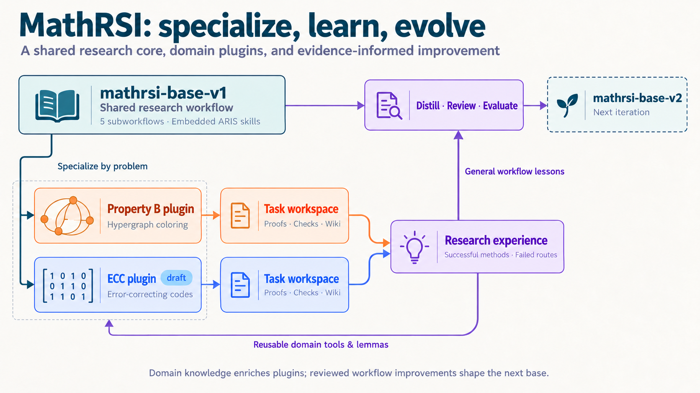

# MathRSI architecture figures

Two coordinated English diagrams, generated and edited with the built-in GPT Image tool. The final PNGs are 1672 × 941 pixels. Composition was developed through two Gemini 4 discussions against the current workflow and plugin contracts, followed by visual review and targeted edits.

## Shared core, domain plugins, and feedback

The shared base supports problem-specific research through domain plugins. Task evidence produces reusable domain knowledge and general workflow lessons. Reviewed general lessons inform the next base iteration; the v2 node represents this evolution design. ECC is shown as a draft plugin example.

The feedback path is executed through the separate [evolution workflow](../../docs/EVOLUTION_WORKFLOW.md); it does not alter the base during an ordinary problem-solving run.

## Five adaptive subworkflows

Prepare, route loop, prove, verify, and handoff reuse embedded ARIS skills. Research memory spans the workflow; domain methods enter at the relevant stage. Backward arrows show targeted literature lookup, route revision, and local verification returning to the proof. Lean is optional.

## Prompts and review

- Figure 1: [generation prompt](01-evolution.prompt.txt), [branch correction](01-evolution-edit.prompt.txt), [plugin-group correction](01-evolution-group-edit.prompt.txt).
- Figure 2: [generation prompt](02-workflows.prompt.txt), [spacing and literature-return correction](02-workflows-edit.prompt.txt).
- [Review and changes](../../development/figures-20261101/REVIEW_DISPOSITION.md), including the actual review scope and original responses.

Underlying executable descriptions: [workflow](../../docs/WORKFLOWS.md) and [plugin contract](../../docs/PLUGIN_CONTRACT.md).
