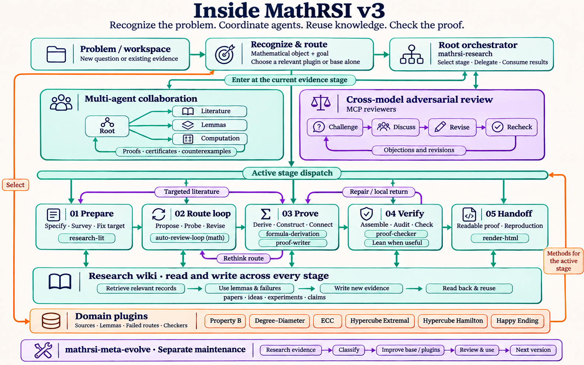
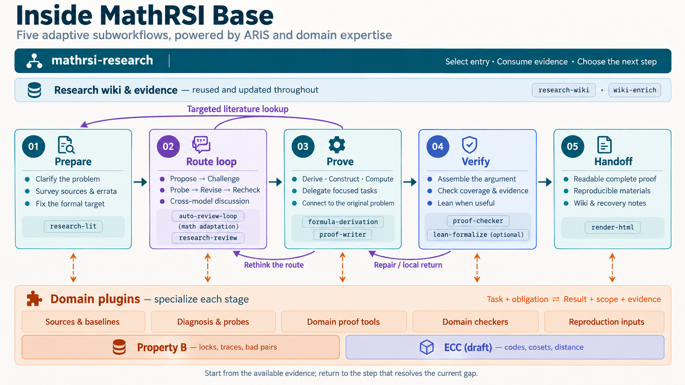

# MathRSI architecture figures

Two coordinated English diagrams explain current **v3**, its research origins, and its executable workflow. Versioned v3 assets keep the earlier v2 diagrams available as historical snapshots. See the [v3 generation and review record](../../development/figures-v3-20261104/REPORT.md) for the actual scope.

## Current v3 · Figure 1: Research experience improves base and plugins

The historical v0 stage comprises basic research tools and the initial Property B and ECC investigations; it is not a Git release. v1 establishes five executable solving subworkflows, Property B and an initial ECC draft. v2 adds separate `mathrsi-meta-evolve` maintenance, concrete base improvements and Degree–Diameter. v3 strengthens the existing base, upgrades the same ECC plugin, and adds Hypercube Extremal, Hypercube Hamilton and Happy Ending. The continuation beyond v3 represents future evolution.

The two tracks show shared workflow improvement and domain expansion/deepening. Research histories supply evidence for maintenance; their mathematical results keep their original attribution. Fixed v1/v2/v3 tags preserve complete snapshots, while `main` follows the recommended version.

## Current v3 · Figure 2: Problem routing, research and evidence

The agent recognizes the original mathematical object, selects the applicable plugin, and enters the current evidence stage. Root owns transitions among prepare, route-loop, prove, verify and handoff; scoped workers return proofs, certificates, counterexamples or precise gaps for Root to consume. Plugins return evidence to their calling stage.

Cross-model adversarial review critiques routes and arguments. Deterministic computation, certificate replay and optional Lean verification establish their own exact predicates and scopes. The task wiki is retrieved, used, written back and read again across every stage, so later obligations consume earlier results and failures.

The separate `mathrsi-meta-evolve` maintenance workflow classifies evidence as Base, Plugin, Task or Defer. Supported Base and Plugin changes proceed through implementation, review, actual use and adoption. Task state remains in the task wiki; deferred proposals stay in the backlog. Maintenance operates within its authorized scope rather than automatically following every handoff as a sixth solving stage.

## Current v3 prompts and review

- Figure 1: [generation prompt](01-evolution-v3.prompt.txt), [v2 maintenance-label refinement](01-evolution-v3-edit.prompt.txt).
- Figure 2: [generation prompt](02-workflows-v3.prompt.txt), [dispatch and plugin-connection refinement](02-workflows-v3-edit.prompt.txt).
- [Generation and review report](../../development/figures-v3-20261104/REPORT.md).

Executable descriptions: [v3 changes](../../docs/V3_CHANGES.md), [domain routing](../../docs/DOMAIN_ROUTING.md), [workflow](../../docs/WORKFLOWS.md), [wiki operations](../../docs/WORKSPACE.md#7-五阶段的-wiki-读取与写回), [maintenance](../../docs/EVOLUTION_WORKFLOW.md), and [plugin contract](../../docs/PLUGIN_CONTRACT.md).

## Historical v2 diagrams

Evolution diagram · v2 snapshot

The ECC-draft and future-v3 labels belong to this historical snapshot. Its base-tool origins and independent DD research feed the v1/v2 evolution; it does not describe current v3 capability.

Workflow diagram · v2 snapshot

The five solving subworkflows remain in v3; the current diagram adds the explicit routing, worker returns and evidence paths.

Historical prompts and records:

- Figure 1: [basic-tools edit](01-evolution-basic-tools-v3.prompt.txt), [final refinement](01-evolution-basic-tools-v3-final.prompt.txt), and [v2 redraw](01-evolution-v2.prompt.txt). The older prompt filenames containing `v3` are historical edit names, not the current versioned v3 asset sources.
- Figure 2: [v2 redraw](02-workflows-v2.prompt.txt).
- [v2 design discussion and review](../../development/figures-v2-20261103/REVIEW_DISPOSITION.md) · [v2 implementation changes](../../docs/V2_CHANGES.md).
- Earlier Figure 1: [generation](01-evolution.prompt.txt), [branch correction](01-evolution-edit.prompt.txt), [plugin-group correction](01-evolution-group-edit.prompt.txt).
- Earlier Figure 2: [generation](02-workflows.prompt.txt), [spacing and literature-return correction](02-workflows-edit.prompt.txt).
- [2026-11-01 review and changes](../../development/figures-20261101/REVIEW_DISPOSITION.md).
