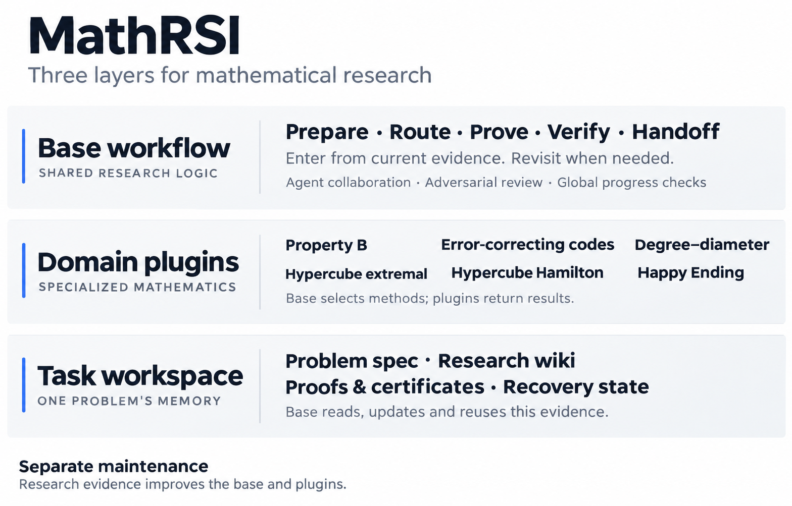
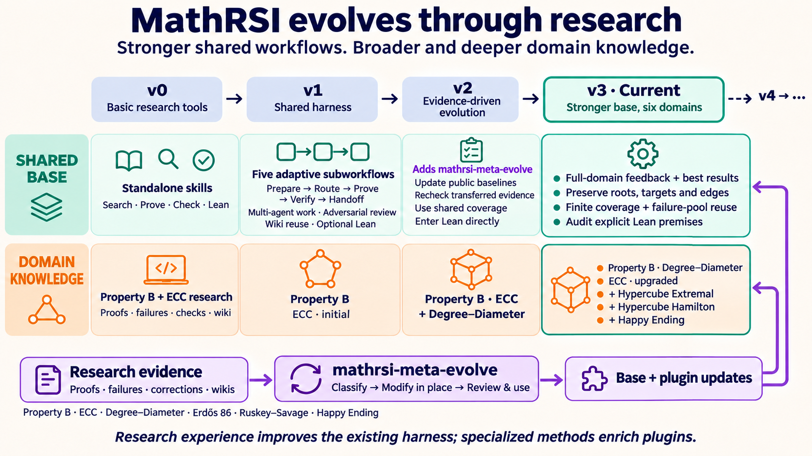

# MathRSI figure gallery

[English entry](../../README.md) · [中文入口](../../README.zh-CN.md) · [Visual tour](../../docs/HOMEPAGE.md)

## Six-domain results overview

[](../../case-studies/README.md)

[中文 SVG](results-overview/results-overview.zh.svg) · [English PNG](results-overview/results-overview.en.png) · [中文 PNG](results-overview/results-overview.zh.png) · [Editable generator, data and sources](results-overview/README.md)

The DD panel retains our constructions across four showcased settings, updating only (11,5)/(12,5) in the 2026-11-16 follow-up. Dated comparisons remain in the linked case. The two READMEs use their corresponding language version and link to the six-case source/scope index. The compact figure preserves the original result values, the literature-derived ECC value and Happy Ending's working-manuscript status. `render.py` regenerates SVGs using Python's standard library; PNG export is optional.

## Three-layer architecture · editable vector


The base calls domain methods and reads, updates and reuses the task's evidence. The research wiki belongs to the task workspace. Separate maintenance can learn from research evidence, including failures and partial work.

- [FigureSpec JSON](specs/architecture-three-layers.json): editable layout and text source.
- [SVG](architecture-three-layers.svg): 1200 × 810, editable text.
- [2× PNG](architecture-three-layers.png): 2400 × 1620.
- [900 CSS-pixel preview](architecture-three-layers-900px.png) · [Measured text bounds](text-bounds.json) · [Browser renderer](render_preview.py).

### Regenerate the vector

Root generated this version using ARIS FigureSpec. Edit the JSON and regenerate the SVG. The original renderer is at `skills/figure-spec/scripts/figure_renderer.py` in ARIS commit `8f493923f28c3f991dcca1287db97aa780d0969b`; it uses only Python's standard library.

Use an ARIS checkout containing that renderer. From this MathRSI clone's root, with `ARIS_REPO` set to that **external renderer checkout**:

```sh
export ARIS_REPO=/path/to/Auto-claude-code-research-in-sleep
python3 "$ARIS_REPO/skills/figure-spec/scripts/figure_renderer.py" validate \
  figures/mathrsi/specs/architecture-three-layers.json
python3 "$ARIS_REPO/skills/figure-spec/scripts/figure_renderer.py" render \
  figures/mathrsi/specs/architecture-three-layers.json \
  --output figures/mathrsi/architecture-three-layers.svg
python3 figures/mathrsi/render_preview.py
```

The browser-preview step needs Playwright and its Chromium browser. The included MathRSI `base/tools/figure_renderer.py` is an upstream forwarding shim whose canonical figure-spec script was not bundled; it is not the regeneration entry above. This optional graphics dependency is separate from normal MathRSI task helpers, which use this clone's `base`.

Root inspected the actual 900px vector render and approved integration. The original browser check placed all text bounds inside the canvas. Approval concerns presentation; it is not a new mathematical review.

## Three-layer architecture · GPT Image alternative



[Full PNG](architecture-three-layers-gpt.png) · [Exact generation prompt](architecture-three-layers-gpt.prompt.txt)

Root generated this bitmap using GPT Image from the supplied prompt and inspected the resulting image before approval. It is a separate visual interpretation, not an SVG conversion. Generate a new variant by sending the prompt to the image-generation tool; repeated generation is not deterministic. The README uses the editable SVG, while this alternative is shown here for comparison and reuse.

## Research evidence → capabilities


This diagram explains feedback, rather than repeating the architecture. Research evidence includes failures and partial work; authorized maintenance adopts concrete Base and Plugin changes. The examples refer to actual existing changes, not measured speedups.

[FigureSpec](specs/research-to-capabilities.json) · [SVG](research-to-capabilities.svg) · [2× PNG](research-to-capabilities.png) · [900px preview](research-to-capabilities-900px.png) · [Text bounds](research-to-capabilities-text-bounds.json) · [Browser renderer](render_research_to_capabilities.py)

Use the same external ARIS renderer described above with `specs/research-to-capabilities.json` and output `research-to-capabilities.svg`; then run `python3 figures/mathrsi/render_research_to_capabilities.py` from the clone root. Root inspected and approved the actual vector rendering.

## Actual homepage motion

The README hero is a recording of the current homepage's v0 → v6 evolution animation, including both the Erdős 86 (`Q₇` / `Q₈` / `Q∞`) bubble and the full `Q₇` R7 author-working-proof bubble (every matching; source accepted 2026-11-19, external peer review pending, no Lean) at v6 Current. [GIF, MP4, poster and reproducible recording instructions](media/README.md). The original source remains in place; a local browser runs the real Replay button. Research-result attribution and manuscript status remain in the [six-case index](../../case-studies/README.md).

## Historical diagrams

The assets below are preserved **v3 and v2 snapshots**. Current release is [v6](https://github.com/lisresearchgroup/math-rsi/tree/v6) (fixed [v5](https://github.com/lisresearchgroup/math-rsi/tree/v5) and earlier tags remain unchanged). See [v6 changes](../../docs/V6_CHANGES.md), [the bilingual visual tour](../../docs/HOMEPAGE.md), and the [v3 generation record](../../development/figures-v3-20261104/REPORT.md). Historical labels describe their original versions.

### v3 snapshot · Figure 1: Research experience improves base and plugins



The historical v0 stage comprises basic research tools and the initial Property B and ECC investigations; it is not a Git release. v1 establishes five executable solving subworkflows, Property B and an initial ECC draft. v2 adds separate `mathrsi-meta-evolve` maintenance, concrete base improvements and Degree–Diameter. v3 strengthens the existing base, upgrades the same ECC plugin, and adds Hypercube Extremal, Hypercube Hamilton and Happy Ending. The continuation beyond v3 represents future evolution.

The two tracks show shared workflow improvement and domain expansion/deepening. Research histories supply evidence for maintenance; their mathematical results keep their original attribution. Fixed v1/v2/v3 tags preserve complete snapshots, while `main` follows the recommended version.

### v3 snapshot · Figure 2: Problem routing, research and evidence


The agent recognizes the original mathematical object, selects the applicable plugin, and enters the current evidence stage. Root owns transitions among prepare, route-loop, prove, verify and handoff; scoped workers return proofs, certificates, counterexamples or precise gaps for Root to consume. Plugins return evidence to their calling stage.

Cross-model adversarial review critiques routes and arguments. Deterministic computation, certificate replay and optional Lean verification establish their own exact predicates and scopes. The task wiki is retrieved, used, written back and read again across every stage, so later obligations consume earlier results and failures.

The separate `mathrsi-meta-evolve` maintenance workflow classifies evidence as Base, Plugin, Task or Defer. Supported Base and Plugin changes proceed through implementation, review, actual use and adoption. Task state remains in the task wiki; deferred proposals stay in the backlog. Maintenance operates within its authorized scope rather than automatically following every handoff as a sixth solving stage.

### v3 prompts and review

- Figure 1: [generation prompt](01-evolution-v3.prompt.txt), [v2 maintenance-label refinement](01-evolution-v3-edit.prompt.txt).
- Figure 2: [generation prompt](02-workflows-v3.prompt.txt), [dispatch and plugin-connection refinement](02-workflows-v3-edit.prompt.txt).
- [Generation and review report](../../development/figures-v3-20261104/REPORT.md).

Executable descriptions: [v3 changes](../../docs/V3_CHANGES.md), [domain routing](../../docs/DOMAIN_ROUTING.md), [workflow](../../docs/WORKFLOWS.md), [wiki operations](../../docs/WORKSPACE.md#7-五阶段的-wiki-读取与写回), [maintenance](../../docs/EVOLUTION_WORKFLOW.md), and [plugin contract](../../docs/PLUGIN_CONTRACT.md).

### v2 snapshots

<details>
<summary>Evolution diagram · v2 snapshot</summary>


The ECC-draft and future-v3 labels belong to this historical snapshot. Its base-tool origins and independent DD research feed the v1/v2 evolution; it does not describe current main capability.

</details>

<details>
<summary>Workflow diagram · v2 snapshot</summary>


The five solving subworkflows remain in v3; the v3 diagram adds the explicit routing, worker returns and evidence paths.

</details>

Historical prompts and records:

- Figure 1: [basic-tools edit](01-evolution-basic-tools-v3.prompt.txt), [final refinement](01-evolution-basic-tools-v3-final.prompt.txt), and [v2 redraw](01-evolution-v2.prompt.txt). The older prompt filenames containing `v3` are historical edit names, not the current versioned v3 asset sources.
- Figure 2: [v2 redraw](02-workflows-v2.prompt.txt).
- [v2 design discussion and review](../../development/figures-v2-20261103/REVIEW_DISPOSITION.md) · [v2 implementation changes](../../docs/V2_CHANGES.md).
- Earlier Figure 1: [generation](01-evolution.prompt.txt), [branch correction](01-evolution-edit.prompt.txt), [plugin-group correction](01-evolution-group-edit.prompt.txt).
- Earlier Figure 2: [generation](02-workflows.prompt.txt), [spacing and literature-return correction](02-workflows-edit.prompt.txt).
- [2026-11-01 review and changes](../../development/figures-20261101/REVIEW_DISPOSITION.md).
