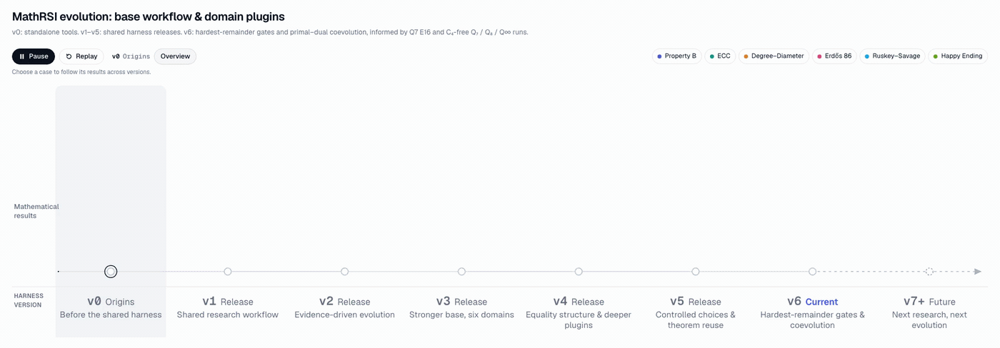

# Homepage evolution replay

[Visual tour](../../../docs/HOMEPAGE.md) · [Figure gallery](../README.md) · [Six results and scope](../../../case-studies/README.md)

[](evolution.mp4)

- [GIF](evolution.gif): 1000 × 363, 18.83 seconds, loops; 696,066 bytes in Root's approved export.
- [MP4](evolution.mp4): 1600 × 580, H.264/yuv420p, faststart; 18.85 seconds and 342,831 bytes in the approved export.
- [Poster](poster.png): 1600 × 580, settled v4 state.
- [Recording receipt](RECORDING.json): original source path, actual v0/v1/v2/v3/v4 samples, geometry and browser errors.
- [Recording source](record.py): resolves this clone from its own location.

Root recorded the current English homepage in `development/homepage-redesign-20261105/site/` on 2026-11-11 and approved the actual result. Chromium ran the existing Replay button with a slowed browser clock; capture-only CSS isolated the chart. The output shows the real homepage animation, including current Base wording. It is a historical research-intake replay, not a fresh mathematical run. Happy Ending remains a working manuscript pending independent review; the new DD graph was produced with v2 + DD and later informed v4.

## Reproduce

Python Playwright, its Chromium browser and ffmpeg must be available. From the clone root:

```sh
python3 figures/mathrsi/media/record.py
```

The script serves this clone on a temporary loopback port, waits for fonts, captures browser frames to H.264, checks the settled v4 state and exports GIF/MP4/poster. It leaves a one-second opening hold and five-second final hold. Source JavaScript and research data are unchanged. Full uncropped video and diagnostic stills go to the ignored `.local/` directory beside the script; they are recording intermediates, not distribution assets. A new run refreshes the recording receipt with paths relative to its clone. The preserved original receipt records Root's source checkout and uncropped source-video location; that intermediate is intentionally not included here.

The README crop preserves the full result bubbles and version axis. Detailed Base/Plugins explanations and mathematical assurance remain in the full homepage and linked case records. At small widths, open the MP4 or full visual tour to read the fine labels.
