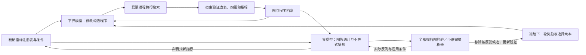

# Qn / C4 双端协同搜索

**主目标澄清：** 本轮主任务是证明所有无四环Q8子图边数≤682，仍然开放；683是对抗反例搜索目标。见 `launches/near-extremal-20261115/PRIMARY_OBJECTIVE.md`、`UPPER_OBLIGATIONS.md` 与 `PROGRESS.md`。后续配置可用 `primary_proof_goal={"statement":"…","upper_bound":682}`，配 `goal.target=683`；报告明确区分主证明状态和搜索结果。没有找到683图只记open，合法超界图即使不满足辅助搜索条件也会记为待独立复核的反例。初始四轮与旧运行保持其历史输出。

**2026-11-15 近极值研究启动：** 新入口为 `configs/q8_near_extremal.json`，任务与已有结果阅读地图在 `launches/near-extremal-20261115/TASK.md`。它以 680 边为可调工作带，保留四张 682 种子及 24 张派生 680/681 样本，主体亲本与上界发现数据优先该带；全部档案仍用于反驳。`quality_band` 只用于边数最大化任务，不成为隐含数学条件。带内 novelty 用 `novelty/(1+novelty)+0.05*progress`，challenge 用有界残差；带外先按 `-2-边数缺口+0.01*progress` 排序，真实适用反例在 challenge 通道仍优先。默认配置和旧验收运行保持原样。

本目录把构造程序进化与局部不等式发现接成同一个可执行循环。下界侧由模型生成 Python 搜索程序，程序在搜索中调用当前 reward；上界侧从已核验图簇提出有明确条件的整数线性不等式。真实反例使候选失效，其余候选的残差回到下一轮构造。

默认实际模型通道是本机 **Codex CLI，模型 `gpt-6.1-sol`**。模型名、推理强度和超时在配置中修改；使用现有 CLI 认证，不复制凭据。核心 Python 仅依赖标准库，运行环境为 Linux/WSL 或 macOS、Python 3.10+（进程资源限制使用 POSIX 接口）。另有明确标识的 `offline` 基线供测试，它不会伪装成模型调用。



## 开始运行

在本目录执行：

```bash
# 无模型依赖的单元与集成测试
PYTHONDONTWRITEBYTECODE=1 python3 -m unittest discover -s tests -v

# 小维完整闭环：两轮，实际程序执行和全枚举，但不调用模型
python3 -m cube_coevolve run --config configs/smoke.json --output runs/my-smoke --rounds 2

# 真实 Sol 调用：小维两轮，便于先验证本机认证与服务
python3 -m cube_coevolve run --config configs/live_smoke.json --output runs/my-live-smoke --rounds 2

# Q8：真实 Sol 生成构造程序与不等式，目标 683 边
python3 -m cube_coevolve run --config configs/q8.json --output runs/my-q8 --rounds 8

# 从相同任务的断点再执行四轮；轮数表示新增轮数
python3 -m cube_coevolve run --output runs/my-q8 --resume --rounds 4
```

输出目录必须新建，或显式 `--resume`；不会悄悄覆盖旧运行。一个输出目录由一个控制进程写入。`configs/q8_offline_smoke.json` 用真实 Q8 种子测试全部机械接口，供不启动模型时使用。演示图和运行样本在 `runs/`，实际检查范围在 `implement-stage/BUILD_NOTE.md`。

## 每一轮实际做什么

1. 从档案重算当前不等式适用范围与分数，冻结本轮奖励。按目标、挑战、新颖性、条件接近度及指标分区选择图亲本；把对应的实际程序源码与评价传给下界模型。
2. 下界模型输出 `generate(context)` 程序。独立 Python 子进程执行，有 CPU、内存、输出和墙钟上限。程序可以临时丢失边、重构或探索非奇方形图；它提交的最终图由宿主验证。
3. 宿主拒绝重复边、非超立方体边和含 C4 的图。四圈分别按正方形和共同邻点计数，必须一致。宿主计算指标与奖励，不读取程序声称的分数。合法图即使不满足任务条件，也可保留为明确标记的探索材料。
4. 上界模型读取指标精确定义、图簇范围、实际样本、已反驳候选及实际反例。它可提出短整数线性不等式，或最多两个声明式子面指标。新增指标写入运行状态，并对旧图重算。
5. 所有候选在**全部已归档图**上检验，不仅是在提示中展示的样本上。小维配置还枚举全部边子集。反例写入档案；被反驳候选从奖励中移除。保存下一轮奖励、证据、未证义务与恢复状态。

这个顺序是逻辑协同，不要求两个模型同时运行。每轮一次下界调用、一次上界调用；没有额外的训练或隐藏付费服务。

## 共享指标与条件

基础指标包括边数、最小/最大度、度平方和、总度数直方图及两个二分部直方图、各类正方形数、三边星、两侧覆盖空位和可单独添加的缺边数。`registry.json` 保存定义。奇方形表示每个二维面保留 1 或 3 条边；`even_squares` 计保留 0、2、4 条边的二维面。

对 C4-free 图，某一二分部的空位数为

\[
h_p=\binom n3 2^{n-3}-\sum_{v\in P_p}\binom{d(v)}3.
\]

Q7 的 `q7_J` 精确定义为

\[
38448-126e+27N_3-44N_6-128N_7.
\]

计算这个多项式不表示已证明它至少为 73。Q8 配置中的 `q7_J_sum` 是 **16 个 Q7 子面的总和**，不能直接改称历史证明的 (S_8)。

可以在配置 `metrics` 或上界响应中增加：

```json
{"name":"q6_holes_max","kind":"face_aggregate","dimension":6,
 "metric":"holes_max_side","aggregate":"max"}
```

它枚举全部带标号 Q6 子面，先计算每个子面的指标，再取 min/max/sum。子面自由坐标按升序重新编号；`p0/p1` 指这个**局部编号**的奇偶，不是未经变换的全局奇偶。首版允许这类声明式扩展；新的数学指标代码仍由维护者实现与核验，模型不能改评分器。

每条候选使用 `sum(coefficients[metric]*metric) <= rhs`，整数系数、整数右端，附独立的合取条件。例如：

```json
{"name":"conditional_candidate","coefficients":{"edges":1,"even_squares":-1},
 "rhs":682,"conditions":[{"metric":"min_degree","op":">=","value":4}],
 "rationale":"仅作为待检验的候选，不声称成立"}
```

任务条件不会隐式附加到不等式上，反过来也一样。`configs/q8_conditional.json` 展示“最小度至少 4 且非奇方形”的 683 边目标；其种子可以暂不满足条件，报告会明确显示没有合格见证。目标可以换成任一已注册指标的最大化/最小化，不限于边数。

## Reward 为什么不会只剩一个平坦分数

不等式 (a\cdot x\le b) 的有符号残差为 (a\cdot x-b)。**在尚未违反时也保留负残差**，所以从 −5 改进到 −1 会产生信号，不用只有“是否反例”的二值奖励。每轮尺度取

\[
s=\max\bigl(\lVert a\rVert_1,\operatorname{IQR}_{\text{适用档案图}}(a\cdot x-b)\bigr),
\qquad z=(a\cdot x-b)/s.
\]

程序可调用 `api.score(edges)` 查看所有残差和分量，或用 `api.reward(edges)` 得到当前探索方向的标量代理。默认轮换 objective → challenge → novelty → condition：

| 方向 | 主要信号 | 保留什么 |
|---|---|---|
| objective | 合格目标值，附条件距离惩罚 | 边数进展 |
| challenge | 本轮指定的一条归一化残差 | 接近或违反相关性猜想的图 |
| novelty | 到轮初档案的最近指标距离 | 其它结构区域 |
| condition | 任务条件的违背距离 | 尚未进入任务条件域的探索 |

挑战候选按**已经执行的 challenge 轮数**轮换；优先非单纯边数候选，防止一条恒紧边数界盖掉其它残差。新颖性是固定指标投影上的距离，不是图同构判定；重复图的新颖性分量为零。父本多样性排序才排除自身。条件通道针对任务条件；不适用某条不等式的图不会被当成其反例。

具体启发式系数、投影和留出方法完整列在 [ASSUMPTIONS.md](implement-stage/ASSUMPTIONS.md)。它们是可调研究设计，不是已证明有效的最优策略。

## 程序接口

```python
import random

def generate(context):
    rng = random.Random(context["seed"])
    parent = context["parents"][0]["edges"]
    candidates = []
    for _ in range(context["search_steps"]):
        edges = api.greedy(parent, delete=8, seed=rng.randrange(10**9))
        candidates.append((api.reward(edges), edges))
    candidates.sort(key=lambda row: row[0], reverse=True)
    return [{"edges": edges} for _, edges in candidates[:context["max_graphs"]]]
```

这是接口示例，不声称这种局部修补能突破 682。`api` 还提供 `cube_edges()`、`valid()`、`metrics()`、`score()`。模型可直接用 Python 实现新搜索算法，不被限制成调用 `greedy`；受限导入列表在实际提示和 `runtime.py` 中。

程序失败不产生图。下一次下界提示会读最近失败程序的源码、ID、评价和 stderr，能够修复真实错误。合法图继续写档案，已成功模型响应及程序执行输出在断点恢复时复用。

## 产物、恢复与证明边界

- `state.json`：恢复入口，含实际图、程序、指标定义、候选状态和完成轮次。
- `graphs/<id>.edges` / `.json`：完整边表、宿主验证和精确指标。
- `rounds/0000/lower/`、`upper/`：实际提示、schema、响应、调用日志和收据。
- `rounds/0000/<program-id>/`：程序源码、实际输入、输出、错误和宿主评价。
- `reward_before.json` / `reward_after.json`：构造实际收到的奖励，以及回馈下一轮的版本。
- `inequalities.json` / `oracle.json` / `proof_obligations.json`：候选、反例与精确适用域，以及仍需证明的义务。
- `summary.json` / `REPORT.md`：当前最好合格见证和状态汇总。

不等式有四种状态：`untested`、`empirical`、`refuted`、`exhaustive_verified`。`empirical` 只说明归档样本未反驳。`exhaustive_verified` 只由 n≤3 的完整边子集枚举产生，并保存域、总数和适用计数；空域会标 `vacuous`。**Q8 默认没有全称证明 oracle**，导出的义务还需后续 SAT 证书、结构证明或其它核验方法接回原目标。

模型调用失败或超时会保存 `last_error.json` 和调用目录，退出非零；不会替换为离线模型。若断点有 `dispatched.json` 却没有成功收据，框架不猜测调用是否完成，不自动重复付费调用。检查该目录后，可把整个失败的 `lower/` 或 `upper/` 目录移到同一轮下新的归档名称，再执行 `--resume`，明确重发该侧；保留已有成功侧即可。运行中不要编辑配置；改变目标/指标语义或模型设置时，用新输出目录。

现有 682 种子从 `../proofs/q8_seed_isometries_cycle011/` 只读导入；原数学 Goal、Cycle015 证据和 MathRSI 不受此工程试跑改变。核心机制参考 [AlphaEvolve 原论文](https://arxiv.org/abs/2506.13131) 的程序生成、评估和档案反馈；这份实现没有复现其训练、基础设施或科学效果。
