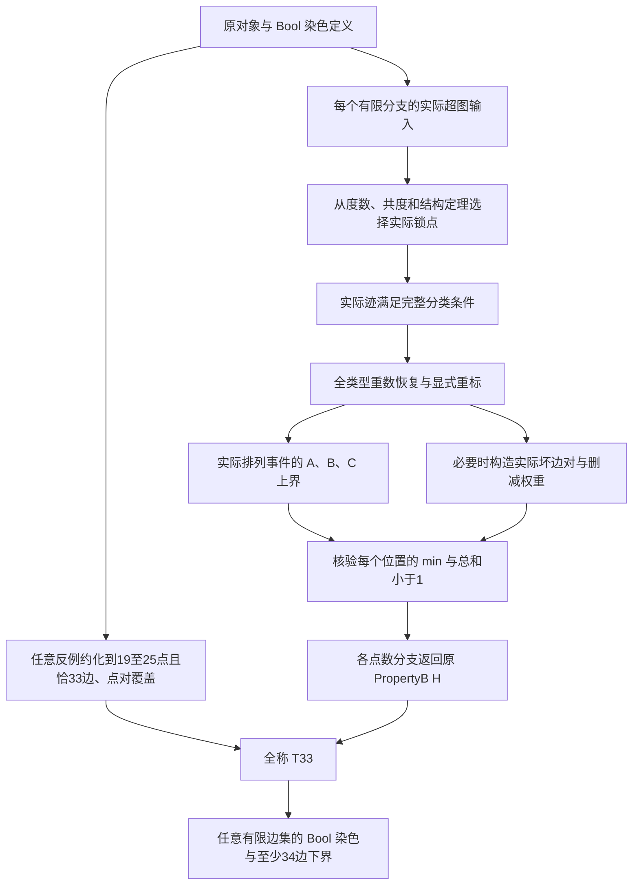

# T33 证明骨架与义务图

2026-10-13。供 ARIS proof-checker 终审使用。数学规格为 `context/propertyb33-preparation/FORMAL_SPEC_PROPERTYB_33.md`；定义和实现定位以本文件所列实际 Lean 源码为准。

**完整端到端形式证明、显式 Lake 构建与构建后原题独立导入均已通过。** `lake build Aris4Math.ThirtyThree.Main` 完成 1138 jobs，随后 `lake env lean ReviewAudit33.lean` 退出0；最终 `Target33` 没有残留分支前提，八项顶层传递公理只有标准三项。fresh proof-checker 的两项正文统计说明纠正已落实，Grok/Gemini 的最终 C 均已有效返回，在实际静态阅读范围内未发现实质缺口。数学内容、源码和执行证据分别在下面记录；本骨架不自行宣布整个 Goal 交付完成，实时状态由最终交付记录维护。原 T32 的主文件、claim 和 `PROOF_CHECK_STATE` 保持原状。

## 1. 原命题与符号

设 V 为任意有限集合，E 为由 V 的不同五元子集组成的有限集合。允许孤立顶点；不对 |V|、点对覆盖、度数、交集型、正则性或色类大小作额外假设。

命题 T33 为

\[
\forall V\text{ finite},\quad
\forall E\subseteq\binom V5,\quad
|E|\le33\Longrightarrow
\exists c:V\to\{0,1\}\ \forall e\in E:\quad
1\le\sum_{x\in e}c(x)\le4.
\]

因此每条边都包含两种颜色。等价下界是：每个不可二染色的有限简单五元超图至少有34条边，即 m(5)≥34。本项目不把这个下界写成 m(5)=34。

Lean 使用未改动的对象定义：

- `Simple5Hypergraph V` 的 `edges : Finset (Finset V)` 保证边和边内顶点均不重复，`five_uniform` 要求每条实际边的基数等于5。
- `PropertyB H` 是存在 `c : V → Bool`，每条实际边内 `c x = true` 的顶点数介于1和4。
- `Target33` 在任意宇宙的 `[Fintype V]` 上量化，仅假设 `H.edges.card ≤ 33`。独立审计稿使用 `[Finite V]`、裸边集 E 及其五元性重新表述，内部选取有限枚举实例。

记 d(x) 为实际边集中包含 x 的边数；λ(x,y) 为同时包含 x,y 的边数。点对覆盖指不同 x,y 满足 λ(x,y)≥1。记 r=|{x:d(x)=6}|、t=|{x:d(x)=7}|。这些数和集合全部由 H 计算，不作为额外抽象输入。

对 n 个选定锁点，令 w:Fin n↪V 为实际顶点嵌入，p:Fin n↪Fin v 为排列中的锁定位置。它们是不同对象：w 选择顶点，p 选择这些顶点所在位置。对 e∈E，定义实际迹

\[
\tau_w(e)=\{i\in\mathrm{Fin}\,n:w(i)\in e\},\qquad
\mu(T)=|\{e\in E:\tau_w(e)=T\}|.
\]

`MultiLockRecovery.count` 正是 μ(T)。μ 是重数函数；不同实际边可以有相同迹。尤其二元迹不被误当作0/1，三低分支的特定三元迹也保留重数。

定义入口：`formal/Aris4Math.lean`、`formal/Aris4Math/ThirtyThree/Target.lean`、`Structure.lean`、`ThirtyThree/MultiLockRecovery.lean`。

## 2. 总体义务 DAG



这张图中的“完整分类”是选定少量锁点上的有限迹数据分类。覆盖证明以实际 H 的度数、共度、边大小等事实为输入，随后恢复所有实际重数。它不要求分类所有23点超图，也不把寻找样例或搜索未命中作为正向论据。

实现有三个不同层次，终审应逐层对应：

1. 结构层构造 w，并证明其实际度数、共度和大迹条件。
2. 分类/计数层从 w 与 H 产生代表编号、重标及 `∀ T, count H w T = counts representative T`。
3. 概率层把这个全称重数等式用于 `RealizesProfile`，再从真实排列事件与严格有理数界推出 `PropertyB H`。

仅第三层的“给定 counts 则可染”不足以结束一个分支；每个完整分支都必须提供前两层的实际 caller。

## 3. R：从任意输入到七个有限分支

`ThirtyThree/Reduction.lean` 实现以下链条。

**R1：最小顶点反例。** 若某个原始 H 满足 |E|≤33 且不可染，先把有限顶点类型重新标号为 Fin v，再在所有反例的顶点数中取最小值。重新标号保持边数、五元性和可染性。入口是 `exists_minimal_counterexample`。

**R2：点对覆盖。** 若最小反例存在不共边的两个不同顶点，合并它们。每条像边仍有五个不同顶点，因为这两个点原来没有同时出现在任何边内；像边去重不增加边数。像超图的合法染色可以拉回，故合并后的超图仍不可染，违反最小性。`minimal_counterexample_pair_covering` 因而提供后续分支需要的点对覆盖。

**R3：顶点数上界。** 点对覆盖给出 4d(x)≥v−1，五元性给出 Σd(x)=5|E|≤165。若 v≥26，则每点的整数度数至少7，因此 Σd(x)≥26·7=182，矛盾。`card_le_twenty_five` 得 v≤25；使用整数度数下界，不能仅用 v(v−1)≤660。

**R4：排除至多18点。** v≤8 时可把顶点分成两个大小至多4的类。9≤v≤18 时，取大小 floor(v/2) 的均匀色类，单边单色概率为

\[
p_v=\frac{\binom{\lfloor v/2\rfloor}{5}+\binom{\lceil v/2\rceil}{5}}{\binom v5}.
\]

对这十个整数 v，33p_v<1。`balanced_count_strict` 核验十个标量式；`propertyB_of_vertices_le_eighteen` 把实际排列计数/并集界接回原染色。于是反例须 v≥19。

**R5：补边到恰33条。** 在 v≥19 的同一顶点集上，五元子集足够多；实际证明使用更弱的 v≥8 和 C(8,5)=56≥33。`exists_extension_33` 选择包含原边集的33条不同五元边。补边保持点对覆盖；若扩充后可染，则原图可染，因此不可染性也保留。该步骤不依赖旧 T32 主定理。

最终 `exists_nineteen_to_twenty_five_counterexample` 给出实际 K:Simple5Hypergraph(Fin v)，满足19≤v≤25、恰33边、不可染、点对覆盖。`target_of_finite_goal` 与七个有限分支的 `PropertyB K` 矛盾，得到任意有限 V 上的 `Target33`。

## 4. F19–F25：有限分支与假设来源

除19点入口仅需边数≤33外，下表完整入口统一接收实际 H:Simple5Hypergraph(Fin v)、点对覆盖、恰33边，并返回 `PropertyB H`。这些额外有限条件由 R 提供，不残留在 T33 的声明中。

| 分支 | 完整入口 | 内部结构与计数路径 |
|---|---|---|
| F19 | `Nineteen.nineteen_propertyB` | 无锁排列；实际 singleton-intersection 有向边对数≤1003，端点事件和临界事件上界结合。实际源码的严格总界为228354/230945<1。 |
| F20 | `twenty_propertyB` | `exists_two_locks_of_twenty` 选出实际单位共度点对及完整度数分支；11个普通类型和额外(8,8)型各由实际 caller 处理。 |
| F21 | `twenty_one_propertyB` | `TwentyOneStructure.exists_locks_of_twenty_one` 给实际二锁或三锁；相应 pair/triple caller 构造重数与必要的实际扣除。 |
| F22 | `twenty_two_propertyB` | `TwentyTwoSelection.exists_locks_of_twenty_two` 覆盖低度点对、高共度点对、三点诱导路径和四锁结构；完整入口逐一调用实际排除。 |
| F23 | `twenty_three_propertyB` | 下节六分支，完整实际入口已直接编译并独立导入。 |
| F24 | `twenty_four_propertyB` | `propertyB_or_matching_or_mixed` 先返回实际可染，或实际五低匹配，或实际混合锁点；两个剩余 caller 自行供给完整分类、实际重数与扣除。 |
| F25 | `twenty_five_propertyB` | `TwentyFiveStructure.exists_six_large_or_eight_triples` 给实际六锁大迹或八锁三元迹结构；六锁大迹 caller 或完整八锁标记分类返回染色。 |

源码分别为 `ThirtyThree/Nineteen.lean`、`Twenty.lean`、`TwentyOne.lean`、`TwentyTwoComplete.lean`、`TwentyThreeComplete.lean`、`TwentyFourComplete.lean`、`TwentyFive.lean`。

`Assembly.finite_goal_of_remaining` 已把19、20、21、22、24、25点接到有限约化，只把23点留下为显式 `RemainingGoal`。新 Main 必须提供这个命题的实际证明，不能把原来的条件装配误读为已证明 T33。

## 5. S23：六个穷尽的实际结构分支

点对覆盖使23点时每点度数至少6。由 Σd(x)=165，

\[
165\ge6r+7t+8(23-r-t)=184-2r-t,\qquad 2r+t\ge19.
\]

`TwentyThreeSelection.six_seven_budget` 与 `degree_count_cases` 从实际 H 证明这个式子与下述完整分类。所有大度顶点仍计入 Σd(x)，没有假定每个顶点只能取度6、7、8。

### S23.4：r≥4

`exists_four_sixes` 选择四个不同的实际六度点。对每个六度点，点对覆盖和4d(x)=24给出其共度超额总量至多2。这限制四锁上的共度及大迹数据。

`TwentyThreeFourLowActual.actual_representative` 从实际数据导出50个代表之一及实际全类型重数。47个非全单位代表直接使用已验证的 bare 概率界。其余3个全单位代表由 `TwentyThreeFourLowUnit` 处理：先在原 H 的 link 中取得真实坏边对，再记录其实际类型槽，之后选择适合该真实槽输入的锁定位置和删减权重。

最终入口 `TwentyThreeFourLowComplete.propertyB_of_four_sixes H cover edges33 many4` 消除代表、位置和坏槽前提。

### S23.3：r=3，所以 t≥13

`exists_three_sixes_two_sevens_of_count` 选出三个六度点和两个七度点，所有低—高共度为1。七度点对若共度≥4，则实际高共度二锁排除直接适用。其余共度由点对覆盖、六度点超额预算及七度点对上界限制。

所有大迹都保留实际重数。三低点共同三元迹可出现两次；其余大迹具有由单位点对推出的0/1界。`TwentyThreeThreeLowHighCatalog` 的覆盖义务正是这个带重数对象域。进一步的完整代表目录给372个代表和保持相关度数/共度的重标；`actual_recovered` 恢复二元、单元和空迹。

`TwentyThreeThreeLow.propertyB_of_counts` 把全类型等式转成实际 profile，并应用 `RefinedDeletion.propertyB_of_refined_deletion`。`TwentyThreeThreeLowComplete.propertyB_of_three_sixes` 从实际 H 完成全部前置输入。该最终实际调用、独立导入和普通 Lake 目录构建均已通过，并已纳入成功的新 Main 构建。

### S23.2：r=2，所以 t≥15

`exists_two_sixes_three_sevens_of_count` 选出两个六度点、三个七度点；除低点对01和一对七度点23外，其余锁点对共度全为1。若七度点对共度≥4，使用高共度排除；否则两组特殊共度都在1..3内。

任意至少三个锁标签都包含单位共度点对，因此每个大迹的实际重数至多1。实际大迹满足各点对容量预算，进入完整55个最大大迹族，再连到208个适用代表及重标。重标后的所有实际重数由边数、度数、共度和大迹恢复。

最终入口是 `TwentyThreeTwoLowComplete.propertyB_of_two_sixes`。数值层使用实际 avoided-lock 配额及非负 dual，扣除保持在 `min(A,B,C-D)` 内。本分支的直接编译、普通 Lake 构建（1018 jobs）和普通构建后的独立导入均已通过。

### S23.1b：r=1，六度点 x 存在七度非单位邻居

唯一六度点从实际 `sixVertices` 非空取得，不作为顶层输入假定。设 y 度7且 λ(x,y)≥2；六度预算给 λ(x,y)≤3。`TwentyThreeColoredSelection.exists_locks_low_bad_high_of_count` 用实际十点有色图选点，得到度数(6,7,7,7,7)的五锁；只有01和23可能非单位。

有色图的颜色来自包含 y 的真实边，每个色类至多4个顶点。选点同时证明：若 λ(2,3)≠1，则不存在实际边同时含锁点1、2、3。这个禁三元条件作用于所有包含该三元组的大迹，不能在分类中丢掉。

`TwentyThreeLowBadHighComplete.actual_forbidden` 将实际禁边事实变成目录谓词，完整分类进入130个保留代表。全类型恢复、真实 profile 和必要扣除后，`propertyB_of_low_bad_high H cover edges33 count1 x y dx dy bad` 返回原染色。

### S23.1u：r=1，x 与全部七度点单位

这是前一分支的逻辑补集。对任意七度 y，d(x)≠d(y) 保证 x≠y；点对覆盖给 λ(x,y)≥1，不存在≥2的七度邻居给 λ(x,y)<2，因此精确为1。

先排除七度点对共度≥3：≥4由实际二锁入口处理；=3由 `exists_mixed_five_of_high_three` 选出实际五锁，重排为高、高、高、高、低，使特殊点对共度为 a 和3，其余单位，其中 a∈1..3。`TwentyThreeLowUnitFiveComplete.propertyB_of_high_pair` 完整覆盖75个代表并返回原染色。

余下所有不同七度点对共度≤2。`TwentyThreeDefectSelection.exists_six_locks_low_unit_of_count` 选出五个七度点和 x，使五个高点的非单位关系图每个顶点至多一个邻居。`TwentyThreeLowUnitSixSelection.exists_locks` 从真实共度定义十个布尔边位，证明完整1024个输入中的26个匹配足以覆盖，再用固定低点标签5的显式置换规范化为0、1或2条匹配边。输出是实际嵌入 w，且每一对实际共度都等于对应规范数据。

从六锁到大迹分类时，实际边只有5点，故六元迹为0。每个大小至少3且至多5的大迹含单位点对，因此重数至多1。`BoundedTraceFamilies` 的容量递归覆盖全部可行大迹族，最大预算目录含611个输入。经过实际预算筛选与显式重标，`TwentyThreeLowUnitSixActual.actual_representative` 给243个代表之一及**全类型实际重数等式**。

数值出口把243代表分为234个 bare 和9个 dual。`TwentyThreeLowUnitSixCounts.counts_match` 还需把两个数值目录与分类目录逐类型绑定。最终 `TwentyThreeLowUnitComplete.propertyB_of_low_unit` 才把这些内容接成无内部证书前提的实际 H→PropertyB H。611覆盖、243代表实际连接、234个bare与9个dual、数值目录绑定及最终caller均已正式构建，完整入口已无内部证书前提。

### S23.0：r=0，所以 t≥19

`TwentyThreeHighComplete.propertyB_of_no_sixes` 已把以下全部结构接成实际染色结论。

首先对七度点对排除共度≥4，以及通过实际四锁选点排除共度3。于是可假设不同七度点对的共度只为1或2。若共度2关系图有诱导 P3，`TwentyThreeHighPath` 选择实际五锁并用完整115个有标号局部重数覆盖排除。

在假定原图不可染的剩余情形，共度2关系图无诱导 P3，因此是团的不交并。`TwentyThreeClusterSelection` 把真实团结构连到两个实际选点出口：

- 五个七度点，只有一个指定点对可能共度2，其余单位；
- 六个七度点，共度2恰为三个不相交的匹配点对，并且存在**实际原边**与六锁的交集大小至少4。

后三团出口中的共同原边由实际边上的 moment 不等式推出。`TwentyThreeHighFive` 与 `TwentyThreeHighSix` 分别进行完整大迹覆盖、全重数恢复和概率排除。六锁出口的大小≥4迹提供压缩分类的实际枢轴；分类的置换与覆盖均在 Lean 中证明，不能只给22个代表的算术值而省略实际枢轴。

### S23 汇合

新 `TwentyThreeComplete.propertyB_of_one_six` 完成 r=1 的两个互补分支；`twenty_three_propertyB` 对 r≥4、r=3、r=2、r=1、r=0逐一调用上述实际入口。输出只含原 `PropertyB H`，不保留 r、t、锁点、图关系、类型表或概率不等式前提。

## 6. M：实际重数与分类覆盖

这是所有局部概率证书与原超图的公共接口。

对 T⊆Fin n，令 U(T)=|{e∈E:T⊆τw(e)}|。实际有

\[
U(\varnothing)=33,\quad U(\{i\})=d(w_i),\quad
U(\{i,j\})=\lambda(w_i,w_j),\quad
U(T)=\sum_{S\supseteq T}\mu(S).
\]

`upper_empty`、`upper_singleton`、`upper_pair` 和 `sum_supers` 从原边集定义证明这些等式。给定实际大迹重数后，先用点对和式恢复二元迹，再用度数恢复单元迹，最后用33边恢复空迹。`actual_recovered` 证明恢复值对**每个** T 都等于实际 μ(T)。实现中的自然数减法有对应的实际和式作依据，不靠假设算术差恰好非负。

大迹分类所需的每个预算来自 `high_pair_budget`：包含一对锁点的实际大迹总重数不超过其真实共度。额外0/1界来自实际单位点对；大于5的迹由五元性为0；有色图禁三元或团结构的大迹条件由实际选点定理提供。

若使用代表取商，必须给出标签等价 σ，并证明实际重数在 `T.image σ` 上与代表相等。`count_relabel` 把这个等式转成重排后实际顶点嵌入的计数。数值目录的一个向量只有在这个等式成立后才用于后续 profile。

`FiveProfiles.realizes_profile`、`TwentyThreeHighSixProfiles.realizes_profile` 和 `MultiLockRecovery.realizes_recovered` 等桥接将实际 μ 与锁定位置 p 绑定到 `RealizesProfile H w p profile 33`。有限数据的有效性和这个实际实现关系是两个不同义务，最终 caller 同时提供。

## 7. P：实际排列事件、坏对扣除与严格界

在固定 w,p 后，样本空间是把实际锁点送到指定不同位置的排列。其非空性和分母由锁定排列计数定理提供。自由位置的左右集合按同一排列联合计数，不假设独立抽样。

`Greedy` 给出确定的染色过程和失败的临界位置。对每个位置 k，失败所需事件同时受到两个端点事件上界 A_k、B_k 和临界有向边对上界 C_k 控制。`EndpointCounting`、`CriticalCounting`、`ProfileProbability` 从实际排列事件推出相应公式；`ProfileApplication.endpoint_sum_eq` 和 `critical_sum_le` 用真实类型重数求和。

对于需扣除的分支，D_k 不是任意数值改善。它必须下界实际被删坏边对的总权重。

**实际坏槽。** `ActualBadSlot.exists_actual_slot` 先取得 H 中真实的 link 坏边对，记录两条边的迹 T,U。相同迹时至少有两条不同实际边；不同迹时分别具有正重数。需要单位中心条件的地方由选点定理提供，它保证共享其他锁点的边对不会被错误当成该中心的可删槽。有限选择表对这个已得到的真实槽输入选取位置，`slot_weight_lower` 再接到原边对的实际权重。

**avoided-lock 配额。** 对中心 x 和不含 x 的避开锁点集合 R，令 F_R 为含 x 且避开 R 的实际边族。其 link 是至多 v−1−|R| 个顶点上的四元集族，提供坏对配额

\[
q_R:=\max\!\left(0,\left\lceil\frac{4|F_R|-(v-1-|R|)}3\right\rceil\right),\qquad\#\mathrm{BadPairs}(F_R)\ge q_R.
\]

实现使用等价的自然数式 `(4*|F_R|+2-(v-1-|R|))/3`。`AvoidedLink.avoided_bad_pair_lower` 证明实际配额，`realized_avoided_count` 从真实 profile 算出 |F_R|。

**重叠配额的 dual。** 非负有理系数 α_R 组合各配额。某个实际无序边对被多个配额重复使用时，`dualPenalty` 对超出其双向实际权重的部分收费；这个罚项在两个方向各计一半。`dual_bad_weight_lower` 先对真实边对证明不等式，再由 `realized_penalty_sum` 按真实重数聚合。相同类型的对角容量保留 μ(T)(μ(T)−1)，不是 μ(T)^2；两个方向的权重也不被无条件视为相等。

`RefinedDeletion.realized_refined_deduction` 将有限 dual 数据接到实际删减权重。`CustomDeletion.propertyB_of_custom_deletion` 或 `RefinedDeletion.propertyB_of_refined_deletion` 最终检查

\[
\sum_{k=1}^{v}\min\{A_k,B_k,C_k-D_k\}<1.
\]

这里直接核验扣除后的最小项；不会从 C_k 下降擅自推出原最小值等量下降。不同位置各自有其删除集合；同一位置内使用实际集合/有向对计数避免重复扣除。条件并集界遂给出成功排列，`Greedy.propertyB_of_successful_permutation` 返回原 H 的 Bool 染色。

## 8. 顶层装配与独立命题检查

新 `ThirtyThree/Main.lean` 依次提供

```lean
Aris4Math.ThirtyThree.remaining_goal : RemainingGoal
Aris4Math.ThirtyThree.finite_goal : FiniteGoal
Aris4Math.propertyB_of_at_most_thirty_three : Target33
Aris4Math.two_colorable_of_at_most_thirty_three
Aris4Math.non_propertyB_edges_ge_thirty_four
```

前三个阶段分别是实际23点、全部19–25点、任意有限顶点类型。最终 `Target33` 不应携带 `RemainingGoal`、分支 oracle、profile、锁点、概率界或分类证书作为参数。

`formal/ReviewAudit33.lean` 单独导入新 Main，从裸 `Finset (Finset V)` 和 `[Finite V]` 构造原超图。它检查三个等价阅读入口：红点数在1..4、每条边分别存在 true 顶点与 false 顶点、不可染边集的基数至少34。所有颜色仍是原顶点类型 V 上的函数，不是代表图或局部迹上的函数。

该独立导入调用同一套已构造证明，不自称第二份数学证明、另一台机器复现或人工审阅。实际输出已确认这些导出的传递公理仅为 `propext`、`Classical.choice`、`Quot.sound`；原始对象/量词的展开类型及两种颜色均出现的版本也已通过。

## 9. 执行与审阅证据（与数学骨架分列）

近期执行证据如下：

- r=0 完整入口：`round02/twentythree-selection/high-complete-build.log`、`HighCompleteImportAudit.lean`、`high-complete-import-audit.log`，含原 Bool 染色调用和标准三公理审计。
- r=1 高共度五锁：`low-unit-five-catalog-build.log`、`low-unit-five-complete-build.log`、`low-unit-five-import-audit.log`；完整实际 caller 和独立原染色调用均通过。
- r=1 六锁匹配选点：`low-unit-six-selection-build.log`、`low-unit-six-selection-import-audit.log`；实际嵌入、度数/共度展开及传递公理通过。
- r=1 bad、r≥4 的正式构建与独立导入日志分别在 `round02/low-bad-high/`、`round02/four-low-unit/`。
- r=2 的完整直接编译、普通 Lake 构建（1018 jobs）及构建后独立导入均通过。r=3 的数值、分类目录、实际入口均已通过正式构建，并纳入新 Main 的成功构建。
- r=1 unit 的全部目录、bare/dual、`SixCounts` 与 `LowUnitComplete` 已正式构建（1032 jobs）并独立导入通过；证据在 `round02/low-unit/`。

最后装配的 `round02/final-assembly/twenty-three-direct.log`、`main-direct.log` 与 `original-statement-import-audit.log` 全部退出0。显式 `lake build Aris4Math.ThirtyThree.Main` 又完成1138 jobs，退出0，记录在 `main-build.log` 与 `main-build.meta.json`。随后 `lake env lean ReviewAudit33.lean` 退出0，记录在 `original-statement-post-build-audit.log` 与同名 `.meta.json`；该输出与此前原题独立导入一致，8项顶层传递公理均只有标准三项。这是本机保留锁定缓存的增量构建，不记为另一台机器或他人独立复现。

早期两个条件试编文件位于 `round02/twentythree-selection/`：`TwentyThreeConditionalCaller.lean` 与 `FinalStatementConditionalCaller.lean`。它们保留分支或 Target 作为显式参数，属于接口试验记录；正式验收使用后来完成的实际 Main 和裸原题审计。

fresh proof-checker 读取完整正文并独立复算，未识别实质数学缺口；21点最大值及三低完整标签域的两处说明已纠正，冻结原稿的 `WARN` 与 exact-diff 核对保留在 `.aris/traces/proof-checker/2026-10-13_t33_run01/`。同家族审阅仍为 provisional。Grok 最终 C 和 Gemini 全新 retry1 最终 C 均有效返回；它们静态读取实际源码、正文和已有输出，没有执行 Lean。原回应、各自实际范围、笔误处置以及首轮 Gemini 连接失败记录见 `round02/reviews/REVIEW_DISPOSITION.md`。审阅提交时的构建在途快照由上述后续实际输出覆盖。

单卷 HTML 的全文与公式保真、离线桌面/手机显示检查为 PASS，记录在 `.aris/traces/render-html/2026-10-13_t33_run01/`；该检查只评价呈现，不替代数学核验。最终形式核验说明为 `context/propertyb33/FORMAL_VERIFICATION.md`，原题复现交接为根目录 `HANDOFF_FOR_REVIEW_33.md`，正式审计为本目录 `PROOF_AUDIT.md/json`；整体 Goal 的交付状态单独由 `PROOF_CHECK_STATE.json` 和实时 Goal 工具维护。

此前纸面候选的 JSON、独立算术复算和模型意见可作为交叉核对材料；有限覆盖、真实输入连接及内核接受仍以本轮对应源码和执行日志为准。原始候选地图入口是 `round01/large-math/COMPLETE_CANDIDATE_MAP.md`；其中的历史“尚未形式化”与旧数值快照不替代本轮实际记录。
