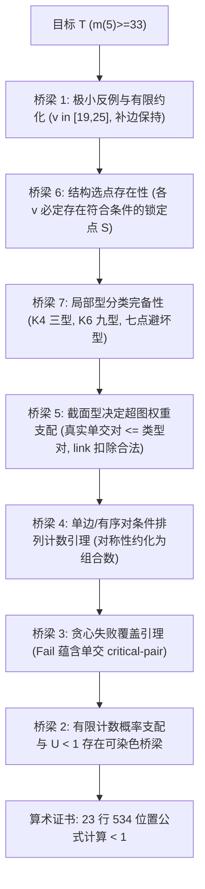

针对当前候选证明的结构与特征，对五个核心问题作出独立判定与可执行的工程路线规划：

---

### 一、能否避开 $17!\dots 25!$ 排列枚举，将一般论证形式化为有限整数计数，再用小型证书验证 534 个位置？

**结论：完全可以，且这是形式化唯一现实的算术通道。**

1. **避免排列枚举的数学本质（Fibering / 纤维化原理）：**
   - 条件排列空间大小为 $N! = (v-s)!$。在 $v=25, s=6$ 时 $N=19$，$19! \approx 1.21 \times 10^{17}$，绝不能逐排列遍历。
   - 证明中的单边端点概率与单交对端点概率（[PROBABILITY_LEMMAS.md](file:///Users/rfy_naiveai/Desktop/aris4math/proofs/PROBABILITY_LEMMAS.md#L60-L100) 的 P2–P4）不是积分或极限，而是**对称群作用下的均匀纤维计数**：
     - 固定一条边 $e$（自由点数 $r_T$），要求指定自由点落在位置 $k$，其余 $r_T-1$ 个点落在 $k$ 之前的 $a_k$ 个空位。
     - 满足条件的排列数精确为：
       $$\binom{a_k}{r_T - 1} \times (r_T - 1)! \times b_k! = \binom{a_k}{r_T - 1} \times (r_T - 1)! \times (N - r_T)!$$
     - 样本空间总排列数为 $N!$。两数相除，排列因子 $(N-r_T)!$ 与全排列完全消去，直接得到：
       $$\frac{r_T \binom{a_k}{r_T-1}}{N \binom{N-1}{r_T-1}}$$
   - 因此，**形式化根本不需要对排列做大数枚举**。在有限集理论中，这一步只需证明一个**通用的整数整除/组合抽样引理**：在对称群子群作用下，满足相对位置约束的置换占比精确等于位置子集组合数之比。
2. **23 行 534 位置小型算术证书的可行性：**
   - 整个数值部分（[reproduce_bounds.py](file:///Users/rfy_naiveai/Desktop/aris4math/computations/reproduce_bounds.py#L32-L60)）只有 23 个配置文件（Profile），累计 534 个位置 $k$。
   - 每个位置的 $A_k, B_k, C_k$ 求和项数至多为截面类型的平方（$s \le 6$ 且非零类型数至多 10，每项求和不超过 100 次基本有理数乘法）。
   - **证书设计**：直接生成一个静态只读字典（JSON / 数据表），记录每个位置的 $(A_k, B_k, C'_k)$、所选取的最小项索引 $m_k$ 及其有理数取值，以及每个分支的求和 $U = \sum_{k=1}^v m_k$。
   - 检查该证书仅需执行 534 次三数比大小（$m_k \le A_k \land m_k \le B_k \land m_k \le C'_k$）和 23 次有理数求和验证（$U < 1$），在内核算术下耗时为毫秒级。

---

### 二、Lean 形式化不可省略的 7 大语义桥梁与算术证书的“盲区”

即使上述 534 个位置的算术证书在 Lean 内核中 100% 验证通过（PASS），**它也仅仅证明了“给定这 23 个数字元组，代入该代数公式计算出的有理数小于 1”**。它完全不涉及任何超图。

要认证主目标 **$T$（$m(5) \ge 33$）**，以下 7 个语义桥梁**缺一不可、无法省略**：



#### 单独算术证书即便 PASS 依然无法保证的致命盲区：
1. **结构存在性与覆盖完备性（Structural Coverage）**：
   - 算术证书假定了某 Profile 存在。但超图是否一定包含该度数配置的点？例如 $v=23$ 的分支二分（要么有 $(6,6)$ 共度 1，要么有 $(6,7,7)$ 共度 1 且三重共度 0）是否完备？
   - $v=25$ 中是否存在七个六度点？七点中是否必定存在不属于例外型 K6-4 的六元子集？（若算术验证了 9 个型全对，但实际超图的子集全落入第 10 个未枚举型，证明即溃败）。
2. **扣除合法性（Deductions Validity）**：
   - $v=22, 23$ 中执行的 link 修正 $C'_k = C_k - D_k$：扣除的边对必须在实际超图中对应共度大于 1 的“坏对”，且在当前中心位置 $k$ 处的权重严格非零，且不同坏对之间在位置 $k$ 没有重复扣除。
3. **事件覆盖真伪（Greedy Covering）**：
   - 贪心算法失败时，确实能抓出 $A \cap B = \{x\}$ 且 $x$ 是唯一临界点吗？（算法依赖单向蕴含，这必须在排列语义上严格化）。

---

### 三、最高收益的可立即实施首个模块与精确 Lean 4 定理声明

**策略**：绝不要在第一阶段碰极其繁重的有限线性空间分类（Doyen 1967）或 Ramsey 式度数极值论证。
**最高收益切入点**：证明**“有限贪心失败覆盖 + 抽象有限计数上界 $\implies$ 存在合法二染色”**。该模块完全独立于具体超图结构，不把最终上界偷渡为超图性质。

#### 精确 Lean 4 形式化规格（无需连续概率，纯有限集）：

```lean
import Mathlib.Data.Finset.Basic
import Mathlib.Data.Rat.Basic
import Mathlib.GroupTheory.Perm.Basic

variable {V : Type*} [DecidableEq V] [Fintype V]

-- 1. 核心定义: 5-uniform 与合法染色
def IsFiveUniform (E : Finset (Finset V)) : Prop :=
  ∀ e ∈ E, e.card = 5

def IsValid2Coloring (E : Finset (Finset V)) (c : V → Bool) : Prop :=
  ∀ e ∈ E, ∃ u v, u ∈ e ∧ v ∈ e ∧ c u ≠ c v

-- 2. 贪心算法的有限确定性定义 (基于排列 σ : Equiv.Perm V)
-- 顶点按 σ 升序扫描, 若存在全红边以当前点为最大元, 则将该点置为 true (蓝), 否则 false (红)
def greedyColor (E : Finset (Finset V)) (σ : Equiv.Perm V) : V → Bool :=
  sorry

-- 3. 语义桥梁一: 失败事件覆盖 (P1)
-- 失败必然蕴含单交临界边对
theorem greedy_failure_covering (E : Finset (Finset V)) (h5 : IsFiveUniform E)
    (σ : Equiv.Perm V) :
    ¬ IsValid2Coloring E (greedyColor E σ) →
    ∃ (A B : Finset V) (x : V),
      A ∈ E ∧ B ∈ E ∧ A ≠ B ∧ A ∩ B = {x} ∧
      (∀ y ∈ A, y ≠ x → σ y < σ x) ∧
      (∀ z ∈ B, z ≠ x → σ x < σ z) :=
  sorry

-- 4. 语义桥梁二: 纯有限计数/加权 Union Bound 判定存在性 (主桥梁)
-- 注意: 不假设任何具体上界, 上界 U 作为前置假设施加于具体实例
theorem existence_of_coloring_from_finite_bound
    (E : Finset (Finset V))
    (Ω : Finset (Equiv.Perm V)) (hΩ : Ω.Nonempty)
    (Q : Fin (Fintype.card V) → Equiv.Perm V → Prop)
    [∀ k σ, Decidable (Q k σ)]
    (h_cover : ∀ σ ∈ Ω, ¬ IsValid2Coloring E (greedyColor E σ) → ∃ k, Q k σ)
    (U : Fin (Fintype.card V) → Rat)
    (h_bound : ∀ k, ((Ω.filter (Q k)).card : Rat) ≤ U k * (Ω.card : Rat))
    (h_sum : (Finset.univ.sum U) < 1) :
    ∃ c : V → Bool, IsValid2Coloring E c := by
  sorry
```

**为什么这个模块收益最高？**
- 它用纯粹的组合计数彻底绕开了测度论与概率单子（Probability Monad）；
- 它正式闭合了“为什么 $U < 1$ 就能断言 $H$ 具有 Property B”的逻辑飞跃；
- 它的形式化工作量小（约 200–300 行 Lean 代码），却直接锁死了证明核心骨架的操作语义。

---

### 四、Lean 内核检查 vs SAT LRAT/DRAT 全实例证明的适配性对比

| 维度 | SAT 全实例 LRAT/DRAT 方案 | Lean 4 内核检查（Kernel Reduction） |
| :--- | :--- | :--- |
| **求解目标** | 对反例搜索约束（[FORMAL_SPEC.md](file:///Users/rfy_naiveai/Desktop/aris4math/FORMAL_SPEC.md#L60-L69) 式 E2）证明 **UNSAT** | 形式化本候选证明的逻辑推导与算术不等式 |
| **问题规模** | $v=25$ 时变量 $\binom{25}{5} = 53,130$，覆盖子句 $2^{24} \approx 1.67 \times 10^7$ | 符号推导定理 + 534 个位置的有理数四则运算 |
| **计算复杂度** | **完全不可行**。超图不同构空间达天文数字，直接在 CNF 上求无条件 UNSAT 证明证书将超过现有求解器极限数万倍。 | **完全可行**。算术证书几毫秒即可验完；结构引理为离散归纳。 |
| **TCB (可信基)** | SAT 求解器 (非信任) + **LRAT 独立验证器** + 原始问题 CNF 编码生成脚本 (需信任) | **Lean 4 内核** (~几千行核心代码) + Lean 环境标准库 |
| **运算信任边界** | LRAT 检查器通常由 C / Rust 写成，完全独立于求解过程。 | **必须严格区分 `rfl`/`decide` 与 `native_decide`**（见下文详述）。 |

#### 必须明确的 Lean 计算信任关键警告：
- **`decide` / `rfl`（内核规约）**：Lean 内核严格按照类型推导规则在自身虚拟机内对有理数表达式进行规约。它的可信度等同于 Lean 内核本身，不引入任何外部信任。
- **`native_decide`（外部编译执行）**：它将 Lean 代码编译为 C++ 代码，调用机器本地二进制执行，并在证明项中注入一个信任公理（axiom）。**切勿在严格数学证明中使用 `native_decide` 替代算术验证**，否则会把 C++ 编译器、链接器和 OS 运行时全部纳入可信计算基！

---

### 五、可信计算基（TCB）与原始命题对应边界及实施路线

要实现严肃的数学认证，必须明确划分**什么是经过机器验证的**，**什么仍然依赖人工审查**：

#### 1. 严格审查的 TCB 清单
1. **Lean 4 内核与类型系统**：这是形式化验证的核心可信基。
2. **顶层命题的语义保真度（Spec Correspondence）**：
   - 形式化目标必须是：
     $$\forall (V : \text{Type}) [V \text{ 有限}],\ \forall E \subseteq \binom{V}{5},\ |E| \le 32 \implies \text{PropertyB}(V, E)$$
   - 若形式化直接将对象定义为“度数和为 160 的超图”或“$v \in [19, 25]$ 的超图”，则**有限约化过程（R1–R4）被遗漏在形式化之外**，仍需人工保证约化等价性。

#### 2. 可执行、节约复杂度的分步实施路线

```
[阶段 0: 证伪试金石 (正在执行)]
  ↳ 拿已知不可染实例 (51/66/126 边) 强行输入候选 U 公式。
  ↳ 必须验证: 对这些实例绝对算不出 U < 1 (确保公式没有泛化虚假可染性)。

[阶段 1: 建立形式语义与失败覆盖桥梁 (Lean 4, 低复杂度)]
  ↳ 形式化 IsValid2Coloring, greedyColor, P1 覆盖定理。
  ↳ 形式化纯有限计数 Union Bound 存在性定理 (问题三中的定理)。

[阶段 2: 算术证书静态生成与内核验证 (Lean 4, 零人工证明复杂度)]
  ↳ 用 Python 将 23 组 profile 的 534 个位置导出为 Lean 4 的结构体数据表。
  ↳ 在 Lean 4 中实现微型 ProfileEvaluator，使用标准 `decide` (纯内核) 验证各 U < 1。

[阶段 3: 结构与完备性形式化 (分步攻坚)]
  ↳ 优先形式化 22/23 点的 link 扣除下界合法性 (最紧分支 645/646)。
  ↳ 形式化 24/25 点的团分解分类穷尽性 (K4/K6) 与七点避坏型引理。
```

这种方案将**耗费人力的数学证明**（结构分类）与**机械但繁重的计算**（534 个分数值）完全解耦，既不会陷入无边无际的暴力排列，也不会因孤立的数值 PASS 而产生虚假安全感。
