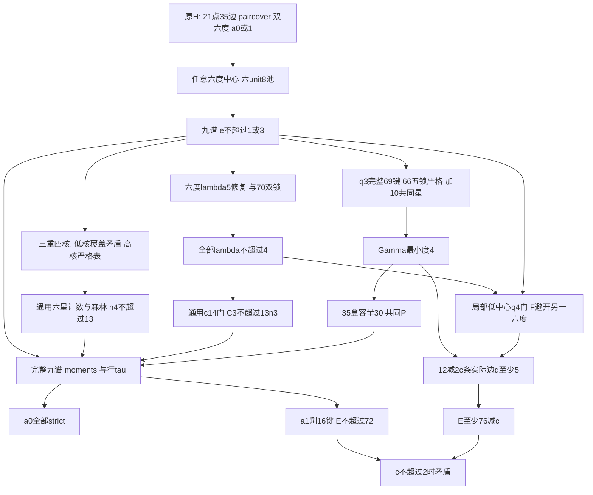

# 二十一点恰二六度、至多一七度的实际分支

## 结论、原题接口与验收状态

**定理。** 设 \(H\) 是21点上的35条互异五元边，覆盖所有不同点对，最小点度为六。恰有两名六度点 \(x,y\)，恰有 \(a\in\{0,1\}\) 名七度点，其余点度至少八。则：

1. 若 \(a=0\)，则 \(H\) 具有 Property B，不另限制 \(\lambda(x,y)\)；
2. 若 \(a=1\) 且 \(\lambda(x,y)\le2\)，则 \(H\) 具有 Property B。

这里 Property B 指原 \(H\) 的全部35条边在同一份二染色中均含两色。点对覆盖是当前最小反例约化后的实际输入条件，不作为任意五元超图都满足的假设。本文不声称全部21点分支或 \(m(5)\ge36\) 已闭合。

本文为 **candidate，等待指定跨家族 reviewer 对这份新迁移的审阅**。完整数学装配已由 root 阅读；root 实际重跑双锁70项、q3五锁69项、迁移六锁10项以及九谱独立 moment 核验，均在下述准确范围内通过。它们是确定性有限核和实际输入连接，不是 Lean 验证。此前对唯一六度稿件的外部审阅不自动覆盖本文。

主要证据目录为

[`context/propertyb35-paper/round01/middle/two_six_transfer_20261020/`](../../context/propertyb35-paper/round01/middle/two_six_transfer_20261020/PROOF.md)。

## 1. 任一实际六度星给全部九个度谱

反设 \(H\) 没有 Property B。记 \(b\) 为八度点数，并令

\[
e=\sum_{v\in V(H)}(d_H(v)-9)_+.
\]

总度为175，因此

\[
12+7a+8b+9(19-a-b)+e=175,
\qquad e=2a+b-8. \tag{1}
\]

对任一六度点 \(z\in\{x,y\}\)，点对覆盖给 \(\lambda(z,v)\ge1\)，且

\[
\sum_{v\ne z}\lambda(z,v)=4d(z)=24,
\qquad \sum_{v\ne z}(\lambda(z,v)-1)=4. \tag{2}
\]

故至多四名八度点与 \(z\) 非单位相交。已有[六名单位八度邻点定理](../../context/propertyb35-paper/round01/twentyone-high/unique6_with7/new_structure_20261020/SIX_UNIT8_POOL_PROOF.md)的声明明确允许任意六度中心，不要求它是唯一六度点：六名不同八度邻点若与该中心共度一，便给原 \(H\) 合法染色。因此非B时至多五名八度邻点与 \(z\) 单位，得到

\[
8-2a\le b\le9,
\qquad 0\le e\le2a+1\le3. \tag{3}
\]

用 \(e\) 的正整数分拆表示九度以上的盈余。全部度谱是两名六度、\(a\) 名七度、\(b\) 名八度以及 \(19-a-b\) 个九度基线，再将该分拆加在不同基线上。每谱至少有九名度数不低于九的点，盈余至多三，不会因基线不足丢掉分拆。\(a=0\) 恰两谱，\(a=1\) 恰七谱；第6节列出全部九谱及实际完整域结果。

## 2. 同一个原 \(H\) 的三个必要容量

### 2.1 全部原点对共度至多四

若点对含六度点 \(z\)，式(2)先给共度至多五。[六度共度五直接修复](../../context/propertyb35-paper/round01/middle/generic_high_degree_pair_gates_20261020/REPORT.md) §5 不限制其他点度或六度点数量：共度五用尽该星四份重复，五个含另一中心的三元 petal 两两不交，另有一个四点块。在20点的10/10样本中，两色同时产生单色 link 的样本数为

\[
2\left[\binom{15}{9}-5\cdot3^5\right]=7580.
\]

可为 \(z\) 选择合法颜色的星兼容样本至少

\[
\binom{20}{10}-7580=177176.
\]

29条避 \(z\) 原边的坏样本 union 至多 \(29\cdot6006=174174\)，故存在星兼容且其余边 proper 的样本，给原 \(H\) 染色。因此非B排除该共度五。

其余实际点度在7至12之间；任意两点 \(u,v\) 满足

\[
(d(u)-9)_++(d(v)-9)_+\le3.
\]

它们若共度 \(c\ge5\)，精确双锁迹库存为

\[
\mu_0=35-d(u)-d(v)+c,\quad
\mu_1=d(u)-c,\quad
\mu_2=d(v)-c,\quad \mu_3=c. \tag{4}
\]

[`PAIR_VERIFY.py`](../../context/propertyb35-paper/round01/middle/two_six_transfer_20261020/PAIR_VERIFY.py)完整覆盖这些选中度数及 \(5\le c\le\min(d(u),d(v))\) 的70项，仅使用固定位置 \((10,21),(21,10)\)，全部零配额严格，最大

\[
\frac{230293}{230945}<1. \tag{5}
\]

计算展开35条不同原边索引和1190个有序异边对，以无放回下降阶乘注入公式逐位置计算原条件排列界。没有读取未选点的度数。故该有限表完整覆盖当前实际点对，得到

\[
\lambda(u,v)\le4\quad\text{对所有不同原点 }u,v. \tag{6}
\]

### 2.2 四交边对数 \(n_4\le13\)

先排除三条原边共同包含四点核 \(K\)。若 \(K\) 含六度点且有 \(r\ge3\) 条中心边包含 \(K\)，六条中心边在 \(K\) 外至多覆盖

\[
r+4(6-r)=24-3r\le15
\]

点，而点对覆盖要求覆盖 \(K\) 外全部17点，矛盾。

若 \(K\) 避开两名六度点，四点度均至少七，且其总九度以上盈余至多三。[通用三重四核门](../../context/propertyb35-paper/round01/middle/generic_quad_core_multiplicity_three_20261020/PROOF.md)的完整6923标签／3809代表覆盖该必要域。3805代表严格；四个未严格尾均有四点度数 \((10,10,10,10)\)，需盈余四，已被式(3)排除。此处不调用唯一六度 A3 的额外23份星修复。

因此每个四点集至多属于两条原边。固定任一六度点 \(z\)，删除其六条边，得20点29边的 \(\overline H\)。[完整六度星计数](../../context/propertyb35-paper/round01/middle/generic_degree_six_star_count_20261020/PROOF.md)给星兼容10/10样本至少164896；[一般非单交森林秩引理](TWENTYONE_A1_BALANCED_STAR_FOREST.md)给 \(\overline H\) 的非单交图森林秩至少 \(29-20+2=11\)。二者均不依赖全局六度点唯一性。

若 \(\overline H\) 的四交图有四条森林边，可将它们扩为十一条非单交森林边，再补成同一坏事件生成树。平衡单坏分子6006；交0、1、2、3、4的共同坏分子依次为506、22、132、572、2002，因此 Hunter 树至少扣除

\[
4\cdot2002+7\cdot132+17\cdot22=9306.
\]

可用样本至少 \(164896-29\cdot6006+9306=28>0\)，给 \(H\) 染色，矛盾。故该四交图森林秩至多三，四交边对至多 \(\binom42=6\)。每条过 \(z\) 原边在 \(\overline H\) 中至多有一个四交邻边，否则三条边共享它的四点 link；跨星至多六对。星内至多一对四交：两对不同四元 link 若都至少三交，重复成本至少 \(3+3=6\)，违反式(2)。因此

\[
n_4\le6+6+1=13. \tag{7}
\]

### 2.3 三交共同 middle 容量

[通用 c14 门](../../context/propertyb35-paper/round01/middle/generic_c3_fourteen_gate_20261020/PROOF.md)仅需选中点对共度至多四和选中四点高盈余至多四；不要求唯一六度、其他度角色或点对覆盖。因此式(3)、(6)使其直接适用于同一 \(H\)，给

\[
C_3\le13n_3. \tag{8}
\]

这里 \(C_j\) 是交 \(j\) 的实际外边对的 valid middle 数之和；所有计数仍属于同一35条原边。

## 3. 三例外门迁移：\(\delta(\Gamma)\ge4\)

在35条原边上定义简单图 \(\Gamma\)：两条原边相邻，当且仅当其交大小不等于一。已有[通用低非单交度修复](TWENTYONE_TWENTYTWO_MINIMUM_NONUNIT_DEGREE_THREE.md)不带度角色前提，给非B时 \(\delta(\Gamma)\ge3\)。

若实际原边 \(F\) 的 \(\Gamma\)-度恰三，将五点编号0至4。三条例外迹 \(T_1,T_2,T_3\subset F\) 的大小在 \(\{0,2,3,4\}\)，允许重复。其余31条边恰交 \(F\) 一点，记附着数为 \(a_v\)，则

\[
\sum_v a_v=31,\quad h_v=\#\{j:v\in T_j\},\quad d_H(v)=1+a_v+h_v. \tag{9}
\]

任选 \(v\in F\) 红、其余四点蓝，在外部16点均匀取 \(r\) 个红点。令

\[
D_r=\binom{16}r,\ R_r=\binom{12}{r-4},\ B_r=\binom{12}r,
\ J_r=\binom8{r-8}.
\]

在红附着坏事件上取任意树，逐样本有效的 union 上界为

\[
U(v,a_v,r)=a_vR_r+(31-a_v)B_r-(a_v-1)_+J_r
+\sum_{j=1}^3 E(T_j,v,r), \tag{10}
\]

其中

\[
E(T,v,r)=
\begin{cases}
0,&v\in T,\\
\binom{11}{r-5}+\binom{11}r,&T=\varnothing,\\
\binom{11+|T|}r,&v\notin T,\ |T|\in\{2,3,4\}.
\end{cases} \tag{11}
\]

不合法下参数的组合数为零。若 \(U<D_r\)，即有使原 \(H\) 每条边 proper 的实际样本。

既有完整3276标签／91个真实 \(S_5\) 轨道及全部 \(r=0,\ldots,16\)、\(a_v=0,\ldots,31\) safe sets，留下119份附着必要输入。本次[迁移核验](../../context/propertyb35-paper/round01/middle/two_six_transfer_20261020/Q3_TRANSFER_VERIFY.py)从该完整域重建119键，再施加实际必要条件：五点度至少六、至多两名六度、至多 \(a\) 名七度、总高盈余至多 \(2a+1\)。\(a=0\) 得13键，\(a=1\) 得69键，前者包含于后者。

同一既有16固定位置菜单、零配额给69键中的66键严格；每键均展开35索引／1190有序异边对独立逐行重放。新增的双六度尾

\[
(T_1,T_2,T_3)=(0,0,7),\quad
(a_0,\ldots,a_4)=(7,7,7,5,5),\quad
(d_0,\ldots,d_4)=(9,9,9,6,6)
\]

在位置 \((4,3,12,2,1)\) 的界是 \(38361/40040<1\)。仅余三个旧尾：

|尾|例外迹 mask|singleton 数|实际 \(F\) 度数|\(F\) 高盈余|
|---|---|---|---|---:|
|A|7,11,28|6,7,7,6,5|9,10,10,9,7|2|
|B|7,25,30|4,7,7,7,6|7,10,10,10,9|3|
|C|7,25,30|5,7,7,6,6|8,10,10,9,9|2|

\(a=0\) 有 \(e\le1\)，三者均不可能。设 \(a=1\)，取任一实际六度点 \(z\)；三尾的 \(F\) 都不含六度点，故 \(z\notin F\)。三条例外迹都非空，所以六条 \(z\) 边都非空地交 \(F\)。覆盖五点至少需五份关联，六条非空迹实际至少给六份，令

\[
\rho_F=\sum_{v\in F}(\lambda(z,v)-1)\ge1.
\]

若某条 \(z\) 边取三／四迹，则六条非空迹总关联至少八，故 \(\rho_F\ge3\)；若全部取 singleton，则其五点计数恰为五种 \(\mathbf1+\mathbf e_i\)。

对A、C，\(e\ge2\)，式(1)给 \(b=6+e\ge8\)，故至少 \(b-5\ge3\) 名八度邻点与 \(z\) 非单位。A的 \(F\) 没有八度点，至少三份重复在 \(F\) 外，式(2)使 \(\rho_F\le1\)。C的 \(F\) 只有一名八度点，至少两份重复在 \(F\) 外，使 \(\rho_F\le2\)。两者都排除三／四迹，只剩各五份 singleton 星。

对B，\(e\ge3\) 迫 \(e=3,b=9\)；\(F\) 没有八度点，至少四名非单位八度邻点都在 \(F\) 外，用尽四份重复，迫 \(\rho_F=0\)，与前述 \(\rho_F\ge1\) 矛盾。

A、C各五份 singleton 星恰为既有[47份共同六锁库存](../../context/propertyb35-paper/round01/middle/three_nonunit_direct_repair_20261020/SIX_LOCK_COMMON_STAR47.json)的十份子集；锁标签是 \(z\) 和 \(F\) 五点。其固定零配额概率界只读这35条实际六锁迹，不读第二名六度点所在的自由部分。本次重新展开35索引逐行重放十份，最大 \(64/65<1\)。所以三尾也全部回到原 \(H\) 染色，矛盾。由此

\[
\delta(\Gamma)\ge4. \tag{12}
\]

本节不使用式(6)、(7)、(8)，故没有借强共度或后续 middle 门循环证明最小度四。

## 4. 四例外低中心门的准确局部版本

### 4.1 可删除全局唯一性的局部声明

**局部引理。** 设 \(H\) 为21点35条互异五元边，\(F\in H\)，\(z\in F\)。假设：

- \(d(z)=6\)，\(F\setminus\{z\}\) 的四点度均至少七；
- \(F\) 中至多三点度七，且 \(\sum_{v\in F}(d(v)-9)_+\le4\)；
- \(F\) 内每个点对的原共度至多四；
- 六条过 \(z\) 原边覆盖其余全部20点；
- \(q_\Gamma(F)=4\)。

则 \(H\) 有 Property B。这里不要求 \(z\) 是全局唯一六度点，不限制未选点的度数。

证明与已送审的[原低中心 q4 稿](../../context/propertyb35-paper/round01/middle/four_nonunit_degree_six_center_20261020/REPORT.md)使用同一有限核，不修改其源或扩大其既有审阅记录。下面逐步列出其全部输入，说明局部版本为何成立。

### 4.2 从局部输入完整恢复 q4 库存

令 \(z\) 为 \(F\) 的 bit0，其他点为 bits1至4。四条不同非单交邻边的 \(F\) 迹 \(T_1,\ldots,T_4\) 可重复，大小在 \(\{0,2,3,4\}\)。其余30条原边的 singleton 计数为 \(a_v\)。精确恒等式是

\[
\sum_v a_v=30,\qquad h_v=\#\{j:v\in T_j\},\qquad
d_H(v)=1+a_v+h_v,\qquad a_0=5-h_0. \tag{13}
\]

最后等式只使用所选 \(z\) 六度；其他点至少七只在当前 \(F\) 内使用。因 \(F\) 自己已包含每个内部点对，共度上限给

\[
\#\{j:u,v\in T_j\}\le3\quad(u\ne v\in F). \tag{14}
\]

六条过 \(z\) 边的重复成本恰四；\(F\) 已各覆盖一次其余四名锁点，故

\[
\sum_{j:z\in T_j}(|T_j|-1)\le4. \tag{15}
\]

式(13)至(15)与 \(F\) 内度条件就是原 `VERIFY.py` 读取的全部实际条件。原代码没有枚举或查询未选点的度，亦没有查询“全局只有一名六度”这个谓词。全局唯一性在原稿中只曾用来保证 \(F\) 的其他四点度至少七；本局部声明已直接提供这个必要条件。

### 4.3 完整锚点分类与五份余证书

仍用式(11)的异常边样本数，q4的红树 union 上界是

\[
U_4(v,a_v,r)=a_vR_r+(30-a_v)B_r-(a_v-1)_+J_r
+\sum_{j=1}^4 E(T_j,v,r). \tag{16}
\]

它来自同一原 \(H\) 的坏事件，故 \(U_4<D_r\) 直接给原染色。四个 residual 类型 \(P,0,2,3,4\) 形成70组；逐组对 \(a=0,\ldots,30\) 和 \(r=0,\ldots,16\) 完整保留 safe/failure sets，不使用未经证明的单调失败尾。

26种单条合法迹的四重 multiset 共 \(\binom{29}{4}=23751\) 标签。真实对称群仅为固定 bit0 的 \(S_4\)，共1563个迹轨道。原程序展开各轨道实际群像，核互不交且恰覆盖23751标签。式(14)排162轨道，式(15)排576轨道，bit0严格锚点关闭645轨道，其他点 safe sets 与实际度条件再关闭175轨道，恰剩五个轨道、各一个附着输入。独立实现直接遍历完整23751标签，用 incidence signature 和互补组合数重建，得到40个标签输入、五个联合轨道；70组完整 failure sets 也逐组相等。

五份完整原迹及固定证书为：

|四例外迹 mask|singleton 数|\(F\) 原度|五锁位置|严格界|
|---|---|---|---|---|
|0,0,3,30|4,8,6,6,6|6,11,8,8,8|4,3,12,2,1|36739/40040|
|0,0,6,26|5,8,5,6,6|6,11,7,8,8|4,3,12,2,1|3383/3640|
|0,0,7,30|4,8,8,5,5|6,11,11,7,7|11,3,2,12,1|38477/40040|
|0,6,25,30|4,6,6,7,7|6,9,9,10,10|4,3,12,2,1|233003/240240|
|0,7,26,30|4,8,6,6,6|6,12,9,9,9|4,12,3,2,1|213/220|

每份库存是一条 mask31 的 \(F\)、上述四条例外边以及各 singleton 的实际重数，总数35。五锁位置来自同一既有16固定菜单，全部零配额。用[条件排列概率引理](../PROBABILITY_LEMMAS.md)逐位置计算

\[
\mathcal U=\sum_{k=1}^{21}\min(A_k,B_k,C_k). \tag{17}
\]

\(A,B\) 是单边风险，\(C\) 向全部兼容有序异边对收费。若自由点数为 \(N\)、pivot左右自由位置数为 \(\ell,r\)，一对自由需求为 \(p,q\)，则自由 pivot 的双边注入权是

\[
\frac{(\ell)_{p-1}(r)_{q-1}}{(N)_{p+q-1}},
\]

固定 pivot 的对应权是 \((\ell)_p(r)_q/(N)_{p+q}\)。所有概率只由这35条原迹及固定位置决定。原核另展开35个不同索引、1190个有序异边对，以下降阶乘实现独立重算105行，逐行和总数完全相等，最大 \(233003/240240<1\)。由条件排列引理给实际 \(H\) proper 染色。群像运输同时搬运实际点标签及位置，覆盖全部40标签余项。因此局部引理成立。∎

### 4.4 迁入同一个双六度原 \(H\)

在本文非B假设下，任一过 \(x\) 但避 \(y\) 的边，或过 \(y\) 但避 \(x\) 的边，都满足局部引理的全部条件：其他四点度至少七、七度数至多一、局部高盈余至多三、式(6)给 paircap4、点对覆盖给星覆盖。因此这些边不能有 \(q_\Gamma=4\)；由式(12)必有 \(q_\Gamma\ge5\)。

令 \(c=\lambda(x,y)\)。两组 eligible 原边各有 \(6-c\) 条，且互不相交，合计 \(12-2c\) 条。对同一个实际35节点图 \(\Gamma\) 握手，令 \(E=|E(\Gamma)|\)，得到

\[
2E=\sum_Fq_\Gamma(F)\ge4\cdot35+(12-2c),
\qquad E\ge76-c. \tag{18}
\]

当 \(c=1,2\) 时分别给 \(E\ge75,74\)。这不是对任意 q4 节点的推广，而只统计避开另一低点的真实中心边。

## 5. 无临界性进口的共同 moment 上界

令 \(n_j\) 为原35边的无序异边对中交大小为 \(j\) 的数量，\(W=\sum_v\binom{d(v)}2\)，并令

\[
\tau=\sum_{\{u,v\}}\binom{\lambda(u,v)-1}{2}.
\]

式(6)及点对覆盖使 \(0\le\tau\le140\)。三个原始 moment 是

\[
\sum_{j=0}^4n_j=595,\qquad
\sum_{j=0}^4jn_j=W,\qquad
n_2+3n_3+6n_4=140+\tau.
\]

以 \(m=n_3,t=n_4\) 消元，精确得到

\[
\begin{aligned}
n_1&=W-280-2\tau+3m+8t,\\
n_2&=140+\tau-3m-6t,\\
n_0&=735-W+\tau-m-3t.
\end{aligned} \tag{19}
\]

[全局单翻门](GLOBAL_PRIVATE_PAIR_REPAIR.md)给非B时 \(n_1\ge397\)，式(7)给 \(t\le13\)。每点 \(v\) 的真实 pair 行满足

\[
\sum_{u\ne v}\binom{\lambda(v,u)-1}{2}
\ge\sum_{u\ne v}(\lambda(v,u)-2)=4d(v)-40.
\]

该行本身是全 \(\tau\) 的子和，因此

\[
\tau\ge\max\{0,4(\Delta(H)-10)\}. \tag{20}
\]

对实际 middle 原边 \(F\)，以 \(t(F,g)\) 记恰交 \(F\) 于 \(g\) 的边数，令 \(s(F)=\sum_gt(F,g)=34-q_\Gamma(F)\)。[共同 middle 恒等式](GLOBAL_TWO_FLIP_SHARED_MIDDLE.md)给

\[
P:=\sum_{j=0}^4C_j
=\sum_F\sum_{g<h}t(F,g)t(F,h),\qquad
\sum_Fs(F)=2n_1.
\]

式(12)给 \(0\le s(F)\le30\)。写 \(s=5q+r\)，定义均衡五组的最大交叉和

\[
f(s)=\frac{s^2-(5-r)q^2-r(q+1)^2}{2}.
\]

其差分 \(f(s+1)-f(s)=s-\lfloor s/5\rfloor\) 单调。固定35盒及总和时，凸性可将两个内部盒向0、30两端推移，直到至多一盒内部。令

\[
X=2(595-n_1)-140=30u+v,\quad0\le v<30.
\]

必要有 \(0\le X\le1050\)，特别 \(n_1\le525\)，并有安全上界

\[
P\le B(n_1)=
\begin{cases}
u f(0)+(35-u)f(30),&v=0,\\
u f(0)+f(30-v)+(34-u)f(30),&v>0.
\end{cases} \tag{21}
\]

不要求该极端盒列表是实际图度数序列，故它仅放宽实际域。这里不用临界性、\(q_\Gamma\le29\)、threshold 图或旧 \(T\)-DP。

[一般 degree 容量引理](../../context/propertyb35-paper/round01/middle/a2_a3_joint_moment_frontier_20261020/CAPACITY_LEMMAS.md)及式(6)、(8)给

\[
\begin{aligned}
C_0&\le33n_0,\\
C_1&\le35n_1-K_d(n_1),\\
C_2&\le\left\lfloor\frac{S_6-6}{2}\right\rfloor n_2
 =\left(24+\left\lfloor\frac e2\right\rfloor\right)n_2,\\
C_3&\le13n_3,\qquad C_4\le4n_4.
\end{aligned} \tag{22}
\]

这里 \(K_d(N)\) 是 \(\sum_vd(v)z_v\) 在 \(\sum_vz_v=N\)、\(0\le z_v\le\binom{d(v)}2\) 下的最小值，按实际度数从小到大填容量即精确求得。\(S_6\) 是六个最大实际点度之和；当前九谱至少九点度不低于九、至多三点有正盈余，故恰有 \(S_6=54+e\)。

所有 \(C_j\) 共享同一个 \(P\le B\)。权重
\(w=(36,120,330,792,1716)\) 递增，故按 \(j=4,3,2,1,0\) 向式(22)容量贪心填至总量 \(B\)，给该标量松弛的最大加权值，记分配为 \(\widehat C\)。[原两翻修复门](GLOBAL_TWO_FLIP_PATH_REPAIR.md)保证

\[
L:=3432n_1+\frac12\sum_{j=0}^4w_j\widehat C_j<2722720
\quad\Longrightarrow\quad H\text{ 有 Property B}. \tag{23}
\]

这没有独立花五次 \(P\)，也没有假设容量分配可实现；对同一原 \(H\) 的实际风险提供了共同安全上界。

## 6. 九谱完整有限覆盖及最终矛盾

[`MOMENT.py`](../../context/propertyb35-paper/round01/middle/two_six_transfer_20261020/MOMENT.py)递归生成全部九谱；对每谱完整遍历 \(\tau=0,\ldots,140\)、\(t\)、\(m\)，由式(19)恢复 \(n_j\)，保留非负及 \(n_1\ge397\)。起始带谱 moment 域有761226键。加入 \(t\le13\)、式(20)至(23)后，完整结果如下；“最大 \(L\)”是该谱全部必要域的最大值，不是少量候选的样本最大值。

|\(a\)|\(b\)|正盈余分拆|\(W\)|最大 \(L\)|\(L\ge2722720\) 余键|
|---:|---:|---|---:|---:|---:|
|0|8|空|650|2718744|0|
|0|9|1|651|2719416|0|
|1|6|空|651|2719416|0|
|1|7|1|652|2724288|1|
|1|8|1+1|653|2725170|3|
|1|8|2|654|2722404|0|
|1|9|1+1+1|654|2729832|6|
|1|9|1+2|655|2728656|3|
|1|9|3|657|2726304|3|

[`MOMENT_CHECK.py`](../../context/propertyb35-paper/round01/middle/two_six_transfer_20261020/MOMENT_CHECK.py)不读取旧幸存列表生成输入：以10至12度的重数 histogram 独立生成九谱，改用 \(n_1,n_3,n_4\) 与奇偶性重建 \(\tau,n_0,n_2\)，独立35-slot背包核式(21)全部1051个总和状态，再重算实际 \(K_d\)、五容量、分配和 \(2L\)。行 cut 前58键、行 cut 后16键全部逐键相等；各谱必要域计数及最大 \(L\) 也相等。

当 \(a=0\)，两谱所有必要键都严格满足式(23)，直接与非B矛盾。因此这一结论不需 \(\lambda(x,y)\le2\)。

当 \(a=1\)，16个残余 aggregate 键全部具有

\[
E=595-n_1\in\{70,71,72\};
\quad E=70,71,72\text{ 的键数依次为 }12,3,1. \tag{24}
\]

它们是必要松弛键，不是16类实际超图。若 \(c=\lambda(x,y)\le2\)，式(18)却给 \(E\ge74\)，排除全部16键，仍与非B矛盾。定理两部分得证。∎

## 7. 依赖图、实际核验与未扩大的范围

root 实际运行记录的范围是：双锁70项 PASS（2.196049 CPU秒）；q3完整69项、66严格加三份待实际星处理的尾（0.260328秒）；迁移10共同星 PASS、最大 \(64/65\)（0.030408秒）；独立九谱、1051盒状态、58→16全键核验 PASS（1.707675秒）。四例外局部门的原始完整域和105行证书有此前独立实跑记录，本稿只检查并明确其真实局部适用条件，没有重跑不变的全域，也没有修改已送审源。

可核对的固定产物是 [`PAIR_RESULT.json`](../../context/propertyb35-paper/round01/middle/two_six_transfer_20261020/PAIR_RESULT.json)、[`Q3_FIVE_LOCK_FULL69.json`](../../context/propertyb35-paper/round01/middle/two_six_transfer_20261020/Q3_FIVE_LOCK_FULL69.json)、[`Q3_TRANSFER_RESULT.json`](../../context/propertyb35-paper/round01/middle/two_six_transfer_20261020/Q3_TRANSFER_RESULT.json)、[`MOMENT_RESULT.json`](../../context/propertyb35-paper/round01/middle/two_six_transfer_20261020/MOMENT_RESULT.json)、[`MOMENT_CHECK.json`](../../context/propertyb35-paper/round01/middle/two_six_transfer_20261020/MOMENT_CHECK.json) 和 [`MOMENT_SURVIVORS.json`](../../context/propertyb35-paper/round01/middle/two_six_transfer_20261020/MOMENT_SURVIVORS.json)。固定证书逐行表保存在链接数据中，正文已内联分类覆盖、实际输入恢复、关键有限表和返回原染色的数学桥梁。

本定理仍是本地完整自然语言候选，外部对新迁移的审阅尚待记录。它不包括 \(a=1,c\ge3\) 的额外结论，不覆盖三名以上六度点、其他七度计数或21点其他最小度分支；原全局36纸面 Goal 的其余义务不因本文自动消失。
